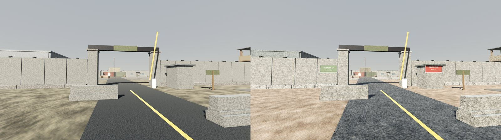
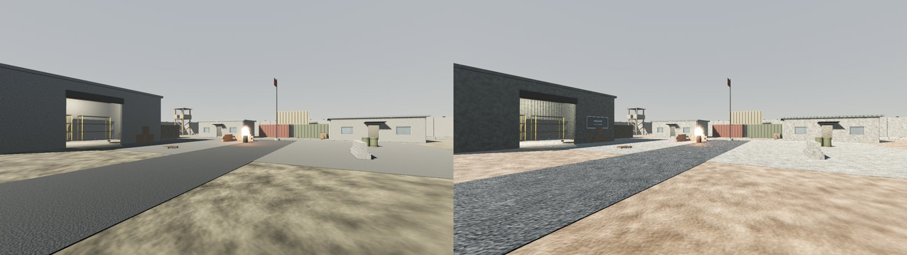
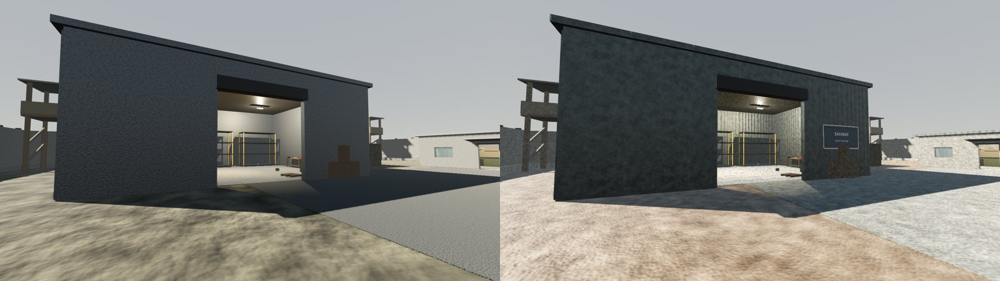
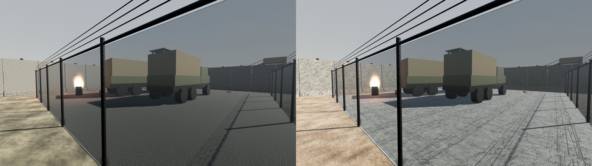
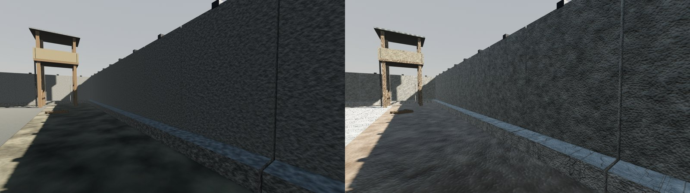
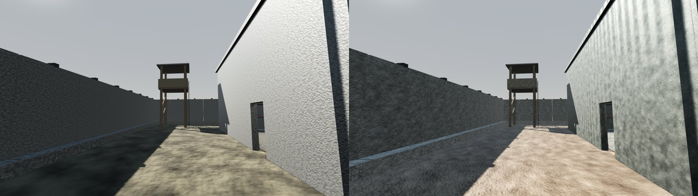
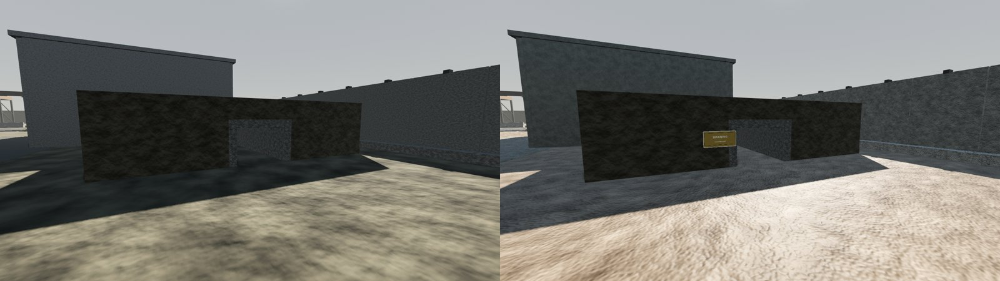
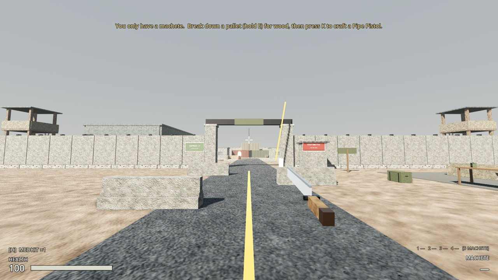
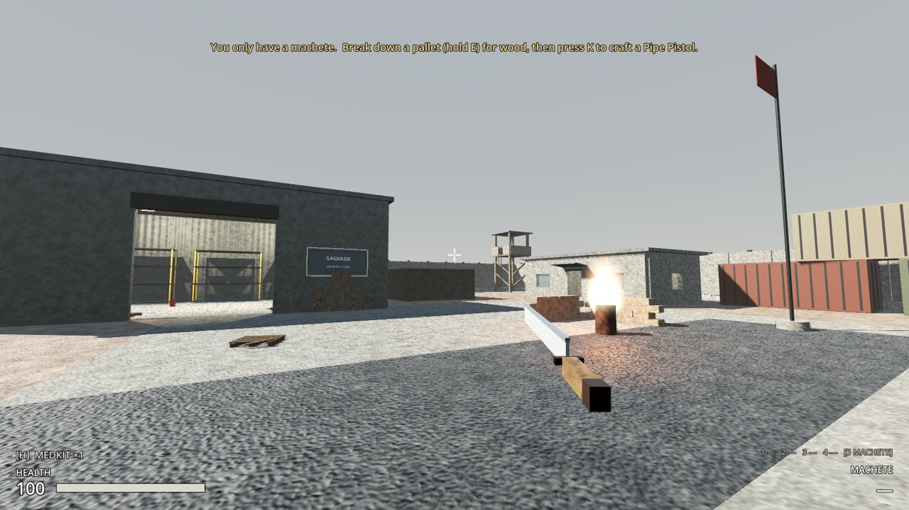

# ASHFALL Resource Pack 1.0: Outpost 17 integration

Branch `art/ashfall-resource-pack-v1`. The pack is in `assets/ashfall_pack_v1/` exactly as shipped (byte-identical to the ZIP); its README and manifest are next to this file.

## What changed in the game

**Only `levels/outpost_17/outpost_17.tscn` changed.** No existing material, script, scene or sound was modified. The shared prop and building scenes keep their original materials, so Halden's Crossing and anything else using them look as before.

**Materials:** per-instance `material_override`s on Outpost 17's own nodes, 471 meshes in all.

| Where | Was | Now |
|---|---|---|
| Ground | `ground_dirt` | `dirt_dry` |
| Main road | `asphalt` | `asphalt_worn` |
| Yard | `gravel` | `gravel_mixed` |
| Motor pool pad | `gravel` | `concrete_cracked` |
| Perimeter walls, gate, command post, barracks, warehouse: concrete | `concrete` | `concrete_weathered` |
| … their stained concrete (wall bases, warehouse floor) | `concrete_stained` | `concrete_cracked` |
| Warehouse, towers, gate: sheet metal | `corrugated_metal` | pack `corrugated_metal` |
| Sandbags (props, towers, range) | `sandbag` | `sandbag_canvas` |
| Guard towers, wooden crates | `wood` | `wood_weathered` |
| Jersey barriers, flag-pole base | `concrete` | `concrete_weathered` |
| Fuel drums, burning barrels | `metal_dark` | `rusted_steel` |

Left alone: vehicles, shipping containers, the range targets, the crafting benches, and all containers and pickups.

**Signs** (`Signage` node): the 4 decals on alpha-scissor quads, 6 mm in front of the wall they were raycast onto, with no collision and no shadows. Their materials are in `assets/materials/signs/` (new files).

| Sign | Where |
|---|---|
| OUTPOST 17 · Authorized entry | Perimeter wall, left of the main gate (outside) |
| RESTRICTED · Military area | Gatehouse, right of the main gate (outside) |
| SALVAGE · Collection point | Warehouse, beside its door (the workbench is inside) |
| WARNING · Radiation zone | Drainage culvert, north mouth |

**Sounds** (`Soundscape` node):

| Node | Sound | Where |
|---|---|---|
| `GeneratorHum` | generator idle (loop) | Motor pool, behind the fuel drums; heard within ~35 m |
| `RadioStatic` | radio static (loop) | Inside the command post; ~14 m |
| `DistantWind` | distant wind (loop) | Everywhere, quiet (−14 dB), *on top of* the original wind ambience |
| `MotorPoolClank` | metal clank | Between the motor-pool trucks, every 9–24 s at a slightly varied pitch (`RandomSoundEmitter`, new script) |

The pack's looping sounds fade in and out (~0.1 s), so looping them as-is dips every few seconds. `tools/audio/make_seamless_loops.py` writes crossfaded copies to `assets/audio/loops/`, and those are what play. The pack's WAVs are unchanged.

## Checks

- **Collision:** every collision shape and body in Outpost 17 (680 entries: path, layers, transform, shape size) was dumped before and after. **Identical.**
- **Tests:** all 233 existing tests pass, plus 5 new ones in `tests/test_art_pack.gd` (238 total):
  - The pack loads.
  - The shared scenes still use the original materials.
  - Outpost 17 uses all 9 pack materials.
  - The signs have no collision and sit 2–20 mm in front of a wall.
  - The 3 loops loop and autoplay, and the original wind ambience is kept.
- **Real window:**
  - The generator, radio and wind play.
  - W walks out through the gate.
  - F5, take a pickup, F9: the pickup is back.
  - Travel to Halden's Crossing and back still works.

## Notes for review

- The textures are **512×512**, not 1024×1024 as the pack README says.
- They're procedural and fairly soft at gameplay distance. `concrete_cracked` has stylised straight crack lines: fine on floors (motor pool, warehouse), busy on small props, so the jersey barriers use `concrete_weathered` instead.
- `asphalt_worn` reads coarser and greyer than the old road, more like packed gravel up close.
- `dirt_dry` is warmer and pinker than the old ground under the dusty sky.
- The interior walls of the warehouse pick up the pack's corrugated metal, which is blotchy on large flat walls.
- Re-run with `godot --headless --path . -s res://tools/integrate_resource_pack_v1.gd` (safe to repeat).

## Screenshots (before | after)

In game:

