# ASHFALL Resource Pack 2.0: Outpost 17 integration

Branch `art/ashfall-pack-v2`, from `main` after Pack 1 was merged (PR #13). The pack is in `assets/ashfall_pack_v2/` exactly as shipped (byte-identical to the ZIP). Its README, manifest and integration notes are next to this file.

## Integrated vs only imported

**15 of the 26 files are used in Outpost 17. The other 11 are imported only:** they're in the project and load, but no scene uses them. `tests/test_art_pack2.gd` checks both lists against the level's real dependencies, so this table can't drift.

| File | Status | Where / why not |
|---|---|---|
| `scenes/water_storage_tank.tscn` | **Integrated** | Water point against the west wall (between the NW tower and the culvert) |
| `scenes/portable_generator.tscn` | **Integrated** | Water point, beside the tank; the generator hum comes from it |
| `scenes/field_radio.tscn` | **Integrated** | Inside the command post, against the east wall; the radio chatter comes from it |
| `scenes/salvage_toolbox.tscn` | **Integrated** | Warehouse floor, beside the workbench |
| `decals/water_purification.png` (POTABLE WATER) | **Integrated** | West wall, above the tank |
| `decals/radio_signal.png` (RADIO RELAY) | **Integrated** | Command post front, above the right-hand window |
| `decals/checkpoint_17.png` | **Integrated** | Gatehouse, the side facing the road in |
| `decals/medical_triage.png` (MEDICAL) | **Integrated** | Barracks front, above the right-hand window |
| `decals/danger_mines.png` | **Integrated** | Drainage culvert, south mouth. The image actually reads **"DANGER · UNSTABLE GROUND"**, not mines |
| `decals/bullet_holes.png` | **Integrated** | Outside face of the south wall, west of the gate |
| `decals/rust_streaks.png` | **Integrated** | Motor-pool side of the east wall, under its metal caps. Fine lines: clear up close, subtle from across the motor pool |
| `audio/power_generator_loop.wav` | **Integrated** | 3D loop at the water-point generator (heard within ~25 m) |
| `audio/radio_chatter_static.wav` | **Integrated** | 3D bursts every 6–16 s from the field radio (`RandomSoundEmitter`) |
| `audio/metal_gate_rattle.wav` | **Integrated** | 3D rattle every 14–38 s at the main gate barrier |
| `audio/distant_industry.wav` | **Integrated** | 3D loop far beyond the north wall (95 m out), so it's quiet and directional |
| `decals/market.png` (OUTPOST MARKET) | Imported only | There's no market or trader in the game yet |
| `decals/soot_marks.png` | Imported only | Tried on a wall behind a fire barrel. At most 14% opaque, so it couldn't be told from the concrete texture even at 1.5 m |
| `decals/scratches.png` | Imported only | Tried on the gatehouse. Only 0.4% of the image has any pixels, so nothing showed |
| `audio/alarm_short.wav` | Imported only | Nothing in the game raises an alarm yet. Wiring one in would change gameplay, so it's left for a later increment |
| `audio/settlement_wind.wav` | Imported only | Outpost 17 already has two wind layers (the original and Pack 1's). Kept for settlements; it also isn't seamless |
| `ui/defense.png`, `ui/trade.png`, `ui/faction_reputation.png`, `ui/morale.png`, `ui/food.png`, `ui/settlement.png` | Imported only | No settlement UI exists yet. Note: "morale" shows a **plus** and "food" a **diamond**, which may not match their names |

## What changed in the game

**Existing files changed:**
- `levels/outpost_17/outpost_17.tscn`: a new `Pack2` node; nothing else in the level changed.
- `levels/outpost_17/outpost_17_navmesh.tres`: rebaked so raiders path around the new props.
- `tests/test_runner.gd`: one line registering the new test suite.

No script, Pack 1 asset or original asset was modified.

```
Outpost17
└── Pack2
    ├── Signs      WaterPoint, RadioRelay, Checkpoint17, MedicalTriage, UnstableGround  (alpha-scissor quads)
    ├── Overlays   GateBulletHoles, MotorPoolRust                                        (alpha-blended quads)
    ├── Props      WaterTank, WaterPumpGenerator, FieldRadio, SalvageToolbox            [navigation_geometry]
    └── Sounds     WaterPumpHum, RadioChatter, GateRattle, DistantIndustry              (all AudioStreamPlayer3D)
```

**New files:**
- Sign and overlay materials: `assets/materials/signs/pack2_*.tres` (7 files).
- The integration script: `tools/integrate_resource_pack_v2.gd` (safe to re-run).
- A pre-Pack-2 save used as a test fixture: `tests/fixtures/outpost_save_before_pack2.json`.
- The tests: `tests/test_art_pack2.gd`.

**Import settings:** looping is on for `power_generator_loop` and `distant_industry`. Both files already join seamlessly at the loop point, so they needed no editing. `radio_chatter_static` fades out, so it's played as occasional bursts rather than looped.

## Checks

- **Collision:** every shape and body in Outpost 17 was dumped before and after. **All 680 original entries are identical.** The only additions are the 4 props' bodies and shapes (8 entries).
- **Prop placement:** the integration script refuses to save if a prop overlaps a wall, another prop, a container, a bench or a pickup. It caught the field radio first placed on a shotgun-shell pickup, and the radio was moved.
- **Tests:** all 239 existing tests pass, plus 6 new ones (245 total), from a fresh import. Every script also passes the parse check. The new tests check:
  - the integrated / imported-only lists above
  - props clear of walls, props and loot, and standing on the ground
  - every container and bench still reachable on the navmesh
  - every sign's corners and centre have a wall within 2 cm behind them (nothing floating or overhanging)
  - no two signs or overlays overlap, including Pack 1's
  - 3D sound sources at their props, with Pack 1 untouched
  - a save made before Pack 2 loads into the new level: position, searched crate and taken pickup all restored, and no Pack 2 node is in the save
- **Real window:**
  - The hum and the industry sound play, and the radio chatter goes off on its own.
  - Walking into the tank stops you.
  - You can walk in through the command post door to the radio.
  - F5, take a pickup, F9: it's restored.
  - Travel to Halden's Crossing and back works.

## Screenshots (before | after)

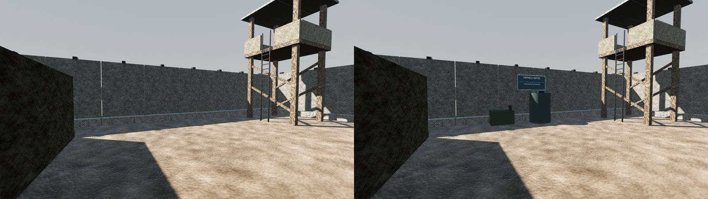
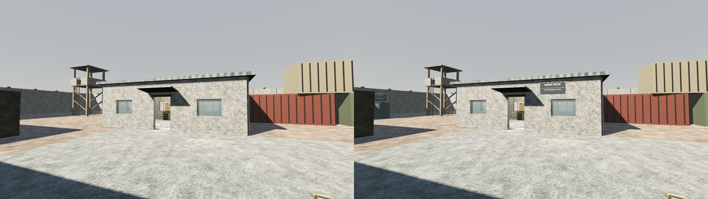
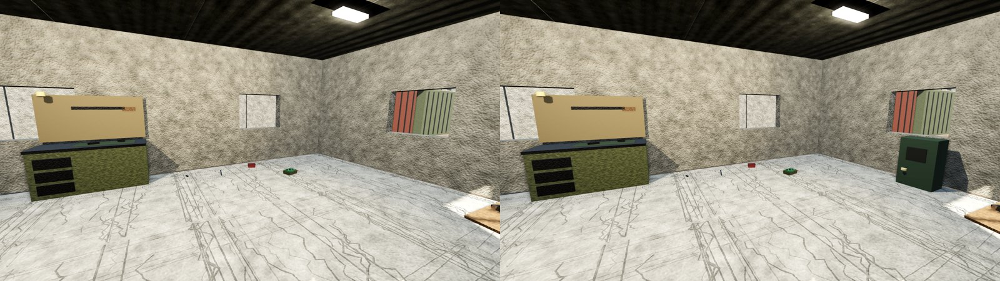
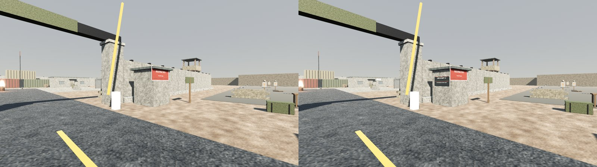
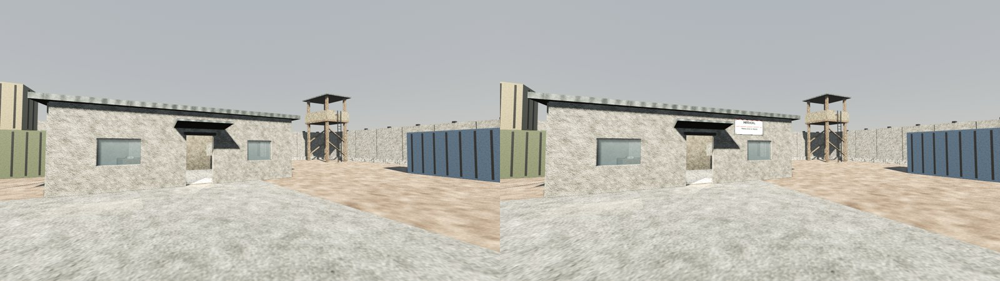
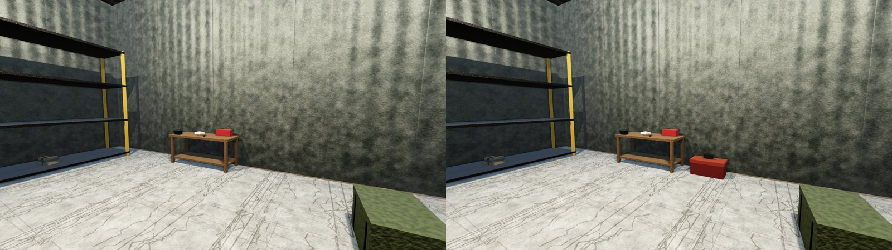
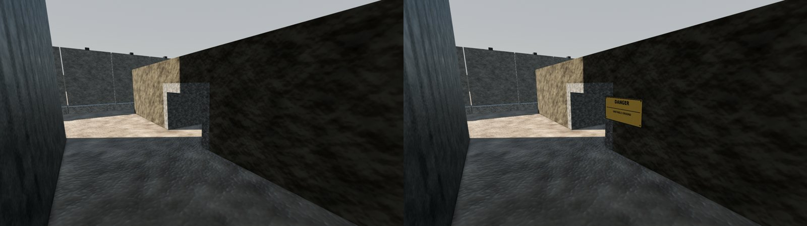
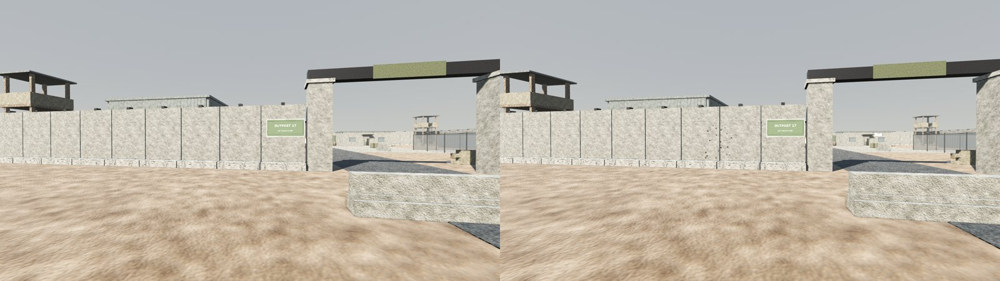
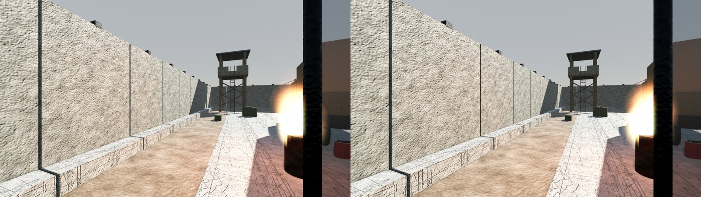
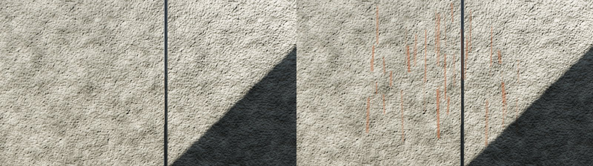

In game:

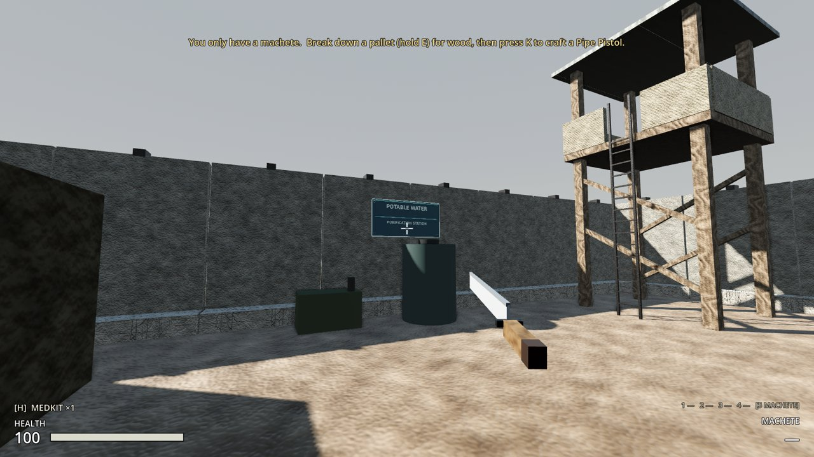
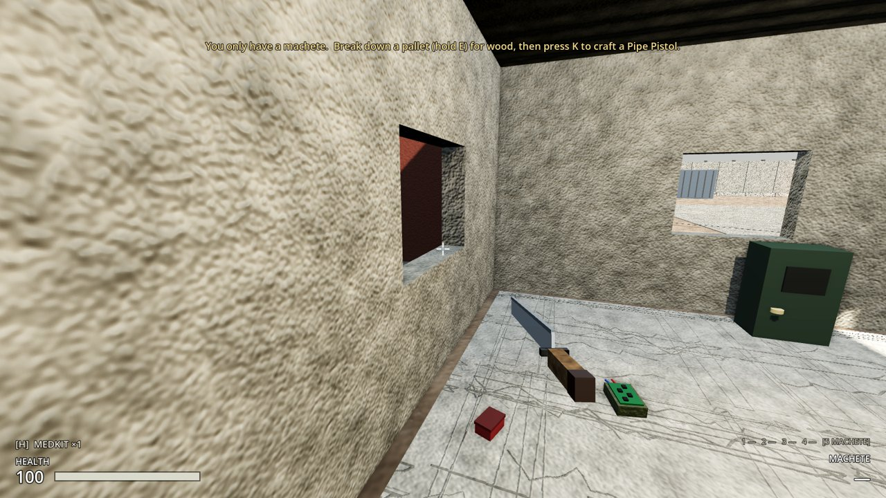
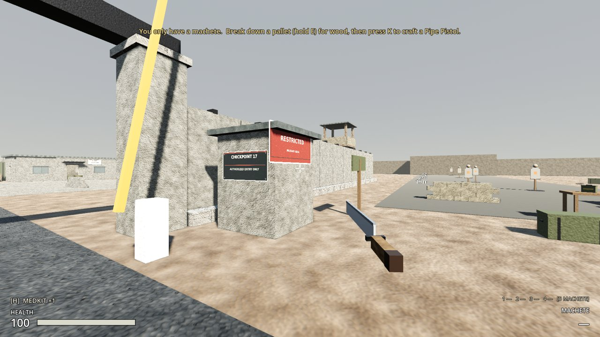
