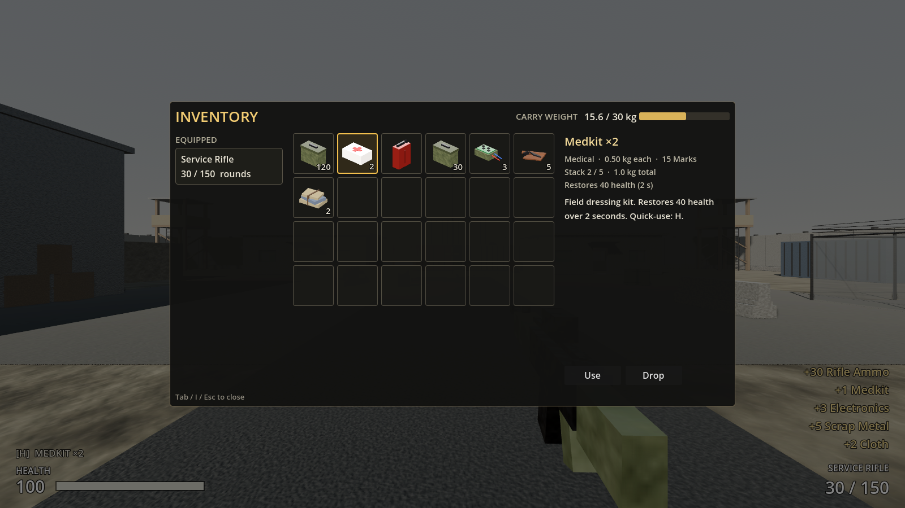

# Increment 6 — Inventory (data + UI), stored medkits, quick-heal

**Status:** complete. 127 automated tests pass in headless Godot 4.7: 21 new, the rest updated or unchanged. The game was also run in a real window with injected key presses:
- Tab opens the inventory and Esc closes it.
- Pressing H at 40 HP heals to 80.
- Pressing E on a warehouse shelf item adds it to the inventory.

None of these runs produced script errors.

**Playable result:**
- Press **Tab** (or **I**) to open the inventory. It has 24 slots with item icons and stack counts, carry weight against a 30 kg limit, the equipped rifle with its ammo, and details for the selected item.
- **Inventory controls:**
  - Left-click selects an item. Right-click (or the **Use** button) uses it.
  - Drag one slot onto another to move, merge or swap stacks.
  - Drag a slot outside the window, or press **Drop**, to put the item on the ground in front of you.
- **Medkits are stored** when you pick them up, even at full health. Press **H** at any time to use one. It takes 2 seconds, and while it runs:
  - You move at half speed and your rifle is lowered.
  - Firing or sprinting cancels it.
  - The HUD shows **[H] MEDKIT ×N** in the bottom-left.
- **Ammo is an inventory item.** The rifle reloads from rifle ammo in your bags, so the reserve number is exactly what you carry. Dropping ammo lowers it.
- Items that would put you over 30 kg are refused with "Too heavy". When every slot is full you get "Inventory full", and any part of a stack that doesn't fit stays on the ground.
- On respawn you keep your inventory, and your rifle ammo is topped up to the starting 120.

> **After pulling:** open with **Edit** in the Project Manager, not Run. This update adds 5 new scripts and removes `player_resources.gd`.



---

## 1. Files

| File | Purpose |
|---|---|
| `scripts/inventory/inventory_component.gd` | **New.** `InventoryComponent` is the reusable slot container: stacking, weight cap, add/remove/move/split/transfer, `to_data()`/`from_data()`, ammo helpers. It is used by the player now, and by containers (Inc 7) and settlements later. |
| `scripts/inventory/player_inventory.gd` | **New.** `PlayerInventory` extends `InventoryComponent`. Adds the starting loadout, best-medical lookup and respawn ammo top-up. |
| `scripts/inventory/item_database.gd` | **New.** `ItemDatabase` (static) finds every `ItemDefinition` under `res://resources/items` by id. Saves (Inc 8) store ids, and this turns an id back into an item. |
| `scripts/ui/inventory_screen.gd` | **New.** `InventoryScreen` is the inventory window. |
| `scripts/ui/inventory_slot.gd` + `scenes/ui/inventory_slot.tscn` | **New.** `InventorySlot` is one grid cell: icon, count, selection highlight, drag and drop. |
| `tools/render_item_icons.gd` | **New.** Renders `assets/icons/<id>.png` from each item's world model. |
| `assets/icons/*.png` | **New.** 128×128 icons for the 6 items. |
| `tests/test_inventory.gd` | **New.** 21 tests. |
| `scripts/inventory/player_resources.gd` | **Removed.** Replaced by `PlayerInventory`. |
| Changed scripts | `item_definition.gd` (+`use_time`, `use_sound`), `player_controller.gd` (item use, drop, inventory), `hitscan_weapon.gd` (ammo source, lowered pose), `input_frame.gd` (+`use_heal`), `player_input.gd` (UI-open mode), `pickup.gd`, `player_audio.gd`, `hud.gd` |
| Patched scenes | `player.tscn` (Resources → `%Inventory`), `hud.tscn` (quick slot, use bar, InventoryScreen), `outpost_17.tscn` (barracks medkit moved onto the crate) |
| Patched resources | All 6 items (+icon); medkit (instant pickup, 2 s use time, heal sound) |

## 2. Scene hierarchy (additions)

```
Player
└── %Inventory            Node + player_inventory.gd   (replaces %Resources)

HUD/Root
├── %QuickSlotLabel       Label  "[H]  MEDKIT ×2"   (bottom-left, above health)
├── %UseLabel             Label  "Using Medkit…  (fire or sprint to cancel)"
├── %UseBar               ProgressBar (green)
└── %InventoryScreen      Control (full rect) + inventory_screen.gd
    ├── Dim               ColorRect  black 55%
    └── %Window           PanelContainer (centred, 1000×540)
        └── VBox
            ├── Header    HBox: "INVENTORY" · CARRY WEIGHT · %WeightLabel · %WeightBar
            ├── Body      HBox
            │   ├── Equipment   VBox: "EQUIPPED" · %EquippedLabel
            │   ├── %Grid       GridContainer (6 columns; 24 InventorySlot instances added at runtime)
            │   └── Details     VBox: %DetailName · %DetailInfo · %DetailDescription · [%UseButton] [%DropButton]
            └── Footer    Label "Tab / I / Esc to close"

InventorySlot (scenes/ui/inventory_slot.tscn)
└── PanelContainer 72×72 + inventory_slot.gd
    ├── %Icon      TextureRect (expand, keep aspect)
    └── %Quantity  Label (bottom-right)
```

## 3. Key points

- **Slots are plain data.** Each slot is `{"item": ItemDefinition, "qty": int}` or empty. Saving converts it to `{"id": "medkit", "qty": 2, "slot": 1}` with `to_data()`, and `from_data()` reads it back, skipping unknown ids.
- **Every change goes through validated methods.** These are `add_item`, `remove_item`, `move_slot`, `transfer_slot_to`, `PlayerController.request_use_item` and `request_drop_slot`. Each one checks its input and returns false/0/null rather than corrupting state. In co-op these become host-side requests.
- **Weight:** `can_add()` returns how many units of an item will fit, accounting for free slots, partial stacks and remaining weight. `max_weight = 0` means unlimited, which containers will use.
- **The rifle doesn't own reserve ammo any more.** `weapon.set_ammo_source(inventory)` makes `reserve_ammo` read `inventory.count_ammo(ammo_type)`, and a reload calls `take_ammo()`. A weapon without a source, such as a test or a turret, keeps its own internal counter.
- **Item use is a timed state** in `PlayerController`, ticked from `simulate()`:
  - **Start:** H, right-click or Use.
  - **Cancel:** fire, sprint, death, or pressing H again.
  - **Finish:** revalidates (still alive, still has the item, not at full health), then removes one item and heals.
  - It is driven by `InputFrame.use_heal` and is deterministic, like movement.
- **UI-open mode:** `PlayerInput.set_ui_open(true)` frees the mouse and sends neutral input frames, so you stop walking and shooting. Closing the window blocks fire until the mouse button is released, so a click in the UI can't fire a shot. The world keeps running while the inventory is open; it doesn't pause.
- **Dropping** spawns a `Pickup` 1 m in front of you on the ground, found with a raycast down. Anyone can pick it up again.

## 4. Input Map

Added in Project Settings → Input Map:

| Action | Keys |
|---|---|
| `inventory` | Tab, I |
| `use_medkit` | H |

Existing: `move_*` WASD · `jump` Space · `sprint` Shift · `crouch` C / Ctrl · `fire` LMB · `reload` R · `interact` E · `pause` Esc · `toggle_debug` F3.

## 5. Inspector settings

**Player → %Inventory (PlayerInventory)**

| Property | Value | Notes |
|---|---|---|
| Slot Count | 24 | 4 rows of 6 |
| Max Weight | 30 | kg. Set to 0 for unlimited |
| Starting Items | rifle_ammo: 120, medkit: 1 | Typed dictionary `Dictionary[ItemDefinition, int]`. Drag item .tres files into the keys |

**Player (PlayerController) → Item Use**

| Property | Value |
|---|---|
| Use Move Multiplier | 0.5 |

**resources/items/medkit.tres**

| Property | Value |
|---|---|
| Pickup Hold Time | 0 (instant pickup now that it's stored) |
| Max Stack | 5 |
| Heal Amount | 40 |
| Use Time | 2.0 s |
| Use Sound | `assets/audio/heal.wav` |
| Icon | `assets/icons/medkit.png` |

**Item icons:** every item's `icon` points at `assets/icons/<id>.png`. To regenerate them after changing a model, run this from the project folder (it needs a real window, not `--headless`):

```
godot --path . -s res://tools/render_item_icons.gd
```

## 6. Signals

| Signal | Emitted by | Connected to |
|---|---|---|
| `contents_changed(slots: PackedInt32Array)` | InventoryComponent | HUD (quick slot count), InventoryScreen (redraw), HitscanWeapon (re-emits `ammo_changed`) |
| `item_received(item, quantity)` | InventoryComponent (`receive()`) | HUD ("+30 Rifle Ammo" notices), PlayerAudio (pickup sound) |
| `item_use_started(item, duration)` | PlayerController | HUD (shows the use bar) |
| `item_use_finished(item)` | PlayerController | HUD, PlayerAudio (heal sound) |
| `item_use_cancelled(item)` | PlayerController | HUD (hides the bar) |
| `item_use_refused(reason)` | PlayerController | HUD (denied sound + "Already at full health" / "No medkits") |
| `item_dropped(item, quantity)` | PlayerController | (future: noise for AI, network replication) |
| `clicked(index, button)` | InventorySlot | InventoryScreen |

## 7. Editor assembly (if building by hand)

1. **Player:** delete the `Resources` node. Add a `Node` named `Inventory`, attach `player_inventory.gd`, and right-click it → **Access as Unique Name**. Fill in Starting Items.
2. **Slot scene:** create a new scene with a `PanelContainer` root (custom minimum size 72×72) and attach `inventory_slot.gd`. Add the children `TextureRect` "Icon" (Expand Mode: Ignore Size, Stretch: Keep Aspect Centered) and `Label` "Quantity" (align right/bottom), both as unique names. Save it as `scenes/ui/inventory_slot.tscn`.
3. **HUD:**
   - Under `Root`, add the hierarchy from §2. Mark every `%` node as a unique name.
   - Set `InventoryScreen` to Full Rect, with Mouse Filter **Stop**.
   - Set `Dim` to Mouse Filter **Ignore**, so dropping outside the window reaches the screen.
   - Set `%Grid` columns to 6.
4. **Input map:** add `inventory` (Tab, I) and `use_medkit` (H).
5. **Items:** give each item an icon. For the medkit, set Pickup Hold Time to 0, Use Time to 2, and Use Sound to `heal.wav`.

The repo's scenes were built exactly this way using a headless builder script. Open them in the editor to inspect.

## 8. Testing

**Automated:** `godot --headless --path . -s res://tests/test_runner.gd` reports **127 passed, 0 failed**. The new tests in `tests/test_inventory.gd` cover:
- Stacking across slots, and refusal by slot count and by weight, with the correct reason strings.
- remove across stacks, move (merge, swap, split), transfer between two inventories, and a save round trip through `to_data`/`from_data`, including bad entries.
- ItemDatabase finds every item by id and maps ammo types to their items. Every item has an icon.
- The player starts with 120 rifle ammo and 1 medkit.
- Reload takes rounds out of the inventory, and an empty inventory means no reload.
- Quick-heal:
  - Heals after 2 s and consumes one medkit.
  - Is refused at full health and when you have no medkits.
  - Is cancelled by firing, and the medkit is kept.
  - Halves walking speed.
- Dropping a stack spawns a pickup in front of you that can be picked up again.
- Respawn tops ammo back up to 120.
- Inventory screen:
  - Opens and closes and builds 24 slots.
  - Shows the weight text "1.9 / 30 kg".
  - The Use button heals, the Drop button removes the item, and dragging moves it.

Updated tests:
- A medkit is stored when picked up at full health.
- Picked-up ammo goes into the inventory.
- A full inventory leaves the remainder on the ground with "Inventory full".
- New input actions exist.
- No loot overlaps solid geometry. This test caught the barracks medkit sitting inside its crate.
- A warehouse shelf item is picked up with a real E press.

**Manually, in the game:**
1. Press F5, then Tab. You should see 120 rifle ammo and 1 medkit, at "1.9 / 30 kg".
2. Walk to the barracks and grab the medkit on the crate. It goes into the inventory even at full health, and the HUD shows **[H] MEDKIT ×2**.
3. Let a raider hit you, then press H. A green bar fills over 2 s, you slow down, and health goes up 40.
4. Press H, then click fire straight away. The heal cancels and you keep the medkit.
5. Pick up everything in the warehouse (fuel cans are heavy, 9 kg each). Somewhere past 30 kg you'll see "Too heavy".
6. Open the inventory and drag the fuel can outside the window. It lands on the ground in front of you.
7. Fire off a magazine and reload. The rifle-ammo stack in the inventory goes down by 30.

## 9. Troubleshooting

| Symptom | Fix |
|---|---|
| Red-tinted frozen screen, HUD shows placeholder values | Stale class cache. Open the project with **Edit**, not Run (see README). |
| `Parser Error: Could not find type "PlayerInventory"` | Same cause. Open in the editor once so it rescans scripts. |
| Inventory won't open | It only opens for the local, living player. If you're dead, wait for respawn. Check that the `inventory` action exists in the Input Map. |
| Slots show no icons | The item's `icon` is empty. Re-run `tools/render_item_icons.gd`, or assign a PNG in the item's .tres. |
| Rifle reserve shows 0 but you have ammo | The ammo item's `ammo_type` must match the weapon's `WeaponDefinition.ammo_type` (`rifle_556`). |
| Can't shoot after closing the inventory | Release the mouse button first. Fire is blocked until release so a UI click doesn't fire a shot. |
| Dropped items fall through the floor | The drop raycast uses `WORLD_SOLID` (terrain + structures). Make sure the floor is on layer 1 or 2. |
| Medkit pickup says "Too heavy" | You're at the 30 kg cap. Drop fuel or raise `max_weight`. |

## 10. How this connects to future systems

- **Increment 7 (salvage containers):** a crate gets its own `InventoryComponent` (`max_weight = 0`), filled from a `LootTable`. Its search UI reuses `InventorySlot` and moves items with `transfer_slot_to(other_inventory)`, which is already tested.
- **Increment 8 (SaveManager):** `inventory.to_data()` and `from_data()` produce and consume JSON-safe arrays of ids. `ItemDatabase.get_item(id)` resolves them on load.
- **Milestone 2, weapon slots and new guns:** each gun's `WeaponDefinition.ammo_type` maps to its own ammo item through `ItemDatabase.find_ammo_item()`, so a pistol and a shotgun draw from separate stacks with no extra code. The **EQUIPPED** panel grows into weapon slots.
- **Milestone 2, crafting:** recipes check `count_of(id)` and consume ingredients with `remove_item(id, qty)` (which handles stacks across slots). They add the result with `receive()`. Scrap, cloth, electronics and fuel already stack and weigh correctly.
- **Co-op:** every UI action calls a validated `request_*` / `move_slot` method. In multiplayer those become RPCs to the host, which runs the same code. Clients only redraw from `contents_changed`.
- **Trading and economy:** `ItemDefinition.base_value` (Marks) is already shown in the details panel, ready for vendors.
