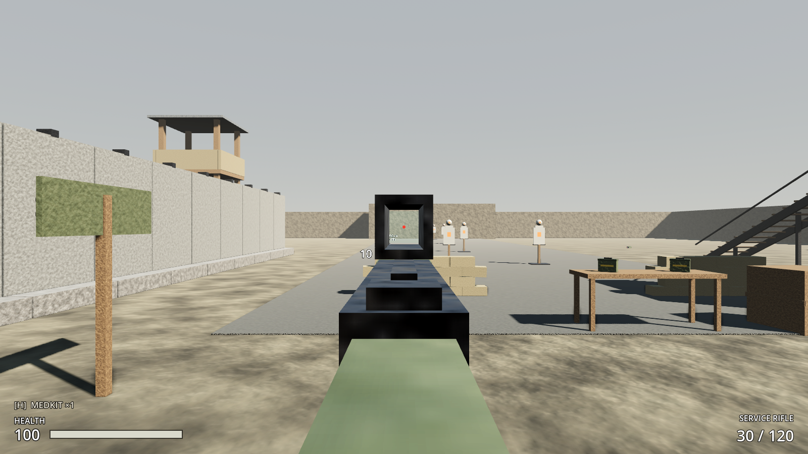
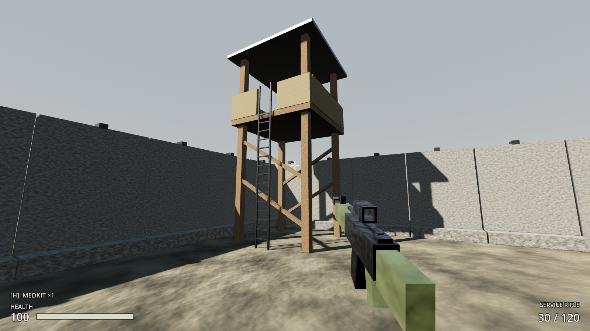

# Increment 6.5 — Aim down sights and ladders

**Status:** complete. 143 automated tests pass in headless Godot 4.7, 16 of them new: 14 in `tests/test_aim_and_ladders.gd`, the guard-tower climb in `test_outpost_17.gd`, and the right-click binding in `test_input_map.gd`. A real-window playtest with injected right-click and W key presses aimed the rifle, climbed a guard tower, and aimed from the top.

**Playable result:**
- **Hold right-click to aim down the sights.**
  - The rifle comes up to your eye in 0.2 s and you look through a see-through red-dot sight. The view zooms 1.4×.
  - The crosshair fades out. Hit markers still show.
  - Spread drops to 35%, recoil to 65% and walking speed to 55%.
  - You can't sprint while aiming. Mouse sensitivity scales down with the zoom, so aiming feels the same.
  - You can't aim while reloading, using a medkit or on a ladder.
- **Ladders.** All four guard towers now have a working ladder, facing into the compound, with a gap in the parapet at the top.
  - Walk into a ladder to grab it. **W** climbs and **S** goes down.
  - Your hands are busy: the rifle is lowered, and you can't shoot, aim or heal.
  - At the top you step forward onto the platform automatically.
  - To get down, walk off the platform towards the ladder. With your back to the ladder, W climbs down. Looking well down also makes W climb down.
  - **Space** jumps off backwards.
  - Rungs clank as you climb.
  - Raiders can't use ladders, so the towers are a strong position.




> **After pulling:** open with **Edit** in the Project Manager (not Run). This update adds 1 new script (`ladder.gd`).

---

## 1. Files

| File | Purpose |
|---|---|
| `scripts/world/ladder.gd` + `scenes/world/structures/ladder.tscn` | **New.** `Ladder` (`@tool`): generates rails and rungs from `height`/`width`; `is_in_reach()`, `get_top_y()`, `get_outward()`, `get_climb_point()`. Group `ladders`. |
| `assets/audio/ladder_step_1-3.wav`, `sets/ladder_step.tres`, `aim_in.wav` | **New.** Synthesized by `tools/audio/synth_sounds.py` |
| `tests/test_aim_and_ladders.gd` | **New.** 14 tests |
| `scripts/player/player_controller.gd` | Aiming (`aim_amount`, `is_aiming`), ladder state (`ladder`, `CLIMBING`), walking moved into `_simulate_walking()` |
| `scripts/combat/weapon_definition.gd` | New **Aiming down sights** group |
| `scripts/combat/hitscan_weapon.gd` | `aim_amount`, `aim_camera`, `get_ads_offset()`; the ADS pose lines `%SightAnchor` up with the screen centre |
| `scripts/core/input_frame.gd`, `player_input.gd` | `aim` flag (right mouse) |
| `scripts/ui/crosshair.gd`, `hud.gd` | `reticle_alpha` fades the crosshair while aiming |
| `scripts/player/player_audio.gd` | Ladder rung and aim-in sounds |
| `tests/test_runner.gd` | Optional filter: `... -s res://tests/test_runner.gd -- ladder` runs only matching tests |
| Patched scenes | `service_rifle.tscn` (hollow optic, clear lens, red dot, SightAnchor), `guard_tower.tscn` (real ladder, parapet gap), `outpost_17.tscn` (south towers turned 180°), `player.tscn` (+LadderStep, +AimSound) |

## 2. Scene hierarchy (changes)

```
ServiceRifle/Model
├── Optic            Node3D (was a solid box) → Top, Bottom, Left, Right bars (hollow housing)
├── OpticLens        clear tinted glass (alpha 0.18)
├── RedDot           tiny unshaded red sphere, drawn on top (no depth test)
└── %SightAnchor     Marker3D on the sight line at the back of the optic

GuardTower
├── Parapet2 / Parapet2b (+ cols)   +Z parapet split, 0.9 m gap in the middle
└── Ladder           ladder.tscn at (0, 0, 1.75), height 4.6 (= platform floor), width 0.5

Ladder (ladder.tscn)
└── Node3D + ladder.gd    rails/rungs generated as internal children (not saved)

Player/Audio  + %LadderStep (AudioStreamPlayer3D, ladder_step set) + %AimSound (AudioStreamPlayer)
```

**Ladder placement rule:** origin at the bottom, against the wall. **+Z points out** to where the climber stands. `height` equals the floor height you climb onto, and the opening at the top must be at least 0.8 m wide (player capsule radius 0.35).

## 3. Key points

- **Aiming is simulated, not just visual.** `aim_amount` (0–1) advances in `simulate()` from `InputFrame.aim`, so in co-op the host gets the same spread, recoil, speed and look scaling as the client. The camera FOV and rifle pose are presentation and follow `aim_amount`.
- **The sights line up exactly.** `HitscanWeapon.get_ads_offset()` works out, from the camera and weapon transforms, the model offset and yaw that put `%SightAnchor` on the camera's centre line, `ads_eye_distance` (0.2 m) in front of the eye, with the barrel parallel to the view. The WeaponMount's slight inward angle is cancelled while aiming. A new weapon only needs a `SightAnchor` marker on its sight line.
- **Ladders are found, not touched.** The player checks ladders in the `ladders` group with `is_in_reach()` each tick. A ladder has no collision and no Area3D signals, so behaviour is deterministic and identical on host and client.
- **Grab rule.** You grab a ladder when you're within reach and moving towards it from in front, or moving out towards it from the floor at the top. After letting go you can't grab for 0.4 s, so jumping off doesn't re-grab.
- **Climb rule.**
  - W climbs up when facing the ladder. It climbs down when your back is to it, or when looking more than 40° down.
  - You're held on a line 0.45 m in front of the ladder, with no gravity.
  - When your feet pass the top, you're pushed forward onto the floor.
  - Reaching the ground while going down releases the ladder.

## 4. Input Map

| Action | Input |
|---|---|
| `aim` | **Right mouse button** (hold) |

Ladders use the existing move keys (W/S) and `jump` (Space).

## 5. Inspector settings

**resources/items/weapons/service_rifle.tres → Aiming down sights**

| Property | Value | Notes |
|---|---|---|
| Ads Zoom | 1.4 | FOV ÷ 1.4 (75° → 53.6°). A future scoped rifle uses ~4 |
| Ads Time | 0.2 s | Time to raise the sights |
| Ads Spread Multiplier | 0.35 | |
| Ads Recoil Multiplier | 0.65 | |
| Ads Move Multiplier | 0.55 | Walking speed while aimed |
| Ads Eye Distance | 0.2 m | Eye to the back of the sight |

**Player → Ladders:** Climb Speed 2.6 m/s · Ladder Regrab Delay 0.4 s · Ladder Step Distance 0.45 m · Ladder Look Down Degrees 40 · Ladder Jump Off Speed 3.

**Ladder:** Height · Width (0.55, 0.5 on towers) · Handhold Height 1.0 · Rung Spacing 0.3 · Material · Stand Off 0.45 · Reach Depth 0.9.

## 6. Signals

| Signal | Emitted by | Connected to |
|---|---|---|
| `aim_changed(aiming)` | PlayerController | PlayerAudio (aim-in rustle) |
| `ladder_grabbed(ladder)` | PlayerController | PlayerAudio (first clank) |
| `ladder_step` | PlayerController, every 0.45 m climbed | PlayerAudio (rung clank) |
| `ladder_released` | PlayerController | (future: animation, network) |

## 7. Editor assembly (by hand)

1. **Input Map:** add `aim` and bind it to the right mouse button.
2. **Rifle sight:**
   - Make the optic hollow so you can see through it. Set the lens material to Transparency Alpha.
   - Add a small unshaded red mesh with **No Depth Test** on and Render Priority 10 at the lens centre.
   - Add a `Marker3D` named `SightAnchor` (Access as Unique Name) on the sight line at the back of the optic.
3. **Ladder scene:** create a Node3D, attach `ladder.gd`, set Material, and save it as `scenes/world/structures/ladder.tscn`.
4. **Guard tower:**
   - Delete the old Rung/LadderRail meshes.
   - Split the +Z parapet (mesh and collision) into two 1.25 m pieces at x = ±1.075.
   - Instance the ladder at (0, 0, 1.75) with Height 4.6 and Width 0.5.
5. **Level:** rotate GuardTower3 and GuardTower4 by 180° on Y so their ladders face the yard.
6. **Player:** under `Audio`, add `LadderStep` (AudioStreamPlayer3D, stream `sets/ladder_step.tres`, bus SFX) and `AimSound` (AudioStreamPlayer, `aim_in.wav`, bus SFX), both as unique names.

## 8. Testing

**Automated** (`godot --headless --path . -s res://tests/test_runner.gd`; add `-- ladder` or `-- aim` to run a subset):
- **Aiming:**
  - The sights come up over 0.2 s, FOV zooms to ÷1.4, and both return on release. `aim_changed` fires on and off.
  - Spread is exactly ×0.35 and recoil kick ×0.65 compared with hip fire.
  - Aimed walking runs at 55% speed, and sprint is ignored.
  - Mouse look is scaled by 1/zoom.
  - No aiming during a reload or a medkit use; aiming resumes after.
  - **The red dot and the back of the sight sit within 1.5 mm of the screen centre**, 0.2 m from the eye, with the barrel parallel to the view. The pose returns to the hip afterwards.
  - A non-boolean `aim` from the network is rejected.
- **Ladders:**
  - Reach box: in front, behind the top, not through the wall.
  - Walking into a ladder grabs it (state CLIMBING) and climbs ~2.6 m/s on the climbing line, with rung sounds. You step off onto the platform at the top, unhurt.
  - Walking off the top towards the ladder grabs it, W descends, and you let go at the bottom with no fall damage.
  - With no input you hang still. Looking down, W descends and S ascends.
  - Jumping off pushes you away and doesn't re-grab.
  - On a ladder you can't fire, aim or use a medkit, and the rifle is lowered.
  - Dying lets go.
- **Level:** every guard tower's ladder faces into the compound, and the player can walk to it, climb it and stand on the platform, unhurt.

**Manually:**
1. Press F5 and hold right-click: the view zooms and you look through the red dot. Fire short bursts: much less climb than hip fire.
2. Walk to the north-west guard tower and walk into the ladder. Hold W to the top and you step onto the platform.
3. From the top, aim at the range or the gate. Raiders can't follow you up.
4. Walk back towards the ladder gap to climb down with W, or press Space partway down to jump off.

## 9. Troubleshooting

| Symptom | Fix |
|---|---|
| Right-click does nothing | Make sure the `aim` action exists (Project Settings → Input Map). You can't aim while reloading, healing or on a ladder. |
| The red dot is off-centre while aiming | The weapon scene needs a `%SightAnchor` marker exactly on the sight line. Check `Ads Eye Distance` isn't smaller than the camera's near plane (0.05). |
| Can't see through the sight | The optic must be hollow and the lens material transparent. |
| Walking into the ladder doesn't grab it | You must be moving towards it (within ~60°) and within 0.9 m in front. Check the ladder's +Z points out from the wall. |
| Climb up and get stuck under the top | The opening above the ladder is narrower than 0.8 m, or `height` doesn't match the floor you're climbing to. |
| Ladder invisible in the editor | It's `@tool` and generates its mesh. Reopen the scene after pulling (open with Edit). |

## 10. How this connects to future systems

- **Milestone 2 weapons (#8):** each `WeaponDefinition` has its own ADS values. The **scoped rifle** sets `ads_zoom` ≈ 4 and swaps the red dot for a scope overlay, using the same `aim_amount` to fade it in. The pistol and shotgun just need a `SightAnchor` on their iron sights.
- **NPC soldiers and settlers (later milestones):** `Ladder` is plain data (top, outward, climb line), so an AI climb behaviour can use the same ladders. NavigationLink3D connections can be added from bottom to top when settlers need to man towers.
- **Co-op:** `aim` travels in the InputFrame and ladder state is simulated, so the host decides spread, speed and where everyone is on a ladder.
- **Building (later):** ladders are a scene with a `height` property, which makes them a natural first buildable for watchtowers and walls.
