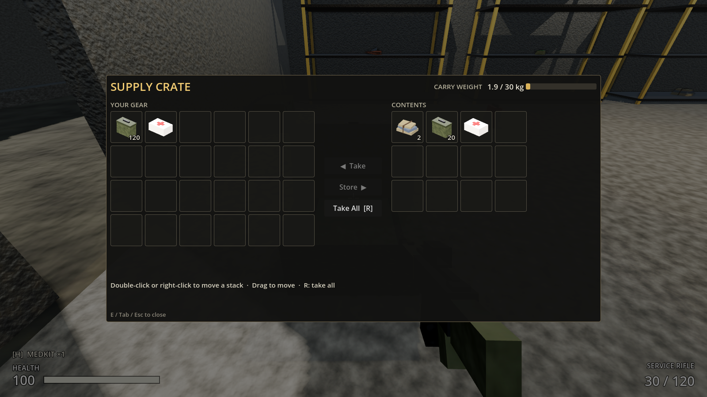
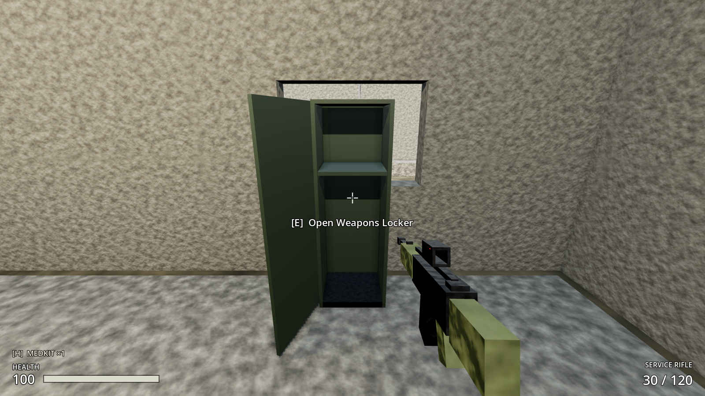

# Increment 7 — Salvage containers

**Status:** complete. 164 automated tests pass in headless Godot 4.7, 15 of them new: 13 in `tests/test_salvage.gd` and 2 level tests in `test_outpost_17.gd`. In a real-window run with injected key presses, a held E searched the warehouse crate and opened the screen, R took everything, and E closed it without reopening while the key was still held.




**Playable result:**
- **11 containers** around Outpost 17:
  - Two supply crates and an ammo crate in the warehouse.
  - Two footlockers and a weapons locker in the barracks.
  - A weapons locker in the command post.
  - A tool chest in the motor pool.
  - An ammo crate at the range.
  - Two scavenger stashes out in raider country.
- Look at one: **"[Hold E] Search Supply Crate"**. Hold E for 1.2 s; you hear rummaging and a progress bar fills. The loot is rolled **once**, the lid swings open, and the transfer screen appears.
- After that, it's a quick **[E] Open Supply Crate** (or "(empty)"). The contents stay exactly as you left it, and you can store things in it too.
- **Transfer screen:**
  - Your gear is on the left and the container on the right.
  - Double-click or right-click a stack to move it across.
  - Drag a stack to move it, or to rearrange within one side.
  - Select a stack and press **Take** or **Store**, or press **Take All (R)**.
  - **E, Tab or Esc** closes it.
  - Your carry weight is shown. Anything that would put you over 30 kg stays in the container, with **"Too heavy"**.
- Walking away or dying closes the container.
- Raiders keep coming while you loot, because the world doesn't pause.

> **After pulling:** open with **Edit** in the Project Manager (not Run). This update adds 4 new scripts.

---

## 1. Files

| File | Purpose |
|---|---|
| `scripts/inventory/loot_entry.gd` | **New.** `LootEntry` Resource: item, weight, min/max quantity |
| `scripts/inventory/loot_table.gd` | **New.** `LootTable` Resource: guaranteed entries, weighted entries, min/max rolls, empty chance; `roll(rng)` (deterministic per seed, merges repeats), `possible_items()` |
| `resources/loot/*.tres` | **New.** military_crate, ammo_crate, footlocker, weapons_locker, tool_chest, scavenger_stash |
| `scripts/interaction/salvage_container.gd` | **New.** `SalvageContainer` (extends `Interactable`): search once, open/close, lid animation, rummage sound, `save_state()`/`load_state()` |
| `scenes/world/containers/supply_crate.tscn`, `footlocker.tscn`, `weapons_locker.tscn` | **New.** Container models with hinged lid/door, a solid body and their own `InventoryComponent` |
| `scripts/ui/container_screen.gd` | **New.** `ContainerScreen`: the two-sided transfer UI |
| `assets/audio/crate_open.wav`, `locker_open.wav`, `rummage.wav` | **New.** Synthesized by `tools/audio/synth_sounds.py` |
| `tests/test_salvage.gd` | **New.** 13 tests (+2 level tests in `test_outpost_17.gd`) |
| `scripts/interaction/interactable.gd` | `focus_offset` (reach/line-of-sight point), `is_within_reach()`, `_get_line_of_sight_exclusions()` |
| `scripts/player/player_controller.gd` | `current_container`, `open_container()`, `close_container()`, validated `request_take()`, `request_store()`, `request_take_all()`; auto-close when out of reach or dead |
| `scripts/player/player_input.gd` | After a menu closes, Interact is ignored until E is released, so closing with E doesn't reopen |
| `scripts/ui/inventory_slot.gd` | Generic: knows its `inventory`; `activated` (double-click); the owning screen handles drops |
| `scripts/ui/inventory_screen.gd`, `hud.gd` | Double-click uses an item; HUD binds the container screen; prompt hidden while looting |
| Patched scenes | `hud.tscn` (+ContainerScreen), `outpost_17.tscn` (+SalvageContainers), `outpost_17_navmesh.tres` (rebaked around containers) |

## 2. Scene hierarchy

```
SupplyCrate / Footlocker / WeaponsLocker   Area3D + salvage_container.gd (layer 5 interactables)
├── Shape           CollisionShape3D (interaction box, slightly larger than the body)
├── Body            StaticBody3D (layer 2 structures): BodyShape + Box/Bands/Handles meshes
├── %Lid            Node3D pivot on the hinge: LidTop + Latch (crates) or Door + Vents + Handle (locker)
├── %Inventory      InventoryComponent (12 / 8 / 12 slots, max_weight 0 = unlimited)
├── %OpenSound      AudioStreamPlayer3D (crate_open / locker_open)
└── %SearchSound    AudioStreamPlayer3D (rummage)

Outpost17
└── SalvageContainers  (group navigation_geometry)
    ├── WarehouseCrateNorth, WarehouseCrateSouth, WarehouseAmmoCrate
    ├── BarracksFootlockerWest, BarracksFootlockerEast, BarracksLocker
    ├── CommandPostLocker, MotorPoolToolChest, RangeAmmoCrate
    └── StashSouthWest, StashEast          (outside the walls)

HUD/Root/%ContainerScreen   Control + container_screen.gd
├── Dim
└── Window/Layout
    ├── Header      %Title · CARRY WEIGHT · %CarryLabel · %CarryBar
    ├── Body        PlayerSide (%PlayerGrid, 6 columns) · Buttons (%TakeButton, %StoreButton, %TakeAllButton) · ContainerSide (%ContainerGrid, 4 columns, %EmptyLabel)
    ├── %DetailLabel · %MessageLabel
    └── Footer
```

A container's **front is its local +Z** (lids open towards it and lockers face it); place it with the front towards open floor.

## 3. Key points

- **Rolled once, on the first search.** Until then the container is empty and unrolled. Rolling lazily lets a save record "not searched yet" (Inc 8) and keeps a fresh roll for each new game. `loot_seed` ≠ 0 makes a container's loot fixed (tests, story loot).
- **Server-authoritative transfers.** The UI never touches inventories directly across sides. It calls `PlayerController.request_take(slot, qty)`, `request_store(slot, qty)` or `request_take_all()`. Each one checks: alive, this container opened by this player, still within reach, and the item fits. Partial moves are allowed; the rest stays, and `transfer_refused("Too heavy" / "Inventory full" / "Container full")` explains why. In co-op these become RPCs to the host.
- **Shared containers.** `users` lists everyone who has it open. Two players can loot the same crate, and both screens update from `contents_changed`.
- **Line of sight to your own crate.** `Interactable` now measures reach and line of sight to `focus_offset` (the middle of the crate) and ignores the container's own body, which would otherwise block the check.
- **Raiders path around containers.** They're static colliders in `navigation_geometry`, and the navmesh was rebaked (715 → 773 polygons).
- **Taking an item counts as receiving it**, so you get the same "+30 Rifle Ammo" notices and pickup sounds as picking items up.

## 4. Input Map

| Action | Keys | Notes |
|---|---|---|
| `take_all` | R | Only while a container is open (R still reloads in gameplay) |
| `interact` | E | Hold to search, tap to open, tap again to close |
| `inventory` / `pause` | Tab, I / Esc | Also close the container screen |

## 5. Inspector settings

**SalvageContainer** (root of each container scene)

| Property | Value | Notes |
|---|---|---|
| Container Name | "Supply Crate" | Prompt and screen title. Placed instances override it ("Ammo Crate", "Tool Chest", "Scavenger Stash") |
| Loot Table | `resources/loot/military_crate.tres` | Per instance |
| Search Time | 1.2 s | First-time hold |
| Loot Seed | 0 | 0 = random each game |
| Container Id | empty | Empty = node path in the level (used by saves) |
| Focus Offset | (0, 0.42, 0) crate / (0, 0.99, 0) locker | Reach / line-of-sight point |
| Lid Open Rotation | (-105, 0, 0) lids / (0, -110, 0) doors | |

**LootTable** example, `military_crate.tres`: rolls 2–4, entries rifle ammo (weight 4, 20–30), medkit (2, ×1), electronics (2, 1–2), scrap (2, 2–4), cloth (1, 1–3).

| Table | Rolls | Notes |
|---|---|---|
| military_crate | 2–4 | Mixed supplies |
| ammo_crate | 30 guaranteed + 1–2 × 30–60 | Rifle ammo |
| footlocker | 1–3, 10% empty | Cloth, medkits, some ammo |
| weapons_locker | 30 guaranteed + 1–2 | Ammo, medkits, electronics |
| tool_chest | 2–3 | Scrap, electronics, sometimes fuel |
| scavenger_stash | 3–5 | Everything, the best rewards, outside the walls |

## 6. Signals

| Signal | Emitted by | Connected to |
|---|---|---|
| `searched(container)` | SalvageContainer | (future: quest hooks, noise) |
| `opened(by)` / `closed(by)` | SalvageContainer | (future: network replication of the lid) |
| `container_opened(container)` / `container_closed(container)` | PlayerController | ContainerScreen (show/hide) |
| `transfer_refused(reason)` | PlayerController | ContainerScreen (red message), HUD (denied sound) |
| `contents_changed` | both InventoryComponents | ContainerScreen (redraw) |
| `activated(index)` | InventorySlot (double-click) | ContainerScreen (move stack), InventoryScreen (use item) |

## 7. Editor assembly (by hand)

1. Create **LootEntry/LootTable** resources: right-click `resources/loot` → New Resource → LootTable, then add entries in the Inspector.
2. **Container scene:**
   - Make an Area3D root with `salvage_container.gd`.
   - Add an interaction `CollisionShape3D`.
   - Add a `StaticBody3D` named **Body** (layer 2 only) with its shape and meshes.
   - Add a `Node3D` hinge pivot named **Lid** (unique name) holding the lid or door meshes.
   - Add an `InventoryComponent` node named **Inventory** (unique; Max Weight 0).
   - Add two AudioStreamPlayer3D nodes, **OpenSound** and **SearchSound** (unique).
3. **Place in the level** under `SalvageContainers` (add it to group `navigation_geometry`), with the front (+Z) facing open floor. Set name and loot table per instance.
4. **Rebake the navmesh:** select `Navigation` → Bake NavigationMesh → save.
5. **HUD:** add the ContainerScreen layout from §2 under `Root`, with `container_screen.gd`. Every `%` name must be unique across the whole HUD, which is why the weight widgets are `CarryLabel`/`CarryBar`, not `WeightLabel`.
6. **Input Map:** add `take_all` → R.

## 8. Testing

**Automated** (`godot --headless --path . -s res://tests/test_runner.gd`, or `-- test_salvage` for this increment):
- **Loot tables:**
  - The same seed gives the same loot, and different seeds differ.
  - Only items from the table appear, quantities stay in bounds, and repeats merge.
  - Weights 9:1 give 85–95% of rolls over 1,000 trials.
  - Guaranteed entries always appear, and empty chance 1 gives nothing.
  - Every shipped table loads and only uses registered items.
- **Containers:**
  - The prompt changes Search → Open → Open (empty).
  - A short hold doesn't search; a full 1.2 s hold searches and opens. Contents match the table roll for the seed.
  - Closing and tapping E reopens it without re-rolling.
  - The lid opens and closes.
- **Transfers:**
  - Taking a stack moves it and fires `item_received`. Storing part of a stack works, and Take All works.
  - With the weight cap, only 3 of 4 fuel cans (9 kg each) fit, with "Too heavy" for both take and take-all.
  - You can't take from an unopened container. Walking away or dying closes it, and later requests return 0.
- **Saving:** save_state → JSON → load_state restores searched and contents. Malformed data loads as an empty, unsearched container.
- **Screen:**
  - Opens with 24 + 12 slots, the title and the carry weight.
  - Right-click takes, double-click stores, dragging across takes, and dragging within rearranges.
  - The Take and Take All buttons work, "Empty" shows, and "Too heavy" is displayed.
  - E, Tab and Esc each close it without opening the inventory.
- **Level:**
  - 11 containers with unique ids and loot tables, none overlapping walls or props, all standing on the ground.
  - **Each one can be searched and opened with a held E from 1.3 m in front.**

**Manually:**
1. F5, then walk into the warehouse. Look at the crate on the right of the door: "[Hold E] Search Supply Crate".
2. Hold E until the screen opens. Press R to take everything, then E to close.
3. Look again: "[E] Open Supply Crate (empty)". Open it and store something heavy (a fuel can) to free up weight.
4. Fill up to 30 kg, then try to take more fuel: "Too heavy".
5. Open a crate and walk away (or let a raider hit you until you die): the screen closes.

## 9. Troubleshooting

| Symptom | Fix |
|---|---|
| Prompt never appears on a container | Check its root is on layer 5 (`Interactable` sets this) and the interaction Shape isn't disabled. The ray also stops at solid geometry in front of it. |
| "Can't reach" when pressing E on a crate | `focus_offset` must sit inside the crate's interaction box. The container's own Body is excluded from the line-of-sight check only if it's named **Body**. |
| Closing with E reopens the container | Make sure `PlayerInput.set_ui_open(false)` is called (ContainerScreen does this); it blocks Interact until E is released. |
| Inventory screen opens instead of closing the crate | InventoryScreen ignores Tab while `player.current_container` is set; check it's the updated script (open with Edit). |
| Raiders walk through a new container | Rebake the navmesh after placing containers; they must be under a node in `navigation_geometry`. |
| `WeightLabel` missing in the inventory screen | Two nodes with the same `%Name` in one scene steal the name from each other. Keep unique names unique across hud.tscn. |

## 10. How this connects to future systems

- **Increment 8 (SaveManager):** containers are in the `persist` group with `save_state()` (`{id, searched, items}`) and `load_state()`, already tested through a JSON round trip. SaveManager just collects and restores them by `get_id()`.
- **Milestone 2 crafting:** the workbench reuses `ContainerScreen`'s two-grid layout and `InventorySlot`. Recipes consume from `inventory` with `remove_item()`.
- **New weapons (Milestone 2):** each gun's ammo item just needs adding to the relevant loot tables (pistol ammo in footlockers, shotgun shells in weapons lockers).
- **Settlements and economy:** a settlement stockpile is an `InventoryComponent` with `max_weight = 0`, opened with the same screen. LootTables also drive raider drops, trader stock and scavenging missions.
- **Co-op:** `users` already supports several players at once. Transfers are host-validated requests, and clients redraw from `contents_changed`.
