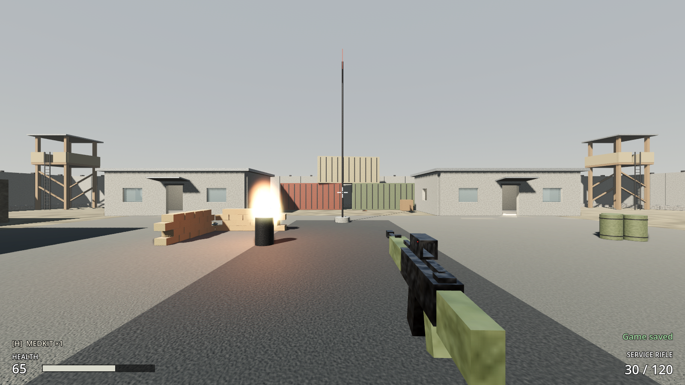

# Increment 8 — SaveManager (save and load)

**Status:** complete, and **Milestone 1 is done**. 175 automated tests pass in headless Godot 4.7, 11 of them new (10 in `tests/test_save.gd` and a container close-sound test), plus the updated footstep-pace test.

A real-window run with injected key presses:
- Walked for 2 s and covered 8.6 m with 7 footsteps (3.5 a second).
- F5 wrote the quick save, and the HUD showed "Game saved".
- After moving away and healing, F9 put the player back at the saved spot with the saved 65 health.

**Playable result:**
- **F5 quick saves; F9 quick loads.** A short notice confirms it: "Game saved", "Game loaded" or "No quick save yet (F5 to save)".
- A save holds:
  - **You:** where you stand and look, your health, every inventory slot, and the rounds in your magazine.
  - **Every salvage container:** whether it's been searched and exactly what's left in it, so loot isn't re-rolled.
  - **Loot on the ground:** pickups you've taken stay taken, items you dropped stay where you dropped them, and anything taken after the save comes back when you load.
- You can't save while dead. Loading while dead brings you back with your saved health.
- Saves survive quitting the game. They're in `user://saves/quicksave.json` (on a Mac: `~/Library/Application Support/Godot/app_userdata/ASHFALL- Reclamation/saves/`).

**Also in this update:**
- **Quieter footsteps.** Steps now fire every 1.3 m instead of 0.75 m: about 3.5 a second when walking instead of 6. The sound is a soft thud with a little grit instead of a gravel crunch, plays 6 dB quieter, and has 6 variations with no immediate repeats. Raiders use the same set.
- **Lockers clang shut.** Weapons lockers and footlockers play the ladder-rung clang when the door or lid finishes closing. Crates get a wooden thud.



> **Mac keyboards:** F5 and F9 may need **fn** held (fn+F5), unless "Use F1, F2, etc. keys as standard function keys" is turned on in System Settings → Keyboard.
>
> **After pulling:** open with **Edit** in the Project Manager (not Run). This update adds an autoload (SaveManager), which the editor registers on opening.

---

## 1. Files

| File | Purpose |
|---|---|
| `scripts/persistence/save_manager.gd` | **New.** Autoload `SaveManager`: `save_game(slot, root)`, `load_game(slot, root)`, `build_save_data()`, `apply_save_data()`, `validate()`, `read_save_file()`, `has_save()`, `delete_save()`; F5/F9 handling; signals `saved`, `loaded`, `failed(reason)` |
| `tests/test_save.gd` | **New.** 10 tests |
| `scripts/player/player_controller.gd` | In `persist`; `save_state()` / `load_state()` |
| `scripts/interaction/pickup.gd` | In `persist`; `save_state()` / `load_state()` / `is_save_removable()` |
| `scripts/interaction/salvage_container.gd` | `%CloseSound` plays when the lid shuts; new `lid_closed` signal (save state came in Increment 7) |
| `scripts/ui/hud.gd` | `show_notice(text, color)`; shows SaveManager results (failures also play the denied sound) |
| `scripts/player/player_audio.gd` | `step_length` 0.75 → 1.3 m; footstep volume −10 dB (crouched −17) |
| `assets/audio/footstep_gravel_1-6.wav`, `sets/footstep_gravel.tres` | Softer steps (`soft_step()` in `tools/audio/synth_sounds.py`), 6 variations |
| `assets/audio/crate_close.wav` | **New.** Wooden lid thud |
| Container scenes | + `%CloseSound` (lockers: `sets/ladder_step.tres`; crate: `crate_close.wav`) |
| `project.godot` | Autoload `SaveManager`; inputs `quick_save` (F5), `quick_load` (F9) |

## 2. Scene hierarchy

SaveManager has no scene; it's a script autoload at `/root/SaveManager`.

```
/root
├── SaveManager            (autoload, save_manager.gd)
└── Outpost17              (current scene = the "world root" that gets saved)
    ├── Player             persist ✓
    ├── SalvageContainers/*  persist ✓
    └── Loot/*             persist ✓ (removable)

SupplyCrate / Footlocker / WeaponsLocker
└── + %CloseSound          AudioStreamPlayer3D
```

## 3. Key points

- **The persist contract.** Any node can be saved by joining the `persist` group and implementing `save_state() -> Dictionary` (JSON-safe) and `load_state(data)`. Things that can vanish also implement `is_save_removable() -> true`. SaveManager knows nothing about players or crates, so future systems (buildings, settlers, factions) just join the group.
- **Paths, scenes and parents.** Each entry stores the node's path inside the level, its scene file and its parent. On load:
  1. Removable nodes the save doesn't list are deleted (taken loot, or items dropped after saving).
  2. Listed nodes that are missing are re-instanced from their scene (loot taken after saving, items dropped before saving).
  3. Everything gets `load_state()`.
- **Versioned format.** Every file has `"format": "ashfall_save"` and `"version": 1`. Newer versions are refused ("Save is from a newer version of the game"), and older ones go through `_migrate()`, a stub until version 2 exists.
- **Validation everywhere.** A save file is untrusted input. Bad JSON, wrong types, NaN or infinite numbers and unknown item ids are skipped, and scenes are only instanced from `res://`. A bad file changes nothing and reports why.
- **Safe writes.** The game writes to `quicksave.json.tmp`, then renames it, so a crash mid-save can't destroy the previous save.
- **Different level.** If a save names another level, `load_game` opens it first and applies the save once it's ready. Only Outpost 17 exists now, but this is how bigger maps and regions will load.
- **Authority.** In co-op, only the host saves and loads. Clients get the world through replication.

## 4. Input Map

| Action | Key |
|---|---|
| `quick_save` | F5 (fn+F5 on most Mac keyboards) |
| `quick_load` | F9 (fn+F9) |

F5 only quick saves while the game is running. In the Godot editor, F5 still starts the game.

## 5. Inspector / project settings

**Project Settings → Globals → Autoload:** `SaveManager` = `res://scripts/persistence/save_manager.gd`, Enabled.

**SaveManager (script defaults):** `save_dir` = `user://saves` · `QUICK_SLOT` = "quicksave" · `SAVE_VERSION` = 1.

**PlayerAudio:** Step Length 1.3 m (sprint strides are 25% longer). Volume is set in code: walking −10 dB, crouching −17 dB.

**Container CloseSound:** lockers use `sets/ladder_step.tres` (0 / +2 dB); crate uses `crate_close.wav` (−2 dB).

## 6. Signals

| Signal | Emitted by | Connected to |
|---|---|---|
| `saved(path)` | SaveManager | HUD ("Game saved") |
| `loaded(path)` | SaveManager | HUD ("Game loaded") |
| `failed(reason)` | SaveManager | HUD (red notice + denied sound) |
| `lid_closed` | SalvageContainer | (CloseSound plays inside it; future: noise for AI) |
| `respawned` | PlayerController (also on load) | HUD, PlayerAudio, GameMode reset as after a respawn |

## 7. Editor assembly (by hand)

1. Create `scripts/persistence/save_manager.gd` and add it as an autoload named **SaveManager** (Project Settings → Globals → Autoload).
2. **Input Map:** `quick_save` → F5, `quick_load` → F9.
3. **Player and pickups:** add `add_to_group("persist")` in `_ready()` and the `save_state` / `load_state` methods. Pickups also need `is_save_removable()`.
4. **HUD:** in `_ready()`, connect `SaveManager.saved`, `loaded` and `failed` to `show_notice`.
5. **Container scenes:** add an AudioStreamPlayer3D named **CloseSound** (unique name) with the clang or thud stream.

## 8. Testing

**Automated** (`-- test_save` runs just this increment):
- The autoload exists, the version is 1, the slot path is right, and F5 / F9 are bound.
- **Player round trip:** position, facing, pitch, health 55, the exact inventory slots and magazine 12 are all restored after everything changes. The `loaded` signal fires, the temporary file is cleaned up, and the player is standing on the floor afterwards.
- **File format:** format tag, version 1, timestamp, level path, and a player entry with every field.
- **Bad files:** the error code and message for each case are listed below. In every case the game state is unchanged.

  | File | Error | Message |
  |---|---|---|
  | Missing | `ERR_FILE_NOT_FOUND` | "No quick save yet (F5 to save)" |
  | Junk text | `ERR_FILE_CORRUPT` | "Save file is damaged" |
  | JSON array | `ERR_FILE_CORRUPT` | "Save file is damaged" |
  | Wrong format | `ERR_INVALID_DATA` | "Not an Ashfall save" |
  | No version | `ERR_INVALID_DATA` | "Save has no version" |
  | Version 99 | `ERR_INVALID_DATA` | "newer version" |
  | No nodes | `ERR_INVALID_DATA` | "Save file is damaged" |

- **Malformed entries:** strings for numbers, infinite yaw, a huge magazine and a `user://` scene path are all ignored or clamped. The player stays alive.
- **Dead:** saving while dead is refused. Loading while dead revives you with the saved health and your weapon back in hand.
- **World:**
  - A crate's searched contents are restored.
  - Loot taken after saving comes back in the same place.
  - An item dropped after saving disappears.
  - Loot taken before saving stays gone in a "fresh" world.
  - A dropped medkit is re-created from the save.
- **Keys and HUD:** F9 with no save shows the hint. F5 writes the file and shows "Game saved". F9 restores health and shows "Game loaded".
- **Outpost 17:** search a crate, take shelf scrap, walk into the warehouse and carry fuel, then save. Load into a **fresh copy** of the level:
  - The player is back in the warehouse with the fuel.
  - The crate is searched with identical (not re-rolled) loot.
  - The shelf scrap is still taken, the gate medkit is still there, and other containers are unsearched.
- **Sounds:** lockers and footlockers use the ladder clang and crates the thud. The close sound fires once, after the lid shuts, not while it's open. Footsteps come at 6–8 per 8.5 m of walking.

**Manually:**
1. F5 (fn+F5). "Game saved" appears bottom-right.
2. Run into raider country, take a beating, grab the stash loot, then F9: you're back at the outpost with your old health, the stash is unsearched, and its loot is gone from your bags.
3. Quit the game, start it again, and press F9: you continue from the save.
4. Open and close a weapons locker: a metal clang when the door shuts.

## 9. Troubleshooting

| Symptom | Fix |
|---|---|
| F5/F9 do nothing on a Mac | Hold **fn** with them, or enable standard function keys in System Settings → Keyboard. |
| "No quick save yet" right after saving | The save failed. Look for a red notice when pressing F5 (e.g. "Can't save while dead"). |
| `Identifier "SaveManager" not declared` / no notices | The autoload isn't registered. Open the project with Edit once (it's in project.godot), or add it in Project Settings → Globals → Autoload. |
| Loot comes back after loading | That pickup must be in the `persist` group and have `is_save_removable()`; custom pickups need both. |
| A new kind of object isn't saved | Add it to the `persist` group with `save_state()` / `load_state()`. It must be inside the level scene. |
| Want to start fresh | Delete `quicksave.json` from the saves folder (path above). |

## 10. How this connects to future systems

- **Bigger maps and regions:** saves record the level path, and `load_game` can open a different level first. Each region becomes a level with its own persist nodes, so a world save becomes one file per region plus the player.
- **Save slots and a pause menu:** `save_game(slot)` / `load_game(slot)` already take any slot name. A menu just lists `user://saves/*.json` and reads `saved_at` from each.
- **Autosave:** call `SaveManager.save_game("autosave")` on events (entering a settlement, sleeping) or on a timer.
- **Milestone 2:** each new weapon's magazine goes in the player's `save_state`, and crafting stations join `persist` to save queued jobs.
- **Settlements, buildings, NPCs:** each joins `persist`. Buildings placed at runtime are re-instanced from their scene paths on load, exactly as dropped items are today.
- **Co-op:** the host's SaveManager saves the shared world. Player entries will be keyed by player id rather than node path.
