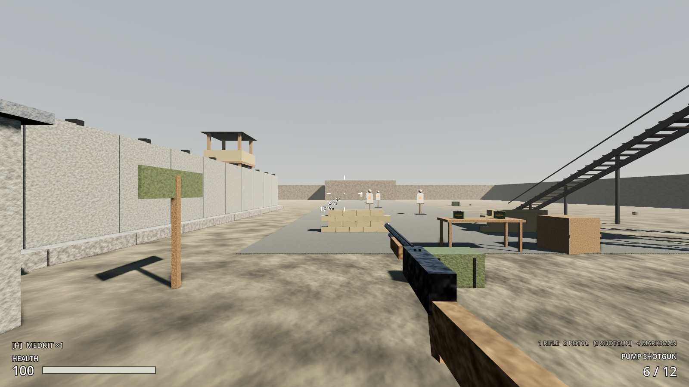
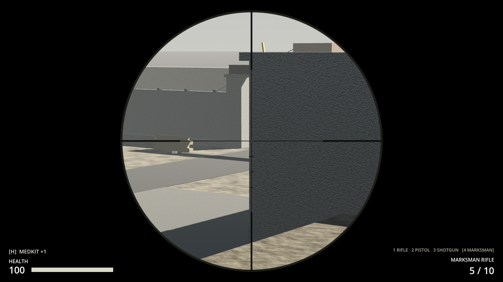

# Milestone 2, Increment 9 — Weapon slots and new guns

**Status:** complete. 194 automated tests pass in headless Godot 4.7, 19 of them new: 18 in `tests/test_weapons.gd` and the placement test in `test_outpost_17.gd`.

A real-window run with injected key and mouse events checked:
- Key 2 switched to the pistol, and right-click aimed down its iron sights.
- The mouse wheel switched to the shotgun, and a left-click blast at the 10 m range target landed pellets.
- Key 4 switched to the marksman rifle on a guard tower, and right-click brought up the 4× scope (FOV 75° → 18.75°).

That run also caught an ADS problem: the shotgun's receiver filled half the screen. The shotgun now sits further from the eye when aimed.

**Playable result:**
- **Four weapon slots**, shown bottom-right as `[1 RIFLE]   2 PISTOL   3 SHOTGUN   4 MARKSMAN`:
  - **1 / 2 / 3 / 4** pick a slot. The **mouse wheel** (or a Magic Mouse swipe) cycles through the guns you own, one gun per swipe.
  - Switching takes the gun down (0.2 s) and brings the next one up (0.3–0.6 s). You can't fire, aim or reload in between.
  - Switching cancels a reload (the magazine keeps its rounds) and lowers toggled sights.
- **You start with the rifle and a pistol** (36 rounds of 9 mm).
- **The pump shotgun** is on the command-post floor, next to a box of shells:
  - 9 pellets per shot, 117 damage point-blank (one raider), almost nothing past 25 m.
  - Loads **one shell at a time**. Pull the trigger mid-reload to stop and fire.
  - Pump sound after every shot.
- **The marksman rifle** is up the north-west guard tower (climb the ladder), with 10 rounds of .308:
  - Bolt action, 5 rounds, 90 damage: one shot kills a raider anywhere on the body.
  - Aim for a **4× scope** with a full-screen reticle. Hip-firing it is very inaccurate.
- **New ammo:**
  - Pistol Ammo (9 mm) is in footlockers, crates and weapons lockers, and raiders drop it.
  - Shotgun Shells are in weapons lockers and stashes.
  - Marksman Rounds (.308) are in scavenger stashes.
- **Picking up a gun** puts it in its slot ("Pump Shotgun → slot 3"). Your guns don't take inventory space. A gun you already own gives you its loaded ammo instead ("Take ammo from Pump Shotgun").
- The inventory screen's EQUIPPED panel lists every gun you carry with its ammo. Saves keep your whole loadout and every magazine.




> **After pulling:** open with **Edit** in the Project Manager (not Run). This update adds 2 new scripts.

---

## 1. Files

| File | Purpose |
|---|---|
| `scripts/combat/weapon_slots.gd` | **New.** `WeaponSlots`: the loadout (slots 1–4), switching (holster → draw), `give_weapon()`, `request_slot()`, `cycle()`, save/load |
| `scripts/ui/scope_overlay.gd` | **New.** `ScopeOverlay`: black surround, reticle with holdover marks |
| `resources/items/weapons/pistol.tres`, `shotgun.tres`, `scoped_rifle.tres` | **New.** WeaponDefinitions |
| `resources/items/weapons/*_item.tres` | **New.** WEAPON items (world pickups) for the three guns |
| `resources/items/pistol_ammo.tres`, `shotgun_shells.tres`, `rifle_308.tres` | **New.** Ammo items |
| `scenes/weapons/pistol.tscn`, `shotgun.tscn`, `scoped_rifle.tscn` | **New.** Weapon scenes (built from the rifle's muzzle flash and sound setup) |
| `scenes/items/models/*_world.tscn`, `*_box.tscn` | **New.** Guns lying on the ground; ammo boxes |
| `assets/audio/pistol_*`, `shotgun_*`, `sniper_*`, `shell_insert`, `shotgun_pump`, `bolt_cycle`, `weapon_draw`, `pickup_weapon` | **New.** Synthesized |
| `tests/test_weapons.gd` | **New.** 18 tests |
| `scripts/combat/weapon_definition.gd` | + `short_name`, `slot`, `scene_path`, `instantiate_weapon()`, `pellets`, `reload_per_round`, `draw_time`, `cycle_sound_delay`, `scope_overlay` |
| `scripts/combat/hitscan_weapon.gd` | Pellets (one combined hit marker per target), shell-by-shell reload with trigger interrupt, pump/bolt sound, hides the model when scoped, `snap_lowered()` |
| `scripts/player/player_controller.gd` | `weapon` follows WeaponSlots; switching blocks fire/aim/reload; `give_weapon()`; `weapon_picked_up` signal; respawn restocks every gun; loadout in `save_state` |
| `scripts/core/input_frame.gd`, `player_input.gd` | `slot` and `cycle` (validated); number keys; rate-limited wheel; switching lowers toggled aim |
| `scripts/interaction/pickup.gd` | Weapon items fill their slot, or give ammo if you already have the gun |
| `scripts/inventory/item_definition.gd`, `item_database.gd` | `ItemDefinition.weapon`; `get_weapon(id)`, `find_weapon_item(id)` |
| `scripts/ui/hud.gd`, `inventory_screen.gd` | Weapon strip, scope overlay, "LOADING 3 / 6" for shells, gun-pickup notice; loadout list in EQUIPPED |
| Patched scenes | Player (`%WeaponSlots` replaces the single `%Weapon`; +DrawSound; starts with 36 pistol rounds), HUD (+WeaponStrip, +ScopeOverlay, notices moved up), Outpost 17 (+shotgun, shells, marksman rifle, .308, pistol ammo), raider (drops pistol ammo) |

## 2. Scene hierarchy

```
Player
├── Head/Camera/WeaponMount          (empty in the scene; WeaponSlots fills it)
│   ├── ServiceRifle   (slot 1)      instanced at runtime, only the one in hand is visible
│   ├── Pistol         (slot 2)
│   └── Shotgun / ScopedRifle (3, 4) when picked up
├── %WeaponSlots       Node + weapon_slots.gd (starting_weapons: rifle, pistol)
└── Audio/%DrawSound   AudioStreamPlayer (weapon_draw.wav)

Pistol / Shotgun / ScopedRifle (HitscanWeapon)
├── Model             parts + Muzzle/MuzzleFlash + %SightAnchor (rear sight)
├── ShotSound · ReloadSound (per shell for the shotgun) · DryFireSound
└── %CycleSound       pump / bolt (shotgun, marksman)

HUD/Root
├── %ScopeOverlay     (first child, under everything) shown at full aim with scope_overlay weapons
└── %WeaponStrip      Label above the weapon name
```

## 3. Key points

- **The rest of the game didn't change.** `PlayerController.weapon` is still "the gun in hand"; WeaponSlots just changes what it points to. The HUD re-binds automatically, and aiming, recoil and reloads all read the current gun's definition.
- **Per-gun ammo through the inventory.** Each gun's `ammo_type` maps to its own ammo item, so the rifle, pistol, shotgun and marksman rifle draw from separate stacks. You can see and drop them like anything else.
- **Pellets.** The shotgun fires 9 rays across its 3.2° cone. Damage per target is added up, so one blast gives one hit marker and one hit sound with the total, not nine.
- **Shell-by-shell reload.** Each shell takes 0.55 s. The trigger stops loading if a shell is chambered, and the HUD shows "LOADING 4 / 6".
- **Switching is simulated.** Slot choice and wheel steps travel in the `InputFrame` (`slot`, `cycle`, validated), so in co-op the host runs the same switch.
- **Definition ↔ scene.** A WeaponDefinition stores its scene as a *path* (`scene_path`), because the weapon scene itself references the definition. That avoids a cyclic resource load.
- **Magic Mouse:** a swipe sends many wheel events, so `PlayerInput.wheel_cooldown_msec` (180 ms) turns one swipe into one weapon step.

## 4. Input Map

| Action | Input |
|---|---|
| `weapon_1` … `weapon_4` | 1, 2, 3, 4 |
| (mouse wheel) | Wheel down / swipe = next gun · wheel up = previous (handled in PlayerInput, rate-limited) |

Existing: `fire` LMB · `aim` RMB / Q (toggle) · `reload` R.

## 5. Inspector settings

| | Service Rifle | Pistol | Pump Shotgun | Marksman Rifle |
|---|---|---|---|---|
| Slot / short name | 1 RIFLE | 2 PISTOL | 3 SHOTGUN | 4 MARKSMAN |
| Damage × pellets | 34 | 24 | 13 × 9 | 90 |
| Falloff (m) | 50–200 (×0.6) | 15–60 (×0.55) | 6–25 (×0.15) | 150–400 (×0.8) |
| Fire mode, rpm | auto 650 | semi 420 | semi 70 (pump) | semi 48 (bolt) |
| Magazine / reload | 30 / 2.3 s | 12 / 1.5 s | 6 / 0.55 s **per shell** | 5 / 3.0 s |
| Ammo type | rifle_556 | pistol_9mm | shotgun_12 | rifle_308 |
| Start reserve | 120 | 36 | 0 | 0 |
| Hip spread | 0.35° | 0.5° | 3.2° cone | 2.0° |
| ADS zoom / spread × | 1.4 / 0.35 | 1.25 / 0.5 | 1.15 / 0.75 | **4.0** / 0.02 |
| ADS move speed × | 0.55 | 0.75 | 0.7 | 0.45 |
| Draw time | 0.45 s | 0.3 s | 0.55 s | 0.6 s |
| Noise radius | 60 m | 45 m | 90 m | 140 m |

**WeaponSlots:** Starting Weapons = [service_rifle, pistol] · Holster Time 0.2 s. **PlayerInput:** Wheel Cooldown Msec 180.

## 6. Signals

| Signal | Emitted by | Connected to |
|---|---|---|
| `switch_started(to_slot)` | WeaponSlots | PlayerAudio (draw sound), PlayerInput (lowers toggled aim) |
| `weapon_equipped(weapon)` | WeaponSlots | (the HUD re-binds through `player.weapon`) |
| `weapon_added(weapon)` | WeaponSlots | (future: weapon wheel UI) |
| `weapon_picked_up(definition)` | PlayerController | HUD ("Pump Shotgun → slot 3"), PlayerAudio (pickup sound) |
| `hit_confirmed` | HitscanWeapon (once per target per shot) | HUD hit marker |

## 7. Editor assembly (by hand)

1. **Player scene:**
   - Delete the `Weapon` instance under `Head/Camera/WeaponMount`.
   - Add a `Node` named `WeaponSlots` (unique name) with `weapon_slots.gd`, and fill Starting Weapons with the rifle and pistol definitions.
   - Add `pistol_ammo: 36` to the inventory's Starting Items.
2. **A new gun:**
   1. Duplicate `service_rifle.tscn` and replace the meshes under `Model`. Keep `Muzzle` (move it to the barrel tip), and add a `Marker3D` **SightAnchor** (unique) on the rear sight.
   2. Set the sounds. Add a `CycleSound` for pump or bolt guns.
   3. Create a WeaponDefinition `.tres`. Set **Slot**, **Scene Path** and **Ammo Type**, and give the root's `definition` that resource.
3. **Pickup:** create an ItemDefinition with Category WEAPON, its **Weapon** set to the definition, and a world model, then place it with `pickup.tscn`.
4. **Ammo:** create an ItemDefinition with Category AMMO and the same **Ammo Type**, then add it to loot tables.
5. **HUD:** add a `Label` named `WeaponStrip` and a full-rect `Control` named `ScopeOverlay` (with `scope_overlay.gd`) as the first child of `Root`, both as unique names.
6. **Input Map:** add `weapon_1`–`weapon_4` on keys 1–4.

## 8. Testing

**Automated** (`-- test_weapons`):
- **Definitions:** all four have distinct slots, scenes that instantiate with sights and a muzzle, ammo items, and lookup by id.
- **Loadout at spawn:** rifle in 1, pistol in 2, slots 3–4 empty, only the rifle visible, 36 pistol and 120 rifle rounds.
- **Switching:**
  - It takes time, and no shots fire while the rifle goes away. The pistol is up after about 0.5 s and fires.
  - Empty slots and the slot already in hand are ignored. The wheel goes next, wraps around, and goes back.
  - A burst of wheel events counts as one step. Switching cancels a reload (the magazine is kept) and toggled aim.
- **Pistol:** semi-auto (holding fires once), 24 damage, reloads 12 from 36 pistol rounds without touching rifle ammo.
- **Pickups:**
  - The shotgun goes to slot 3 (prompt, signal, pickup removed, not in the inventory grid).
  - A second shotgun shows "Take ammo from…" and gives 6 shells.
  - The marksman rifle can be targeted and taken on the guard-tower platform in the real level.
- **Shotgun:**
  - Nine pellets give **one** hit marker and 117 damage at 3 m. Pump fires one shell per shot. Falloff leaves under 2.5 damage at 25 m.
  - **Shell by shell:** one shell after 0.55 s, then a second; a trigger pull stops loading and fires; shells come out of the inventory.
- **Marksman:**
  - 4× zoom, scoped spread under 5% of hip spread, the HUD scope overlay shows and the gun model hides, and both revert when lowered.
  - One shot kills an 80 HP target at 60 m.
- **Iron sights:** the pistol's rear sight and front dot, and the shotgun's rear notch and bead, sit on the screen centre when aimed.
- **HUD strip:** shows `[1 RIFLE]   2 PISTOL   3 —   4 —`, then follows the switch to `[3 SHOTGUN]`, and the weapon name updates.
- **Saves:**
  - The shotgun, the gun in hand and every magazine are restored.
  - Old saves (no loadout) still load the rifle magazine.
  - A loadout of unknown guns never leaves you unarmed.
- **Respawn** tops up pistol ammo and refills magazines.
- **Input:** slot and cycle survive the network round trip, bad values are rejected, and keys 1–4 map to the slots.

**Manually:**
1. F5, then press **2**: pistol. Fire a few shots at the range, aim (right-click), reload (R).
2. Go into the command post (west of the yard) and take the **shotgun** and shells. Blast a target from 3 m and from 20 m and compare. Reload and fire mid-reload.
3. Climb the north-west tower and take the **marksman rifle**. Aim (right-click): 4× scope. Shoot a raider coming through the gate.
4. Swipe the Magic Mouse: one gun per swipe.
5. F5 to save, swap guns, then F9: your loadout and magazines come back.

## 9. Troubleshooting

| Symptom | Fix |
|---|---|
| Number keys do nothing | You only switch to slots you own (1 and 2 at the start). Check the `weapon_1`–`weapon_4` actions exist. |
| Swipes jump two guns | Raise `PlayerInput.wheel_cooldown_msec`. |
| "Could not find type WeaponSlots" / no gun in hand | Stale class cache: open with **Edit**, not Run. |
| A new gun's sights are off-centre when aiming | `%SightAnchor` must be on the sight line, and `ads_eye_distance` sets how far in front of the eye the rear sight sits (bigger = gun further away). |
| Shotgun hits for tiny amounts | Falloff starts at 6 m and bottoms out at 25 m (×0.15). Get closer. |
| Picking up a gun gives ammo instead | You already own that gun; you get its magazine as ammo. |

## 10. How this connects to future systems

- **Crafting (#9):** recipes for 9 mm, shells and .308 from scrap, fuel and electronics give the new guns a steady supply. Weapon parts can repair or upgrade them later.
- **The first region (#10):** close-quarters buildings for the shotgun, long streets and rooftops for the marksman rifle. The region's loot tables reuse the new ammo items.
- **Raider variety:** an NPC can carry any `HitscanWeapon` scene, because the definitions are data. A raider marksman uses the same `scoped_rifle.tres`.
- **Co-op:** the loadout is per player and switching is driven by InputFrames, so the host runs and validates it. Weapon pickups are validated interactions.
- **Weapon wheel or attachments (later):** `WeaponSlots.weapon_added` and `owned()` give a UI everything it needs. Attachments become per-weapon state saved in the loadout entry.
