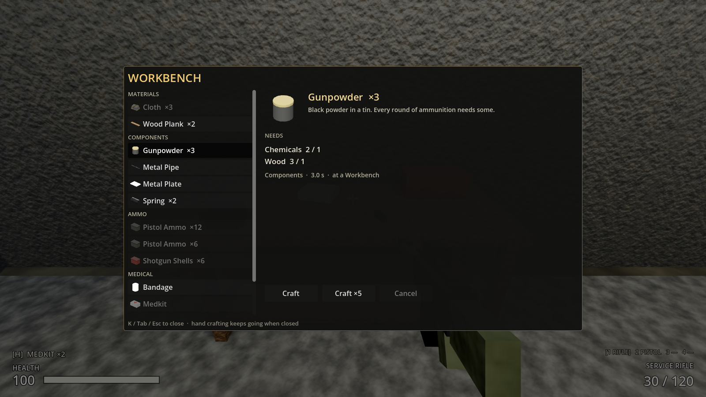
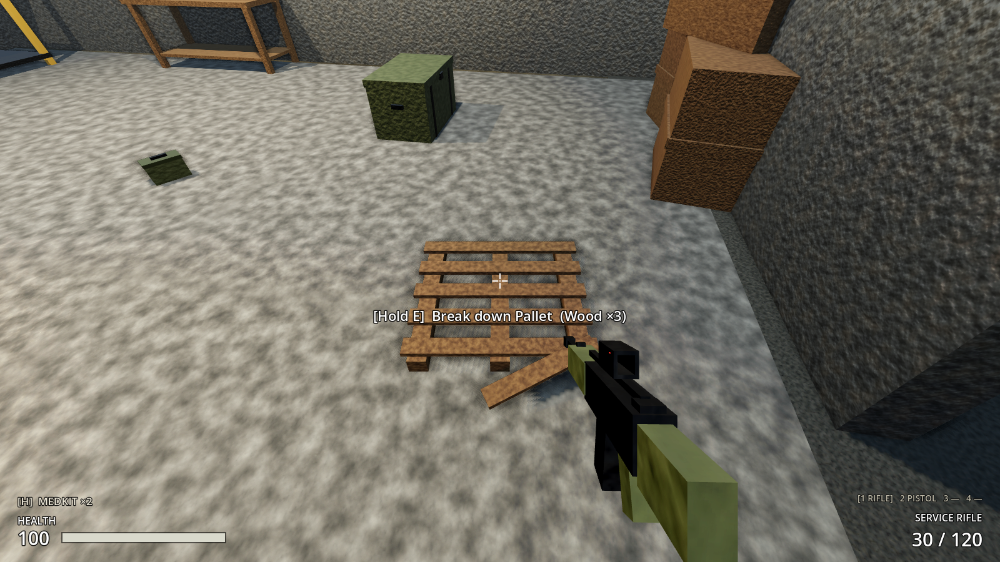

# Milestone 2, Increment 10 — Crafting: materials, recipes and benches

**Status:** complete. 209 automated tests pass in headless Godot 4.7, 15 of them new: 13 in `tests/test_crafting.gd` and 2 level tests in `test_outpost_17.gd`.

A real-window run with injected key presses checked:
- **K** opened the crafting menu, a bandage was queued, and K closed the menu while the bandage kept crafting.
- A held **E** broke down a warehouse pallet into 3 wood.
- **E** at the workbench opened the WORKBENCH screen, and **Esc** closed it and released the bench.

The tests caught one problem: a pallet placed inside the gate sandbags. It was moved.

**Playable result:**
- **New materials:**
  - **Wood**: break down **pallets** and **broken furniture** (hold E). There are 10 piles around the outpost and outside it.
  - **Chemicals**: found in crates and stashes.
  - **Components** made from these: planks, metal plates, metal pipes, springs, gunpowder and bandages.
- **Crafting by hand, anywhere: K.** Bandages, wood planks and a small batch of pistol ammo. Hand crafting keeps going when you close the menu, and the HUD shows "Crafting Bandage (2 left)".
- **Workbench** (warehouse, by the south wall): metal plates, pipes, springs, gunpowder, medkits, pistol ammo ×12, shotgun shells.
- **Weapons bench** (command post, by the back wall): rifle ammo ×30 and marksman rounds ×10. Gun parts, guns and attachments are added here in Increment 11.
- **The menu:**
  - Recipes you can make here are listed first, grouped by type. Recipes for other benches are listed greyed under **AT OTHER BENCHES**, so you can see what exists.
  - Each recipe shows the ingredients you have and need ("Cloth 4 / 2"), the time and where it's made.
  - **Craft**, **Craft ×5** and **Cancel**, with a progress bar.
  - A reason is shown whenever you can't craft: "Missing 2 Cloth", "Needs a Workbench" or "Inventory full".
- Leaving a bench stops that bench's work; hand recipes carry on. **Bandages** heal 20 in 1 s. H still uses your best medical item.




> **After pulling:** open with **Edit** in the Project Manager (not Run). This update adds 6 new scripts.

---

## 1. Files

| File | Purpose |
|---|---|
| `scripts/crafting/recipe_definition.gd` | **New.** `RecipeDefinition` Resource: id, category, station (HAND / WORKBENCH / WEAPONS_BENCH), inputs `Dictionary[ItemDefinition, int]`, output + quantity, craft time |
| `scripts/crafting/recipe_database.gd` | **New.** `RecipeDatabase`: all recipes under `resources/recipes/`, sorted; `get_recipe(id)`, `recipes_for(item)` |
| `scripts/crafting/crafting_station.gd` | **New.** `CraftingStation` (Interactable): a bench, E to use |
| `scripts/interaction/salvage_pile.gd` | **New.** `SalvagePile` (Interactable): hold E to break down into materials; keeps what doesn't fit; saved |
| `scripts/ui/crafting_screen.gd` | **New.** `CraftingScreen` |
| `resources/recipes/*.tres` | **New.** 13 recipes |
| `resources/items/wood, chemicals, wood_plank, metal_plate, metal_pipe, spring, gunpowder, bandage .tres` | **New.** Items (with icons and world models) |
| `scenes/world/stations/workbench.tscn`, `weapons_bench.tscn` | **New.** Benches (solid, raiders path around them) |
| `scenes/world/salvage/wood_pallet.tscn`, `broken_furniture.tscn` | **New.** Salvage piles |
| `tests/test_crafting.gd` | **New.** 13 tests |
| `scripts/player/player_controller.gd` | Crafting queue: `request_craft()`, `cancel_crafting()`, `craft_refusal_reason()`, `open_station()`, `close_station()`; signals |
| `scripts/inventory/inventory_component.gd` | `can_exchange()`: would the output fit once the inputs are used? (changes nothing) |
| `scripts/ui/hud.gd`, `inventory_screen.gd` | Crafting screen binding; crafting progress in the use bar when the menu is closed |
| Patched | `hud.tscn` (+CraftingScreen), `outpost_17.tscn` (+CraftingStations, +SalvagePiles), navmesh rebaked, loot tables (+chemicals, gunpowder, bandages, springs, pipes, planks), `project.godot` (+`crafting` = K) |

## 2. Scene hierarchy

```
Workbench / WeaponsBench     Area3D + crafting_station.gd (layer 5)
├── Shape                    interaction box
└── Body                     StaticBody3D (layer 2): BodyShape + bench meshes

WoodPallet / BrokenFurniture Area3D + salvage_pile.gd (layer 5)
├── Shape
└── Model                    meshes (no collision: you walk over a pallet)

Outpost17
├── CraftingStations  (navigation_geometry)   Workbench (-21, 0, 0.6) · WeaponsBench (-13.5, 0, -18.45)
└── SalvagePiles      7 pallets, 3 furniture piles

HUD/Root/%CraftingScreen
└── Window/Layout: %CraftTitle · Body [ RecipeScroll/%RecipeList | Detail: %RecipeIcon %RecipeName %RecipeDescription,
    NEEDS %RecipeIngredients, %RecipeInfo, %RecipeStatus, [%CraftButton %Craft5Button %CancelCraftButton],
    %CraftProgress, %CraftQueue ] · Footer
```

## 3. Key points

- **One recipe format for everything.** A recipe is inputs → output at a station in some time. Gun parts, guns and attachments (Increment 11) and construction (later) use the same `RecipeDefinition`; only what happens to the output differs.
- **Where things are made.** HAND recipes work anywhere *and* at any bench. Bench recipes need that bench, and you must stay within reach. Walk away and the bench closes and its work stops; hand work continues.
- **Validated twice.** `request_craft()` checks you're alive, at the right station, have the ingredients, and that the output fits once the ingredients are used (`can_exchange`). It checks again when each unit finishes, because materials can be dropped mid-craft. Nothing is consumed until a unit is done, so cancelling is free.
- **Queues.** Craft ×5 queues five. The queue stops cleanly when you run out. Choosing a different recipe replaces the queue.
- **Materials loop:**
  - Pallets and furniture give wood.
  - Crates, stashes and lockers give chemicals and scrap.
  - Chemicals + wood make gunpowder.
  - Scrap + gunpowder make ammo.
  - Cloth makes bandages, and bandages + chemicals make medkits.
- **Server authority:** every craft is a validated PlayerController request (host-side in co-op). The UI only asks.

## 4. Input Map

| Action | Key |
|---|---|
| `crafting` | **K**: open/close hand crafting |
| `interact` | E: use a bench, hold to break down a pile; also closes the bench screen |
| `inventory` / `pause` | Tab / Esc also close the crafting screen |

## 5. Recipes

| Recipe | Where | Needs | Makes | Time |
|---|---|---|---|---|
| Wood Plank | hand | 1 Wood | 2 | 1.5 s |
| Bandage | hand | 2 Cloth | 1 | 2 s |
| Pistol Ammo (by hand) | hand | 1 Scrap, 1 Gunpowder | 6 | 3 s |
| Metal Plate | workbench | 3 Scrap | 1 | 2.5 s |
| Metal Pipe | workbench | 2 Scrap | 1 | 2 s |
| Spring | workbench | 1 Scrap | 2 | 1.5 s |
| Gunpowder | workbench | 1 Chemicals, 1 Wood | 3 | 3 s |
| Cloth | workbench | 2 Bandages | 3 | 1 s |
| Medkit | workbench | 2 Bandages, 1 Chemicals | 1 | 3.5 s |
| Pistol Ammo | workbench | 1 Scrap, 1 Gunpowder | 12 | 2.5 s |
| Shotgun Shells | workbench | 1 Scrap, 1 Gunpowder, 1 Cloth | 6 | 3 s |
| Rifle Ammo | weapons bench | 2 Scrap, 2 Gunpowder | 30 | 3.5 s |
| Marksman Rounds | weapons bench | 1 Metal Plate, 2 Gunpowder | 10 | 4 s |

New items: Wood (1 kg, stack 20), Chemicals (0.8 kg, 10), Wood Plank (0.5 kg, 30), Metal Plate (0.8 kg, 20), Metal Pipe (0.6 kg, 20), Spring (0.05 kg, 50), Gunpowder (0.1 kg, 50), Bandage (0.1 kg, 10, heals 20 over 1 s).

Salvage: Pallet → 3 Wood · Broken Furniture → 2 Wood + 1 Scrap (hold E 1.5 s).

## 6. Signals

| Signal | Emitted by | Connected to |
|---|---|---|
| `crafting_started(recipe, duration)` / `crafting_finished(recipe)` / `crafting_cancelled(recipe)` | PlayerController | CraftingScreen (refresh); finishing also triggers `item_received` (HUD "+2 Wood Plank", sound) |
| `craft_refused(reason)` | PlayerController | CraftingScreen (red status), HUD (denied sound) |
| `station_opened(station)` / `station_closed(station)` | PlayerController | CraftingScreen (open/close with bench recipes) |

## 7. Editor assembly (by hand)

1. **A new recipe:** right-click `resources/recipes/` → New Resource → **RecipeDefinition**. Set Id, Station, Category, Inputs (drag item `.tres` files into the dictionary keys), Output, Output Quantity and Craft Time. It appears in the menu automatically.
2. **A bench:**
   - Make an Area3D root with `crafting_station.gd` and set Station.
   - Add an interaction Shape and a **Body** StaticBody3D (layer 2) with a shape and meshes.
   - Set Focus Offset to the bench top.
   - Place it under `CraftingStations` (in `navigation_geometry`) and rebake the navmesh.
3. **A salvage pile:** make an Area3D with `salvage_pile.gd`, set Yields (item → amount), Pile Name and Salvage Time, then add a Shape and a model.
4. **HUD:** add the CraftingScreen layout from §2, with every `%` name unique in hud.tscn.
5. **Input Map:** `crafting` → K.

## 8. Testing

**Automated** (`-- test_crafting`):
- **Recipes:**
  - At least 13 recipes, with registered inputs and outputs, positive quantities and times, and no recipe consuming its own output.
  - All three stations are covered. Every new item has an icon and a model. All ammo, medkits and gunpowder can be crafted.
- **`can_exchange`:** changes nothing and emits nothing. Correct for both fit and no-fit.
- **Hand crafting:**
  - Two bandages queued.
  - Nothing at 1 s. One bandage at 2 s with 2 cloth used, then the second.
  - `crafting_finished` ×2, plus `item_received`.
- **Refusals:**
  - "Missing 2 Cloth" and "Needs a Workbench".
  - With full bags, planks still fit when the wood slot frees up.
  - "Inventory full" when it doesn't.
  - Dead: "Can't do that now".
- **Queue and cancel:** a ×5 queue stops after the cloth runs out, and cancelling consumes nothing.
- **Recheck at completion:** dropping cloth mid-craft gives "Missing 1 Cloth" and nothing is made.
- **Benches:**
  - E opens the workbench. A plate takes 2.5 s.
  - Walking away closes the bench, stops bench work and only consumes the finished plate's scrap.
  - Hand recipes still work away from benches.
  - Weapons-bench recipes are refused at the workbench, while hand recipes are offered there.
- **Screen by hand:**
  - Open with input paused, title CRAFTING, and the "AT OTHER BENCHES" section.
  - Ingredients show "Cloth 4 / 2", Craft queues it, and progress is shown.
  - A bench recipe is explained and disabled.
  - Closing restores input, and the HUD shows hand crafting.
- **Screen at a bench:** E opens WORKBENCH. E, Tab and Esc each close it (releasing the bench) without opening the inventory.
- **Salvage:**
  - The prompt reads "Break down Pallet (Wood ×3)". A short hold does nothing; the full hold gives 3 wood and removes the pallet.
  - With room for 1 wood, 1 is taken and 2 stay in the pallet, and that is saved.
- **Bandage:** heals exactly 20 in 1 s.
- **Level:**
  - Both benches are clear of walls and open with E from the front.
  - 10 salvage piles are clear of walls and props and can be targeted from in front.

**Manually:**
1. F5, then **K**: craft 2 bandages from your cloth, close with K and watch the HUD count down.
2. Break down the two pallets inside the warehouse door (hold E). Go to the **workbench** by the south wall and make **gunpowder** (chemicals come from crates).
3. Make pistol ammo ×12 at the workbench. Go to the **weapons bench** in the command post and make rifle ammo.
4. Start a bench recipe and walk away: it stops. Start bandages and walk away: they finish.

## 9. Troubleshooting

| Symptom | Fix |
|---|---|
| K does nothing | Check the `crafting` action exists. K doesn't open while the inventory or a container is open. |
| A recipe is greyed out | Select it; the red line under it says why (missing items, wrong bench, inventory full). |
| New recipe doesn't show | It must be a `.tres` in `resources/recipes/` with an Output set. RecipeDatabase loads at first use (restart the game). |
| Bench work stops on its own | You walked out of reach (about 3.75 m). Hand recipes don't need a bench. |
| Pallet won't break down | Your bags are full (the prompt shows why). Drop or store something. |
| "Could not find type RecipeDefinition" | Stale class cache: open with **Edit**, not Run. |

## 10. How this connects to future systems

- **Increment 11, gun crafting and attachments:**
  - New recipes at the weapons bench make gun parts (barrel from pipe, receiver from plate, stock from planks, trigger group and magazines from springs).
  - Guns are assembled from those parts. Recipe outputs gain a "weapon" kind that goes into its loadout slot instead of the bag.
  - Attachments (red dot, 4× scope, suppressor, extended magazine, foregrip) are items fitted at the weapons bench.
  - The new start is a **machete** plus enough scrap for a **pipe pistol** in the first minutes.
- **Construction (later milestone):** barricades, walls and gates are recipes whose output is a structure you place instead of an item, at the same stations or by hand.
- **Settlements:** benches become buildable, and settlers can run a crafting queue with the same validated `request_craft`.
- **Economy:** `RecipeDatabase.recipes_for(item)` lets traders value goods by what goes into them.
