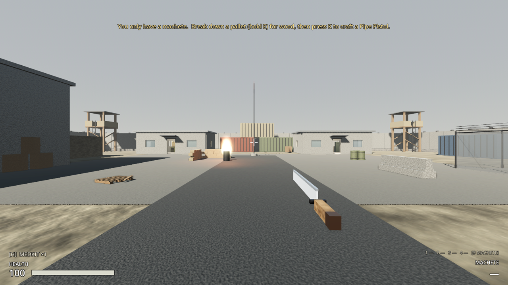
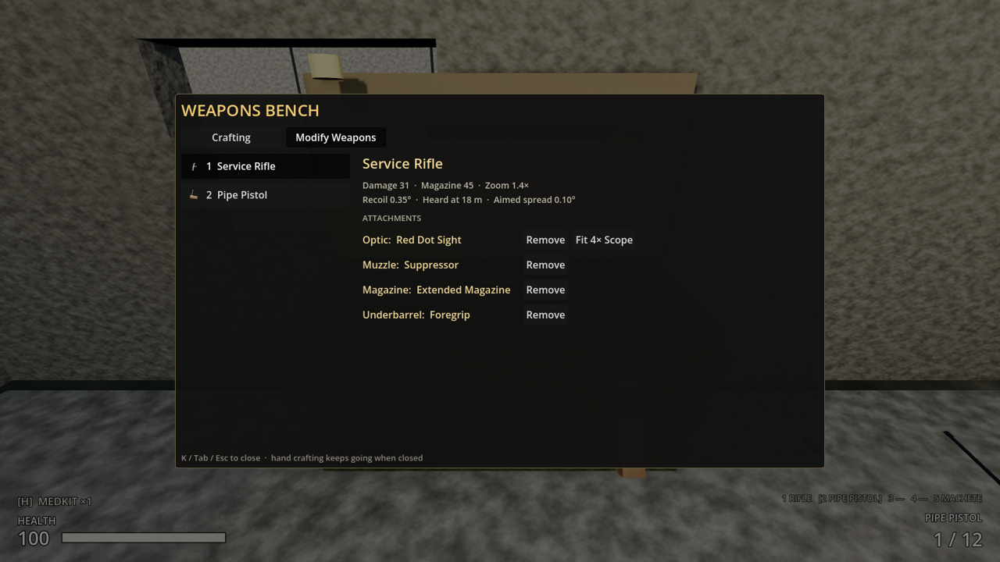
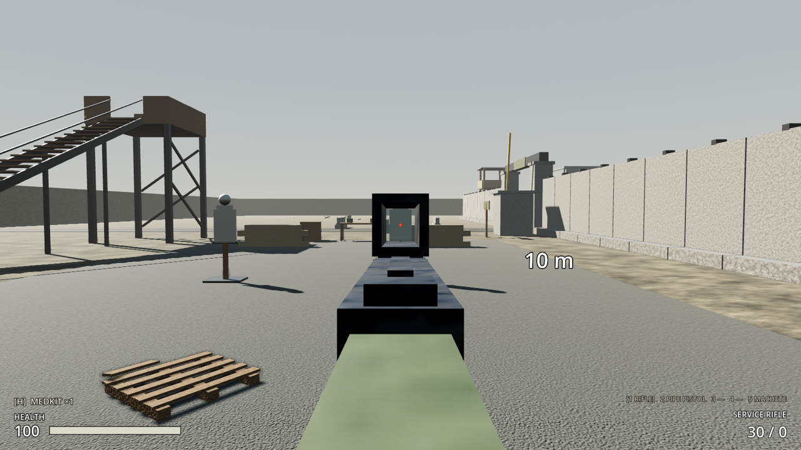
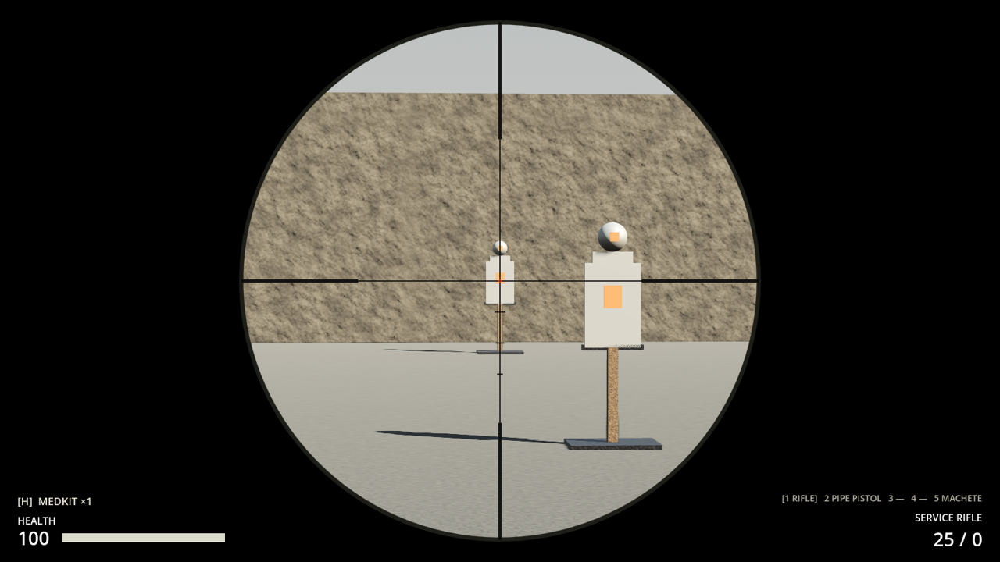

# Milestone 2, Increment 11 — Gun crafting, attachments and a new start

**Status:** complete. 221 automated tests pass in headless Godot 4.7, 12 of them new in `tests/test_gun_crafting.gd`. Older suites now use a `classic_kit()` helper (the rifle + pistol start) so they keep testing what they were written for.

A real-window run with injected key and mouse input checked:
- The game starts with only the **machete** and the first-minutes hint.
- Left click swings the machete and damages a range target.
- A held **E** broke down a pallet for wood, and the hint changed to "Press K".
- **K** → Pipe Pistol → Craft; the pipe pistol came out on its own when it was done, and the hint disappeared.
- Right click aimed the pipe pistol's nail sights; **5** and **2** switched between the machete and the pistol.
- **E** at the weapons bench, **Modify Weapons** tab: red dot, suppressor, foregrip and extended magazine fitted; the rifle showed all four and aimed through the red dot. The 4× scope swapped in and showed the scope overlay.

The tests caught one bug: loading a save clamped the magazine to the gun's *base* size, so an extended magazine lost 15 rounds on every load. Fixed.

**Playable result:**
- **New start:** a **machete** (slot 5) plus 4 scrap, 2 cloth, 12 pistol rounds and a medkit. A hint at the top of the screen tells you what to do: break down a pallet for wood, then press **K** and craft a **Pipe Pistol** (4 scrap + 1 wood, 6 s, by hand).
- **Machete:** hold left click to swing (85 a minute). 40 damage, about 1.9 m reach, a wide arc, no ammo, can't aim.
- **Pipe Pistol (slot 2):** single shot, 35 damage, 1.8 s reload, uses pistol ammo, crude nail sights.
- **Gun parts** (made at the weapons bench): barrel, receiver, stock, trigger group, magazine. Some are also found in lockers, crates and stashes, and two lie on the command-post floor.
- **Guns** are assembled from parts at the weapons bench:

| Gun | Slot | Parts |
|---|---|---|
| Sidearm Pistol | 2 | receiver, barrel, trigger group, magazine |
| Pump Shotgun | 3 | 2 barrels, receiver, stock, trigger group |
| Service Rifle | 1 | receiver, barrel, stock, trigger group, magazine, electronics |
| Marksman Rifle | 4 | receiver, barrel, stock, trigger group, 2 metal plates |

- A better gun replaces a worse one in the same slot (the pistol replaces the pipe pistol). You can't craft a worse one over a better one: "Your Sidearm Pistol is better".
- **Attachments** (made at the weapons bench; fitted and removed on its **Modify Weapons** tab):

| Attachment | Fits | Effect |
|---|---|---|
| Red Dot Sight | rifle, pistol, shotgun | replaces the iron sights; +15% zoom, 30% tighter aimed spread, 10% faster to aim |
| 4× Scope | rifle, marksman rifle | 4× zoom with the scope overlay; very tight aimed spread; slower to aim |
| Suppressor | pistol, rifle, marksman rifle | raiders hear shots at 30% of the distance; 8% less damage; small flash; 10% less recoil |
| Extended Magazine | pistol, rifle | +50% rounds (rifle 45, pistol 18); 10% slower reload |
| Foregrip | rifle, shotgun | 30% less recoil, 15% tighter hip-fire |

- Each attachment appears on the gun model. Fitting one where another already is swaps them, and the old one goes back into your bag. Attachments are saved with the gun.
- **Every gun now has iron sights.** The service rifle's red dot and the marksman rifle's scope became attachments; a 4× scope lies next to the marksman rifle up the tower.
- **The level:** the free shotgun in the command post is gone (a barrel and a trigger group are there instead). A service rifle lies out in raider country, east of the range.
- **Key 5** selects the machete. The weapon strip shows 5 slots.






> **After pulling:** open with **Edit** in the Project Manager (not Run). This update adds 2 new scripts.

---

## 1. Files

| File | Purpose |
|---|---|
| `scripts/combat/attachment_definition.gd` | **New.** `AttachmentDefinition` Resource: slot (OPTIC / MUZZLE / MAGAZINE / UNDERBARREL), compatible gun ids, model scene, and multipliers or overrides for zoom, aim time and spread, hip spread, recoil, magazine, reload, noise, damage and muzzle flash |
| `scripts/ui/gunsmith_panel.gd` | **New.** `GunsmithPanel`: the Modify Weapons tab (your guns, stats, Fit / Remove buttons) |
| `scripts/combat/hitscan_weapon.gd` | `base_definition` (shared) and `definition` (the effective stats with attachments); `fit_attachment`, `remove_attachment`, `recompute_stats`; attachment models on mounts; optional `%IronSights`; **melee** swings |
| `scripts/combat/weapon_definition.gd` | `tier` (crafting can't downgrade), `melee`, `melee_arc`, `melee_rays`; slot 1–5 |
| `scripts/combat/weapon_slots.gd` | 5 slots; attachments saved and loaded per gun |
| `scripts/inventory/item_definition.gd` | Categories PART and ATTACHMENT; `attachment` field |
| `scripts/inventory/item_database.gd` | `get_attachment(id)`, `find_attachment_item(id)` |
| `scripts/player/player_controller.gd` | `request_fit_attachment`, `request_remove_attachment`, `attachment_refusal_reason`, `weapon_refusal_reason` (tiers); crafted guns go into their slot; no aiming with a melee weapon |
| `scripts/ui/crafting_screen.gd` | Crafting / Modify Weapons tabs at the weapons bench |
| `scripts/ui/hud.gd` | First-minutes hint; "—" for melee ammo; denied sound for attachment refusals |
| `scripts/interaction/pickup.gd` | Weapon pickup prompt uses the tier rule |
| `resources/items/attachments/*_def.tres` | **New.** 5 attachment definitions |
| `resources/items/{gun_barrel, gun_receiver, gun_stock, trigger_group, gun_magazine}.tres` | **New.** Part items |
| `resources/items/{red_dot, scope_4x, suppressor, extended_mag, foregrip}.tres` | **New.** Attachment items |
| `resources/items/weapons/{machete, pipe_pistol, pipe_pistol_item, service_rifle_item}.tres` | **New.** |
| `resources/recipes/*.tres` | **15 new:** 5 parts, 5 guns, 5 attachments |
| `scenes/weapons/{machete, pipe_pistol}.tscn` | **New** first-person weapons |
| `scenes/weapons/attachments/*.tscn` | **New.** Attachment models (origin = the mount point; optics have a `Sight` marker) |
| `scenes/weapons/{service_rifle, pistol, shotgun, scoped_rifle}.tscn` | Iron sights grouped under `%IronSights`; `%OpticMount`, `%MuzzleMount`, `%UnderMount` markers |
| `scenes/player/player.tscn` | New start: machete; 4 scrap, 2 cloth, 12 pistol ammo, 1 medkit |
| `scenes/ui/hud.tscn` | `%HintLabel`; `%CraftTabs` (`%CraftTab`, `%ModifyTab`); recipe body renamed `%CraftBody`; `%GunsmithPanel` |
| `levels/outpost_17/outpost_17.tscn` | Command-post parts, tower scope, wasteland rifle |
| `resources/loot/*.tres` | Parts and attachments in loot tables |
| `tests/test_gun_crafting.gd` | **New.** 12 tests |
| `tests/test_case.gd` | `classic_kit()` for older suites |

## 2. Scene hierarchy

```
ServiceRifle (HitscanWeapon)
├── Model
│   ├── Receiver, Handguard, Barrel, Magazine, Stock …
│   ├── %IronSights           (hidden while an optic is fitted)
│   │   ├── RearL, RearR
│   │   └── FrontPost
│   ├── %SightAnchor          (rear sight: the eye lines up here on irons)
│   ├── %OpticMount           (attachment models are instanced here)
│   ├── %MuzzleMount
│   ├── %UnderMount
│   └── Muzzle/MuzzleFlash
└── ShotSound, ReloadSound …

RedDot (attachment model, origin = the mount)
├── Top, Bottom, Left, Right, Base, Lens, Dot
└── Sight                     (Marker3D: where the eye lines up when aiming)

HUD/Root/CraftingScreen/Window/Layout
├── Header …
├── %CraftTabs                (weapons bench only)
│   ├── %CraftTab             "Crafting"
│   └── %ModifyTab            "Modify Weapons"
├── %CraftBody                (the recipe list and details, as before)
└── %GunsmithPanel (GunsmithPanel)
    ├── %GunList              (one button per gun you own)
    └── GunDetail
        ├── %GunTitle, %GunStats
        ├── AttachTitle
        ├── %AttachmentSlots  (a row per slot: fitted / Remove / Fit X)
        └── %GunStatus        (red refusal text)
```

## 3. Key points

- **Shared vs effective stats:** every gun of a type shares one `WeaponDefinition` Resource. With no attachments, `definition` *is* that shared Resource. When an attachment is fitted, `recompute_stats()` makes a private copy and applies the attachments to it, so one player's suppressor never quietens anyone else's rifle. `base_definition` always points at the shared one: compare guns by `base_definition.id`.
- **Server authority:** fitting and removing go through `request_fit_attachment` / `request_remove_attachment`, which check: alive, at a weapons bench, gun in that slot, item carried, attachment fits that gun, room in the bag for whatever comes off. The UI only calls these; it never touches the gun directly.
- **Tiers:** a crafted or found gun replaces a lower-tier gun in its slot. Crafting a lower tier is refused before any materials are used. Picking one up turns it into its ammo ("Take ammo from …").
- **Melee is a weapon:** the machete is a `HitscanWeapon` with `melee = true`. It fans rays across `melee_arc` from the centre outwards and hits the first `HealthComponent` in reach. It has no magazine, can't aim or reload, and the respawn top-up skips it.
- **Magazine changes:** a bigger magazine starts empty for the extra rounds. Removing an extended magazine puts the extra rounds back into the pack. Loading a save restores attachments first, then the magazine.
- **Aiming with optics:** `get_sight_node()` returns the fitted optic's `Sight` marker, or `%SightAnchor` on iron sights. The aim pose lines that point up with the camera, so any optic lines up without per-gun tuning.
- **Save data:** each gun in the loadout saves `"attachments": ["red_dot", …]`. Unknown ids, and attachments that don't fit that gun, are skipped. Older saves without the field load bare guns.

## 4. Input Map

| Action | Key |
|---|---|
| `weapon_5` | **5** (machete) |

## 5. Recipes

| Recipe | Where | Inputs | Time |
|---|---|---|---|
| Pipe Pistol | by hand | 4 scrap, 1 wood | 6 s |
| Gun Barrel | weapons bench | 2 metal pipes | 4 s |
| Receiver | weapons bench | 2 metal plates, 1 spring | 5 s |
| Gun Stock | weapons bench | 2 wood planks | 3 s |
| Trigger Group | weapons bench | 2 springs, 1 scrap | 3 s |
| Magazine | weapons bench | 1 metal plate, 1 spring | 3 s |
| Sidearm Pistol | weapons bench | receiver, barrel, trigger group, magazine | 8 s |
| Pump Shotgun | weapons bench | 2 barrels, receiver, stock, trigger group | 10 s |
| Service Rifle | weapons bench | receiver, barrel, stock, trigger group, magazine, electronics | 12 s |
| Marksman Rifle | weapons bench | receiver, barrel, stock, trigger group, 2 metal plates | 12 s |
| Red Dot Sight | weapons bench | 2 electronics, 1 metal plate | 5 s |
| 4× Scope | weapons bench | 2 electronics, 1 metal pipe, 1 metal plate | 7 s |
| Suppressor | weapons bench | 1 metal pipe, 2 cloth, 1 metal plate | 6 s |
| Extended Magazine | weapons bench | 2 magazines, 1 spring | 5 s |
| Foregrip | weapons bench | 1 wood plank, 1 scrap | 3 s |

Metal plates, pipes, springs and planks come from the workbench (Increment 10).

## 6. Signals

| Signal | Emitted by | Connected to |
|---|---|---|
| `attachment_refused(reason)` | PlayerController | GunsmithPanel (red status), HUD (denied sound) |
| `attachments_changed` | HitscanWeapon | (available for the HUD and future network replication) |
| `weapon_picked_up(def)` | PlayerController | now also emitted when a gun is crafted (HUD notice, sound) |

## 7. Editor assembly (by hand)

1. **A new attachment:**
   - Make a model scene whose origin is where it sits on the mount. An optic needs a `Sight` Marker3D where the eye should line up.
   - New Resource → **AttachmentDefinition**: set Id, Slot, Compatible (gun ids), Model Path and the multipliers.
   - New Resource → **ItemDefinition**: Category ATTACHMENT, Attachment = the definition, plus a world model and icon.
   - Add a recipe at the weapons bench.
2. **Mounts on a gun:** add Marker3D nodes under `Model` named `OpticMount`, `MuzzleMount` and `UnderMount`, each with **Access as Unique Name**. Group the iron sights under a Node3D named `IronSights` (unique name) so they hide under an optic.
3. **A new melee weapon:** a WeaponDefinition with Melee on, Max Range as the reach, a short Draw Time, and Magazine Size 0. Give its scene a `%MeleeHitSound` AudioStreamPlayer3D.
4. **Starting kit:** Player → WeaponSlots → Starting Weapons, and Player → Inventory → Starting Items.

## 8. Testing

**Automated** (`-- test_gun_crafting`):
- **Data:** every part and attachment has an icon, model and recipe. Every optic model has a `Sight` marker. Every gun an attachment claims to fit has the matching mount. Each gun has exactly one recipe, at the right place. Tiers: pipe < pistol < rifle.
- **New start:** only the machete (slot 5, in hand); 4 scrap, 2 cloth, 12 pistol rounds, a medkit. The pipe pistol needs only "Missing 1 Wood". No aiming or reloading with the machete.
- **Machete:** 40 damage at 1.3 m with one hit marker; holding keeps swinging; nothing at 3 m; no ammo used.
- **Pipe pistol by hand:** made in 6 s; scrap and wood used; slot 2; drawn straight away; 1 loaded with 12 in the pack; 35 damage; one shot; can't craft a second.
- **Parts → pistol:** refused by hand; at the weapons bench it replaces the pipe pistol and uses the parts; the pipe pistol is then refused ("Your Sidearm Pistol is better").
- **Part recipe:** 2 pipes → 1 barrel.
- **Effects:** suppressor noise and damage; foregrip × suppressor recoil; red dot zoom; scope replaces the red dot and gives 4× with the overlay; extended magazine 45, and removing it returns 15 rounds; the shared rifle definition never changes; a bare gun uses the shared definition again.
- **Models:** irons on a bare rifle; optic, suppressor and grip models shown, irons hidden; aiming uses the optic's `Sight`; irons return when the optic comes off.
- **Fit / remove rules:** refused away from a bench; red dot fitted and used up; "Doesn't fit the Sidearm Pistol" for a scope; swapping returns the red dot; "You don't have a 4× Scope"; remove returns it; "Nothing fitted there".
- **Saves:** extended magazine + suppressor restored with 40 of 45 rounds; bad ids skipped; loading replaces what was fitted.
- **UI:** tabs at the weapons bench; Modify Weapons lists 2 guns with the rifle selected; "Fit Red Dot Sight" works; back to recipes.
- **Hint:** "pallet" with no wood, "Press K" with wood, gone once you have a gun; the ammo label shows "—" for the machete.

**Manually:**
1. F5. You have only a machete; read the hint. Swing at a range target.
2. Break down a pallet inside the warehouse door (hold E). Press **K**, select **Pipe Pistol**, Craft. When it's done, it's in your hand.
3. Pick up the barrel and trigger group in the command post, make the rest of a pistol's parts at the benches, and assemble the **Sidearm Pistol** at the weapons bench.
4. Fetch the service rifle east of the range (raiders!). At the weapons bench, open **Modify Weapons** and fit what you've crafted or found. Aim through it.
5. Climb the north-west tower for the marksman rifle and the 4× scope, and fit the scope at the bench.
6. F5 save, F9 load: attachments stay on.

## 9. Troubleshooting

| Symptom | Fix |
|---|---|
| No Modify Weapons tab | It only shows at the **weapons bench** (command post), not at the workbench or with K. |
| "Doesn't fit the …" | Each attachment fits certain guns only (see the table above). |
| A crafted gun is refused | You already have that gun, or a better one in the same slot. |
| Can't aim with the machete | Melee weapons don't aim. Press 2 for the pipe pistol once you've made it. |
| Attachments missing after loading an old save | Saves from before this update have no attachment data; fit them again. |
| "Could not find type AttachmentDefinition" | Stale class cache: open with **Edit**, not Run. |

## 10. How this connects to future systems

- **Construction (#12):** the same recipe and station system with a new output kind: a structure you place (barricades, walls, gates) instead of an item.
- **First new region (#10):** rarer parts and attachments in a raider camp; better loot tables per region.
- **Co-op:** `request_fit_attachment` / `request_remove_attachment` become server RPCs; the gun's attachment ids are replicated so everyone sees your scope and suppressor.
- **More gear:** new attachments are data only (a definition, an item, a model, a recipe); new guns just add mounts.
