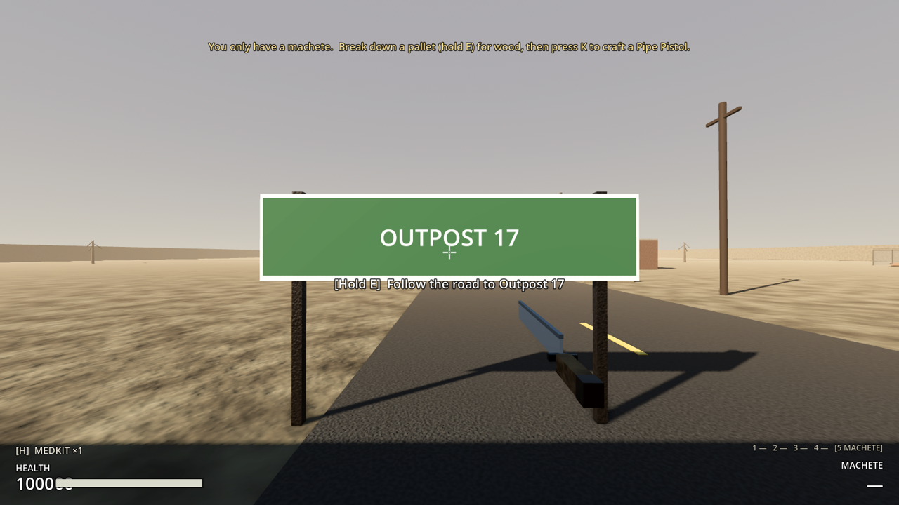
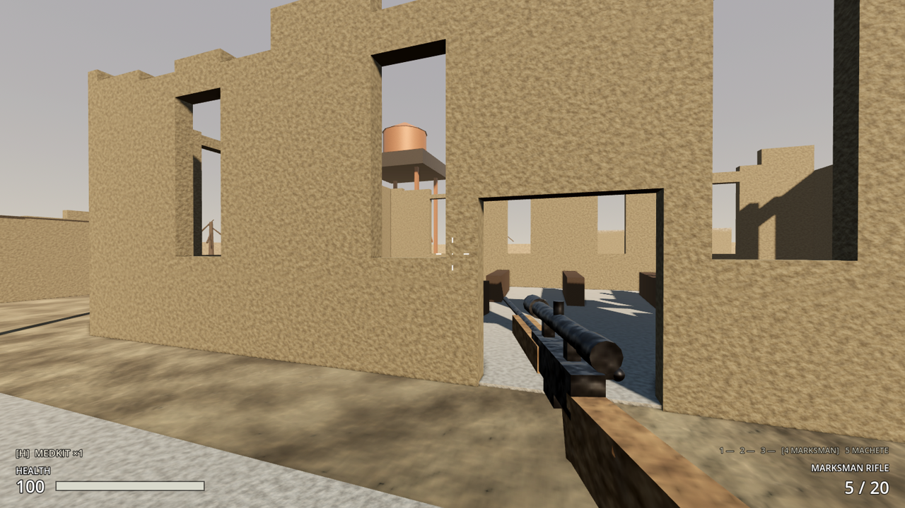
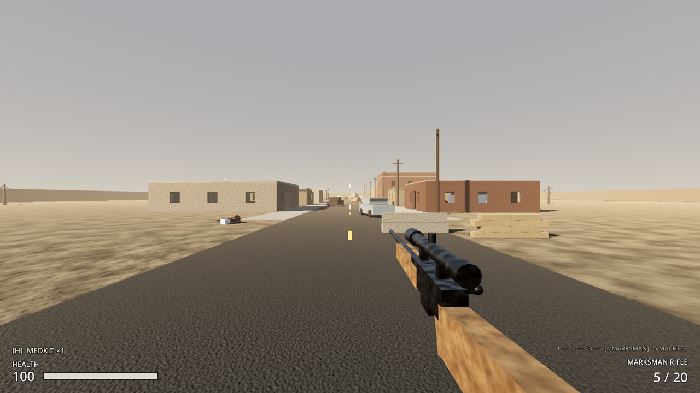
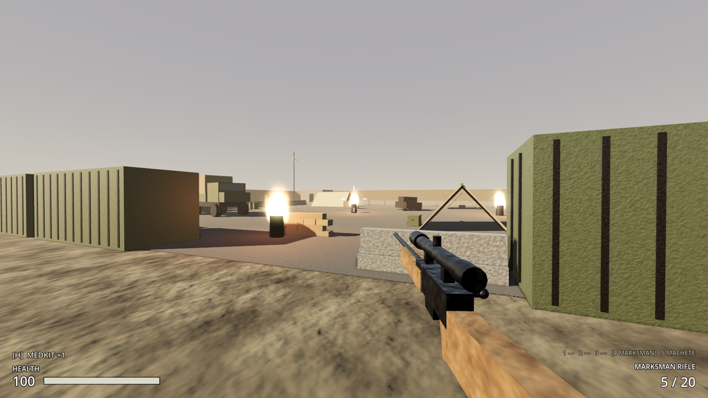
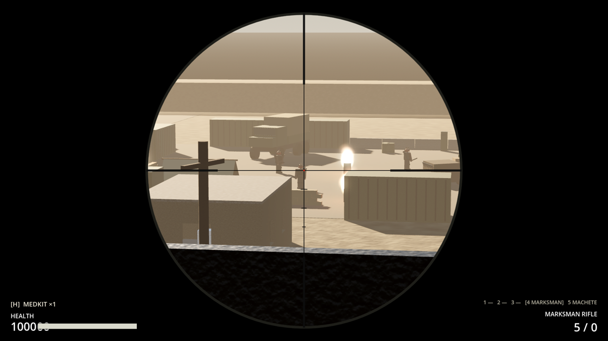

# Milestone 2, Increment 12 — Regions, road travel and Halden's Crossing

**Status:** complete. 233 automated tests pass in headless Godot 4.7, 12 of them new in `tests/test_regions.gd`. One of them holds E at the outpost's road sign and goes through the real scene change.

A real-window run with injected key and mouse input checked the whole loop:
- A held **E** at the outpost's road sign started travel. The game faded out and opened Halden's Crossing, carrying 3 electronics and the marksman rifle with its 4× scope.
- **W** walked down Main Street and into the church. Holding W climbed the water-tower ladder to the 9.1 m deck, and **4** + right click aimed the scope at the raider camp, with veterans walking about inside.
- **F5** saved in town, then the road sign took the player home to Outpost 17. **F9** loaded straight back into the town at the saved spot. The scrap taken before saving was still gone, and the outpost was still remembered.

The tests and the playtest caught several problems, all fixed:
- A counter blocked the General Store's doorway.
- A fallen roof slab overlapped a chest, a pallet and a pickup.
- The hotel's inside ladder stood against a wall, so you couldn't step off at the top. It now stands at the edge of the floor hole.
- Ruined church walls left window lintels floating in the air.
- The first road sign was white on white and hard to read.
- The test runner silently skipped a suite that failed to parse; it now counts that as a failure.

**Playable result:**
- **A second region: Halden's Crossing**, a ruined town reached by the road south out of Outpost 17. Follow the main road past the gate to the end (by the berm), look at the road sign and **hold E for 1 s**: "Follow the road to Halden's Crossing". The screen fades, and you arrive at the north end of the town's Main Street.
- **You keep everything:** health, inventory, guns, attachments and what's in each magazine.
- **Each region remembers its state.** Crates you've searched stay searched with whatever you left in them; pickups you took stay gone; things you dropped stay where they fell; broken-down pallets stay gone. Raiders are not remembered: they come back when you return.
- **Travel is refused** while raiders are chasing you ("Raiders are on your tail"), while you're crafting, or when you're dead.
- **The way home:** a road sign at the north end of town, "Follow the road to Outpost 17". You arrive on the outpost's south road.
- **Saves** (F5 / F9) now include every region's state. A save made in the town loads straight into the town, and still remembers what you looted at the outpost.

**The town:**
- **Main Street** (north–south) and the **Cross Street** (east–west), lined with ruined buildings you can walk into: General Store, two houses, the **two-storey Hotel**, Garage, Diner, Bank, Clinic, Feed Store, a burned-out **Church**, and a gas station with a kiosk. Some roofs have fallen in; ruined walls are broken down to different heights.
- **Close quarters** (good for the shotgun): shop interiors with counters, shelves, booths and pews for cover.
- **Long sightlines** (good for the marksman rifle):
  - The **Hotel roof**: an exterior ladder on its west wall, a parapet to crouch behind. Its upstairs is reached by an inside ladder.
  - The **water tower** west of the church (9 m): a ladder on its south side, a deck all the way round.
  - From both, the raider camp is 70–80 m away.
- **The raider camp** (south-east of the crossing): a yard walled with shipping containers, jersey barriers and sandbags, with gates on the north and west. Tents, a truck, fire barrels and **4 Raider Veterans**: 170 HP, harder hits, quicker, sharper senses, and they always drop something (ammo, electronics, gun parts). They respawn slowly (2 minutes).
- **3 ordinary raiders** roam the outskirts.
- **Two outskirts ruins:** a burned farmhouse (north-west) and a radio relay shack under a mast (south-east).

**Loot (crafting materials in bulk):**
- **21 containers** with 7 new loot tables, including:
  - **Raider Cache:** always a gun barrel and trigger group, plus ammo, electronics and a chance of attachments.
  - **Sniper's Stash** on the water tower and the **Rooftop Stash** on the hotel: always .308 rounds, maybe a 4× scope or suppressor.
  - **Bank Safe:** always 3 electronics and a gun receiver.
  - **Medicine Cabinet** in the clinic: always a medkit.
  - Others: household chests, store crates, a garage tool chest and parts bin.
- **23 salvage piles:**
  - New **Scrap Heaps** (6 scrap + a metal pipe).
  - New **Busted Appliances** (2 electronics, 2 scrap, a spring).
  - Pallets and furniture for wood.
- **24 pickups:** fuel at the gas station and garage, chemicals and a medkit in the clinic, electronics in the bank, ammo in the camp, .308 upstairs in the hotel.







> **After pulling:** open with **Edit** in the Project Manager (not Run). This update adds 2 new scripts and a new autoload, **WorldManager**.

---

## 1. Files

| File | Purpose |
|---|---|
| `scripts/core/world_manager.gd` | **New autoload `WorldManager`.** Travel (validation, fade, scene change, arrival), per-region state in memory (`region_states`), `capture_region` / `enter_region`, the regions part of the save |
| `scripts/interaction/region_exit.gd` | **New.** `RegionExit` (Interactable): a road sign; hold E to travel. Target level, arrival id and destination name |
| `scripts/persistence/save_manager.gd` | Save **version 2**: `"regions"`; version 1 saves are migrated |
| `scripts/ui/hud.gd` | "Arrived at …" notice; travel refusals shown with the denied sound |
| `tests/test_runner.gd` | A suite that fails to load (parse error) now counts as a failure instead of being skipped silently |
| `levels/haldens_crossing/haldens_crossing.tscn` | **New level** (plus `_environment.tres`, `_navmesh.tres`) |
| `levels/outpost_17/outpost_17.tscn` | `Arrivals/FromHaldens` marker and the `Exits/RoadToHaldens` sign; `region_name` meta |
| `scenes/world/region_exit.tscn` | **New.** The road sign |
| `scenes/enemies/raider_veteran.tscn` | **New.** Inherits `raider.tscn`: tougher, dark armour with a chest plate, red bandana |
| `scenes/world/salvage/{scrap_heap, appliance_pile}.tscn` | **New** salvage piles |
| `resources/loot/{town_household, town_supplies, garage_parts, clinic_cabinet, raider_camp_cache, sniper_stash, bank_safe}.tres` | **New** loot tables |
| `assets/materials/{brick, plaster, soot, rust, wood_charred, tent_canvas}.tres` | **New** materials (tinted from existing ones) |
| `project.godot` | Autoload `WorldManager` (before `SaveManager`) |
| `tests/test_regions.gd` | **New.** 12 tests |

## 2. Scene hierarchy

```
HaldensCrossing (Node3D, meta region_name = "Halden's Crossing")
├── Lighting (WorldEnvironment with dust fog, low sun)
├── Terrain (ground + berms)                         [navigation_geometry]
├── Surfaces (streets, sidewalks, lots: visual only)
├── Buildings (StaticBody3D per building)            [navigation_geometry]
│   └── Hotel → walls per floor, Slab1A/B, InnerLadder1, Roof, Parapet*, RoofLadder
├── Furniture, Street, RaiderCamp, WaterTower, GasStation  [navigation_geometry]
├── CampFires (burning barrels)
├── SalvageContainers (21)  ·  SalvagePiles (23)  ·  Loot (24 pickups)
├── Arrivals
│   └── FromOutpost (Marker3D: where you arrive from Outpost 17)
├── PlayerSpawn (respawn point = the north road)
├── Exits
│   └── RoadToOutpost (RegionExit)
├── Player · HUD · GameMode · Navigation
├── RaiderSpawner (3 raiders, outskirts)
├── CampSpawner (4 Raider Veterans, inside the camp)
└── Ambience (wind)

RegionExit (Area3D, region_exit.gd, layer 5)
├── Shape
├── Body (StaticBody3D: posts, board, arrow)
├── %SignText (Label3D, front)  ·  SignTextBack
```

## 3. Key points

- **Region = level scene.** `WorldManager.capture_region(root)` runs SaveManager's `build_save_data` on the level you're leaving, keeps everything but the player in `region_states[level path]` and returns the player's data. `enter_region(root, player_data, arrival_id)` applies the remembered state to the new level with SaveManager's `apply_save_data` (so taken pickups are removed and dropped ones recreated, exactly as loading does), then loads the player's data with the position and facing replaced by the arrival marker's.
- **Same contract as saving:** anything in the `persist` group with `save_state` / `load_state` is remembered per region automatically. There's no new per-object code.
- **Arrival markers** live under `Arrivals/` and are named; a RegionExit names the one to use. If it's missing, the level's `PlayerSpawn` is used.
- **Authority:** `RegionExit` only asks. `WorldManager.request_travel` re-checks everything (`travel_refusal_reason`). In co-op this runs on the host, which will move the whole party.
- **Input is frozen** during the fade and handed back when the new region is visible.
- **Save version 2:** `"regions"` holds the other regions' node entries (the current region is in `"nodes"` as before). Loading replaces the remembered regions with the save's. Unknown or non-`res://` level keys are ignored.
- **Raider veterans** are an *inherited scene*: changes to `raider.tscn` (AI, sounds) flow into them automatically.
- **The level is generated** by a builder script (kept out of the repo) and baked headless. Every building is a StaticBody3D whose walls are split around door and window openings. Ruined walls are cut into chunks of different heights, but never below the tops of their openings, so nothing floats.

## 4. Input Map

No new actions. Travel uses **E** (hold 1 s) on the road sign.

## 5. Loot tables

| Table | Rolls | Guaranteed | Highlights |
|---|---|---|---|
| `town_household` | 1–3 (15% empty) | — | cloth, bandages, chemicals, a little ammo |
| `town_supplies` | 2–4 | — | scrap, cloth, electronics, chemicals, fuel, springs |
| `garage_parts` | 2–4 | — | scrap, pipes, springs, fuel, plates, maybe a barrel or trigger group |
| `clinic_cabinet` | 2–3 | medkit | bandages, chemicals |
| `raider_camp_cache` | 3–5 | gun barrel, trigger group | rifle/shotgun/.308 ammo, electronics, receiver, magazines, attachments, gunpowder |
| `sniper_stash` | 1–2 | 10–15 .308 | 4× scope, suppressor, medkit |
| `bank_safe` | 2–3 | 3 electronics, gun receiver | red dot, extended magazine, pistol ammo |

## 6. Signals

| Signal | Emitted by | Connected to |
|---|---|---|
| `travel_started(destination)` | WorldManager | (tests; later: party travel in co-op) |
| `arrived(region_name)` | WorldManager | HUD ("Arrived at Halden's Crossing") |
| `travel_refused(reason)` | WorldManager | HUD (red notice + denied sound) |

## 7. Editor assembly (by hand)

1. **A new region:**
   - Make a level scene with the usual Player, HUD, GameMode, PlayerSpawn and navigation.
   - Add a Node3D named `Arrivals` with a Marker3D per road in, pointing the way the player should face.
   - Add the metadata `region_name` (String) on the root.
2. **A road between two regions:**
   - Instance `scenes/world/region_exit.tscn` near the map edge in each level, under `Exits`.
   - Set **Target Level**, **Arrival Id** (the marker name in the other level) and **Destination Name**.
3. **Autoload:** Project Settings → Globals → `WorldManager` = `res://scripts/core/world_manager.gd`, listed before `SaveManager`.
4. **A tougher enemy:** right-click `raider.tscn` → New Inherited Scene, then change the exported values, the HealthComponent's Max Health and the materials.

## 8. Testing

**Automated** (`-- test_regions`):
- **Links:** both levels have a road out to the other, and the arrival markers they name exist. Region names are "Outpost 17" and "Halden's Crossing".
- **Veterans and loot:**
  - Veterans have at least 1.5× a raider's health, hit harder and always drop loot.
  - All 7 tables use registered items, and the raider cache always has a barrel and a trigger group.
- **Round trip** (no scene change):
  - At the outpost: take a pickup, search a crate, then travel.
  - In town: you arrive at the north road with the rifle, the machete, 3 electronics and 63 health. Take cloth, break a pallet, travel back.
  - At the outpost: you're on the south road, the pickup is still gone, and the crate is searched with the same contents. You have the pallet's wood.
  - Back in town: the cloth and the pallet are still gone, and untouched loot is still there.
- **Refusals:** "The road is blocked", "Finish crafting first", "Raiders are on your tail" (a raider alerted 8 m away) and "Can't travel now" (dead).
- **Real travel:**
  - The outpost is made the current scene, and the player looks at the sign and holds E.
  - 20 ticks does nothing. At 70 ticks travel starts.
  - Halden's Crossing becomes the current scene. You're at the north road with your items, and controls are handed back.
- **Save in town:**
  - Version 2 with the outpost in `"regions"`.
  - After forgetting everything and loading, your position is back and the outpost is remembered again. Going home applies it.
  - A version-1 save validates and migrates.
- **Containers:** 20+, clear of walls and props, standing on a floor and searchable from the front.
- **Reachable:**
  - Every ground-level container has a navmesh path from the north road.
  - The 3 high ones (hotel roof, hotel upstairs, water tower) each have a ladder up to their floor.
- **Placement:** 20+ salvage piles, all clear, with 6+ scrap heaps. Every pickup rests on something and isn't inside anything.
- **Climbing:** a player holding W climbs the water tower ladder (9.1 m), the hotel roof ladder (6.7 m) and the hotel's inside ladder (3.3 m) and steps off onto the floor at the top.
- **Doors:** walking straight in through the doors of the General Store, Hotel, Garage and Church.
- **Spawns:** 4 veterans inside the camp walls and 3 raiders around the town.

**Manually:**
1. F5. Walk out of the gate and south down the road to the sign by the berm. Hold E.
2. Walk down Main Street. Go into the shops; climb the hotel (inside ladder to upstairs, outside ladder to the roof).
3. Climb the water tower west of the church, aim the marksman rifle (with the 4× scope) at the camp.
4. Fight into the camp through the north or west gate; open the Raider Cache in the south-east corner.
5. F5 in town. Walk back to the north sign and travel home: your outpost is as you left it. F9: you're back in town.

## 9. Troubleshooting

| Symptom | Fix |
|---|---|
| "Identifier WorldManager not declared" or the game won't start | Stale class cache or a missing autoload: open with **Edit**, and check Project Settings → Globals lists WorldManager. |
| The sign says "Raiders are on your tail" | A raider is chasing you within 25 m. Lose them or kill them first. |
| Arrived in the wrong place | The exit's Arrival Id must match a Marker3D name under the target level's `Arrivals`. |
| Loot came back after travelling | Only nodes in the `persist` group are remembered (containers, pickups, salvage piles). Raiders always respawn. |
| An old save loads at the outpost with nothing remembered elsewhere | Saves from before this update only know one region. Save again. |

## 10. How this connects to future systems

- **Co-op (Milestone 3):** the host decides travel for the whole party. `capture_region` / `enter_region` already work on any level root, so the host can keep several regions' state while guests load the new level.
- **Settlements:** the open ground around Halden's Crossing (and the farmhouse and relay shack) is where the first settlement can be claimed. Settlement state will use the same per-region `persist` contract.
- **Construction (#12):** barricades and walls you build are `persist` nodes, so they'll be remembered per region with no extra work.
- **More regions:** a new level, a pair of road signs and named arrival markers. `WorldManager` doesn't need to change.
