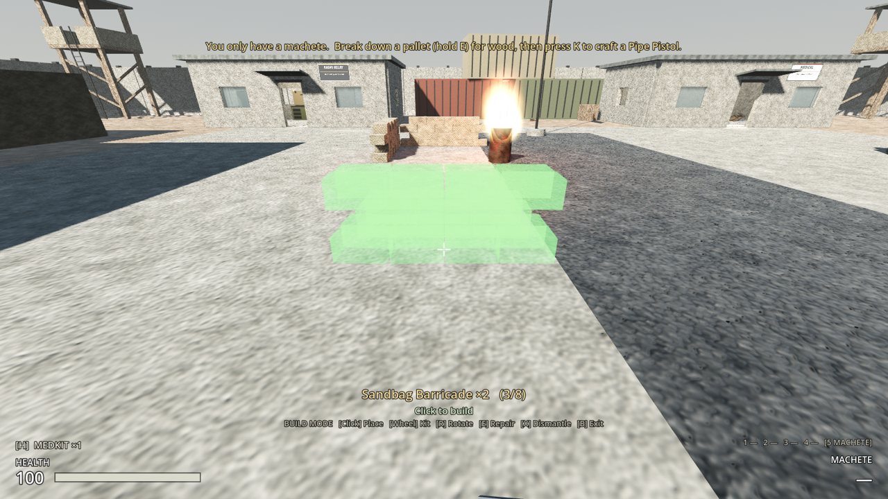
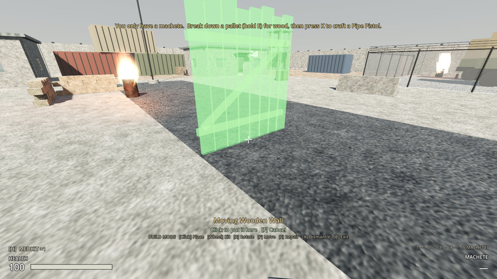
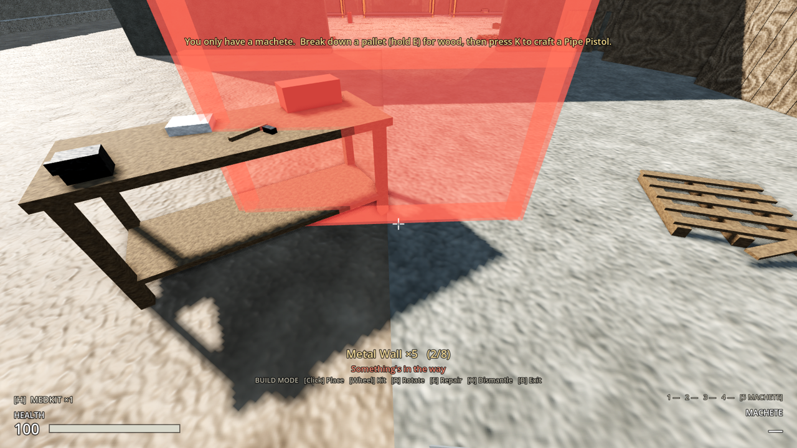
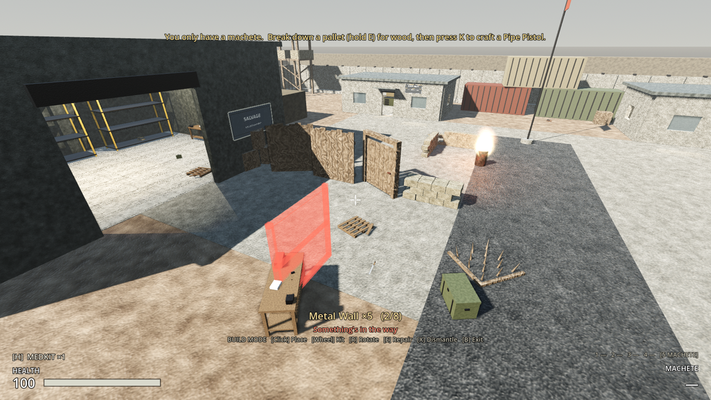
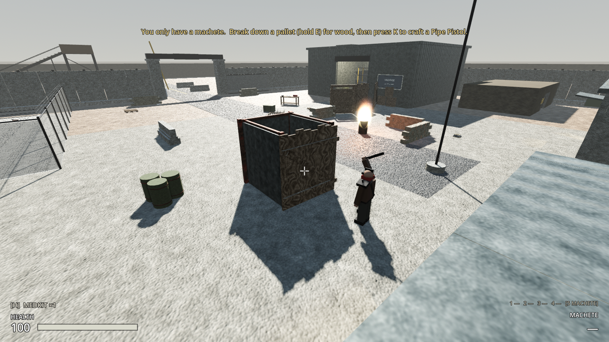
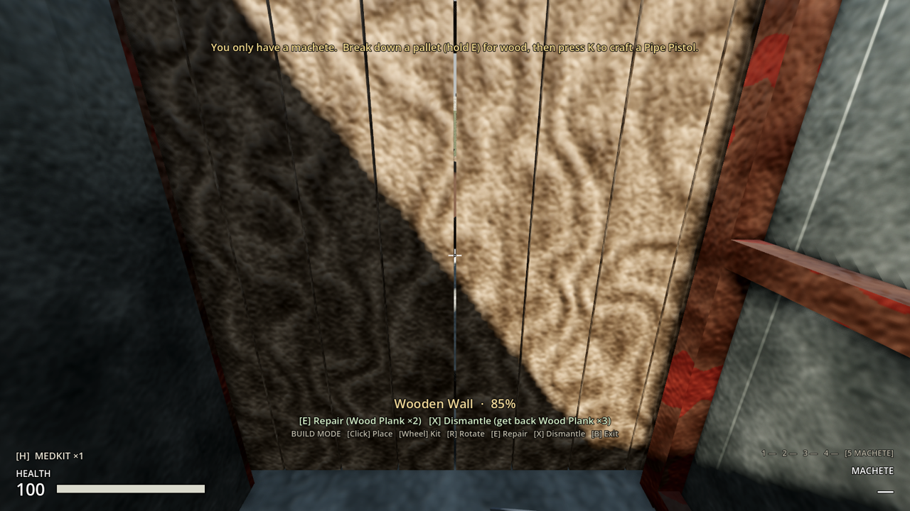
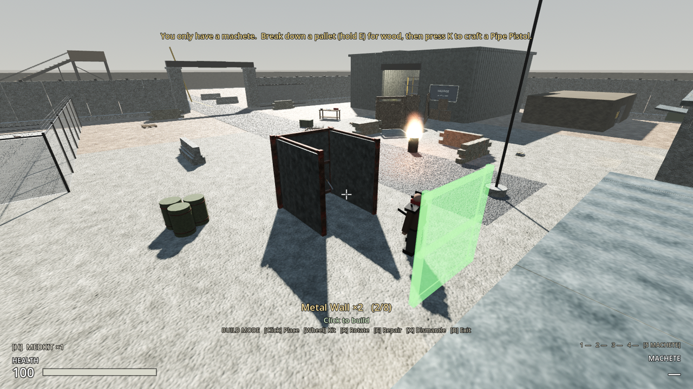

# Milestone 2, Increment 13 — Construction

**Status:** complete. 266 automated tests pass in headless Godot 4.7, 21 of them new in `tests/test_construction.gd`.

**Update: moving and undo.** In build mode, look at something you've built and press **F** to pick it up: it becomes the ghost (keeping its damage and anything stored in it). Aim, rotate with **R** and click to put it down, or press **F** again (or **B**) to leave it where it was. Dismantling something within **30 seconds** of placing it, while it's undamaged, gives the **kit** back instead of materials. You can also enter build mode with no kits, to move, repair or dismantle what's already built. A real-window run placed a wall, picked it up with F, moved and rotated it, put it down, and dismantled it.

A real-window run at Outpost 17, with injected key and mouse input, checked the whole loop:
- **B** entered build mode with 8 kinds of kit. A green ghost followed the crosshair, and a click built a sandbag barricade.
- **R** rotated the ghost 15° each press, and **Shift+R** rotated it back.
- **]** picked the next kit. Clicks built two wooden walls, a gate, a spike trap, a storage crate and a field workbench. A ghost pushed against the bench turned red: "Something's in the way".
- Four walls were built round the player and a raider was set on them. It couldn't path in, so it hacked at the wooden wall. Looking at the wall showed "Wooden Wall · 85%  [E] Repair (Wood Plank ×2)  [X] Dismantle (get back Wood Plank ×3)". The raider kept going until the wall broke.
- **F5**, everything was removed, then **F9**: all 10 structures came back in place.

The tests and the playtest caught several problems, all fixed:
- The stuck check measured the speed a raider was *trying* to move, not how fast it actually moved. Pressed against a wall, it never counted as stuck.
- Raiders gave up on a wall as soon as it hid you from sight, and drifted from wall to wall. They now stick with one wall until it breaks, unless a way round opens.
- Kits weighed more than the materials they're made from, so you could be refused a craft for being overweight. Every kit now weighs no more than its materials, and a test checks this.
- A crate-sized prop under the ghost was reported as "The ground is too uneven". Obstacles are now checked first, so it says "Something's in the way".
- Spike traps had no body, so build mode couldn't target them to repair or dismantle. They now have one that only build mode and placement see; you still walk into them.
- Shift+R didn't reverse with some input devices. It now reads the key event's own Shift flag.

**Playable result:**
- **Craft structure kits** (K): 4 by hand, 4 at a workbench (they're in a new **Structures** category).
- **Press B** to enter build mode, holding any kit. A see-through **ghost** shows where it will go: green if it fits, red with the reason if not. The panel at the bottom shows the kit, how many you have and what's possible where you look.
  - **Click:** build it (uses one kit).
  - **Mouse wheel** or **[ ]:** choose the kit. One Magic Mouse swipe = one step.
  - **R:** rotate 15°; **Shift+R** the other way.
  - **B** again (or opening the inventory, dying, or climbing a ladder) leaves build mode. Running out of kits does too.
- **Look at something you've built** (in build mode) to see its health. **F** picks it up to move it (click to put it down, F to cancel); **E** repairs it to full for a few materials; **X** dismantles it and gives some materials back. Within 30 s of placing it, undamaged, X gives the kit back instead (an undo).
- **Raiders path around what you build:** the navmesh is rebaked a moment after you place, break or remove something. When you've **walled them out** completely, they **hack through**. A raider picks the wall in its way, keeps hitting it until it breaks, then comes in. Walls take 10–45 hits.
- **Everything you build is saved** (F5 / F9) with its position, rotation and damage, and each region remembers its own structures when you travel.
- Your bullets don't damage your own walls.

**The structures:**

| Structure | Health | Recipe | Made | Repair | Dismantle returns |
|---|---|---|---|---|---|
| **Sandbag Barricade** (2.4 m, waist high) | 300 | 4 cloth, 1 scrap | by hand | 1 cloth | 2 cloth |
| **Wooden Barricade** (2.4 m, chest high) | 200 | 3 planks, 1 scrap | by hand | 1 plank | 1 plank |
| **Wooden Wall** (2.4 × 2.6 m) | 400 | 6 planks, 2 scrap | workbench | 2 planks | 3 planks |
| **Metal Wall** (2.4 × 2.6 m) | 900 | 4 plates, 2 planks, 2 scrap | workbench | 1 plate | 2 plates, 1 plank |
| **Wooden Gate** (2.4 × 2.6 m) | 450 | 6 planks, 1 spring, 2 scrap | workbench | 2 planks | 3 planks, 1 spring |
| **Spike Trap** (1.6 m square) | 100 | 2 planks, 3 scrap | by hand | 1 plank, 1 scrap | 1 plank |
| **Storage Crate** | 250 | 4 planks, 2 scrap | workbench | 1 plank | 2 planks |
| **Field Workbench** | 300 | 6 planks, 2 plates, 2 springs, 4 scrap | by hand | 1 plank, 1 scrap | 3 planks, 1 plate |

- **Gate:** E on its handle opens and closes it (the door swings 100°). It won't swing shut on someone standing in it. Raiders can't open it; they break it.
- **Spike trap:** raiders who step in take 25 damage, once a second while they stay in it. Each hit wears the trap down by 10, so it breaks after about ten. It doesn't hurt you, and raiders don't know to avoid it.
- **Storage crate:** an empty container that keeps what you put in it (saved with the region). It can only be dismantled when empty.
- **Field workbench:** works exactly like the warehouse workbench, so you can make walls, components, ammo and medkits wherever you set up. It can't be dismantled while someone is using it.

**Where you can't build** (the ghost says why):
- "Too far away": more than 6 m from your eyes to the structure's centre.
- "Something's in the way": walls, props, people, raiders, loot, containers, benches, signs or other structures.
- "Can't build on another structure": no stacking.
- "Needs solid ground" / "The ground is too uneven": the centre and four corners must be on ground within 0.35 m of each other.
- "Keep the road in clear": within 3.5 m of a spawn point, an arrival point or a road sign.
- "Too many structures here": 80 per region.









> **After pulling:** open with **Edit** in the Project Manager (not Run). This update adds 10 new scripts.

---

## 1. Files

| File | Purpose |
|---|---|
| `scripts/construction/structure_definition.gd` | **New.** `StructureDefinition` (Resource): id, name, scene, max health, footprint, blocks navigation, breakable, repair cost, dismantle return |
| `scripts/construction/structure.gd` | **New.** `Structure` (Node3D): health, `apply_damage`, `repair_full`, `destroy`, `dismantle_block_reason`; saves its transform and health; asks for navmesh rebakes |
| `scripts/construction/gate_structure.gd`, `gate_handle.gd` | **New.** The gate and its E handle |
| `scripts/construction/spike_trap.gd` | **New.** Damages raiders standing in it |
| `scripts/construction/storage_structure.gd` | **New.** Storage crate (a SalvageContainer that starts searched and empty) |
| `scripts/construction/bench_structure.gd` | **New.** Field workbench (a CraftingStation) |
| `scripts/construction/construction_rules.gd` | **New.** `ConstructionRules`: grid snapping, ground height, and `refusal_reason`. Used by both the ghost and the authoritative check, so they can never disagree |
| `scripts/construction/nav_rebaker.gd` | **New.** `NavRebaker`: batched, threaded navmesh rebakes on a copy of the level's navmesh |
| `scripts/construction/build_mode.gd` | **New.** `BuildMode` (on the player): input, ghost, targeting, moving (`start_move` / `cancel_move`), HUD text |
| `scripts/player/player_controller.gd` | `place_refusal_reason` / `request_place_structure`, `move_refusal_reason` / `request_move_structure`, `repair_*`, `dismantle_*` (with the undo); `building` lowers the gun; 5 new signals |
| `scripts/player/player_input.gd` | `build_mode`: fire, aim, reload, interact and weapon keys are free for building while it's on |
| `scripts/npcs/raider.gd` | Breaks through structures when stuck or walled out (`break_target`); stuck check uses the real velocity |
| `scripts/inventory/item_definition.gd` | `STRUCTURE` category and `structure: StructureDefinition` |
| `scripts/ui/hud.gd`, `scenes/ui/hud.tscn` | Build panel (`%BuildPanel`, `%BuildTitle`, `%BuildStatus`, `%BuildKeys`); placed / repaired / dismantled / refused notices |
| `scenes/player/player.tscn` | `%BuildMode` node |
| `scenes/structures/*.tscn` | **New.** The 8 structures |
| `resources/structures/*.tres` | **New.** 8 StructureDefinitions |
| `resources/items/kits/*_kit.tres`, `scenes/items/models/kits/*.tscn`, `assets/icons/*_kit.png` | **New.** 8 kit items with miniature models and icons |
| `resources/recipes/kit_*.tres` | **New.** 8 recipes (Structures category) |
| `assets/audio/{build_place, structure_break, structure_hit_1..3}.wav`, `assets/audio/sets/structure_hit.tres` | **New** sounds (synthesized by `tools/audio/synth_sounds.py`) |
| `levels/outpost_17/outpost_17.tscn`, `levels/haldens_crossing/haldens_crossing.tscn` | A `Structures` node each (in `navigation_geometry`). Nothing else changed |
| `project.godot` | 6 input actions |
| `tests/test_construction.gd` | **New.** 21 tests |

## 2. Scene hierarchy

```
Level (Outpost 17 / Halden's Crossing)
├── ...
├── Navigation (NavigationRegion3D)
│   └── NavRebaker (added at runtime by the first rebake)
└── Structures (Node3D)                          [navigation_geometry]
    └── wooden_wall_48213377 (Structure, one per thing you build)

WoodenWall (Node3D, structure.gd)                [persist, structures]
├── Body (StaticBody3D, layer 2) → Shape
├── Board0..N, rails (MeshInstance3D)
└── %HitSound (AudioStreamPlayer3D)

WoodenGate (gate_structure.gd)
├── Posts (StaticBody3D) · %Door (Node3D hinge) → DoorBody, planks
├── Handle (Interactable, gate_handle.gd) · %SwingSound · %HitSound

SpikeTrap (spike_trap.gd)
├── Body (StaticBody3D, layer 5: build mode and placement only)
├── %Spikes (Area3D, mask NPCS) · frame and stakes · %HitSound

StorageCrate (storage_structure.gd) → %Storage (SalvageContainer)
FieldWorkbench (bench_structure.gd) → %Bench (workbench.tscn)

Player
└── %BuildMode (Node, build_mode.gd) → BuildGhost (Node3D, top_level, meshes only, while active)
```

## 3. Key points

- **Kits are items.** You craft a kit, carry it (it has weight and an icon) and build from it. A kit's `structure` field says what it builds. Anything with a StructureDefinition can be added this way: a resource, a scene, a kit and a recipe.
- **Moving:** the structure stays where it is (hidden) while you carry the ghost, and `ConstructionRules.refusal_reason(..., moving)` leaves its own collision out of every check, so you can nudge it half a metre. `request_move_structure` re-validates, sets the new transform and asks for a navmesh rebake. Damage, gate state and crate contents stay with it. A crate someone has open, or a bench in use, can't be moved.
- **Undo:** `request_place_structure` records the kit and the time on the structure (`kit`, `placed_msec`; not saved). `Structure.can_undo()` is true for `ConstructionRules.UNDO_SECONDS` (30 s) while it's undamaged, and then dismantling returns the kit. Moving doesn't reset the clock.
- **Authority:** BuildMode only asks. `PlayerController.request_place_structure` / `request_repair_structure` / `request_dismantle_structure` check everything again (`*_refusal_reason`). In co-op these run on the host.
- **One set of rules:** `ConstructionRules.refusal_reason` colours the ghost *and* validates the request.
- **The ghost** copies just the meshes of the structure's scene, with a see-through material. The real scene never enters the world while you preview, so nothing gets saved or rebaked by accident.
- **Grid:** 0.5 m positions, 15° rotations, origin on the ground. The ghost faces across your view plus your rotation. Looking at a wall puts the ghost on the ground in front of it.
- **Navmesh:**
  - `Structures` is in the `navigation_geometry` group, so baked walls cut the navmesh.
  - Placing, breaking, removing or loading a structure calls `NavRebaker.request(node)`. The rebaker waits 0.15 s so a burst gives one bake, then bakes on a worker thread.
  - It duplicates the level's navmesh resource first, so the `.tres` on disk (shared by every copy of the level) is never changed.
  - Spike traps don't block navigation (`blocks_navigation = false`) and never cause a rebake.
- **Breaking through** (`raider.gd`):
  - While chasing, a raider that hasn't really moved for 0.8 s, or can't reach you on the navmesh, looks for a breakable structure in the way (rays at chest height towards you, along its path and straight ahead).
  - It then commits to that one: walks up to it, hits it every attack cycle (`attack_damage`), and doesn't lose interest while it's hacking.
  - It drops the target only when the structure breaks, or when it can see and reach you another way.
- **Saving:** every Structure is in `persist`, removable, and re-created under `Structures` from its scene. It saves its health, its basis (9 numbers) and origin; the gate adds `open`. A storage crate's container is a child node with its own `persist` entry, so its contents come back too. Region memory (Increment 12) uses the same data, so per-region structures needed no extra code. The save version stays at 2: older saves just have no structures.
- **Layers:** walls, barricades, gates, crates and benches are on layer 2 (structures), like the outpost's own walls. The spike trap's body is on layer 5 (interactables), which players, raiders and the navmesh ignore.
- **Bullets** never damage structures: only raiders call `apply_damage` on them (and spike traps on themselves).

## 4. Input Map

| Action | Key | Notes |
|---|---|---|
| `build_mode` | **B** | Enter / leave build mode |
| `build_rotate` | **R** | 15°; **Shift+R** the other way. R only reloads outside build mode |
| `build_dismantle` | **X** | Dismantle the structure you're looking at |
| `build_move` | **F** | Pick up the structure you're looking at to move it; F again cancels |
| `build_next` / `build_previous` | **]** / **[** | Choose the kit (the mouse wheel does too) |

In build mode, left click (`fire`) places and **E** (`interact`) repairs. Firing, aiming, reloading, using things and switching weapons are off.

## 5. Inspector settings

| Node | Setting | Value |
|---|---|---|
| StructureDefinition | `footprint` | the box used for placement checks (x width, y height, z depth) |
| StructureDefinition | `blocks_navigation` | rebakes the navmesh when placed/removed (false for traps) |
| StructureDefinition | `breakable` | raiders hack at it (false for traps: they wear down instead) |
| SpikeTrap | `damage` / `wear_per_hit` / `interval` | 25 / 10 / 1 s |
| ConstructionRules (constants) | `REACH`, `GRID`, `ROTATE_STEP`, `MAX_PER_REGION`, `KEEP_CLEAR_RADIUS`, `GROUND_TOLERANCE` | 6 m, 0.5 m, 15°, 80, 3.5 m, 0.35 m |
| NavRebaker | `DELAY` | 0.15 s |

## 6. Signals

| Signal | Emitted by | Connected to |
|---|---|---|
| `structure_placed(structure)` | PlayerController | HUD ("Built …" + sound) |
| `structure_repaired(structure)` | PlayerController | HUD ("Repaired …") |
| `structure_dismantled(definition)` | PlayerController | HUD ("Dismantled …") |
| `structure_moved(structure)` | PlayerController | HUD ("Moved …") |
| `build_refused(reason)` | PlayerController | HUD (red notice + denied sound) |
| `damaged(amount)` / `repaired` / `destroyed(structure)` | Structure | (tests; later: settlement alerts) |
| `changed` | BuildMode | (HUD polls; available for UI) |
| `baked` | NavRebaker | (tests) |

## 7. Editor assembly (by hand)

1. **A new structure:**
   - Make a scene with a Node3D root using `structure.gd` (or a subclass) and a StaticBody3D on layer 2 with its collision shape. Its origin should be on the ground, centred.
   - Add meshes and an AudioStreamPlayer3D named `HitSound` (unique name) using `assets/audio/sets/structure_hit.tres`.
   - Make a StructureDefinition `.tres` pointing to the scene, with the footprint matching the collision box, then set its **Definition** on the root.
2. **Its kit:** a new ItemDefinition with category **Structure**, its **Structure** set to the definition, an icon, a weight no more than its materials, and stack 5.
3. **Its recipe:** a RecipeDefinition in category **Structures** with the kit as output, at Hand or Workbench.
4. **A level you can build in:** add a Node3D named exactly `Structures` to the level root, in the group `navigation_geometry`. The level's navmesh must use the group (`geometry_source_geometry_mode` = groups with children).

## 8. Testing

**Automated** (`-- test_construction`):
- **Data:**
  - All 8 structures have a definition, a scene that uses it, solid bodies on the right layer, and a kit with an icon.
  - Each has a Structures recipe at the right station. No kit weighs more than its materials, and dismantling never returns more than the recipe used.
  - A barricade kit is hand-crafted; a wall needs a workbench.
- **Placing:**
  - Snaps to the grid, uses one kit and builds under Structures at the requested transform, at full health, in `persist`.
  - Every refusal is checked: no kit, not a kit, too far, a prop in the way, a person in the way, stacking, uneven ground, no ground, the spawn kept clear, the region limit, a level without Structures, dead.
  - A refused request uses nothing.
- **Repair and dismantle:**
  - Repair is refused when undamaged or without materials. It costs the repair materials and restores full health.
  - Dismantling returns the materials and removes the structure, and is refused from 12 m away.
  - Breaking: still standing at 50 health, breaks at 0, and only once.
- **Types:**
  - Gate: opens, closes, saves and loads `open`. It won't close on a player standing in it, and closes once they move.
  - Storage crate: starts searched and empty; can't be dismantled with something in it.
  - Spike trap: the player standing in it isn't hurt. A raider takes 25, not again within a second, then 25 more; the trap wears 10.
  - Bench: is a workbench, and can't be dismantled while someone uses it.
- **Navigation:**
  - Three metal walls across a path: after the rebake, the path goes more than 3.5 m round them. The level's own navmesh resource isn't changed.
  - A trap causes no rebake. Removing the walls straightens the path again.
- **Breaking in:**
  - The player is walled into a 1.8 × 2.4 m box and a raider is set on them. It hacks at a wall without reaching the player.
  - It keeps hacking well after losing sight of them.
  - When the wall breaks, it comes through and hits the player.
- **Saving:**
  - A damaged, rotated metal wall, an open gate and a crate with 9 scrap go through save data (via JSON) and come back the same.
  - A barricade built after saving is removed on load.
- **Moving:**
  - A damaged crate with 6 scrap moves (including a nudge over its own spot) at a new angle, keeping damage and contents; it's moved, not copied.
  - Moves are refused into a prop, another structure or out of reach, and a refused move leaves it put. A bench in use can't be moved.
  - Turning the middle of three walls opens a gap the navmesh routes through.
  - In build mode with no kits: F picks a wall up (hidden, ghost shown, "Moving Wooden Wall"), F again puts it back, click puts it down turned, and B mid-move cancels.
- **Undo:** dismantling right after placing (and after moving) returns the kit, not planks. After 30 s, or once damaged, it's materials. Structures not placed this session have no undo.
- **Per region:** a damaged wall at Outpost 17 is remembered after leaving and coming back. Both levels have a `Structures` node.
- **Build mode:**
  - It won't start without kits, and offers each kind of kit once.
  - Green ghost on open ground; the ghost has no collision, and previewing builds nothing. The HUD panel shows and hides.
  - Next and previous kit wrap round. Rotation goes past 0°.
  - Red ghost with a reason. Click builds.
  - Looking at a structure shows its health and the E/X keys; dismantling from build mode works.
  - Leaving removes the ghost. The gun is lowered while building, and build mode closes when the last kit is used.
  - A spike trap can be targeted, and you walk into it, not onto it.

**Manually:**
1. Gather planks (break pallets, hold E; then K → Wood Plank) and scrap. Press **K** → **Structures** → craft a Wooden Barricade and Sandbag Barricade by hand, and a Field Workbench if you have plates and springs.
2. At a workbench (the warehouse, or your own), craft wooden walls and a gate.
3. Press **B**. Aim at open ground: green. Aim into a wall or crate: red with the reason. **R** to rotate, **wheel** to choose, **click** to build.
4. Build a small enclosure with a gate. Use **E** on the gate handle to open and close it.
5. Let raiders find you (fire a shot and wait inside). They hack at a wall; in build mode, look at it to see its health, and **E** to repair it.
6. **F5**, **F9**: everything is still there. Travel to Halden's Crossing and back: still there.

## 9. Troubleshooting

| Symptom | Fix |
|---|---|
| "No structure kits: craft one first (K)" | Build mode needs a kit in your inventory. Kits are in the crafting screen's Structures category. |
| The ghost is red: "Keep the road in clear" | You're within 3.5 m (plus the structure's half-width) of a spawn point, arrival point or road sign. |
| The ghost is red: "Something's in the way" on open ground | Look for a small prop, a pickup, or yourself (step back). |
| Raiders walk through where a wall was | The rebake takes a moment after placing. If it never happens, check the level's `Structures` node is in `navigation_geometry` and the navmesh uses groups. |
| R reloads instead of rotating | You're not in build mode (press B). |
| "Identifier BuildMode not declared" | Stale class cache: open with **Edit** once. |

## 10. How this connects to future systems

- **Settlements:** a claimed settlement will be a region area with its own build limit, storage and benches. Settlers can use the storage crates and benches you build, and raids will use the same break-through behaviour.
- **Co-op (Milestone 3):** all three requests are validated on the host. The ghost is local, and placed structures are ordinary persistent nodes the host replicates.
- **More structures:** turrets, watchtowers with ladders, floors and roofs (snapping to other structures) and lights only need a definition, a scene, a kit and a recipe. Snapping to other structures will extend `ConstructionRules`.
