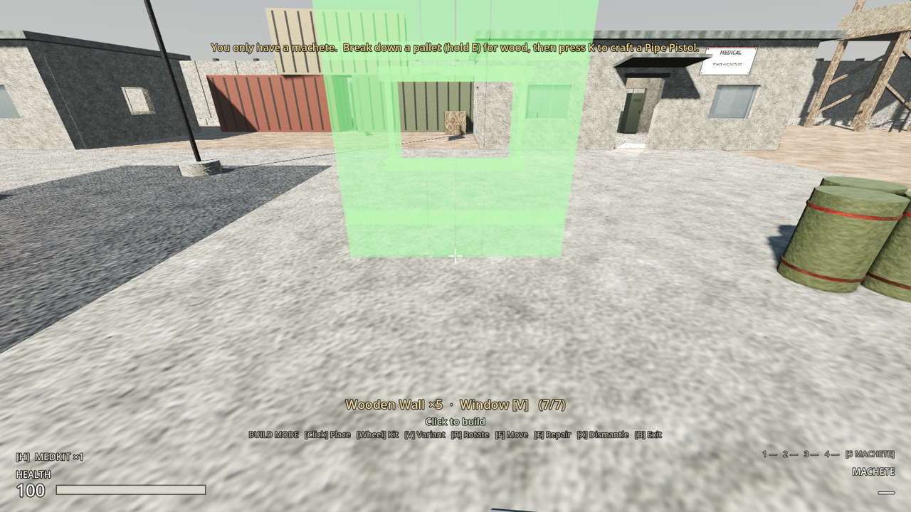
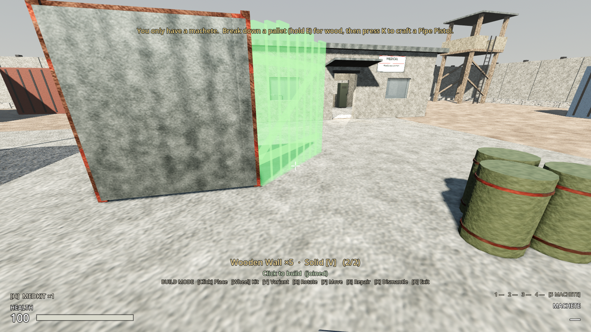
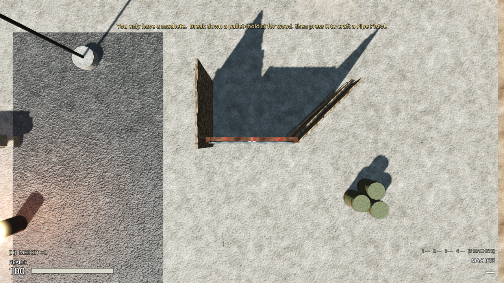
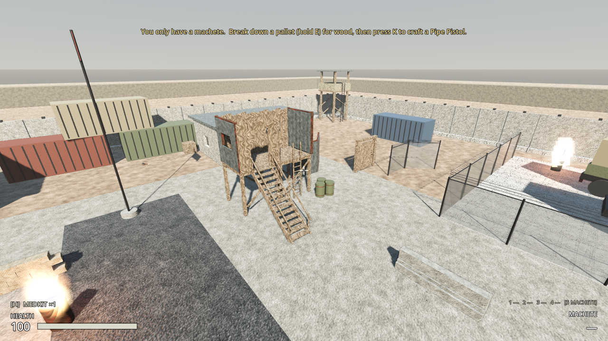
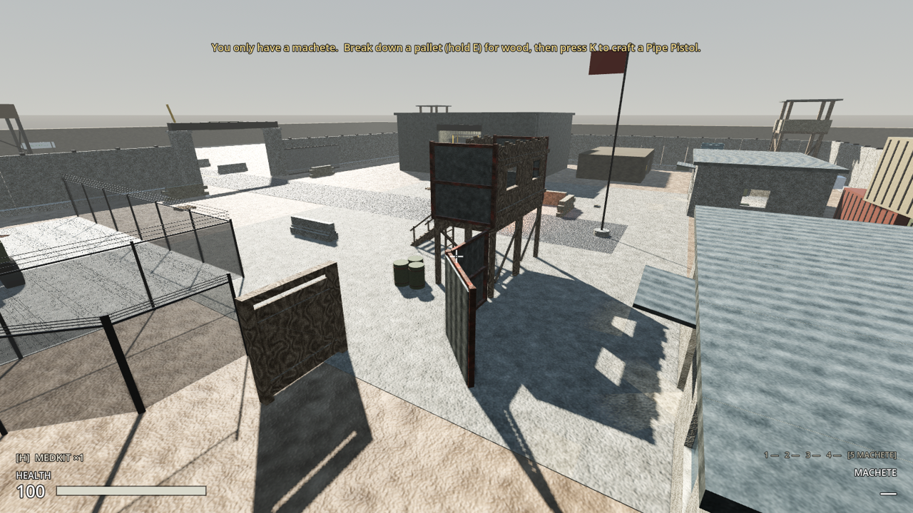
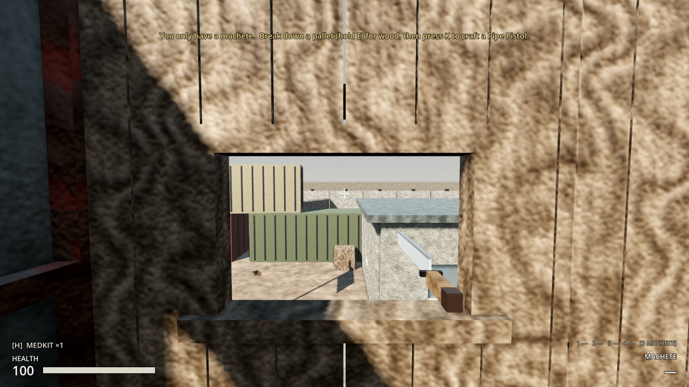
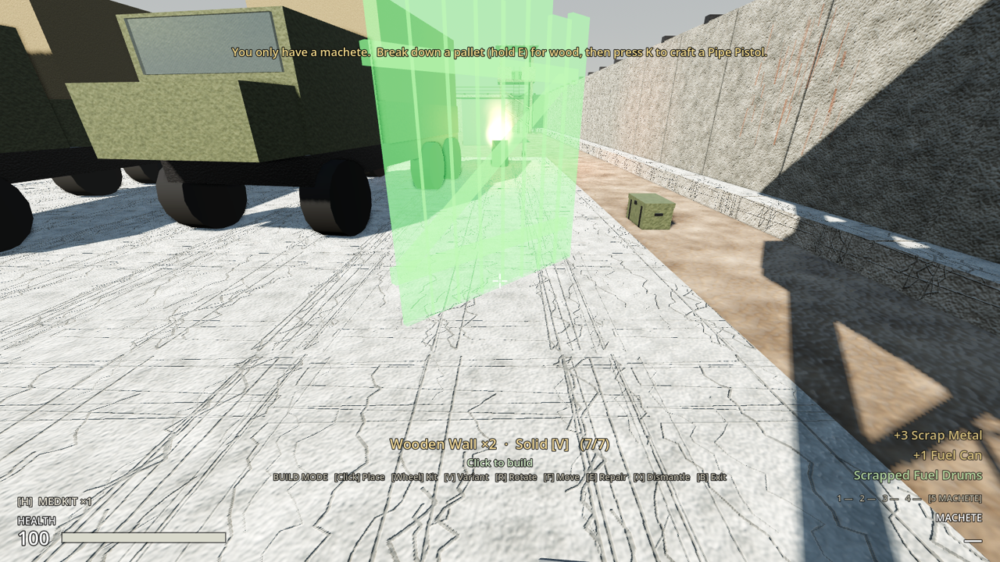
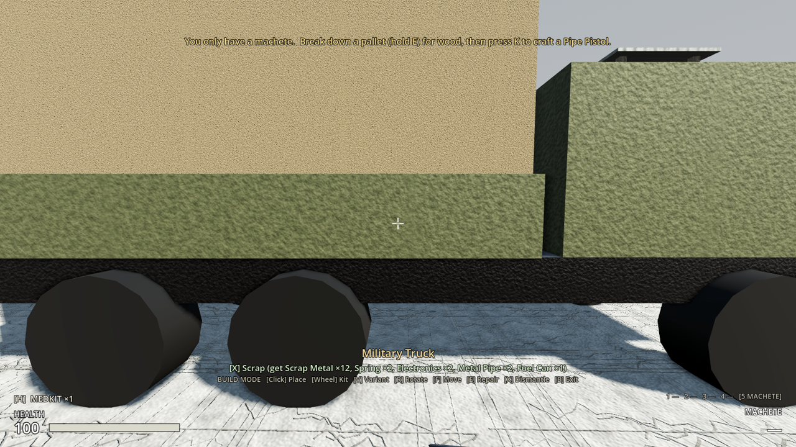

# Milestone 2, Increment 14 — Fort building

**Status:** complete. 281 automated tests pass in headless Godot 4.7, 15 of them new in `tests/test_construction.gd`.

**Update (follow-ups):**
- **Loot containers can be moved and scrapped too:** supply crates, footlockers and weapons lockers. F moves one with its loot inside. X scraps it, but only once it's been searched and emptied, so no loot is lost: a supply crate gives 2 wood and 1 scrap, a footlocker 2 wood, 1 scrap and 1 cloth, a weapons locker 4 scrap and 1 plate. Saved and remembered per region like the other props.
- **Spike traps slow raiders to a quarter of their speed** while they wade through, as well as hurting them. Measured in the test: about 1.2 m/s in the trap against 4.9 m/s outside.
- **Scrolling with a Magic Mouse or trackpad now works**, both for choosing build kits and for switching weapons. On a Mac these swipes don't arrive as mouse-wheel clicks but as "pan gestures", which nothing listened for, and Godot's UI took them before the weapon code. Now one swipe = one step, momentum included, and a normal wheel still works one notch at a time. Checked in a real window with simulated swipes: three swipes stepped kits 0 → 1 → 2 → 1, and a swipe outside build mode switched pistol → machete.

Two real-window runs at Outpost 17, with injected key and mouse input, checked the loop:
- **V** switched the wooden wall ghost to "Window".
- A small fort was built:
  - two platforms side by side, joined edge to edge
  - window walls, a metal window wall and a doorway along the deck edges
  - stairs up to the doorway and a ladder on the other side
  - on the ground, a metal wall line with a 45° bend, a gate and two chain-link fence sections
- **W** walked the player up the stairs onto the deck (2.6 m) to look out of a window.
- In open ground, **R ×3** turned a wooden wall ghost 45°, and it hinged onto a metal wall's end ("Click to build (joined)"). Three more presses gave a 90° corner off the other end; the top-down view shows the ends meeting with no gaps.
- In build mode, **X** scrapped the yard's fuel drums: +3 scrap and a fuel can, and the drums are gone. A truck showed **[X] Scrap** only, with its big haul listed.

The tests caught several problems, all fixed:
- Thin walls joined at 90° were refused: the new wall's end support point landed exactly on its partner's face. Joined partners are now left out of the support check as well as the overlap check.
- Build mode couldn't be entered with no kits in a level that has props but nothing built yet.
- Background navmesh rebakes from one test were still running when the next test started, making a wall test fail intermittently. Tests now wait for rebakes, and unbaked test worlds don't start them.
- Regenerating the scenes dropped the spike trap's selection body from Increment 13. It's now part of the builder.

**Playable result:**
- **1,000 structures per region** (up from 80). Measured on Outpost 17: rebuilding the raider navmesh takes ~120 ms in the background whether there are 0 or 1,000 walls, and 1,000 walls add ~230 KB to a save.
- **Faster rendering:** every structure is now one mesh per material instead of 10–20 separate pieces (a sandbag barricade was 21), and small ones fade out beyond 90 m, big ones beyond 180 m.
- **The gate opens with E anywhere on it**: the door, either post or the beam.
- **Wall variants (V):** a Wooden Wall kit or Metal Wall kit can be placed as **Solid**, with a **Window** (1.2 × 0.7 m, chest height: see and shoot through) or as a **Doorway** (1.2 × 2.1 m: walk through, and so can raiders). Same cost, health and materials back.
- **Snapping:**
  - **Walls, fences, barricades, sandbags and gates join end to end.** Aim near the end of one you've built and the ghost hinges onto it. **R** sets the joint's angle in 15° steps: 0° carries straight on, 3 presses is 45°, 6 is 90°. Shift+R goes the other way. The status line says "Click to build (joined)".
  - **Platforms** join edge to edge, or stack on top of each other.
  - **Walls line up along a platform's edges**, on the deck.
  - **Stairs and ladders** go against a platform's edge, facing out.
- **Building upward:**
  - **Wooden Platform:** a 2.4 m square deck at wall height (2.6 m) on four posts. You can walk under it. Put walls, more platforms (a second storey at 5.2 m), crates and benches on top.
  - **Wooden Stairs:** 2.6 m up to a deck. You and raiders can walk up them.
  - **Ladder:** 2.6 m, or 5.2 m (V) for a second storey. **Raiders can't climb ladders**, so a deck reached only by a ladder keeps them off.
  - **Support:** you can't dismantle or move something with things built on it ("Take down what's built on it first"). If raiders break a platform, whatever stood on it comes down too.
- **Chain-Link Fence** section (2.4 m): raiders can see through it but not get through.
- **The outpost's own props can be moved (F) and scrapped (X)** in build mode, in both regions:

| Prop | Move | Scrap gives |
|---|---|---|
| Fuel Drums | ✓ | 3 scrap, 1 fuel |
| Wooden Crate | ✓ | 3 wood |
| Sandbag Wall | ✓ | 4 cloth |
| Jersey Barrier | ✓ | 2 scrap |
| Chain-Link Fence | ✓ | 3 scrap, 1 pipe |
| Water Tank, Generator, Field Radio, Toolbox (Pack 2) | ✓ | scrap, plates, electronics, springs |
| Military Truck | ✗ (driving comes later) | 12 scrap, 2 springs, 2 electronics, 2 pipes, 1 fuel |
| Supply Crate (loot) | ✓ (loot inside) | 2 wood, 1 scrap (searched and empty) |
| Footlocker (loot) | ✓ | 2 wood, 1 scrap, 1 cloth |
| Weapons Locker (loot) | ✓ | 4 scrap, 1 metal plate |

  Scrapped props stay gone and moved props stay moved: saved, and remembered per region. Burning barrels and shipping containers stay fixed for now: they already run their own scripts.

**New recipes:**

| Kit | Recipe | Made | Health | Repair | Dismantle returns |
|---|---|---|---|---|---|
| Wooden Platform | 8 planks, 4 scrap | workbench | 500 | 2 planks | 4 planks, 1 scrap |
| Wooden Stairs | 6 planks, 2 scrap | workbench | 300 | 2 planks | 3 planks |
| Ladder (2.6 / 5.2 m) | 3 planks, 1 scrap | by hand | 120 | 1 plank | 1 plank |
| Chain-Link Fence | 2 pipes, 4 scrap | workbench | 350 | 2 scrap | 1 pipe, 2 scrap |










> **After pulling:** open with **Edit** in the Project Manager (not Run). This update adds a new script (`level_prop.gd`) and a new input (V).

---

## 1. Files

| File | Purpose |
|---|---|
| `scripts/construction/structure_definition.gd` | `snap` (NONE / EDGE / TILE / ATTACH), `supports_building`, `variants` + `variant_name` (`get_variants()`), `is_level_prop`, `movable` |
| `scripts/construction/construction_rules.gd` | Limit 1000. Support points (thin walls: centre line). Building on decks. `snap_to_built`, `snap_partners`, `ends_of`, `resting_on` |
| `scripts/construction/structure.gd` | `destroy()` brings down what rests on it; `take_down()`; `get_collision_rids()` includes the root body |
| `scripts/construction/level_prop.gd` | **New.** `LevelProp` (extends Structure): a level prop you can move/scrap; scrapped = hidden, no collision, saved |
| `scripts/construction/container_prop.gd` | **New.** `ContainerProp` (extends LevelProp): a `Prop` child of each salvage container that stands in for it (`structure_proxy` meta), moving/hiding the container; scrap needs it searched and empty |
| `scenes/world/containers/{supply_crate, footlocker, weapons_locker}.tscn` | A `Prop` node (ContainerProp + definition) |
| `scripts/player/scroll_stepper.gd` | **New.** `ScrollStepper`: wheel notches and pan-gesture swipes → one step each |
| `scripts/player/player_input.gd` | Weapon cycling through ScrollStepper; pan gestures caught in `_input` (before the GUI takes them) |
| `scripts/npcs/raider.gd`, `scripts/construction/spike_trap.gd` | `slow_down(factor, duration)` / `get_speed_factor()`; traps slow raiders in them to `slow_factor` (0.25) |
| `scripts/construction/build_mode.gd` | V variants, snapping (`snapped_to`), props (Move / Scrap text), entering with no kits when there are props |
| `scripts/player/player_controller.gd` | `request_place_structure(kit, xform, variant)`; support checks for dismantle/move; props: movable flag, reach for big props |
| `scripts/ui/hud.gd`, `scenes/ui/hud.tscn` | "Scrapped …" notice; [V] Variant in the key line |
| `scenes/structures/*.tscn` | All regenerated with merged meshes; **new:** `wooden_wall_window`, `wooden_wall_doorway`, `metal_wall_window`, `metal_wall_doorway`, `wooden_platform`, `wooden_stairs`, `ladder`, `ladder_tall`, `chain_link_fence`. The gate has a door-sized handle and a `FrameHandle` |
| `resources/structures/*.tres` | Snapping set on walls/barricades/sandbags/gate; variants on the wall definitions; 9 new definitions |
| `resources/structures/props/*.tres` | **New.** 10 prop definitions (scrap return, footprint, movable) |
| `resources/items/kits/`, `resources/recipes/kit_*.tres`, `scenes/items/models/kits/`, `assets/icons/` | 4 new kits with recipes, models and icons; the wall kits' descriptions mention V |
| `scenes/world/props/{fuel_drums, wood_crate, sandbag_wall, jersey_barrier, chain_link_fence}.tscn`, `scenes/vehicles/military_truck.tscn` | `level_prop.gd` and a definition on the root (4 lines each) |
| `levels/outpost_17/outpost_17.tscn` | The 4 Pack 2 props get `level_prop.gd` and a definition on their instances (the pack's own files are untouched) |
| `project.godot` | `build_variant` (V) |
| `tests/test_construction.gd` | 11 new tests (32 in the suite) |
| `tests/test_art_pack2.gd` | Pack 2 props are now saved (as movable props); an old save leaves every prop in place |

## 2. Scene hierarchy

```
WoodenPlatform (Node3D, structure.gd)            [persist, structures]
├── Mesh (merged: deck planks, joists, posts, braces)
├── Body (StaticBody3D, layer 2) → Deck (2.4 × 0.15 × 2.4 at 2.525), 4 posts
└── %HitSound

WoodenStairs (structure.gd)
├── Mesh (treads, stringers, rails, balusters)
└── Body → Ramp (box tilted 37°: you and raiders walk up it)

Ladder / LadderTall (structure.gd)
├── Mesh (rails and rungs)
├── Body (StaticBody3D, layer 5: build mode only, you walk into it)
└── Ladder (ladder.tscn, height 2.6 / 5.2, hidden: it does the climbing)

WoodenGate (gate_structure.gd)
├── Mesh · Posts (StaticBody3D) · FrameHandle (Interactable: posts + beam)
└── %Door → DoorMesh, DoorBody, %Handle (Interactable: the whole door)

FuelDrums (StaticBody3D + level_prop.gd)         [persist, level_props]
└── (unchanged meshes and collision)
```

## 3. Key points

- **Snapping is a suggestion; the rules decide.** `ConstructionRules.snap_to_built` moves the ghost onto a wall end or a platform edge. The result goes through the same `refusal_reason` as everything else, for the ghost and for the host-side request.
- **Joined walls:** `snap_partners` finds built EDGE structures sharing an end (within 6 cm) that don't fold back over the new one. Their collision is left out of the overlap and support checks, because at an angle two 0.3 m walls overlap a little at the corner. A wall folded back onto its partner is still "in the way".
- **Thin things stand on their centre line** (`support_points`): a wall can sit right along a deck's edge, and walls on neighbouring edges meet at the corner.
- **Building on structures:** only definitions with `supports_building` (platforms) can be built on. `resting_on(s)` casts each nearby structure's support rays and returns those landing on `s`. It's used to refuse dismantling or moving, and by `destroy()` to bring things down.
- **Variants are separate definitions and scenes.** The kit's `structure` is the main one; `variants` lists the rest. `request_place_structure(kit, xform, variant)` checks the variant belongs to the kit. Saves recreate structures from their scene path, so a doorway comes back as a doorway with no extra save data.
- **Mesh merging** happens in the builder: each structure's own MeshInstance3D children are combined with SurfaceTool into one ArrayMesh, one surface per material (the gate's door separately, so it still swings). Instanced parts (the crate and bench, and the ladder's climbing node) are left alone. The ghost and kit models copy the merged mesh.
- **Level props** use `LevelProp` on their scene root, which is allowed even though the root is a StaticBody3D, because the class extends Node3D. They join the `persist` group but are never removed by a load. Scrapping hides them and sets their collision layer to 0, so they drop out of physics, sight and the navmesh. They're saved as `scrapped`, and a save without them leaves them in place. Raiders don't break props. Props aren't counted towards the 1,000 limit.
- **Ladders are raider-proof:** a Ladder has no collision and isn't navigation geometry, so the navmesh doesn't connect the ground to a ladder-only deck. Stairs are a walkable 37° ramp, under the navmesh's 45° slope limit.

## 4. Input Map

| Action | Key | Notes |
|---|---|---|
| `build_variant` | **V** | Next variant of the selected kit (walls: Solid / Window / Doorway; ladder: 2.6 / 5.2 m) |

R now also sets the angle of a joint when the ghost has snapped to a wall end.

## 5. Inspector settings

| Resource | Setting | Value |
|---|---|---|
| StructureDefinition | `snap` | EDGE: walls, fences, barricades, sandbags, gate · TILE: platform · ATTACH: stairs, ladders |
| StructureDefinition | `supports_building` | platform only |
| StructureDefinition | `variants` / `variant_name` | wall: [window, doorway] · ladder: [tall] |
| Prop definitions | `is_level_prop`, `movable`, `dismantle_return` | see the table above |
| ConstructionRules | `MAX_PER_REGION`, `SNAP_RADIUS`, `END_MATCH` | 1000, 1.5 m, 0.06 m |
| Merged meshes | `visibility_range_end` | 90 m (under 1 m tall), 180 m (the rest) |

## 6. Signals

No new signals. `structure_dismantled(definition)` also fires for scrapped props (`definition.is_level_prop`), and the HUD says "Scrapped …".

## 7. Editor assembly (by hand)

1. **A new variant:** make its definition and scene like the main one, set `variant_name`, and add it to the main definition's `variants`. The kit needs no change.
2. **A snapping structure:** set `snap` to EDGE (ends at ±half its width along X), TILE, or ATTACH. Keep the footprint matching the collision.
3. **Something you can build on:** tick `supports_building`; the top of its footprint is the floor.
4. **Another movable prop:** make a StructureDefinition in `resources/structures/props/` with `is_level_prop`, the footprint (origin on the ground), the scrap return and `movable`. Then attach `level_prop.gd` to the prop scene's root and set its Definition. If the scene belongs to an art pack, set them on the instance in the level instead.

## 8. Testing

**Automated** (`-- test_construction`, new tests):
- **Variants and rendering:**
  - Both wall kits offer Solid / Window / Doorway, and the ladder offers 2.6 / 5.2 m.
  - Every structure scene has at most 2 of its own mesh nodes, each with a fade-out distance.
  - The limit is 1000.
- **Doorways:**
  - A doorway in a line of five walls: the raider path goes through it.
  - It saves and loads as a doorway, and only the kit's own variants are accepted.
- **V:** build mode cycles Solid → Window (title and ghost follow), places the window wall, and wraps round.
- **Joints:**
  - Snapping to a wall's end at 0°, 45°, 90°, −90° and 30°: the end is shared, at that angle, and placement is allowed despite the corner overlap.
  - Folding back is refused, and nothing snaps far from an end.
  - In build mode, the ghost joins on ("joined") and the placed wall is a partner.
- **Platforms:**
  - Tile beside one, stack a second storey on it, and line up a wall on the deck edge. A barricade can't go on a wall top.
  - You can stand on the deck.
  - The wall rests on its platform, so dismantling or moving that platform is refused. Breaking the lower platform brings down the storey on it, and the other platform and its wall stand.
- **Stairs and ladders:**
  - Stairs snap against the edge. There's a raider path up them, and a player holding W walks up onto the deck.
  - A ladder snaps against another edge with its top level with the deck, and a player climbs it onto the deck.
  - A 5.2 m ladder doesn't snap to a one-storey deck. With only a ladder, there's no raider path onto the deck.
- **Fence:** snaps onto a wall end, in line, and is solid.
- **Gate:** focusing the posts, beam and door all offer "Open Wooden Gate"; E on the middle of the door opens it.
- **Props** (Outpost 17):
  - All 8 kinds are editable. Scrapping fuel drums gives 3 scrap and fuel, removes their collision, and can't be done twice.
  - A jersey barrier moves; trucks don't.
  - After save → fresh level → load, the drums are still scrapped and the barrier is where it was moved. An older save brings the drums back.
  - Build mode with no kits targets a truck, shows Scrap only, refuses F, and X gives 12+ scrap.
- **Pack 2** (updated): only movable props are saved from Pack 2, and an old save leaves every prop untouched.
- **Scrolling:** wheel notches step once per cooldown; a 40-event Magic Mouse swipe with momentum steps once; a pause, then the next swipe steps again; the reverse swipe steps back; a resting finger does nothing.
- **Traps slow raiders:** a raider chasing across a trap moves at under 35% of its free speed inside, is back to full speed after, and still gets through.
- **Loot containers:**
  - The warehouse crate is targetable and refuses scrapping until searched and emptied.
  - It moves with the same loot and stays searched; once emptied, it scraps for 2 wood with its collision off.
  - It stays scrapped after save and load, and other containers are untouched.
  - A built storage crate is still its own structure.

**Manually:**
1. Craft two platforms, stairs, a ladder and walls (workbench; ladder by hand).
2. **B**, choose the platform, build one; aim beside it to build the second (it snaps).
3. Choose the wooden wall, **V** to Window, aim at a deck edge: it lines up on the edge. Build a doorway where the stairs will go.
4. Choose the stairs, aim near that edge from the ground: they snap facing out. Walk up.
5. On the ground, build a wall, then aim past its end with **R** pressed 3 times: a 45° joint.
6. Look at the yard's fuel drums in build mode: **X** scraps them; **F** moves a jersey barrier.

## 9. Troubleshooting

| Symptom | Fix |
|---|---|
| The ghost won't join onto a wall | Aim closer to that wall's end (within about 1.5 m), at the same height. |
| The joint is at the wrong angle | R / Shift+R in 15° steps; 0° continues straight on. |
| "Take down what's built on it first" | Dismantle or move what stands on the platform first. |
| Raiders get onto my platform | They walk up stairs. Use a ladder instead, or a gate or wall at the top of the stairs. |
| A prop can't be moved | Trucks are scrap-only; burning barrels and shipping containers are fixed for now. |
| "Identifier LevelProp not declared" | Stale class cache: open with **Edit** once. |

## 10. How this connects to future systems

- **Vehicles:** trucks are LevelProps for now (scrap only). Driving will replace that with a vehicle script, keeping the scrap option.
- **Settlements:** the 1,000 cap can become a settlement-size budget; platforms and walls give settlers watch posts.
- **Raids:** raiders already path up stairs and hack through walls; ladder-only towers are a safe spot until raiders get ranged weapons.
- **Co-op:** snapping is client-side; the host only sees the final transform and validates it as before.
