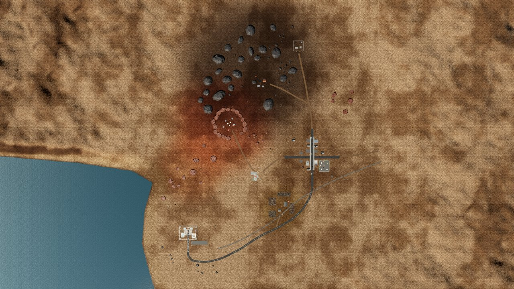
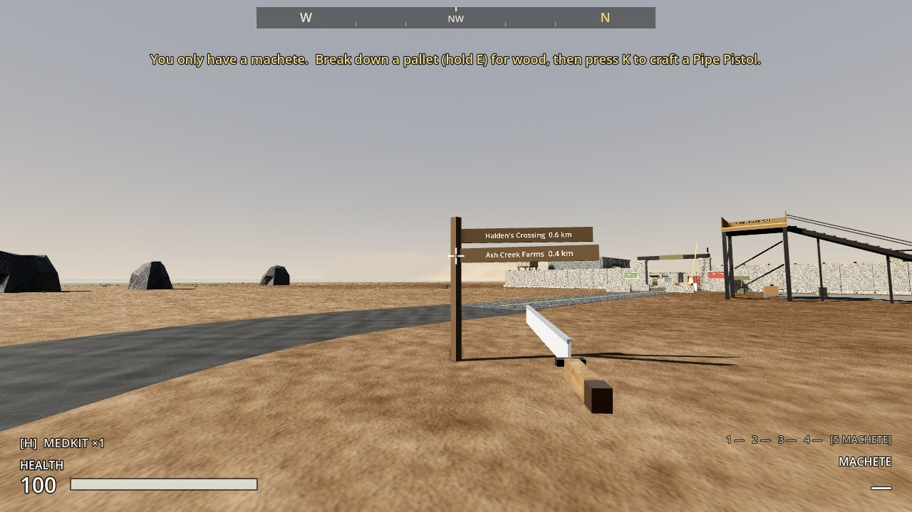
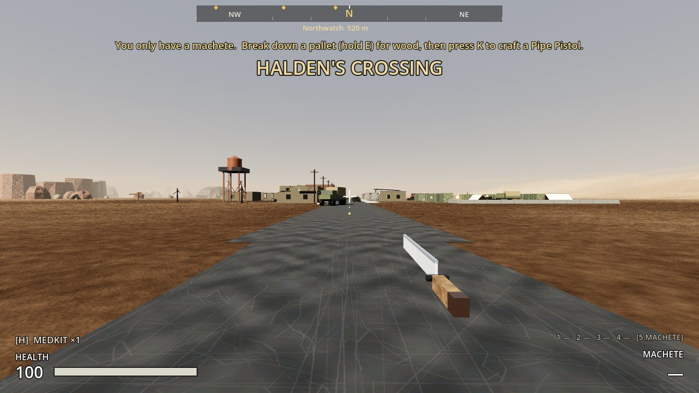
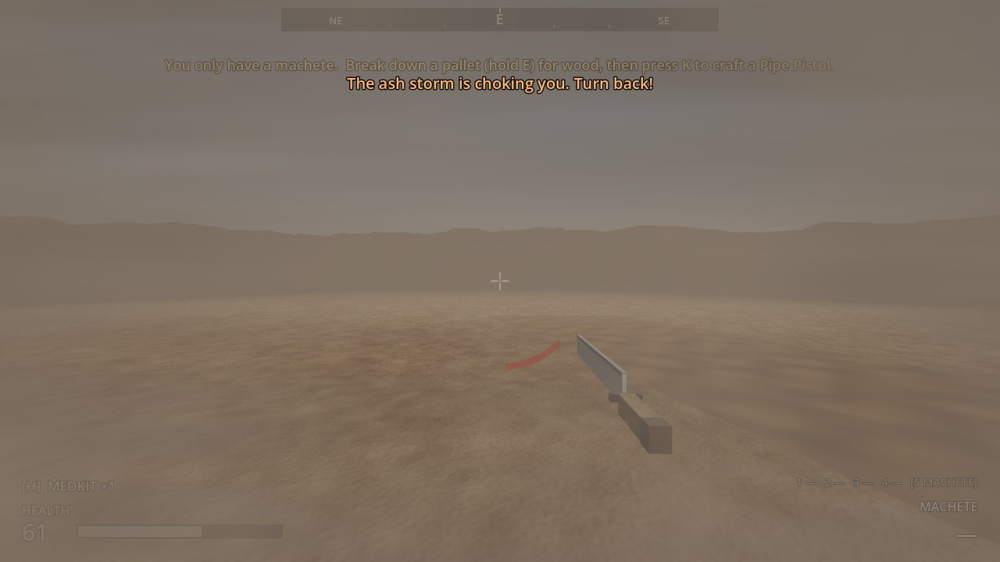
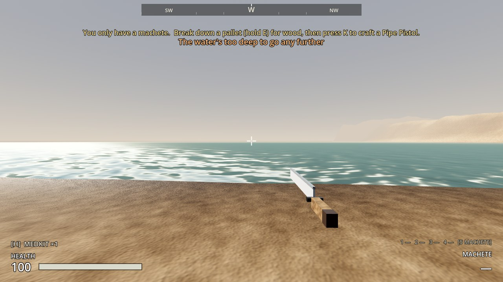
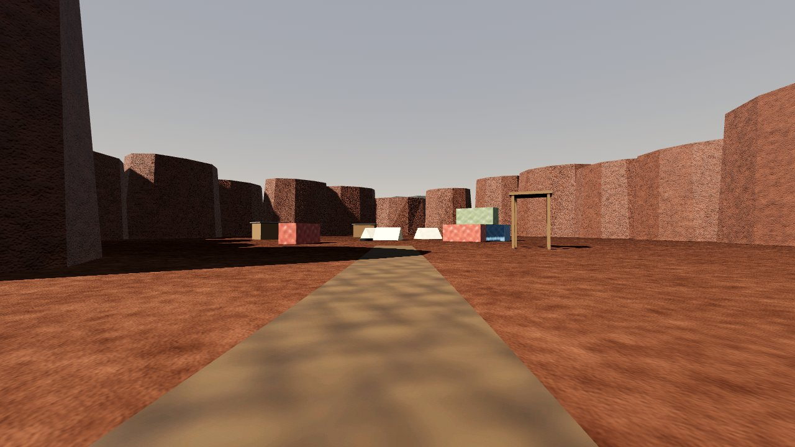
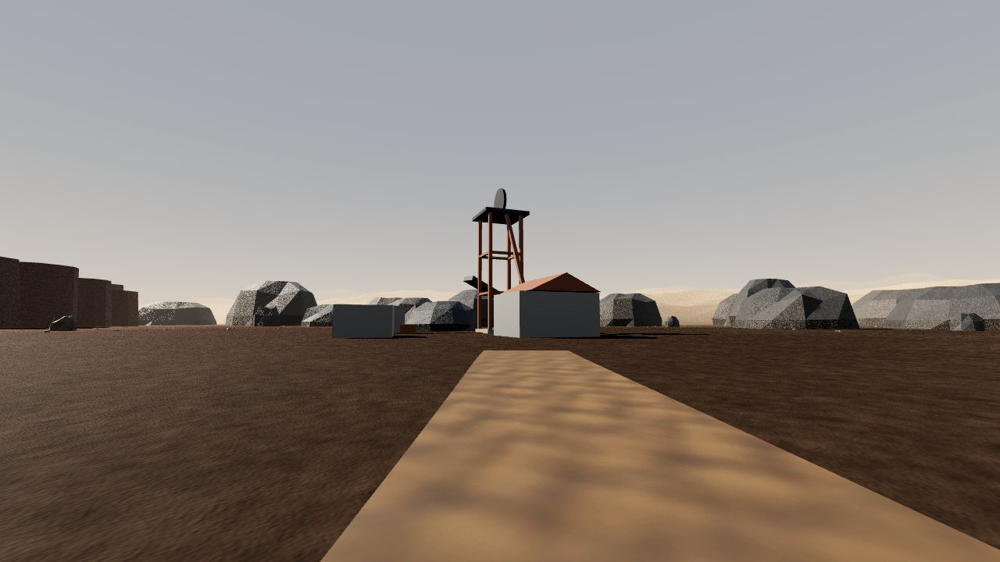
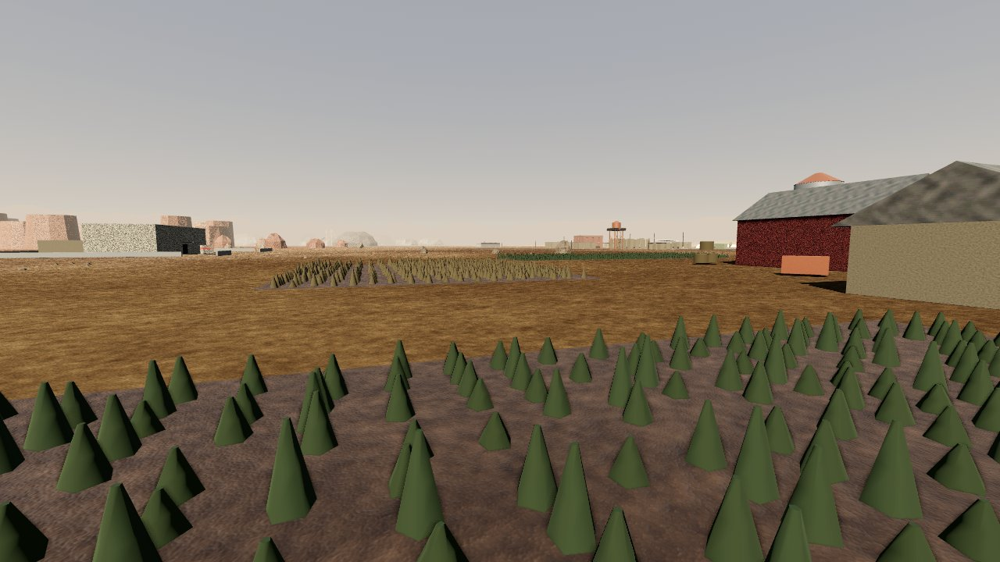

# Milestone 3, Increment 15: The early zone

**Status:** complete. 313 automated tests pass in headless Godot 4.7, 20 of them new in `tests/test_early_zone.gd`.

Phase 1 of the roadmap (`ashfall/ROADMAP.md` in the project): the world laid out from the **Regional Buildout Map**.

**A real-window run** used the game's own main scene, with injected key input:
- **W** walked out of the outpost's south gate onto the new main road.
- The compass showed Halden's Crossing to the north-east at 530 m.
- Walking up Main Street into Halden's showed **HALDEN'S CROSSING** on screen.
- Walking east from the town into the storm:
  - At the edge the haze closed in, with "The ash storm is too thick ahead. Turn back".
  - 17 m past it, ash blew across the screen, "The ash storm is choking you. Turn back!", and health was down to 61.
  - The invisible wall 32 m out is checked by the tests.
- Walking west from the outpost to the coast: "The water's too deep to go any further", and no damage.
- **F5** in town, then teleport home, then **F9**: back in town at the same spot.

The tests and the playtest caught several problems, all fixed:
- **Raiders and their loot drops landed in the wrong place** in Halden's Crossing: 450 m east and 275 m north of where they should be, out in the void. The spawner and loot drops used world positions as positions inside the town, which only worked while every level started at the origin. Both now convert.
- **The navmesh tiles didn't join up.** Each tile's walkable area stopped 1 m short of its edge, so no path crossed a tile line. The baking box is now grown by the border it cuts off.
- **Crops, sleepers and scattered stones vanished from the saved scenes**: the builder runs headless, and Godot keeps no MultiMesh data there. They're now merged into ordinary meshes, which is also fewer draw calls.
- **A spawner property was ignored**: it was written above the script line in the scene file, before the property existed.
- **Two pack images glowed:** the Pack 3 dirt road and the farm soil. Both are now tinted down.
- **The ground looked like a repeating swirl from above.** Its patch noise is now sampled at two scales.
- **The compass sat half off-screen.** It's now placed in code, and it names only the landmark nearest the middle, so labels don't overlap.
- **There was a gap where the new road met Main Street.** The road now runs on under it.



## Playable result

- **One walkable zone instead of two levels.**
  - **Layout:** Outpost 17 sits on the west coast. Halden's Crossing is ~530 m north-east, up the new main road: about two minutes' walk, or a minute and a quarter sprinting.
  - **No more border berms:** the walls around each old level are gone.
  - **No more road signs to travel:** you walk between the places.
- **Seven places,** laid out where the concept map draws them (1 px of the map = 1.1 m):

| Place | Where | What's there now |
|---|---|---|
| Outpost 17 | West coast (the start) | Unchanged: everything from Increments 1–14 |
| Halden's Crossing | 530 m north-east | Unchanged: the town and the raider camp |
| Saint Mercy Clinic | West of the town | **Blockout:** a two-storey clinic with red crosses, an annex, a broken wall and a wrecked ambulance |
| Ash Creek Farms | Between the outpost and the town | **Blockout:** a red barn, farmhouse, silo, water tower and four fields of crops |
| Smuggler's Gulch | North-west, up a trail | **Blockout:** a hollow in a ring of red rock, with shacks, containers, tents and a lookout |
| Black Ridge Mine | North, among dark hills | **Blockout:** a headframe over the shaft, hoist house, sheds, conveyor and spoil heap |
| Northwatch Outpost | Far north | **Blockout:** a small walled post with a watchtower, radio mast and dish |

  The blockouts are solid shapes at the right size and place, so you can judge distances and sightlines. You can't go inside, and they have no loot or raiders yet. Each one is a single scene file that the real place will replace.
  *Since Increment 16 all five are real places: see [`16_places.md`](16_places.md).*

- **Roads and the railway:**
  - **Main road (asphalt):** from the outpost gate to Halden's Main Street, past Ash Creek.
  - **Dirt roads:** to Saint Mercy, north to Northwatch with a branch to Black Ridge, east out of the town toward the mid zone, a trail to Smuggler's Gulch, and a farm lane.
  - **Railway:** from a buffer stop beside the outpost, past Halden's and on east. It's scenery for now; train travel comes next increment.
- **Signposts** at the junctions point to each place, with its distance.
- **A compass** across the top of the screen:
  - Shows N/NE/E… and a marker for each place.
  - The place nearest the middle is named, with its distance.
  - Walking into a place shows its name in large letters.
- **The edge of the zone:**
  - **Ash storm (land):**
    - Within ~30 m of the edge the haze thickens and a warning tells you to turn back.
    - Past the edge, ash blows across the screen, the wind howls, and the storm does 4–18 HP/s, more the further you go.
    - An invisible wall stops you 32 m out.
    - If it kills you: "Choked to death in the ash storm".
  - **Coast:** the water gets "too deep to go any further" 10 m out. It never hurts you.
  - **Scenery:** past the storm there are hills, and past the coast the sea, all fading into the dust haze. The haze fully closes in at ~620 m.
- **Raiders only exist near you:** each place's raiders appear when you come within 230 m of their spawn points. When you're far away, those not chasing you are removed.
- **Building:**
  - The limit is now **2,000 structures for the zone**: it's one region now, holding what were two regions of 1,000 each.
  - Placing something rebakes only the navmesh around it, not the whole zone.
- **Old saves load:** a quick save from before this update moves into the zone automatically. You keep everything you looted and built in both places, and you arrive where you saved.









> **After pulling:** open with **Edit** in the Project Manager (not Run). This update adds 6 new scripts. The game now starts in `levels/early_zone/early_zone.tscn`.

---

## 1. Files

| File | Purpose |
|---|---|
| `levels/early_zone/early_zone.tscn` | **New main scene.** The zone: lighting, terrain, roads, rocks, the seven places, landmarks, the boundary, navigation, structures, the player, HUD, game mode, storm effects, wind |
| `levels/early_zone/terrain.scn` | Ground: a 10 m mesh grid (2.3 × 2.4 km, in chunks), the collision, and the sea. Generated |
| `levels/early_zone/roads.scn`, `rocks.scn` | Roads, railway and signposts; hills, outcrops and scattered stones. Generated |
| `levels/early_zone/navigation.scn` | The navmesh in 82 tiles of 100 m. Generated |
| `levels/early_zone/sites/*.tscn` | The five blockouts. Generated, and each will be replaced by its real place |
| `levels/early_zone/early_zone_environment.tres`, `materials/*.tres` | Sky and dust haze; ground, sea, rock, field and sign materials |
| `levels/outpost_17/outpost_17.tscn`, `levels/haldens_crossing/haldens_crossing.tscn` | **Now sites, not levels.** Their lighting, ground, berms, player, HUD, game mode, navmesh, exits and wind moved up to the zone. Spawners got `active_radius = 230` |
| `scripts/world/zone.gd` | **New.** `Zone`: the zone root. Gives small things a draw distance on load |
| `scripts/world/zone_boundary.gd` | **New.** `ZoneBoundary`: the playable area, storm and sea edges, warnings and storm damage (host-side) |
| `scripts/world/storm_effects.gd` | **New.** `StormEffects`: the haze, blowing ash, wind and warning for your own player |
| `scripts/world/landmark.gd` | **New.** `Landmark`: a named place for the compass and the place-name banner |
| `scripts/ui/compass_bar.gd` | **New.** `CompassBar`, built by the HUD |
| `assets/shaders/zone_terrain.gdshader`, `sea.gdshader`, `ash_storm.gdshader` | **New** shaders: ground, sea, blowing ash |
| `scripts/construction/nav_rebaker.gd` | Navigation can be tiles: only the tiles near a change rebake |
| `scripts/npcs/enemy_spawner.gd` | `active_radius`: sleeps when no player is near |
| `scripts/persistence/save_manager.gd` | **Save version 3**: version 2 saves move into the zone |
| `scripts/interaction/pickup.gd` | `Pickup.spawn` takes a world position under any parent |
| `scripts/ui/hud.gd` | Adds the compass |
| `scripts/construction/construction_rules.gd` | Structure limit 2,000 per region (a zone) |
| `project.godot` | Main scene → the early zone |
| `tools/levels_to_sites.py` | **New.** One-off text edit that turned the two levels into sites (safe to re-run) |
| `tools/build_early_zone.gd` | **New.** Builds everything generated under `levels/early_zone/` |
| `tests/test_early_zone.gd` | **New.** 20 tests |
| `tests/fixtures/region_a.tscn`, `region_b.tscn` | **New.** Two small regions for testing travel between regions (zones will need it) |
| `tests/test_*.gd` | Level tests now load the zone. Outpost 17 sits at the origin, so its coordinates didn't change |

## 2. Scene hierarchy

```
EarlyZone (Node3D, zone.gd, meta region_name = "Early Zone")
├── Lighting
│   ├── WorldEnvironment (dust haze: depth fog 60–620 m)
│   └── Sun
├── Terrain (terrain.scn)
│   ├── Mesh: Chunk_x_z × 100                  (10 m grid, vertex-tinted per area)
│   ├── Ground (StaticBody3D, terrain layer)   [navigation_geometry]
│   └── Sea
├── Roads (roads.scn)
│   ├── MainRoad, RoadToSaintMercy, TrailToGulch, RoadNorth, RoadToBlackRidge, FarmLane, RoadEast
│   ├── Railway: Ballast, RailL, RailR, Sleepers, BufferStop
│   └── Signposts
├── Rocks (rocks.scn)
│   ├── Rock0…124 (StaticBody3D, convex)       [navigation_geometry]
│   └── Scatter: Stones, Scrub                 (merged, no collision)
├── Outpost17          (levels/outpost_17/outpost_17.tscn at 0, 0, 0)
├── HaldensCrossing    (levels/haldens_crossing/haldens_crossing.tscn at 450, 0, -275)
├── SaintMercyClinic · AshCreekFarms · SmugglersGulch · BlackRidgeMine · NorthwatchOutpost (sites/*.tscn)
├── Landmarks: one Landmark per place
├── Boundary (ZoneBoundary)
│   └── Backstop (StaticBody3D: invisible walls)   [navigation_geometry]
├── Structures   [navigation_geometry]   (what you build, anywhere in the zone)
├── Navigation (navigation.scn): Tile_x_z × 82 (NavigationRegion3D)
├── PlayerSpawn · Player · HUD · GameMode
├── StormEffects (CanvasLayer)
└── Ambience (wind, %Ambience) · DistantWind
```

## 3. Key points

- **Zones, sites and regions:**
  - A **zone** is a level: one seamless stretch of map. Travel between zones (Increment 16) still uses `WorldManager` regions; a region is now a zone.
  - A **site** is a place inside a zone: a scene with its buildings, props, loot, spawners, signs and sounds, but no player, ground or lighting of its own.
- **Outpost 17 stands at the origin**, so every coordinate in it (tests, saves, the player's spawn) is unchanged. Halden's Crossing stands at `(450, 0, -275)`.
- **World positions vs positions in a site:** anything that creates a node inside a site from a world position must convert it, as `EnemySpawner` and `Pickup.spawn` now do. Saves use world positions, as before.
- **Generated, not hand-built:** `tools/build_early_zone.gd` builds the terrain, roads, rocks, blockouts, navmesh and the zone scene from data at the top of the file:
  - `PLACES`, `EDGE` (the boundary), `ROADS`, `RAIL`, `SIGNPOSTS`, `ROCK_CLUSTERS`, `TINTS`.
  - To move a road or a place, edit the data and re-run the builder.
  - The two real sites are never touched by it.
- **The ground:**
  - Flat (height 0) everywhere inside the zone, so every site sits on it as before.
  - Past the storm edge, hills rise beyond the backstop. Past the coast, the sea bed falls away.
  - Collision covers the zone plus 45 m. The rest is only scenery.
- **Navmesh tiles:**
  - Each 100 m tile is baked with a 1 m border inside a box grown by that border, so tile edges meet exactly and paths cross them.
  - Building rebakes the 1–4 tiles within 10 m of the change, on a worker thread.
  - The navigation map then takes about a second to pick up the new tiles, on its own thread, so the game doesn't stutter.
- **The storm:**
  - `ZoneBoundary` decides the damage, on the host.
  - `StormEffects` only draws what your own player sees: it works on its own copy of the environment, so the level's file is never changed.
  - Raiders aren't affected, because the navmesh ends at the backstop.
- **Draw distances:** on load, `Zone` gives every mesh in the sites a draw distance by its size:
  - Under 2.5 m: 130 m. Under 9 m: 320 m. Bigger: 750 m.
  - The terrain, rocks, roads and sea set their own.
- **Cost:** measured in the same real-window setup at the same spots, the zone is about the same as the old levels.

  | Spot | Before | Now |
  |---|---|---|
  | Outpost gate | 215 draw calls | 293 draw calls |
  | Halden's Crossing, south end | 4,037 draw calls | 3,797 draw calls |
  | Open ground between them | n/a | 982 draw calls |

  The extra triangles (~180k for the terrain, rocks and scatter) are trivial for any GPU.
- **Save version 3:**
  - **Old saves are moved into the zone:** each saved path gains its site name (`Loot/GateMedkit` becomes `Outpost17/Loot/GateMedkit`), positions in Halden's Crossing move with the town, and built structures get names that can't clash.
  - **A place the old save never saw** (a town you never visited) is listed in `untouched`, so loading doesn't treat its loot as taken.

## 4. Input Map

No new actions. The compass and place names appear on their own.

## 5. Signals and groups

| Name | What |
|---|---|
| group `landmarks` | `Landmark` nodes (compass, place names) |
| group `zone_boundary` | The zone's `ZoneBoundary` (`ZoneBoundary.find_in(tree)`) |
| `EnemySpawner.dormant` | True while no player is within `active_radius` |

## 6. Editor assembly (by hand)

1. **Move a place, a road or the edge:** edit `PLACES`, `ROADS`, `RAIL` or `EDGE` at the top of `tools/build_early_zone.gd`, then run:
   ```
   godot --headless --path . -s res://tools/build_early_zone.gd
   ```
   (macOS: `/Applications/Godot.app/Contents/MacOS/Godot --headless --path . -s res://tools/build_early_zone.gd`.) It takes about 10 seconds and rewrites everything under `levels/early_zone/`.
2. **Build a blockout into a real place:**
   - Make the place as its own scene (like `levels/haldens_crossing/haldens_crossing.tscn`): buildings, props, `Loot`, `SalvageContainers`, spawners with `active_radius`.
   - Give it no player, ground or lighting.
   - Point the zone's instance at it in place of `levels/early_zone/sites/…`, and remove that entry from the builder's blockout list.
   - Re-run the builder for the navmesh.
3. **A spawner in a big zone:** set **Active Radius** (m) in the Inspector. 0 means always awake.

## 7. Testing

**Automated** (`-- test_early_zone`):
- **The zone is the game:**
  - It's the main scene and has everything a level needs.
  - The sites have no second player, HUD, sky or navmesh.
- **Layout:**
  - Every place is where the map puts it, with a landmark.
  - Halden's is north-east at 450–600 m, and Northwatch is furthest north.
  - The sea is west of the outpost and the storm east of the town.
  - Every place is 60 m+ inside the edge.
- **Flat ground** under every place, on the terrain body.
- **Draw distances:**
  - 1,000+ meshes get one, and 100+ of the town's small things are culled from far away.
  - The haze ends between 400 and 800 m.
- **On foot:**
  - Every place is reachable from the outpost gate, across tiles.
  - A walk out of the south gate goes past where the old berm stood.
- **The storm:**
  - It's calm well inside, with a warning near the edge and no damage before it.
  - Past the edge it hurts, more the further you go.
  - Walking into it you're hurt and stopped by the wall; staying in it kills you, with the storm's cause of death.
- **The sea:** stopped in the shallows, warned, never hurt, no storm.
- **Storm effects:**
  - The haze rises past 0.5 near the edge, with the warning and blowing ash.
  - The fog thickens on a copy of the environment, not the file.
  - It all clears again back home.
- **No border walls** where the old berms stood.
- **Compass:**
  - The bearings are right, and Halden's shows north-east.
  - It's on the HUD, says "Outpost 17" at the start and "Halden's Crossing" in town, with the banner, and nothing in the open between places.
- **Signposts:** 6 or more, and the outpost's one points at Halden's with the distance.
- **Sleeping spawners:**
  - The camp is empty while you're at the outpost, and fills when you reach the town.
  - Meanwhile the outpost's raiders go (any still chasing you stay until they give up).
- **Town loot drops** land at the raider's feet.
- **Building:** a wall rebakes 1–4 of 82 tiles, raiders path round it, and the whole zone is still connected.
- **Old saves:**
  - A version 2 save made in town, with the outpost remembered, migrates correctly: paths, player position, and both regions' walls kept apart.
  - Loading it puts you in town with both crates searched and both walls rebuilt.
  - A save that never saw the town leaves the town's loot alone.
  - Saving and loading across the zone works.

**Updated:** the Outpost 17 (25), regions (12), save, Pack 1–3, audio and construction suites now load the zone. Travel between regions is tested on two fixture regions.

**Manually:**
1. F5. Walk out of the south gate. The road bends east; follow it. The compass shows Halden's to the north-east.
2. Pass Ash Creek Farms, cross the railway, and walk up Main Street. "HALDEN'S CROSSING" appears.
3. Take the west road to Saint Mercy, the north road to Black Ridge and Northwatch, or the trail to Smuggler's Gulch.
4. Walk east past the town until the storm warning appears; keep going to feel it, then turn back.
5. Walk west from the outpost to the beach.
6. F5 anywhere, walk off, F9: you're back where you saved.

## 8. Troubleshooting

| Symptom | Fix |
|---|---|
| The game opens Outpost 17 with no ground and no player | Godot is running the old main scene from its cache. Open with **Edit**; Project Settings → Run → Main Scene should be `levels/early_zone/early_zone.tscn`. |
| "Identifier ZoneBoundary/Landmark/CompassBar not declared" | Stale class cache: open with **Edit** once. |
| A quick save from before the update loads at the outpost with the town's loot all there | That's right if the save was made before you'd visited the town. Saves made after visiting it keep what you took. |
| No raiders at Halden's | They only appear within 230 m of the town. Walk there; they spawn out of sight. |
| Raiders a long way off don't come after gunfire | Sleeping spawners: only places within 230 m of you have raiders. |
| The ground looks flat out to the haze | It is, inside the zone (hills are beyond the storm, for now). Rock outcrops and the Black Ridge hills are the relief. |
| `tools/integrate_resource_pack_v*.gd` fail | They were written for the old level scenes and have already been run. The dressing they made is part of the sites now. |
