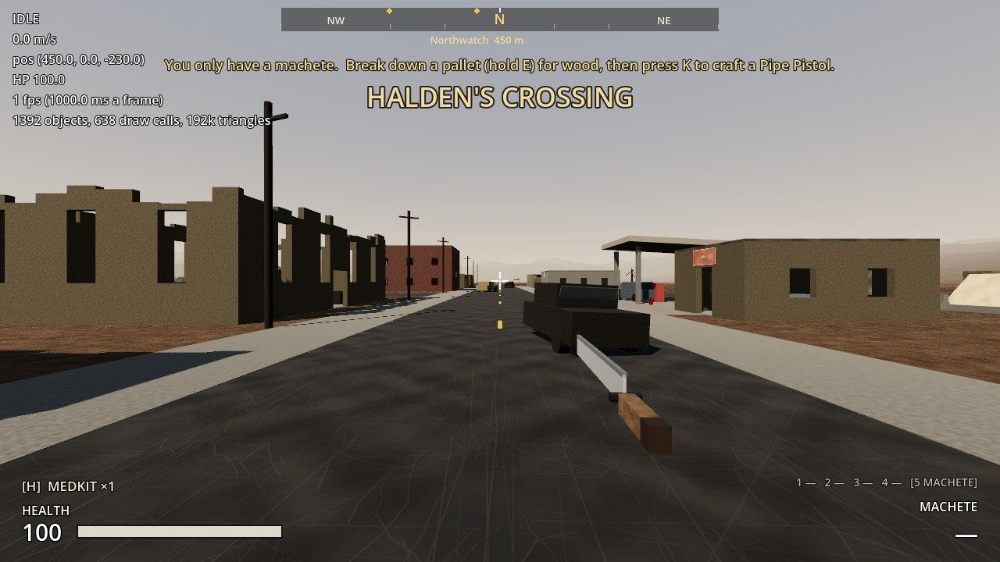

# Increment 16.5: Performance pass

**Status:** complete. 332 automated tests pass in headless Godot 4.7, 8 of them new in `tests/test_performance.gd`.

The zone now draws far less for the same picture. Measured with a new benchmark that stands at 12 fixed spots across the zone, in the Forward+ renderer the game uses:

| Spot | Draw calls before | After | Objects before | After |
|---|---|---|---|---|
| Outpost yard | 1,231 | 525 | 2,681 | 1,011 |
| Outpost gate, looking out | 278 | 144 | 608 | 468 |
| Main road to Halden's | 287 | 197 | 699 | 527 |
| Halden's, Main Street | 3,015 | 636 | 4,067 | 1,212 |
| Halden's water tower | 518 | 356 | 1,014 | 730 |
| Farm, looking at Halden's | 1,038 | 417 | 1,705 | 804 |
| Inside the hospital | 874 | 255 | 1,509 | 630 |
| Hospital roof | 337 | 248 | 746 | 617 |
| Smuggler's Gulch | 914 | 392 | 1,581 | 864 |
| Black Ridge Mine | 645 | 320 | 1,234 | 768 |
| Northwatch | 881 | 263 | 1,605 | 696 |
| Open ground | 1,288 | 555 | 2,347 | 1,010 |
| **Whole route** | **11,306** | **4,308** | | |

That's **62% fewer** over the route, and Halden's Main Street goes from 3,015 to 636. Merging on its own accounts for about half of the saving (8,252 → 4,308 with everything else the same); the shadow and occlusion changes make up the rest.

Draw calls are how many separate drawing instructions the computer sends the graphics chip each frame, and with many small pieces they were the main cost. Triangles were never the problem.

**Nothing you can do in the game changed.** The same views rendered with and without the changes match pixel for pixel, apart from a few small shadow slivers (under 0.3% of the screen in the worst view). Collision, looting, moving and scrapping props, breaking down piles, saving and the navmesh are untouched, and the tests check each of these.



## What changed

1. **Buildings are merged when the zone loads.** The plain pieces of each place (walls, floors, roofs, fixed dressing) become one mesh per material, size and 48 m patch of ground. Across the zone, 3,036 pieces become 707.
   - Props you can move or scrap (sandbags, fences, barriers, trucks, crates, drums) and salvage piles keep their own node, so they still move, scrap and break down. Their own pieces are merged inside them, so a sandbag wall is one mesh instead of 18.
   - Never merged: containers (their lids and doors open), pickups, ladders, raiders, anything saved, anything see-through.
   - It adds well under a second to loading: under a tenth of a second on its own here, and up to 0.8 s while the test machine was also rendering in software. The scene files are unchanged, so you can still edit every wall in the Godot editor.
2. **Interiors are drawn only when you're close.** Furniture, loot, containers and lamps inside a roofed building are drawn within 70 m (it was up to 320 m) and cast no sun shadow, since the sun doesn't reach inside. Roofless ruins like the burned church are left alone: the sun does reach in there.
3. **Fewer sun shadows.** The sun's shadows use 2 cascades out to 120 m, instead of 4 out to 150 m. Each cascade draws every shadow-casting object again, so this nearly halves the shadow work. Tiny things under half a metre cast no shadow.
4. **Buildings hide what's behind them.** Occlusion culling is on. Each building's walls, floors and roofs get an invisible blocker, made from its collision boxes and shrunk slightly, so Godot skips drawing whatever they hide. Inside the hospital, this alone cut the draw calls by a third.
5. **F3 shows the numbers.** The debug readout now shows fps, milliseconds per frame, objects, draw calls and triangles.

## Checking it on your Mac

Press **F3** in game and note the numbers at:
- the outpost gate
- Halden's Main Street
- the farm, looking toward Halden's
- inside the hospital

Or run the benchmark, which prints the table above for your machine (its fps column is meaningful on real hardware):
```
godot --path . -s res://tools/benchmark.gd
godot --path . -s res://tools/benchmark.gd -- --no-batch    # without the merging, to compare
```

## Files

| File | What it is |
|---|---|
| `scripts/world/static_batcher.gd` | New: merging, interiors, small shadows and occluders, per site |
| `scripts/world/zone.gd` | Runs the batcher for each place before setting draw distances (`batch_sites` turns it off) |
| `scripts/ui/hud.gd` | F3: fps and draw counts |
| `levels/early_zone/early_zone.tscn`, `tools/build_early_zone.gd` | The sun: 2 shadow cascades to 120 m |
| `project.godot` | Occlusion culling on |
| `tools/benchmark.gd` | New: the fixed route and its table |
| `tests/test_performance.gd` | 8 new tests (below) |

## Tests (`tests/test_performance.gd`)

1. **Merging keeps every triangle and all collision:** each place has the same triangles, the same collision shapes and the same scripted things, with 40%+ fewer meshes, merged in under a second.
2. **Merged meshes keep their look:** every building material is still drawn, and each merged mesh has a material and a draw distance.
3. **Props still move and scrap:** a merged sandbag wall moves with F and hides when scrapped.
4. **Containers and piles untouched where it matters:** every container keeps all its parts, and every pile yields the same.
5. **Interiors drawn close, without sun shadow:** the hospital's medicine cabinet within 70 m and no shadow; a cache out in the open still seen from afar; the hospital's walls from far off.
6. **Buildings hide what's behind them:** occlusion culling is on, and every place has occluders, each inside a building.
7. **Sun shadows:** two cascades, to 120 m.
8. **F3 readout:** shows fps and draw calls.

## What's left, if it's ever needed

- **Containers** are still several meshes each (about 45 across the zone), because their lids and doors open. They could be merged except for the moving part.
- **Shipping containers** keep their parts, because their paint is set per container.
- **Far-off buildings** could be swapped for one simple box each beyond about 300 m.
