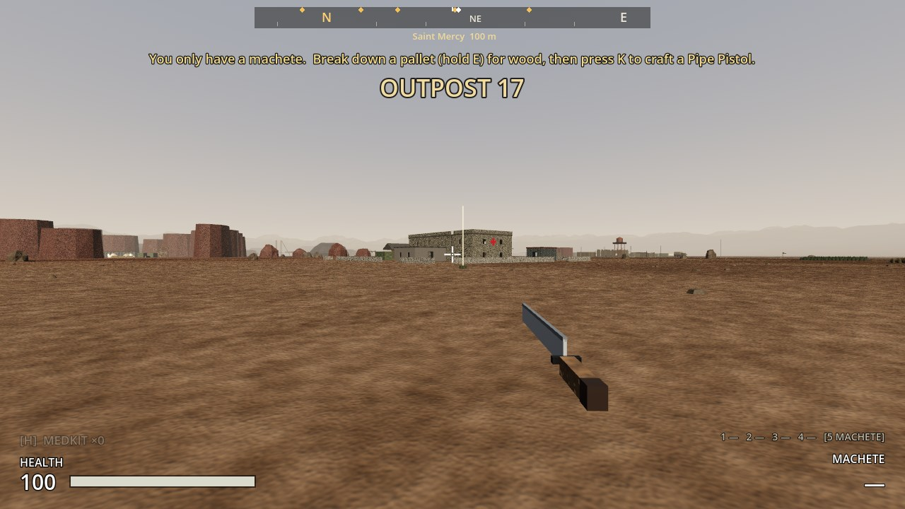
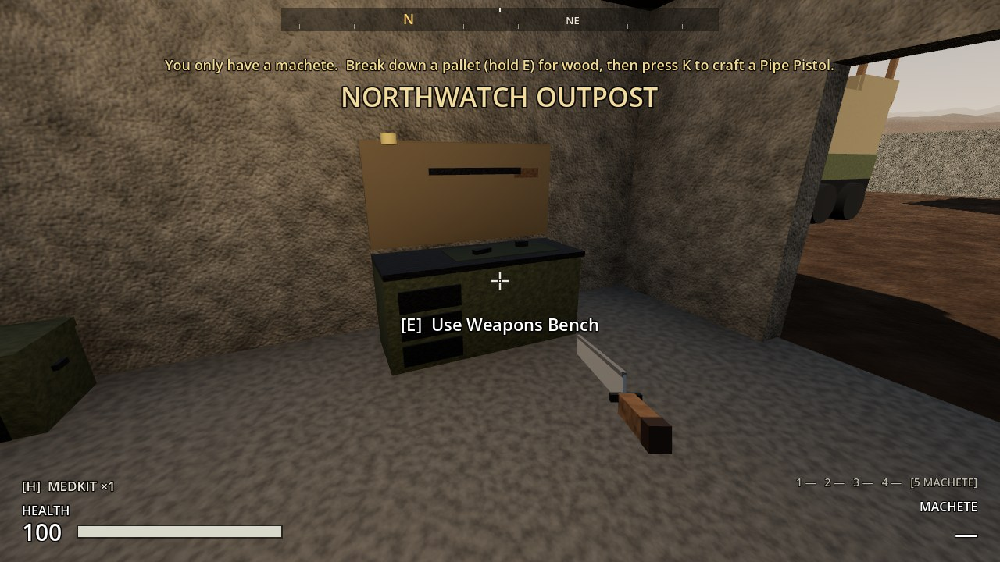
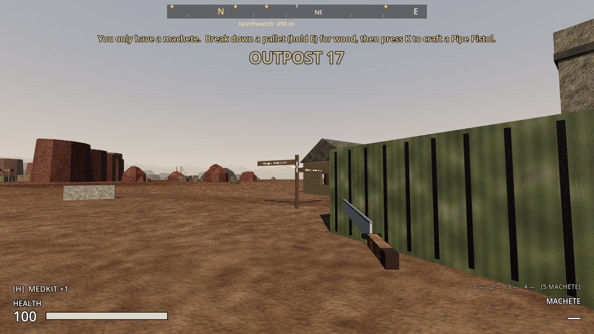
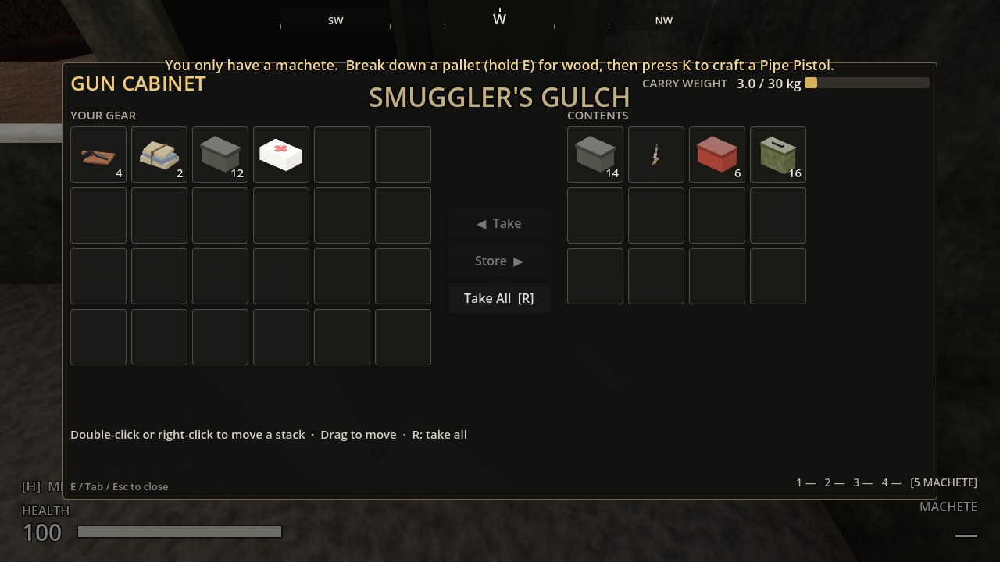
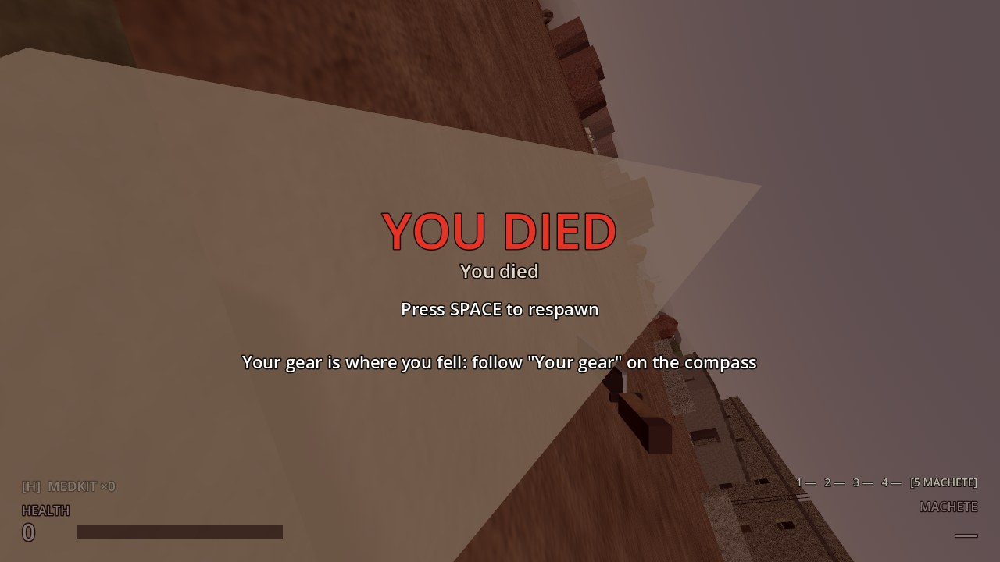
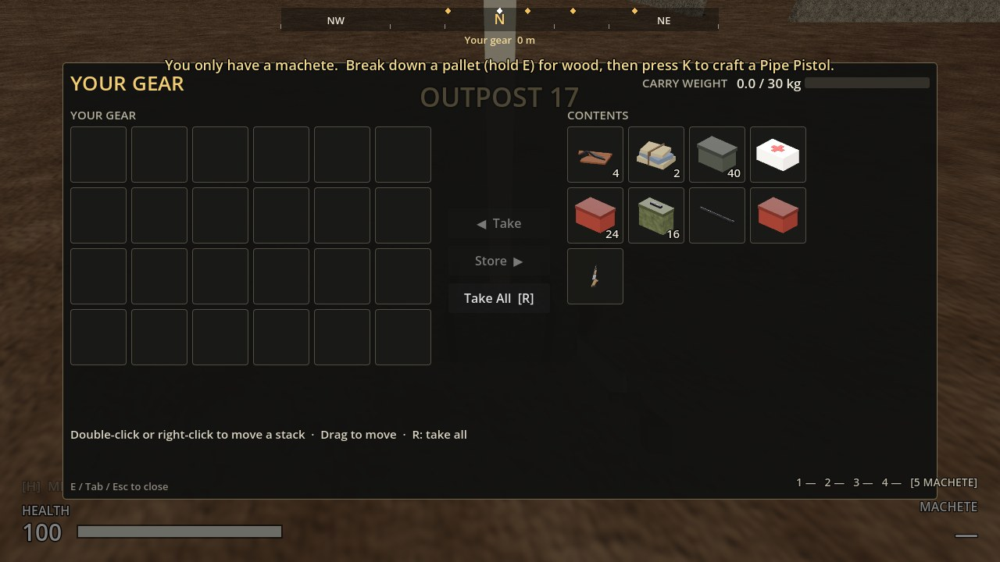

# Increment 16.6: Dropped gear, guns to find, Northwatch's gun bench

**Status:** complete. 340 automated tests pass in headless Godot 4.7, 8 of them new in `tests/test_gear_and_guns.gd`.

Four changes from your playtest notes:
1. **Dying drops your gear** in a chest where you fell, and you come back with only your machete.
2. **Guns you can find** in Smuggler's Gulch and at Northwatch, with better loot all round in both.
3. **A gun bench** (weapons bench) in Northwatch's armory.
4. **The signpost inside a building** by Saint Mercy is out at the trail head.

**A real-window run** of the game's own main scene, with injected key input:
- **Smuggler's Gulch:**
  - Searching the Gun Cabinet (hold **E**) found a pump shotgun, with pistol rounds, shells and rifle rounds.
  - **R** (Take All) put the shotgun straight into slot 3, ready to fire.
- **Northwatch:**
  - The armory has the weapons bench against its north wall.
  - A weapons locker held a second shotgun (you already had one, so it came as shells), plus ammo and parts.
- **Dying on open ground** with 89 items and the shotgun:
  - The death screen says your gear is where you fell.
  - The chest appeared on the spot. Your backpack was empty and only the machete was left.
  - **Space** respawned you at the outpost with nothing.
- **Going back for it:**
  - From 40 m away, "Your gear" showed on the compass and a pale beam of light stood over the chest.
  - **E** opened it at once (no searching), and **R** took back all 89 items and the shotgun.
  - Once closed and empty, the chest was gone.

## Dropped gear

- **When you die,** everything you carry goes into a chest called **Your Gear**, where you fell. That's your backpack and every gun except your blade.
  - Each gun keeps its attachments and the rounds in its magazine.
  - You respawn with only the machete, and no free top-up of ammo.
- **Finding it:** a white **"Your gear"** marker on the compass shows the way and the distance, and a pale beam stands over the chest. The death screen reminds you.
- **Opening it:** no search, just **E**.
  - Take things one at a time, or press **R** to take everything.
  - Guns go back into their slots with their attachments and loaded rounds.
  - Once it's empty and you close it, it's gone.
- **Dying again before you fetch it** leaves a second chest. Each death has its own.
- **Dying in the ash storm** pulls the chest back at least 12 m inside the zone's edge, so fetching it won't kill you too.
- **Saved and loaded** like everything else: quit, load, and it's still there with everything in it.
- **Raiders don't take it.** (Something to consider: they could loot it after a while.)

## Guns to find, and better loot

**Guns from containers now work like guns on the ground:** taking one puts it straight into its weapon slot, not your backpack. If you already have that gun or a better one in that slot, you take a magazine of its ammo instead.

| Where | Container | Now holds |
|---|---|---|
| Smuggler's Gulch, the den | **Gun Cabinet** | **Always one gun:** a sidearm pistol (most likely), pump shotgun or service rifle. Plus pistol rounds, and maybe shells, rifle rounds, a magazine or a suppressor |
| Smuggler's Gulch, the den | Contraband ×2 | 3–5 finds (was 2–4). Adds a chance of a 4× scope, foregrip, barrel and trigger group to the attachments, ammo and parts already there |
| Smuggler's Gulch, the lookout | **Lookout Cache** | .308 rounds, and maybe a **scoped rifle** or a pistol, a scope or a red dot |
| Northwatch, the armory | **Weapons Locker ×2** | **Always one gun each:** service rifle or pump shotgun (most likely), pistol, or scoped rifle. Plus 2–3 of rifle rounds, shells, pistol rounds, parts and attachments |
| Northwatch, the armory | Ammo Crate | Always 30–60 rifle rounds, plus more ammo and gunpowder |
| Northwatch, barracks and stores | Military Crate ×2 | Always a medkit, plus ammo, gun parts, bandages and electronics |
| Northwatch, command post | Officer's Locker | Pistol rounds, and maybe a pistol, attachments or a medkit |

A raid on Northwatch can now arm you properly. Outpost 17's lockers are unchanged: your home base still starts you on the machete and crafting.

## Northwatch's gun bench

- The armory is a little bigger (8 × 6 m) and has a **weapons bench** against its north wall, so you can make gun parts and attachments and fit them on the spot.
- The two weapons lockers and the ammo crate are still there, and there's a new south window.

## The signpost

The signpost for the gulch trail at Saint Mercy stood inside the staff house. It now stands at the trail head, west of the staff house. A new test checks every signpost in the zone has nothing solid within reach of its arms.

## Screenshots

| | |
|---|---|
|  |  |
|  | |

## Files

| File | What it is |
|---|---|
| `scripts/interaction/death_cache.gd`, `scenes/world/containers/death_cache.tscn` | New: the Your Gear chest |
| `scripts/core/game_mode.gd` | Drops your gear when you die (`drop_gear_on_death`) |
| `scripts/combat/weapon_slots.gd` | `remove_guns()` (keeps the blade) |
| `scripts/player/player_controller.gd` | Guns taken from containers go to their slot; your own come back as they were |
| `scripts/inventory/loot_table.gd` | `one_of`: exactly one of a list (one gun from the rack) |
| `scripts/world/landmark.gd`, `scripts/ui/compass_bar.gd` | Compass markers can have their own colour |
| `scripts/ui/hud.gd`, `scripts/ui/container_screen.gd` | Death-screen reminder; big containers get wider rows |
| `tools/build_sites.gd` | Six new loot tables, richer smuggler stash, the armory and its bench |
| `tools/build_early_zone.gd` | The signpost's new spot |
| `tests/test_gear_and_guns.gd` | 8 new tests (below) |

## Tests (`tests/test_gear_and_guns.gd`)

1. **Dying leaves your gear where you fell:**
   - backpack and pistol in the chest, on the ground at the spot
   - you're left with your blade, it's on the compass, and you respawn with nothing
   - you take it all back, and the pistol keeps its red dot and its 7 rounds
   - the empty chest goes
2. **Nothing to drop, no chest.**
3. **Dying in the ash storm:** the chest is pulled back 12 m inside the edge, on the ground.
4. **Dropped gear is saved:** after save and load it's in the same place with everything in it, and the pistol comes back as it was.
5. **Guns to find:** the gun cabinet and armory lockers always give exactly one gun (20 rolls each), and the other containers give a bigger haul.
6. **A gun from a container goes into your hands:** taking a second gun you already have gives you its ammo.
7. **Gun bench at Northwatch,** inside the armory.
8. **Signposts stand in the open:** nothing solid within 3.1 m of any of them.
