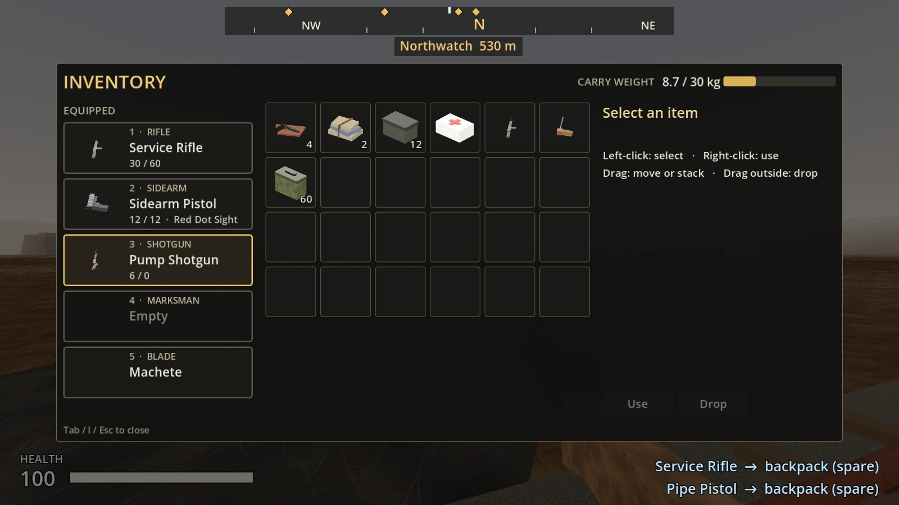
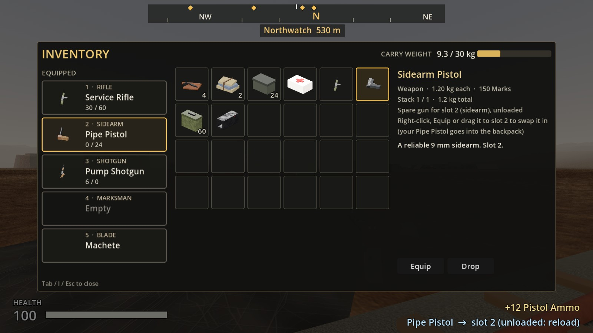
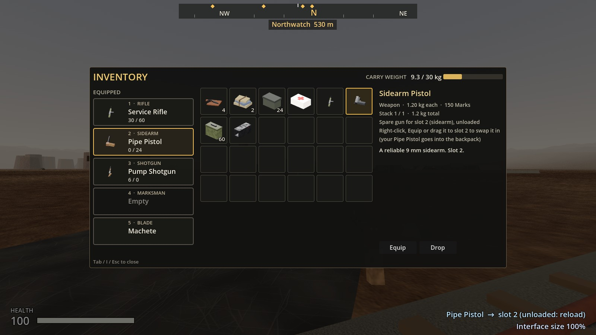
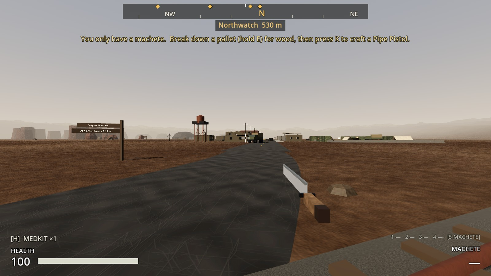
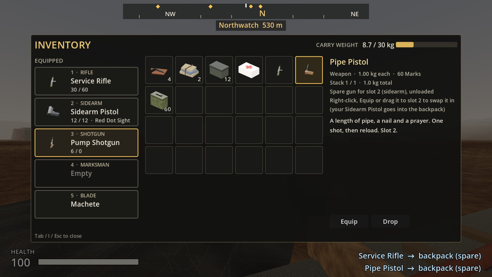

# Increment 16.7: Bigger interface, weapon slots, spare guns

**Status:** complete. 349 automated tests pass in headless Godot 4.7, 9 of them new in `tests/test_spare_guns.gd`.

From your playtest notes:
1. **Text, the inventory and the compass were too small.** Everything is bigger now, and it scales properly on a Retina screen and in full screen.
2. **The inventory screen shows your five weapon slots,** filled with your guns.
3. **Spare guns:** carry more than one of a gun in your backpack. You'll need that to arm guards and soldiers later.

## A bigger interface

- **It scales with the window now.** Before, the interface was drawn at a fixed size in pixels. On a Retina Mac, or in full screen, that made it much smaller than intended. It now stretches with the window, so it looks the same size whatever the screen.
- **It's 25% bigger by default.** The compass, prompts, notices, inventory, containers and crafting all grow together. The 3D view isn't affected.
- **You can change it:**
  - **Ctrl/Cmd + =** makes it bigger, **Ctrl/Cmd + −** smaller (5% at a time), and **Ctrl/Cmd + 0** puts it back.
  - A notice shows the size, and the game remembers it.
  - The default is already as big as fits on a 16:9 or 16:10 screen while keeping the inventory and container windows whole, so in practice = can't go higher. It's mainly for making things smaller.
- **The compass** is wider, with bigger letters (N/E/S/W 22, NE/SW 16), bigger place markers, and the place name and distance on a dark backing so they read against bright sky. The "You only have a machete" hint moved down to make room.
- **While a window is open,** the weapon readouts in the corners are hidden, and the latest two notices sit under the window instead of over its buttons.

| 125% (new default) | 100% (the old size) |
|---|---|
|  |  |

## Weapon slots in the inventory screen

The left of the inventory screen shows your five weapon slots, in place of the old text list:

| Slot | Kind | Guns |
|---|---|---|
| 1 | Rifle | Service rifle |
| 2 | Sidearm | Pipe pistol, sidearm pistol |
| 3 | Shotgun | Pump shotgun |
| 4 | Marksman | Scoped rifle |
| 5 | Blade | Machete |

- Each slot shows its gun's picture and name, the rounds loaded and carried, and its attachments. Empty slots say "Empty".
- The gun in your hands is outlined in amber.
- **Click** a slot to take that gun out.
- **Right-click** a slot, or **drag** it onto the backpack, to put the gun away as a spare. Your blade stays on your belt.

## Spare guns

- **A second gun goes into your backpack.** If you find, pick up, craft or take a gun you already have (or a worse one than in that slot), it goes into your backpack as a spare. It used to turn into ammo.
  - The prompt says so: "Pick up Pump Shotgun (spare, into your backpack)".
- **A better gun swaps in.** It goes into its slot, and the one it replaces goes into your backpack instead of disappearing (a pistol over a pipe pistol, say).
- **Spares have weight:** pipe pistol 1.0 kg, pistol 1.2 kg, shotgun 3.4 kg, service rifle 4.0 kg, scoped rifle 4.6 kg. With the 30 kg limit you can carry a few, not an armory. If there's no room, you can't take it, and the prompt says why.
- **Swapping a spare in:**
  - **Right-click it**, select it and press **Equip**, or **drag it onto its weapon slot**.
  - The gun that was in that slot goes into the backpack in its place.
  - Swapping never fails for weight, since you're trading one gun for another.
  - The details panel says which slot it's for and what would go into the backpack.
- **Spares are carried unloaded and stripped:**
  - A gun going into the backpack has its rounds put back with your ammo, and its attachments come off into the backpack.
  - A spare comes out with an empty magazine, so reload.
  - Swapping back and forth never makes ammo (a test checks this).
  - Fit the attachments again at a weapons bench.
- **Spares go everywhere guns as items already went:**
  - You can drop them, store them in a storage crate, or leave them in a container.
  - They go into your dropped gear if you die.
  - That's the groundwork for arming guards: stockpile guns in a crate at your base.

## Files

| File | What it is |
|---|---|
| `project.godot` | The interface stretches with the window (`canvas_items`, `expand`) |
| `scripts/ui/ui_scale.gd` | New: interface size: default, limits, saved setting |
| `scripts/ui/hud.gd` | Ctrl/Cmd + = / − / 0; corner readouts hidden and notices moved while a window is open; spare-gun notices |
| `scripts/ui/compass_bar.gd` | Bigger compass, letters, markers and name |
| `scripts/ui/weapon_slot_row.gd` | New: one weapon slot in the inventory screen (click, right-click, drag and drop) |
| `scripts/ui/inventory_screen.gd`, `inventory_slot.gd` | Weapon slots; Equip for spare guns; drag guns both ways |
| `scripts/player/player_controller.gd` | `receive_gun`, `gun_destination`, `request_equip_spare`, `request_stow_gun` |
| `scripts/combat/weapon_slots.gd` | `remove_weapon` |
| `scripts/inventory/inventory_component.gd` | `add_to_slot` |
| `scripts/interaction/pickup.gd` | Guns on the ground follow the same rules |
| `resources/items/weapons/*_item.tres` | Gun weights |
| `scenes/ui/hud.tscn` | Wider inventory window; the hint moved down |

## Tests (`tests/test_spare_guns.gd`)

1. **Guns weigh something as spares,** long guns more than pistols.
2. **A second gun becomes a spare,** and a worse one too.
3. **A better gun swaps the old one into the backpack.**
4. **No room, no gun:** refused with a reason, and nothing changes.
5. **Equipping a spare swaps without free ammo:**
   - it comes out unloaded, and the old gun takes its backpack slot
   - its rounds go back to your ammo, and back-and-forth swaps make nothing
   - you can't equip the gun already in your hands
6. **Putting a gun away:** its red dot and 17 rounds go into the backpack, and the machete comes out. The blade can't be put away.
7. **Spares drop with your gear** when you die.
8. **Weapon slots in the inventory screen:**
   - five slots, showing guns, names, pictures and "Empty"
   - click to take a gun out, Equip and right-click for spares
   - drag a gun off its slot, and drop a spare on its own slot only
9. **Interface size:** stretches with the window, 125% by default, fits every common screen, can be made smaller and is remembered, and the compass is bigger.

Changed tests: a second shotgun picked up is now a spare, not 6 shells; crafting a pipe pistol when you hold a pistol now makes a spare, and the pistol it replaced is kept.
