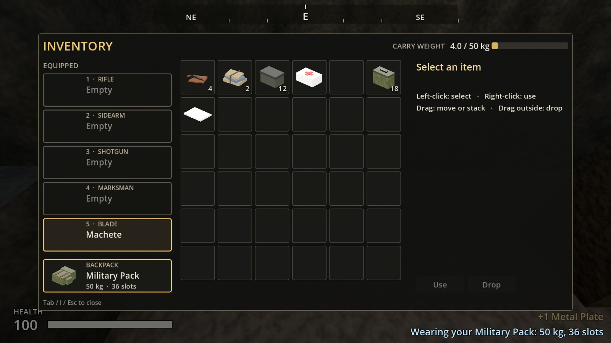
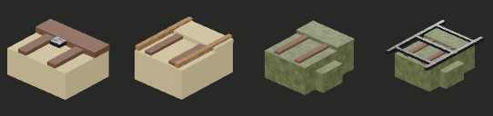
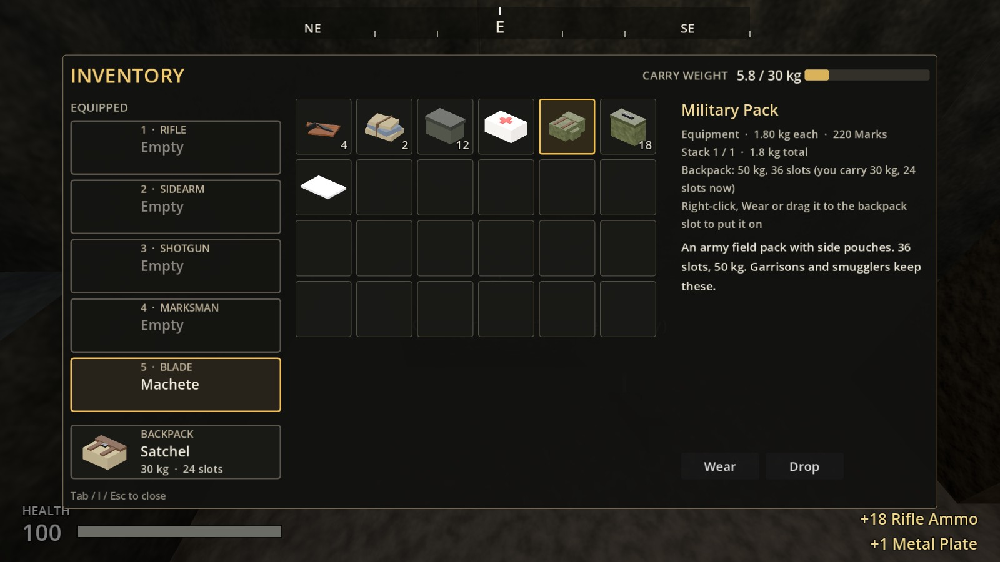
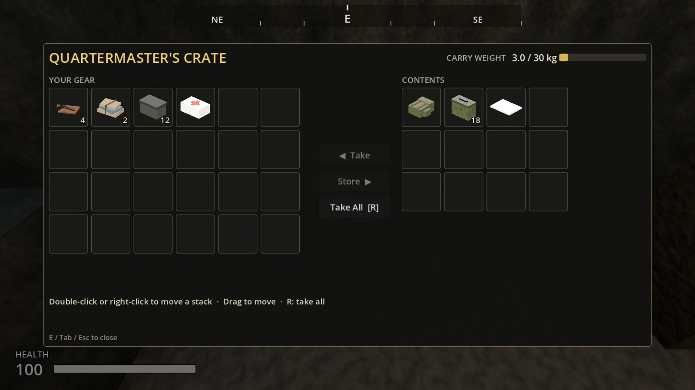
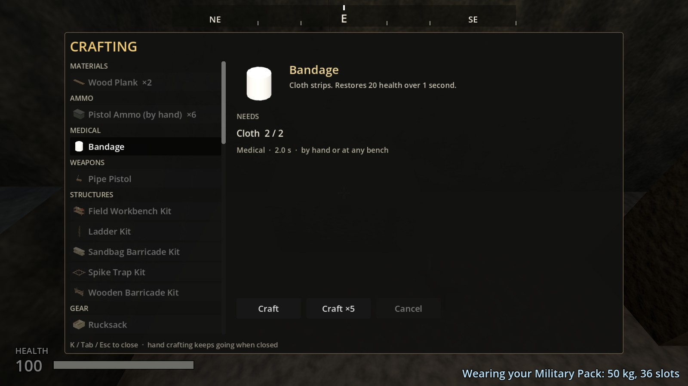

# Increment 16.8: Backpacks, and double-tap W to sprint

**Status:** complete. 359 automated tests pass in headless Godot 4.7, 10 of them new in `tests/test_backpacks.gd`. (One older audio test, which checks a sound is still playing two frames after a trigger pull, failed once in the final full run and passed in isolation twice: it is timing-sensitive.)

1. **Backpacks:** wear one to carry more. Craft the first, find the second, and craft or find the last.
2. **Double-tap W to sprint,** like Minecraft. Shift still works. The game counts time spent sprinting, ready for hunger.

**A real-window run** of the game's own main scene, with injected key input:
- **Sprinting:**
  - Holding **W** walked at 4.5 m/s.
  - Tapping **W** and holding it again sprinted at 7.5 m/s, and 1.5 s of sprinting was counted.
- **Northwatch:** the Quartermaster's Crate in the stores held a military pack.
- **Wearing it:** in the inventory, **Wear** put it on. The backpack slot showed **Military Pack, 50 kg, 36 slots**, the grid grew to 36 slots, and the weight bar read 50 kg.
- **The crafting screen** (**K**) has a new **Gear** section with the rucksack.

The run caught one problem, fixed: **double-tap timed the taps on the wall clock.** If the game stuttered between your two taps, they counted as too far apart. It now times them in game time.

## Backpacks

| Pack | Carries | Slots | How you get it |
|---|---|---|---|
| Satchel | 30 kg | 24 | What you start with. Never lost |
| **Rucksack** | 40 kg | 30 | **Craft by hand** (K → Gear): 6 cloth, 2 wood planks, 2 scrap metal, 8 s |
| **Military Pack** | 50 kg | 36 | **Loot only:** always in Northwatch's Quartermaster's Crate (in the stores hut); sometimes in Northwatch's military crate and the Gulch's contraband |
| **Frame Pack** | 60 kg | 42 | **Craft at a workbench:** 3 metal pipe, 2 springs, 1 metal plate, 8 cloth, 14 s. Rarely in Black Ridge Mine's supplies. **It rattles** |

- **The backpack slot** sits in the inventory screen, under the weapon slots. It shows what you're wearing, its weight limit and its slots.
- **Putting one on:** right-click it in the grid, select it and press **Wear**, or drag it onto the backpack slot. The pack you had on goes into the grid in its place.
  - A worn pack doesn't take a slot and doesn't count toward your weight.
- **Taking it off:** right-click the backpack slot, or drag it onto the grid. You're back to your satchel.
- **Switching to a smaller pack** only works if everything fits. Otherwise it says what to do: "The Rucksack carries 40 kg: drop 6.5 kg first", or "empty 3 slots first". Nothing ever spills.
- **The frame pack's catch:** walking with it makes a rattle raiders hear within 14 m, and 21 m when sprinting. Crouch-walk to move quietly. The others are silent.
- **Dying:** the pack you're wearing goes into your dropped gear with everything else, and you come back with your satchel. Fetch it to get your capacity back.
- **Saved and loaded:** your pack and everything in its extra slots come back as they were. Older saves load with the satchel.
- **A big pack's grid scrolls:** the inventory shows 6 rows at a time, and the container screen's "Your gear" side shows 4.
- **Packs top out at 60 kg,** so the truck (Phase 2) will still be the way to haul big loads.

| | |
|---|---|
|  |  |
|  | |

## Double-tap W to sprint

- **Tap W twice quickly** (within 0.3 s) and hold it: you sprint, at 7.5 m/s instead of 4.5.
- You keep sprinting as long as you keep moving forward. Let go of W, or crouch, and you're back to walking.
- **Shift** still sprints too.
- As in Minecraft, **the view widens slightly** (6°) at full sprint and eases back when you stop.
- Sprinting still lowers your sights and stops you firing, as before.
- **For hunger later:** the player counts every second spent sprinting (`sprint_seconds`). When food comes in, sprinting can burn it faster.
- `PlayerInput` has two settings: `double_tap_sprint` (on/off) and `double_tap_window` (0.3 s).

## Interface tidy-ups

- The inventory window is taller, to fit the backpack slot.
- While any window (inventory, container, crafting) is open, the "You only have a machete" hint and the place-name banner are hidden, so they don't cover the window title.

## Files

| File | What it is |
|---|---|
| `tools/build_backpacks.gd` | New: builds the four packs (models, items, recipes) from data at the top |
| `resources/items/{satchel,rucksack,military_pack,frame_pack}.tres`, `scenes/items/models/*.tscn`, `assets/icons/*.png` | The packs |
| `resources/recipes/craft_rucksack.tres`, `craft_frame_pack.tres` | Their recipes (new Gear category) |
| `scripts/inventory/item_definition.gd` | Equipment category; `pack_slots`, `pack_carry_weight`, `pack_rattle_radius` |
| `scripts/inventory/inventory_component.gd` | `set_capacity` (grow or shrink, keeping everything) |
| `scripts/inventory/player_inventory.gd` | The pack you wear; satchel defaults |
| `scripts/player/player_controller.gd` | Wear and take off packs (validated), rattle, save; sprint view and `sprint_seconds` |
| `scripts/player/player_input.gd` | Double-tap W |
| `scripts/interaction/death_cache.gd` | Your pack drops with your gear |
| `scripts/ui/pack_slot_row.gd` | New: the backpack slot |
| `scripts/ui/inventory_screen.gd`, `container_screen.gd`, `inventory_slot.gd`, `hud.gd` | Backpack slot, Wear button, scrolling grids, notices |
| `tools/build_sites.gd` | Quartermaster's Crate; packs in loot tables |
| `tools/render_item_icons.gd` | Can render just some icons (`-- id1,id2`) |

## Tests (`tests/test_backpacks.gd`)

1. **Four packs, each carrying more,** with icons and models. No pack means satchel defaults, the top carries 60 kg, and only the frame pack rattles.
2. **Wearing and swapping up:** slots and weight change, the worn pack leaves the grid, nothing is lost, and the old pack takes the new one's place.
3. **A smaller pack only if it all fits:** refused with the reason when there are too many things or too much weight; things in high slots move down when it fits.
4. **To craft and find:** rucksack by hand (actually crafted), frame pack at a workbench, military pack loot only (the quartermaster always has one), frame pack at the mine.
5. **Dying drops your pack,** and you're back to the satchel.
6. **Your pack is saved,** with what's in slot 41; an older save loads with the satchel.
7. **The frame pack rattles** when you walk (a test listener hears it); a military pack doesn't; crouching is quiet.
8. **The backpack slot in the inventory screen:** shows the satchel, then the rucksack; the grid grows to 30 slots and scrolls; the button says Wear; right-click takes the pack off.
9. **Double-tap forward:**
   - two taps within 0.3 s sprint until you let go
   - taps too far apart don't
   - crouching stops it, and it can be turned off
10. **Sprinting is faster and widens the view,** and the time is counted.
