# Milestone 3, Increment 16: The five places, built out

**Status:** complete. 324 automated tests pass in headless Godot 4.7, 11 of them new in `tests/test_sites.gd`.

Increment 15 left five of the zone's places as **blockouts**: solid shapes you couldn't go into. Each one is now a real place, built the way Halden's Crossing is:
- buildings you walk into, with rooms, windows, upper floors and roofs
- containers to search and salvage piles to break down
- loot lying about
- ladders up to lofts, roofs and lookouts
- raiders who wait there

They stand where the Regional Buildout Map puts them, so the roads, signposts, compass and navmesh from Increment 15 all still line up.

**A real-window run** used the game's own main scene, with injected key input:
- **Saint Mercy Clinic:**
  - Walking in off the road showed the **SAINT MERCY CLINIC** banner.
  - **W** walked through the hospital's front door.
  - **Hold E** searched the Medicine Cabinet (two medkits and more). **R** took the lot.
  - The ladder by the stairwell climbed to the upper floor (y 3.3).
- **Ash Creek Farms:** the barn's loft ladder went up onto the hayloft deck (y 3.0), and the Hayloft Stash gave up shotgun shells.
- **Black Ridge Mine:** **W** walked into the mine tunnel to the lamp-lit dead end. The Explosives Crate held gunpowder.
- **Smuggler's Gulch:**
  - Coming up the trail woke **6 raiders** (3 Raider Veterans and 3 raiders) among the shacks.
  - The Gun Cabinet in the den held a can of ammunition.
- **Northwatch Outpost:** the Comms Gear crate in the command post held electronics.
- 129 items came home in the backpack.

The tests and the playtest caught several problems, all fixed:
- **Interiors were nearly black.** The sun never reaches inside, and nothing else lit the rooms. Every roofed building now has warm ceiling lamps, one every ~9 m per floor, and the mine tunnel has two work lamps. They cast no shadows and fade out past 60 m, so all 30 cost little.
- **An older save would have wiped the new places' loot.** Loading clears pickups a save doesn't list, and an Increment 15 save listed nothing in the blockouts. Saves are now version 4: a version 3 save leaves the five places exactly as they are.
- **A crate upstairs in the hospital was 17 m from any way up.** It's now beside the stairwell ladder.
- **The mine's winding wheel came out the wrong size.** It shared a cached box mesh with another part, and now has its own.
- **Several placements were moved before the first build:**
  - a few containers
  - the water tower, which stood in the farm lane
  - the clinic's boundary wall, which blocked the trail to the gulch
  - the rocks over the mine tunnel, which weren't solid

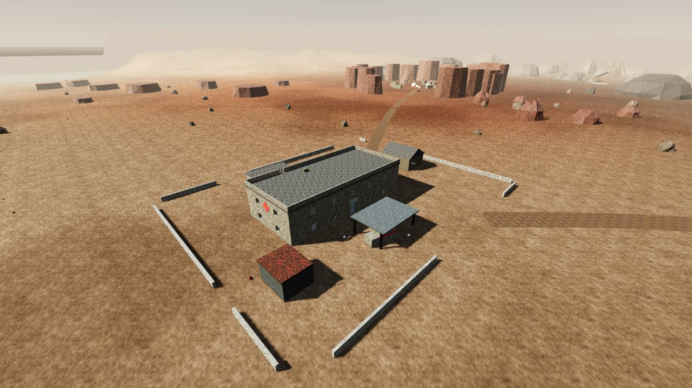

## Playable result

| Place | What's there | Containers | Raiders |
|---|---|---|---|
| **Saint Mercy Clinic** | Two-storey hospital: reception, wards with beds, a pharmacy, surgery upstairs and a roof with a parapet. Also a triage annex, staff house, generator shed, ambulance bay and a broken boundary wall. | 11 (medicine, pharmacy, surgical supplies; a rooftop stash) | 3 raiders |
| **Ash Creek Farms** | Farmhouse, a red barn with a hayloft, tool shed (**workbench**), pump house, a water tower you can climb, plus a silo, chicken coop, crop fields and a tractor wreck. | 8 (feed bins, tool chests, a lookout stash up the tower) | 2 raiders |
| **Smuggler's Gulch** | A hollow in a ring of red rock, reached by one gap. Inside are the smugglers' den (**weapons bench**, contraband, gun cabinet), three shacks, a lookout, shipping containers, tents and fires. | 8 (contraband with attachments, an ammo crate, a raider cache) | 3 **Raider Veterans** + 3 raiders |
| **Black Ridge Mine** | A headframe you can climb to the winding gear, plus a hoist house, mine office with a safe, workshop (**workbench**), bunkhouse and ore plant. A tunnel runs into the ridge to the explosives store. | 9 (mine supplies, explosives, the foreman's locker and the mine safe) | 4 raiders |
| **Northwatch Outpost** | A walled military post: command post with the radio, barracks, an armory with two weapons lockers, stores, and two guard towers you can climb. | 9 (comms gear, weapons lockers, military crates) | 2 **Raider Veterans** + 2 raiders |

Across the five places:
- **21 buildings** to go into, **45 containers**, **42 salvage piles** (scrap, appliances, furniture, pallets) and **31 pickups**.
- **8 ladders** and **3 crafting stations**.

**Nine new loot tables** match what each place should hold:

| Table | Where | Leans toward |
|---|---|---|
| `hospital_supplies` | Clinic wards and surgery | Bandages, chemicals, cloth, the odd medkit |
| `pharmacy` | Clinic pharmacy | Always bandages; chemicals, medkits |
| `farm_shed` | Farm sheds and bins | Scrap, planks, springs, pipe, fuel, shotgun shells |
| `barn_loft` | The hayloft | Always shotgun shells; sometimes a gun stock |
| `mine_supplies` | Hoist house, headframe | Gunpowder, fuel, metal plate, scrap |
| `mine_explosives` | The tunnel | Always 3–5 gunpowder |
| `mine_office` | Foreman's locker | Electronics, pistol ammo, a magazine |
| `smuggler_stash` | The den | Always electronics; attachments, rifle and pistol ammo, a receiver |
| `comms_gear` | Northwatch command post | Always electronics; a 4× scope, .308 rounds |

The rest use the existing tables (weapons lockers, footlockers, tool chests, ammo crates, military crates and so on).

**The raiders sleep until you come near.** Each place's spawners wake within 230 m and go back to sleep when you leave, as in Increment 15.

**Saves:** every container you search and every pickup you take in the new places is saved and loaded like the rest of the zone. Older saves load as before.

## Screenshots

| | |
|---|---|
| 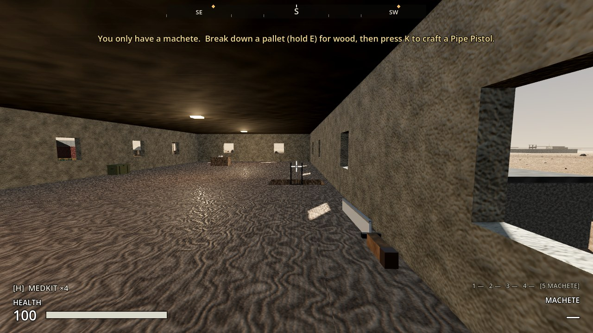 | 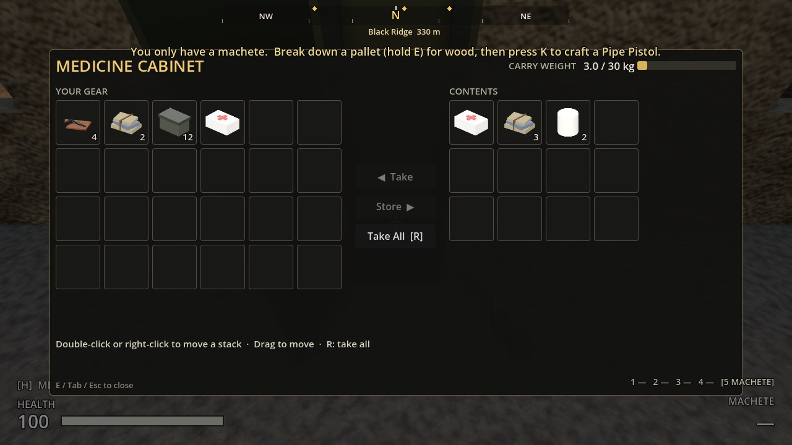 |
| 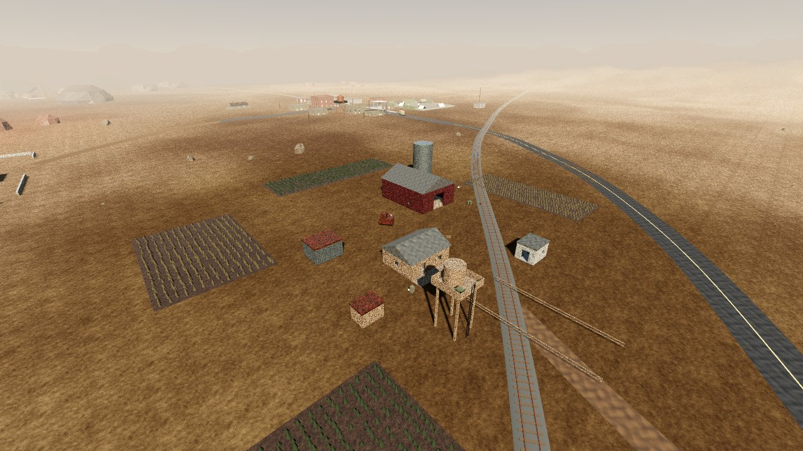 | 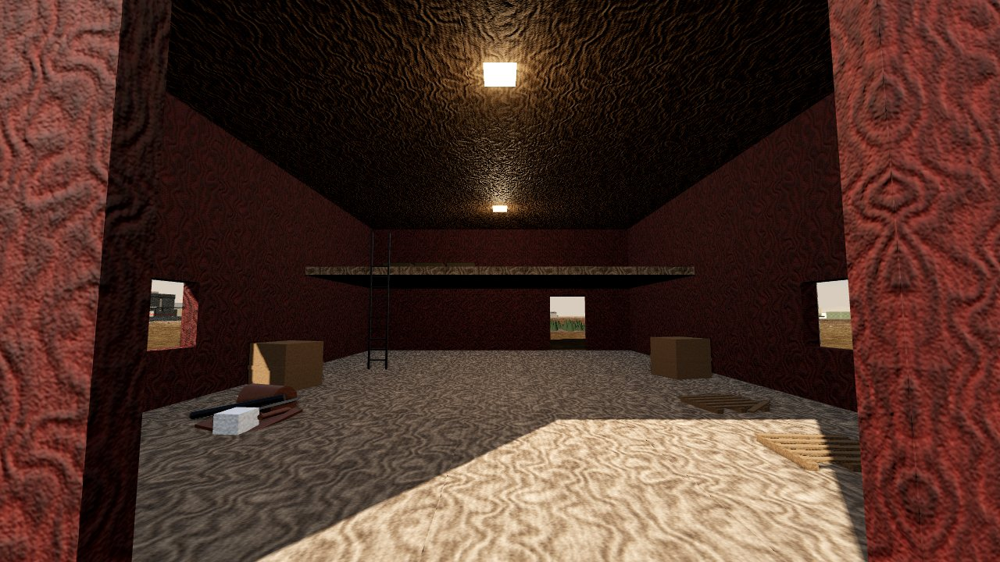 |
| 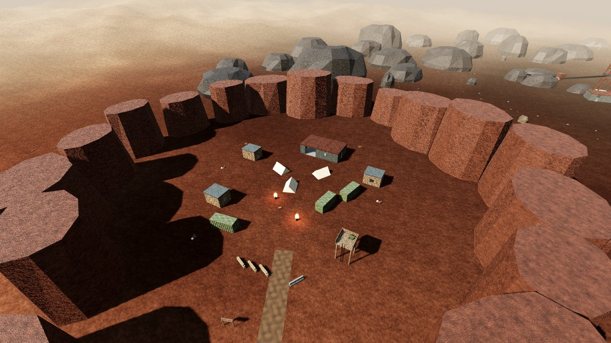 | 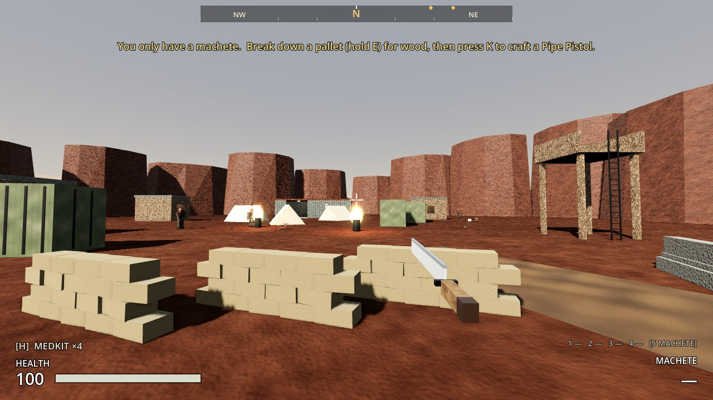 |
| 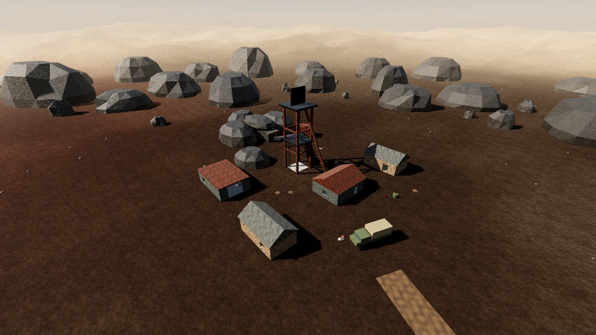 | 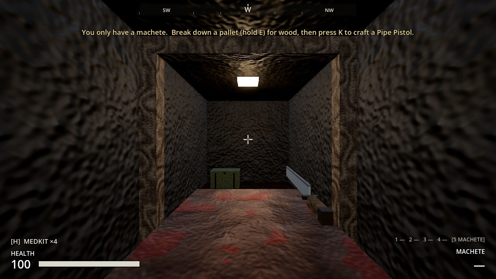 |
| 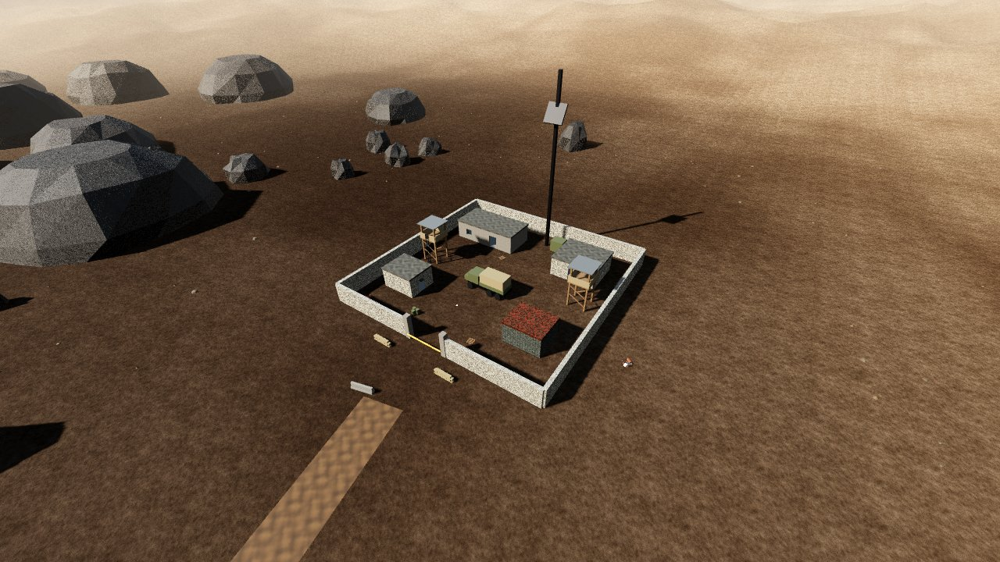 | 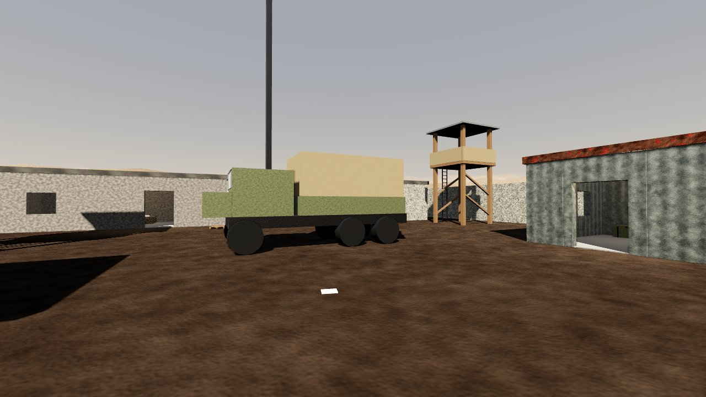 |

## Files

| File | What it is |
|---|---|
| `levels/saint_mercy_clinic/saint_mercy_clinic.tscn` | Saint Mercy Clinic. Generated |
| `levels/ash_creek_farms/ash_creek_farms.tscn` | Ash Creek Farms. Generated |
| `levels/smugglers_gulch/smugglers_gulch.tscn` | Smuggler's Gulch. Generated |
| `levels/black_ridge_mine/black_ridge_mine.tscn` | Black Ridge Mine. Generated |
| `levels/northwatch_outpost/northwatch_outpost.tscn` | Northwatch Outpost. Generated |
| `resources/loot/*.tres` | The nine new loot tables (listed above). Generated |
| `tools/site_kit.gd` | The building kit the sites are made with (below) |
| `tools/build_sites.gd` | The five places, one function each, and the loot tables |
| `tools/build_early_zone.gd` | Now instances the five places in place of the blockouts |
| `scripts/persistence/save_manager.gd` | Save version 4: older saves leave the new places alone |
| `tests/test_sites.gd` | 11 tests (below) |
| `levels/early_zone/sites/` | **Removed:** the five blockouts |

## How it's built

- **Generated, like the zone.** `tools/build_sites.gd` writes the five scenes and nine loot tables. Then `tools/build_early_zone.gd` rebuilds the zone and its navmesh around them. Run them in that order after any change:
  ```
  godot --headless --path . -s res://tools/build_sites.gd
  godot --headless --path . -s res://tools/build_early_zone.gd
  ```
  Hand edits to the generated scenes are overwritten. Change the builder instead.
- **`site_kit.gd`** makes a place from a few calls:
  - **`building(name, at, yaw, size, opts)`:** walls cut round doors and windows, floors and upper floors (with a hole for the ladder), a flat or pitched roof (optionally a parapet), inner walls with doorways, ruined walls, and ceiling lamps.
    - It records each building's doors, so the tests walk through every one.
  - **Placement helpers:**
    - `container_at_wall(kind, name, building, side, offset, table, label)` puts a crate, footlocker or locker flush against a wall, facing into the room.
    - `container`, `pile`, `pickup` and `fixture` place things in a building's own coordinates.
    - `ladder(name, building, at, yaw, height)` adds a climbable ladder.
  - **Raiders and atmosphere:** `spawner(...)` adds a sleeping raider spawner; `sign`, `tent`, `rock`, `lamp` and `sound` add signs, tents, rocks, lamps and ambient sound.
  - **Groups:** each place has the same groups Halden's Crossing has (Buildings, Furniture, Props, SalvageContainers, SalvagePiles, Loot, CraftingStations…), so the existing systems (searching, salvaging, saving, moving and scrapping props, draw distances) work with no changes.

## Tests (`tests/test_sites.gd`)

1. **Real places now:** each place is its own scene where the map puts it, with 3+ buildings you can walk into, 8+ containers, 6+ salvage piles, 5+ pickups and sleeping spawners.
2. **New loot tables:** all nine load, roll, and give what they promise.
3. **Containers clear and searchable:**
   - every container stands on a floor, inside its room, clear of walls and furniture
   - the player can stand in front of it and search it
4. **Everything reachable:** every container is on the navmesh or a short climb up a ladder.
5. **Salvage and pickups placed sensibly:** on the ground or a floor, not inside walls or furniture.
6. **Walk in through every door:** the player walks in through each building's doors.
7. **Climb every ladder:** the player climbs every ladder to the top and steps off onto the floor, loft or deck.
8. **Raiders wait at each place:** they wake when you arrive, on the ground, on the navmesh, at the place.
9. **Lit inside and cheap:** every roofed building has a lamp up by its ceiling, with no shadows and a fade-out, and the lights across the places stay few.
10. **Looting the places is saved:** a searched container and a taken pickup in each place stay that way through save and load.
11. **An older save leaves the new places alone:** a version 3 save loads without clearing their loot.

`test_early_zone.gd` now checks the five places are real sites, not blockouts. The save-version checks elsewhere expect version 4.

## Notes and next steps

- **Draw calls:** standing in the farm with Halden's Crossing in view draws about 1,600 calls. Most of that is the town, which was already true in Increment 15. The five places add 100–250 each when close.
  - If frame rate suffers on your Mac, the next step is to merge each building's walls into one mesh per material.
  - The screenshots' frame rate (2–3 fps) is the software renderer in the test machine, not a measure of the game.
- **Placeholders:** the buildings use the existing Pack 1–3 materials. A future art pack can replace the boxes with modelled buildings without moving anything.
- **Next on the roadmap (Increment 17):** the world map and travel.
