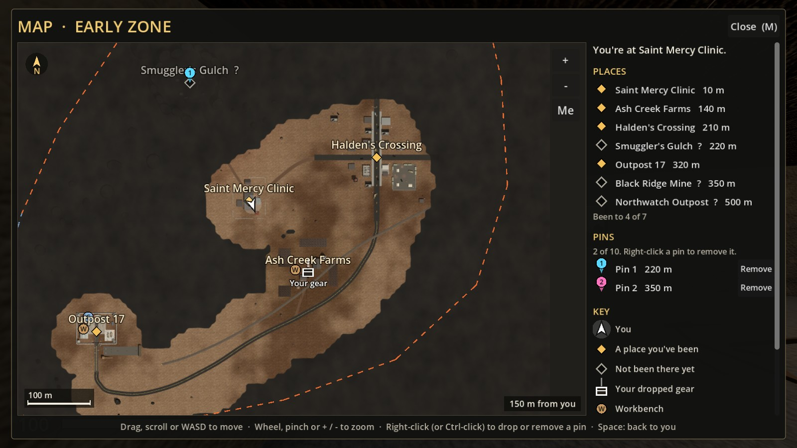
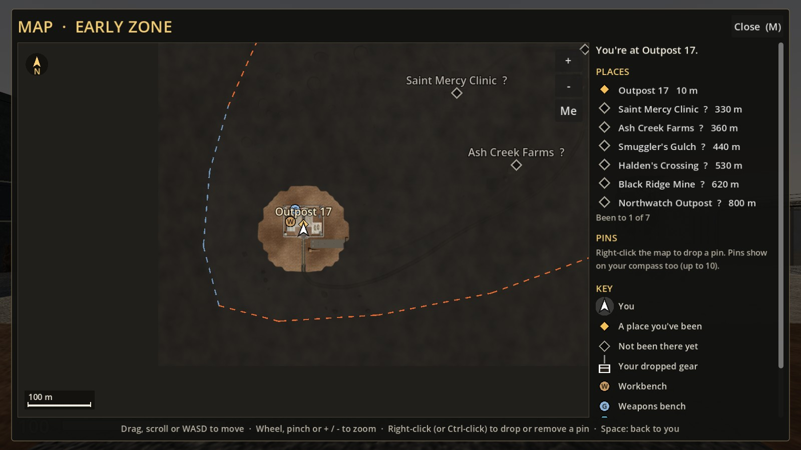
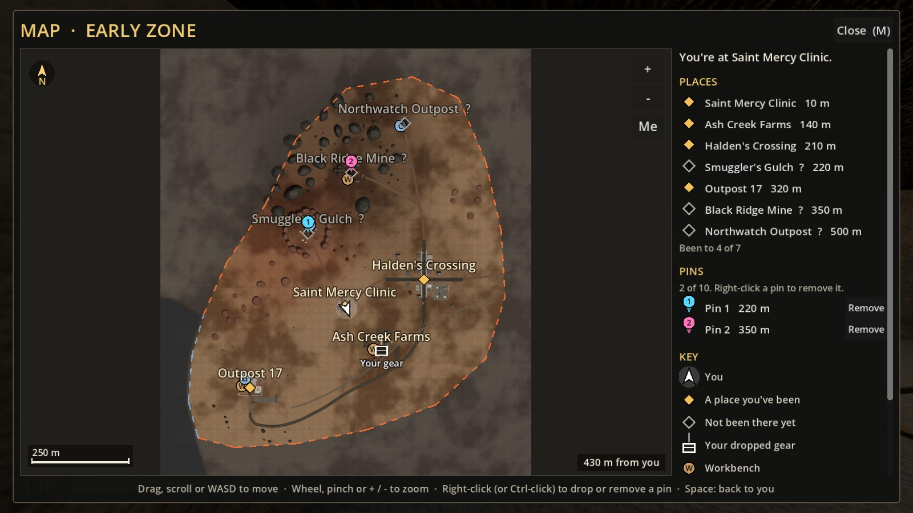
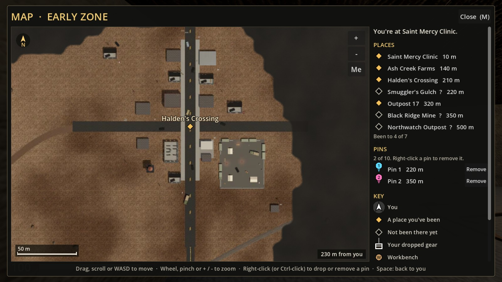
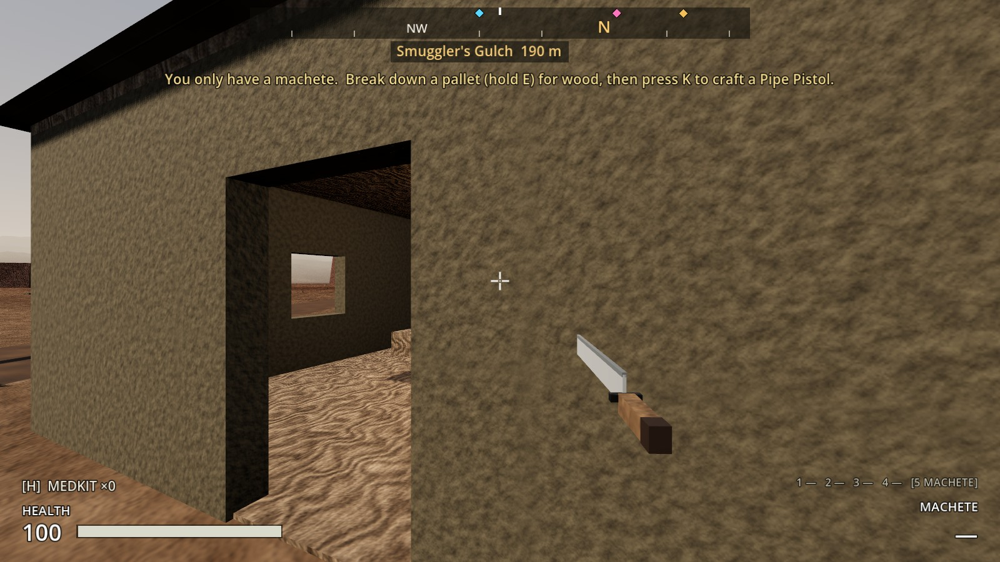

# Increment 17: The map

**Status:** complete. 368 automated tests pass in headless Godot 4.7, 9 of them new in `tests/test_map.gd`. (One construction test that waits on a background navmesh rebake failed once in the full run and passed when run again: it is timing-sensitive, and the map doesn't touch navigation.)

Press **M** for a map of the zone. It starts dark apart from Outpost 17 and fills in as you explore. It marks:
- the places, greyed until you've been there
- the crafting benches you've found
- what you've built
- your dropped gear
- the ash-storm edge
- your own **pins**, which also show on the compass

This is the map screen from the roadmap's Increment 17. Train stations and road exits wait for the mid zone, since there's nowhere to travel to yet.



## Using it

| | |
|---|---|
| **M** | Open or close the map. **Esc** also closes it; **Tab** and **K** close it and open the inventory or crafting |
| **Drag**, two-finger scroll (trackpad, Magic Mouse), **WASD** or arrow keys | Move the map |
| Mouse wheel, pinch, **+ / -** keys, or the **+ / -** buttons | Zoom, from the whole zone up to 4× |
| **Right-click** (or **Ctrl-click**) | Drop a pin, or remove the pin you clicked |
| **Space** or the **Me** button | Back to where you are |
| Click a place or pin in the side panel | Look at it on the map |

**Hovering** over anything shows its name and how far it is from you. Over open ground, it shows the distance from you to the cursor.

**The side panel** has:
- where you are ("You're at Saint Mercy Clinic", or "In the open, 150 m from Halden's Crossing")
- every place, nearest first, with distances and "Been to 4 of 7"
- your pins, each with a **Remove** button
- a key to the symbols

The world doesn't pause while the map is open, just like the inventory.

## Filling in as you explore

The zone is divided into 8 m squares. Everything within **70 m** of you goes on the map, and you see further from higher up: **6 m more for every metre you climb**, up to 150 m. From the top of Halden's water tower that's 124 m.

Ground you haven't seen is dark, with a faint hint of the land's shape and a rough, hand-drawn edge.

**A place counts as visited** once you walk into it, the same moment its name comes up on screen. You'll also get a notice: "Ash Creek Farms is on your map (M)".

**What's shown where:**

| Marker | Shown |
|---|---|
| Places | Always (the compass and signposts already name them). Amber once visited, grey with a **?** until then |
| Workbenches (**W**) and weapons benches (**G**) | Once you've seen the ground they're on |
| Things you've built | Once you've seen the ground they're on |
| Your dropped gear | Always: a chest with "Your gear" under it |
| The ash-storm edge | Always: orange dashes, blue along the coast |
| Your pins | Always |

| A new game | The whole zone, for comparison |
|---|---|
|  |  |

(The second shot uses the map's `reveal_all` switch, which tests and screenshots use. In play you uncover it yourself.)

Zoomed in on Halden's Crossing (the closest zoom is 4×; this is 3×):



## Pins

Right-click anywhere on the map to drop a pin, up to **10**.

- Each pin has a number and a colour, and shows on the **compass** as "Pin 3" in that colour. Use them to mark a stash, a route or somewhere to come back to.
- Right-click a pin again, or press **Remove** in the side panel, to take it off the map and the compass.
- A new pin takes the lowest free number.
- An 11th pin is refused, with a notice telling you to remove one first.



## Saving

Your map is saved with you in `save_state()["maps"]`: the explored squares (packed into a small bitmap), the places you've been and your pins.

- It's stored **per zone** ("early_zone"), so the mid zone will get its own map.
- An older save has no map, so you start mapping from where you stand.
- The save version stays 4: nothing old needed changing.

## The picture

`levels/early_zone/map.webp` is a real top-down render of the zone at 2 pixels a metre (1920 × 2208).

- **How it's made:** an orthographic camera looks straight down, tile by tile, with the haze off and a high sun.
- **Past the playable edge:** the ground is dimmed and greyed like the storm.
- **Inside the edge:** colours are slightly muted so the markers stand out.
- **The resource:** `levels/early_zone/map.tres` is a `ZoneMap`, the picture plus the ground it covers (x −232…728, z −872…232).

**Re-render it whenever the zone changes** (after `build_sites` / `build_early_zone`). It needs a real renderer, so don't use `--headless`. It takes about 40 seconds:

```
godot --path . -s res://tools/render_map.gd
```

## Files

| File | What |
|---|---|
| `scripts/world/zone_map.gd` | **ZoneMap** resource: picture, ground covered, title |
| `scripts/player/map_knowledge.gd` | **MapKnowledge**: explored squares, places visited, pins; save data |
| `scripts/ui/map_screen.gd` | **MapScreen**: the window, side panel, keys, pins on the compass |
| `scripts/ui/map_view.gd` | **MapView**: the map itself (picture, fog, markers, zoom/pan, pins) |
| `assets/shaders/map_fog.gdshader` | Hides the ground you haven't explored |
| `tools/render_map.gd` | Renders the picture |
| `levels/early_zone/map.webp`, `map.tres` | The early zone's map |
| `tests/test_map.gd` | 9 tests |

**Changed:**

| File | Change |
|---|---|
| `scripts/player/player_controller.gd` | `maps` (zone id → MapKnowledge) and `map_knowledge` for the zone you're in. `_update_map` (4× a second on the host) reveals the ground and notes the places you reach. `request_add_pin` / `request_remove_pin`; signals `place_discovered`, `map_pins_changed`, `pin_refused`; `"maps"` in the save |
| `scripts/world/zone.gd` | `get_map()`, `Zone.map_for(scene)`, `Zone.of(node)` |
| `scripts/ui/hud.gd` | Builds the MapScreen; `is_window_open()`; hides the compass while the map is open; notices for new places and refused pins |
| `scripts/ui/inventory_screen.gd` | Tab doesn't open the inventory over the map |
| `project.godot` | The `map` input action (M) |

## How it fits together

**Authority:** the host decides what you've explored, and validates pins.
- `PlayerController._update_map` runs in `_physics_process` for every player.
- Pins change only through `request_add_pin` / `request_remove_pin`.

**Presentation:** MapScreen and MapView only draw. The compass markers for pins are ordinary `Landmark` nodes (radius 0, so you're never "at" one), which MapScreen keeps in step with your pins.

**Fog:** one pixel per 8 m square, covering the same ground as the picture.
- MapView updates it as squares are revealed.
- `assets/shaders/map_fog.gdshader` blends the picture into the dark using that image (filtered smooth) plus a little noise.

## Testing

Run with `godot --headless --path . -s res://tests/test_runner.gd -- test_map`. The 9 tests cover:
- **Revealing ground:** what's revealed round you, waiting until you've moved, seeing further from up high.
- **Places and pins:** visiting a place, the 10-pin limit and pin numbering.
- **Saving:** a JSON round trip, and rejecting a corrupt save.
- **On a real player:** mapping as you go, place discovered, pins refused, save and load, older saves, nothing mapped while dead.
- **The picture:** its size and scale, that it covers the whole playable area, north up.
- **The screen in the real zone:**
  - Opening it, centring on you, the fog.
  - Markers: only benches you've seen.
  - Zoom limits, zooming about the cursor, not dragging the map away.
  - Right-click pin on and off, on the compass, the side panel.
  - Tab to the inventory and back.
- **A pin through a full save and load in the zone.**

**Playtest in a real window** (Forward+, the game's own main scene, injected key presses):
- **M on a new game:** only the outpost is uncovered.
- **The trip:** along the main road to Halden's, up the water tower, to Saint Mercy and Ash Creek. The map filled in along the route, wider round the water tower, and the four places turned amber.
- **Dying at Ash Creek:** the gear chest showed.
- **Two pins** went on the compass in their colours.

The run caught one problem, fixed: the "Your gear" label sat on top of the place's name when you died in a place. It now goes under the chest. A full test run then caught a second: on a new game, an "Outpost 17 is on your map" notice appeared before you'd gone anywhere. There's no notice for the place you start in now.

## Troubleshooting

- **The map is black or missing:** open the project with **Edit** once so Godot imports `levels/early_zone/map.webp`. A Run from the Project Manager doesn't import new files.
- **The picture no longer matches the zone:** re-run `tools/render_map.gd` (in a window, not headless).
- **Zoom doesn't work with my mouse:** a Magic Mouse scrolls the map instead. Use the **+ / -** buttons or keys.
