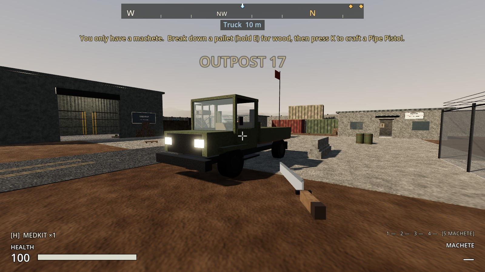
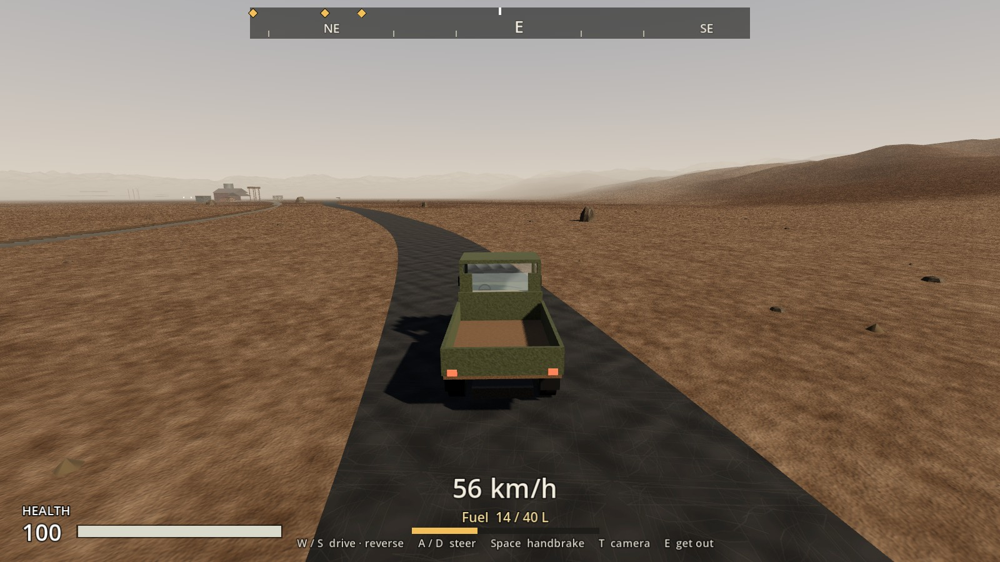
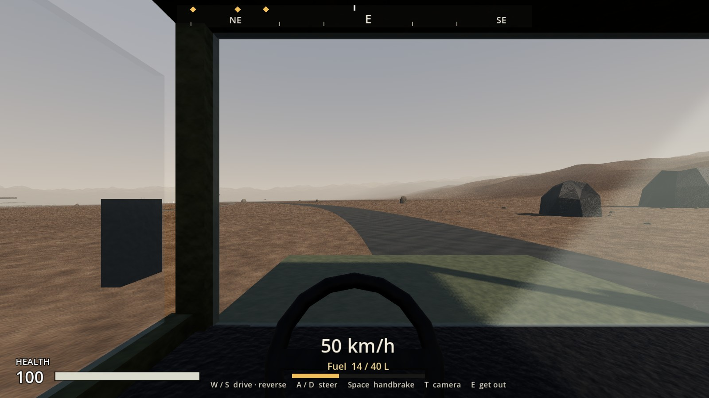
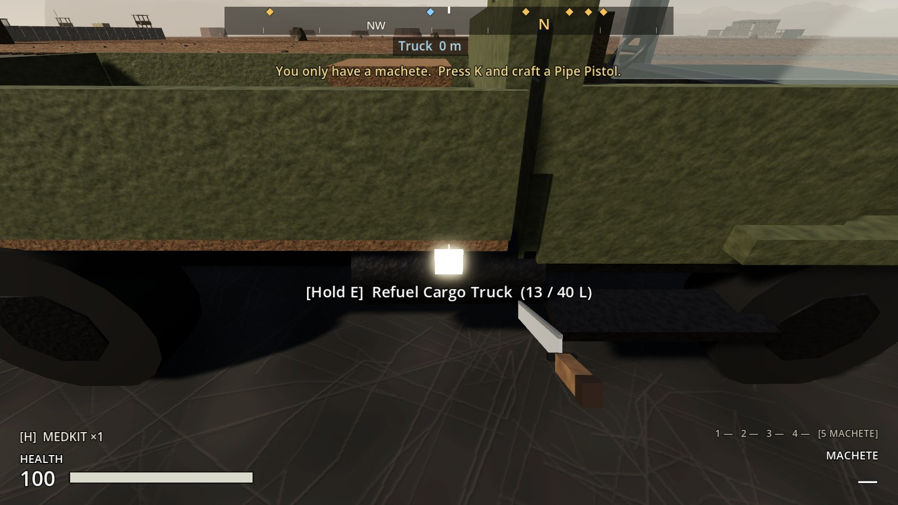
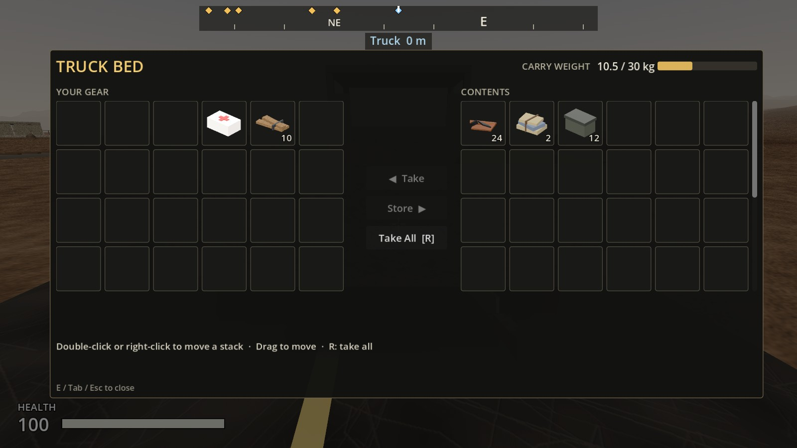
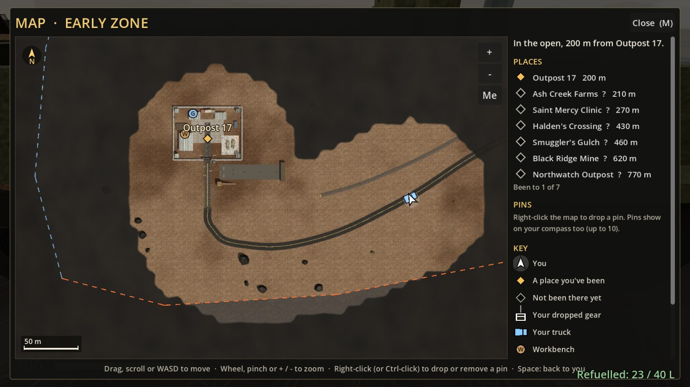

# Increment 18: The truck

**Status:** complete. 379 automated tests pass in headless Godot 4.7, 11 of them new in `tests/test_truck.gd`.

A **cargo truck** you can drive, parked in Outpost 17's yard beside the motor pool with its nose to the gate. It's Phase 2 of the roadmap: the way to move more than a backpack holds between places, and later the supply runs between settlements.

**A real-window run** of the game's own main scene, with real key presses:
- **Getting in:** **E** at the driver's door put me in the cab.
- **Driving:** W with A/D took it out of Outpost 17's gate and along the main road toward Halden's at 56 km/h. **T** switched to the chase camera.
- **Getting out:** Space stopped it and **E** got me out.
- **The bed:** I opened it at the tailgate and loaded scrap, wood and a medkit; a crate appeared in the bed.
- **Refuelling:** holding **E** at the fuel cap with a Fuel Can took it from 13 to 23 L.
- **The map:** M showed the truck where I'd left it, on the road I'd uncovered.

**The run caught three problems, fixed:**
- **The windscreen was too dark to drive behind.** The truck now has its own clearer glass.
- **The roof cut off the top of the view.** The cab is taller, with bigger windows.
- **The crosshair still showed while driving.** It's now hidden.

The tests caught three more:
- **A parked truck crept a few centimetres a second, burning fuel.** It's now held still once settled, and only driving uses fuel.
- **It could roll over in a fast, hard turn.** It now has a stabiliser and less steering at speed.
- **With an empty tank the brakes didn't work either.** They do now.

They also showed that the first parking spot was boxed in by the sandbag walls inside the gate. It now stands by the yard road, nose to the gate.

## Driving

| Key | |
|---|---|
| **E** at the driver's door (left side) | Get in |
| **W / S** | Drive / brake, then reverse |
| **A / D** | Steer |
| **Space** | Handbrake |
| **T** | Cab view or chase camera (behind the truck) |
| Mouse | Look round the cab (up to ~115° each way) |
| **E** | Get out, beside the driver's door. If that side is blocked, you get out on the other side, behind, or in front. With no room anywhere: "No room to get out here" |

**How it drives.**
- Top speed about **70 km/h**. From a stop it reaches 40 km/h in about 3 seconds.
- Stopping from full speed takes about 20 m.
- Reversing goes up to about 20 km/h.
- Steering eases off the faster you go, and a stabiliser keeps it on its wheels in hard turns. It's an arcade truck: it won't roll over on the flat.

**The HUD while driving.** Your speed (with **R** when reversing), fuel in litres with a bar that turns red below 15%, and the keys. The crosshair and weapon readouts are hidden: your hands are on the wheel, and your gun's away until you get out.

**Things that wait while you drive:** shooting, building (B), crafting, and using items. Getting in closes any container or bench you have open.

## Fuel

- **The tank:** 40 L. It uses **6 L per km**, so a full tank is about 6.5 km, a dozen or so trips across the zone.
- **To start:** the truck starts with **15 L**, about 2.5 km, so you'll need to find fuel.
- **Refuelling:** hold **E** at the fuel cap (the right side, behind the cab) to empty a **Fuel Can** into the tank: +10 L. The prompt shows how full it is.
- **Refusals:** "The tank's full", or "You need a Fuel Can".
- **Running dry:** "Out of fuel". The engine has no power, but the brakes and steering still work, so you can coast to a stop.
- **Only real driving uses fuel:** sitting still with the engine running doesn't, and neither does a parked truck settling on its suspension.

## The truck bed

- **Size:** **48 slots and up to 400 kg**, against 24–42 slots and 30–60 kg in a backpack.
- **Opening it:** **E** at the tailgate opens it like any container, with no search. The prompt shows how full it is, for example "Open Truck Bed (3 / 48 slots, 62 / 400 kg)".
- **On screen:** the bed's side of the transfer screen scrolls.
- **Crates in the bed** show how loaded it is: up to six, one for every sixth of the bed in use.
- **On the move:** the load goes where the truck goes. Walk or drive away and the bed closes.

## Raiders

- **They hear the engine:** idling within about 24 m, flat out within about 70 m.
- **Running into one** faster than about 15 km/h hurts them, a lot at speed: around 150 damage at 70 km/h: a raider (80 health) goes down from about 40 km/h, a veteran (170) takes more than one hit. It also shoves them aside.
- **One hit per raider a second.** The truck doesn't stop dead on a raider.
- **They can still reach you in the cab** if you sit still next to them.

## Finding it

The truck is on the **compass** ("Truck", pale blue) and on the **map** (M), as a truck shape pointing the way it faces.

## Dying and saving

- **Dying at the wheel:** you're put out beside the truck first, so your gear chest lands on the ground, not in the cab.
- **Saving:** the truck is saved where you left it, facing the same way, with its fuel and the distance driven. The bed is saved like any container.
- **Saving while driving** saves you standing beside the truck. Loading a save puts any driver out.
- **Older saves** have no truck in them, so it's in the yard at Outpost 17. The save version stays 4.

## How it's built

**The truck** (`scripts/vehicles/truck.gd`, class **Truck**) is Godot's VehicleBody3D, with:
- four wheels (front ones steer, all drive)
- a 2.6 t body with a low centre of mass
- a cab you can see out of: windows, pillars, dashboard and a steering wheel that turns
- a bed with crates, lights, a fuel tank, mudflaps and mirrors

**Its front is +Z**, the way Godot's vehicles drive. The driver's seat turns you to look along the nose.

**Authority.** The host runs the truck's physics. Getting in, getting out and refuelling are validated by the truck and PlayerController.
- The driver's `InputFrame` reaches the truck through `PlayerController.simulate` → `Truck.set_controls(throttle, steer, handbrake)`.
- `InputFrame` gains `jump_held` (Space held), the handbrake.

**While driving, the player:**
- has collision off
- is held in the seat every physics tick and every frame, so the view is smooth
- looks round with the mouse (`head.rotation.y`)
- presses E (a fresh press, not the one that got you in) to get out

**Parked trucks** are frozen once settled. Godot's vehicles otherwise creep a few centimetres a second. Getting in, or a load, releases it.

**Built by** `tools/build_truck.gd` → `scenes/vehicles/cargo_truck.tscn`. It's placed by the `VEHICLES` list in `tools/build_early_zone.gd`. The new `-- zone-only` switch rebuilds just the zone scene (not the terrain or navmesh). The map picture leaves vehicles out, since they move.

**The engine sound** (`assets/audio/truck_engine_loop.wav`) is a synthesised diesel loop. Its pitch rises with speed and its volume with the throttle.

## Files

| File | What |
|---|---|
| `scripts/vehicles/truck.gd` | **Truck**: driving, fuel, engine noise, running into raiders, seat and exit spots, chase camera, crates, save |
| `scripts/vehicles/truck_door.gd` | **TruckDoor**: E to drive |
| `scripts/vehicles/truck_fuel_cap.gd` | **TruckFuelCap**: hold E to refuel |
| `scripts/vehicles/truck_cargo.gd` | **TruckCargo**: the bed (a SalvageContainer with no search, 400 kg) |
| `tools/build_truck.gd` | Builds the truck scene |
| `scenes/vehicles/cargo_truck.tscn` | The truck |
| `assets/audio/truck_engine_loop.wav` | Engine loop |
| `assets/materials/truck_headlight.tres`, `truck_taillight.tres` | Lights |
| `tests/test_truck.gd` | 11 tests |

**Changed:**

| File | Change |
|---|---|
| `scripts/player/player_controller.gd` | `vehicle`, `enter_vehicle`, `leave_vehicle`, `request_refuel`, `_simulate_driving`. MovementState **DRIVING**. Signals `vehicle_entered`, `vehicle_exited`, `vehicle_refused`, `vehicle_refuelled`. Out of the truck on death, respawn and load. Saved beside the truck |
| `scripts/core/input_frame.gd`, `scripts/player/player_input.gd` | `jump_held` |
| `scripts/combat/damage_info.gd` | Damage type `VEHICLE` |
| `scripts/construction/build_mode.gd` | No building while driving |
| `scripts/ui/hud.gd` | Driving panel (speed, fuel, keys); notices for getting in, refuelling and running out; crosshair and weapon readouts hidden while driving |
| `scripts/ui/container_screen.gd` | The container's side scrolls when it has many slots |
| `scripts/ui/map_view.gd`, `map_screen.gd` | The truck on the map, and in the key |
| `tools/build_early_zone.gd` | `VEHICLES`, `-- zone-only` |
| `tools/render_map.gd` | Leaves vehicles out of the picture |
| `levels/early_zone/early_zone.tscn` | The truck, under `Vehicles/CargoTruck` |
| `project.godot` | The `camera_toggle` action (T) |

## Testing

`godot --headless --path . -s res://tests/test_runner.gd -- test_truck`: 11 tests.
- **The truck itself:** built to drive (wheels, bed, parts, compass marker), and parks without creeping.
- **Getting in and out:** you don't drop straight out while still holding E, you ride in the seat, and you get out at the door facing the way it faces.
- **Boxed in:** "no room to get out", and never through a wall.
- **Driving:** steering, braking distance, reversing, handbrake.
- **Fuel:** 2 L runs out at about 333 m, an empty tank goes nowhere, refuelling and its refusals.
- **The bed:** loading it, the 400 kg limit, the crates, the load riding along.
- **Raiders:** they hear the engine (louder going fast), and running into one hurts them, credited to the driver, once per hit.
- **Saving and dying:** a save and load round trip (position, heading, fuel, bed), saving while driving, bad save data, dying at the wheel.
- **Input:** the handbrake over the network, and T for the camera.
- **At Outpost 17:** parked level in the yard, on the map, driven out of the gate and down the road by a steering test, the cab and chase cameras, in the zone's save.

## Troubleshooting

- **The truck isn't in the yard:** pull, then open the project with **Edit** once so Godot picks up the new scripts.
- **"No room to get out here":** move away from walls, or drive into the open.
- **It won't move:** check the fuel on the HUD. Out of fuel, you need a Fuel Can at the fuel cap (the right side, behind the cab).
