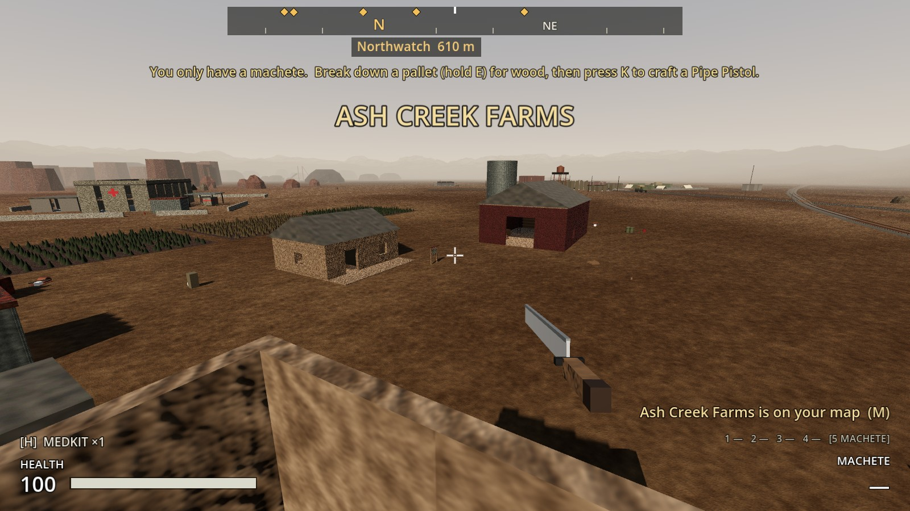
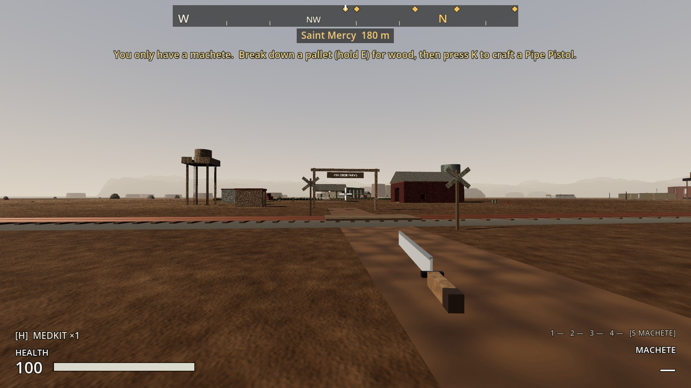
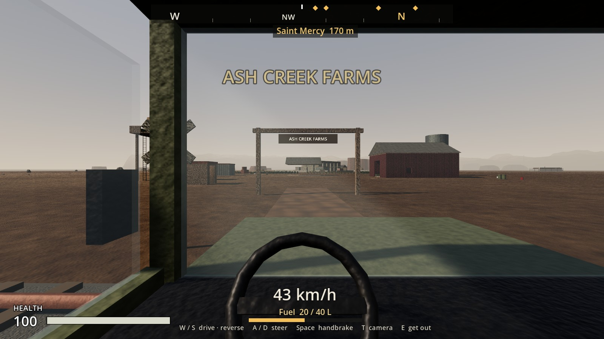
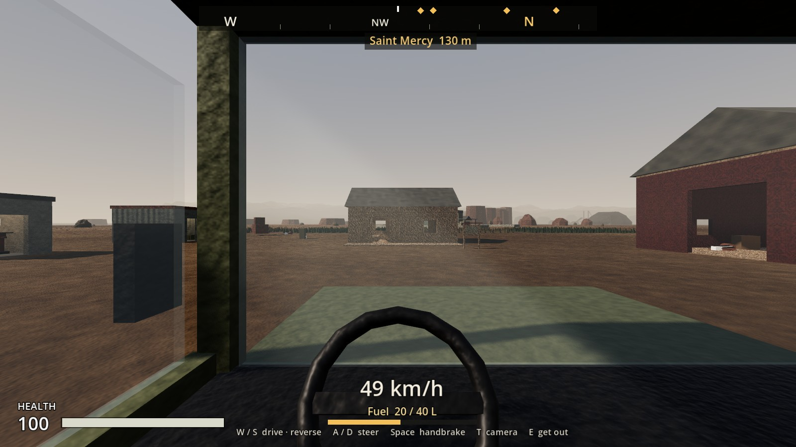
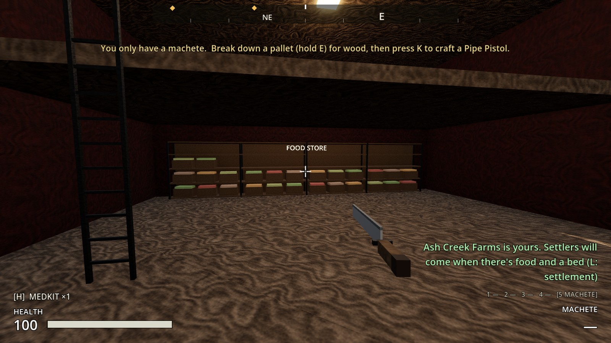
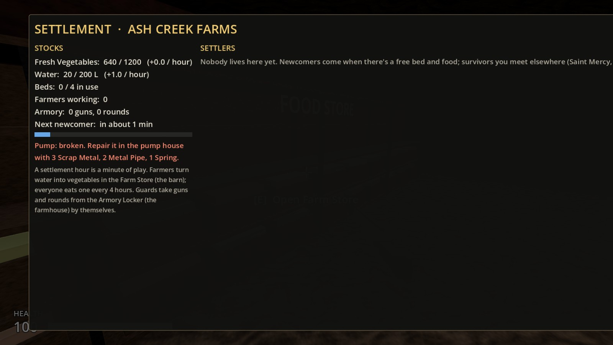
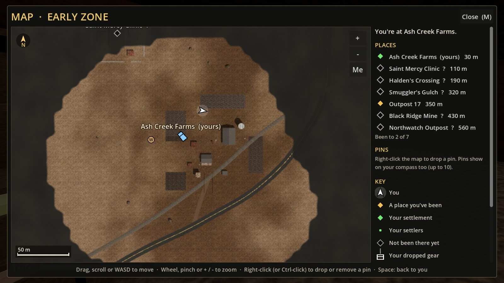

# Increment 19.5: Ash Creek Farms laid out again, and food shelves

**Status:** complete. 398 automated tests pass in headless Godot 4.7, 7 of them new in `tests/test_farm_layout.gd`.

From your playtest notes on Increment 19:
- **The railway ran through the middle of the farm,** between the farmhouse and the barn, and the farm's lane fence crossed the tracks: those were the two wooden beams.
- **The farm looked scattered** rather than laid out on purpose.
- **The Farm Store filled up** at 240 vegetables.

## What changed

**The farm has moved off the tracks.** The whole farm moved about 35 m west and turned to face the railway and the main road. The tracks now run past its front, about 14 m out from the gateway, and nothing solid stands on them anywhere along the line.

**A level crossing** where the lane meets the tracks: planks laid level with the rails, and a crossing sign each side. The truck drives off the main road, over the crossing, under the gateway and into the yard without slowing. The main road's crossing near Halden's got the same treatment. Crossings are made automatically wherever a road meets the railway.

**Laid out round a yard:**
- **The gateway:** the lane comes in under an **ASH CREEK FARMS** arch, 4.6 m high, so the truck fits under it.
- **Round the yard:**
  - The **farmhouse** faces the yard from the back, with its porch and the **notice board** beside it.
  - The **barn** is on the right, its big doors open onto the yard, with the **silo** behind it.
  - The **tool shed** (workbench), **pump house** and **water tower** stand in a row on the left, all facing in. The **chicken coop** is by the water tower.
- **The fields:** four, in a row behind the farmhouse, with tracks between them. Farmers work two to a field.
- **Kept open:** the front right of the yard is left clear for new buildings (19.6).
- **Not built yet:** there's no fence round the farm and no guard posts. Your settlers build those once you've claimed it, with materials you bring (next: 19.6). Guards patrol the gateway, the yard's corners and the fields until then.

**Food shelves at the back of the barn.** The Farm Store is now a 10 m run of shelving along the barn's back wall, under the hayloft.
- **Capacity:** 60 slots, so **1,200 vegetables** (the old crate held 240).
- **Seeing it fill:** crates of produce appear on the shelves as it fills, bottom shelf first.
- **On the settlement screen:** it shows food against capacity ("640 / 1200"), and "Store full" when it is.

**Your save carries over.** Whatever was in the old Farm Store moves onto the shelves. Settlers saved standing round the old layout are brought to the new yard when the save loads. The claim, the pump and everything else are kept.

## The real-window run

The game's own main scene, in a real window:
- Climbed the water tower and looked over the yard and down to the tracks.
- Walked up the lane over the crossing.
- Drove the truck off the main road, over the crossing, under the gateway and into the yard.
- Claimed the farm at the board.
- Put 640 vegetables in the store and looked at the shelves (32 slots full, about half the crates showing).
- Opened the store, the settlement screen and the map.

**The run caught one problem, fixed:** the crates on the shelves didn't show at all. The build tool saved their positions in a way the game didn't keep, so the shelves now set the crates up when they load.

| Up the lane: the crossing and the gateway | Over the crossing in the truck |
|---|---|
|  |  |

| Into the yard | The food shelves, half full |
|---|---|
|  |  |

| Food against capacity | The new layout on the map |
|---|---|
|  |  |

## How it's built

- **`tools/build_sites.gd`:** `_ash_creek()` lays the farm out in its own frame: -z is the back, +z the front toward the tracks, +x runs north-east along them.
  - The fields are `FIELD_X`, `FIELD_Z` and `FIELD_SIZE`.
  - The pump head is placed in the pump house's frame.
  - The Farm Store is `scenes/world/containers/food_shelves.tscn`, still named `FarmStore` so saves load into it.
- **`tools/build_early_zone.gd`:**
  - **Turning a place:** `PLACES` takes an optional fifth value, a turn in degrees. Ash Creek is at (307, -106), turned 39.5°, with a radius of 80.
  - **Moved with the farm:** the farm lane, its signpost and the tilled ground.
  - **Crossings:** `level_crossings()` finds every road/rail crossing, and `_level_crossing()` builds the planks and signs.
- **`tools/build_food_shelves.gd`** builds the shelves: four bays of four shelves, 60 slots, no weight limit.
  - `ShelfFill` (`scripts/settlement/shelf_fill.gd`) shows the crates.
  - The crate spots are stored as plain data and put into the MultiMesh when it loads.
- **`Settlement.food_capacity()`** gives what the store holds when full.
- **To rebuild everything:**

      godot --headless --path . -s res://tools/build_food_shelves.gd
      godot --headless --path . -s res://tools/build_sites.gd -- ash_creek_farms
      godot --headless --path . -s res://tools/build_early_zone.gd
      godot --path . -s res://tools/render_map.gd      (needs a window)

## Tests (`tests/test_farm_layout.gd`)

1. **The railway runs past the farm:** every stretch of track in front of the farm is past the gateway, and nothing solid stands on the tracks anywhere in the zone.
2. **A level crossing on the farm lane:** planks level with the rail tops, and a sign each side.
3. **Drive off the road into the yard:** the gateway's beam is above 4.2 m, and a truck driven from the main road reaches the yard without stalling, upright.
4. **The buildings face a yard:**
   - The farmhouse, barn, tool shed, pump house and coop all have a door facing the yard.
   - The four fields are in a row behind the farmhouse, and every farm spot is in a field.
   - The old lane fence is gone.
5. **Food shelves at the back of the barn:**
   - 60 slots and 1,200 vegetables, against the back wall and facing in.
   - Empty to start, then some crates, then all of them.
   - Nothing more fits when it's full.
6. **Farmers fill the shelves past the old crate:**
   - Production carries on past 240.
   - The settlement screen shows "N / 1200".
   - Saving and loading keeps the food, with crates on the shelves.

7. **A save from the old layout:** a settler saved where the old farmhouse stood is brought to the new yard on loading. Saves now note the layout.

`test_sites`, `test_settlement` and `test_early_zone` were updated for the farm's new spot and turn.
