# Increment 19.6: settlers build

**Status:** complete. 410 automated tests pass in headless Godot 4.7, 12 of them new in `tests/test_settlement_building.gd` (one older sound-timing test, `test_shot_reload_and_dry_fire_sounds`, can miss in a full run; it passes on its own).

From your notes on 19.5:
- **Premade buildings,** like a building with beds so more people can settle at the farm.
- **The fences and guard posts** shouldn't be there until you've claimed the farm. Then your settlers build them, with materials you bring.
- **The fields** should be fenced too.

## How it works

**Claiming lays out the farm's plan.** When you claim Ash Creek, faint blue outlines appear for everything the farm is meant to have:
- **A fence round the yard:** 288 m, with gaps at the gateway and at the back for the track to the fields.
- **A fence round the fields:** 240 m, with a gate facing the yard.
- **A guard post at each corner of the yard.**

Each outline has a sign saying what it still needs.

**Materials:**
- **By hand:** walk up to an outline and tap **E** to hand over whatever you carry that it needs. It takes only what it needs.
- **From the stores:** leave materials in the Farm Store and the farm takes them itself, one site at a time.
- **Called off:** a site you call off (on the settlement screen) gives back what was handed over.
- **Wood Planks:** most things need them. Craft them from wood (**K**), or break down pallets and furniture.

**Builders.** There's a new job on the settlement screen: **Builder** (a hard hat, a tool belt and a hammer).
- **What they work on:** the sites in order, starting with the first that has all its materials. Each Builder puts in an hour's work per settlement hour, which is a minute of play.
- **Lending a hand:** once a site has everything, **hold E** there to help.
- **Fences:** they go up a 4 m length at a time, so you watch the line grow. A finished site becomes the real thing.

**Plan buildings yourself in build mode (B).** Inside a settlement you hold, the build list has five buildings after your kits. Point where you want one: its near side goes where you look, with its door facing you.

| Building | Needs | Work | What it does |
|---|---|---|---|
| **Bunkhouse** | 30 Wood Plank, 10 Scrap Metal, 6 Cloth | 6 h | **Four more beds** (two bunk beds), so more people can live there |
| **Storehouse** | 20 Wood Plank, 12 Scrap Metal, 2 Metal Pipe | 5 h | Another 60-slot run of shelves: **1,200 more food**, or anything else |
| **Guard Tower** | 16 Wood Plank, 6 Scrap Metal, 2 Metal Pipe | 4 h | A lookout 2.6 m up a stair, for one guard |
| **Guard Post** | 6 Wood Plank, 4 Cloth, 2 Scrap Metal | 2 h | A sandbagged spot with a tin roof, for one guard |
| **Farm Plot** | 4 Wood Plank, 2 Scrap Metal, 10 Fresh Vegetables | 2 h | A new 12 × 10 m field: **work for two more farmers** |
| *Fence* (the farm's plan) | a Wood Plank per 4 m, a Scrap Metal per 16 m | 15 min per 4 m | Keeps raiders to the gaps |

- **Where you can plan one:** only inside a settlement you hold, on flat ground with nothing in the way.
- **Call off:** on the settlement screen.
- **What gets built:**
  - It's saved, raiders path round it, and raiders can break it, like walls you build.
  - It can't be moved.
  - Dismantling it (**X** in build mode) gives some materials back.

**What the buildings do:**
- **Beds:** each bunkhouse adds four. Newcomers come while there are free beds and spare food.
- **Food:** storehouse shelves count as part of the farm's stores. Food goes there once the barn's shelves are full, and everyone eats from both.
- **Fields:** each field has room for two farmers. The farm starts with four fields, so eight farmers. A ninth farmer has "No field free" until you build a farm plot.
- **Guard posts and towers:** once any are built, each guard stands at one of their own. Guards with no post free keep patrolling.

**The settlement screen (L)** has a new **Building** column. It lists every site with what it still needs, or "Ready: make someone a Builder", or "Being built: 40%", plus a **Call off** button. The stocks show beds, fields and guard posts.

**Saves:** sites (what's handed over, the work done, which lengths are up) and everything built are saved. If your farm was claimed in an older save, its plan is laid out when you load it.

## The real-window run

The game's own main scene, in a real window:
- Claimed the farm: 15 outlines appeared (11 fence runs and 4 guard posts).
- Walked up to the corner guard post ("Hand over materials for the Guard Post") and tapped **E**.
- Made Joel a Builder on the settlement screen. He walked over in his hard hat and hammered away.
- Saw the guard post finished.
- Left planks and scrap in the Farm Store. The front fence took them, and it went up a length at a time.
- In build mode, the bunkhouse showed a green ghost; I placed it, it was supplied, and it was built. Bunk beds inside.
- Then a storehouse, a guard tower with its stair, a farm plot west of the yard, and the rest of the plan.
- Final count: 8 beds, room for 2,400 food, fields for 10 farmers, 5 guard spots. The map shows the fence lines.

**The run caught two problems, fixed:**
- **The settlement screen was too wide:** with the new Building column, the settler rows ran off the right edge. The columns are narrower, and the gun buttons sit under the gun line.
- **The outlines were too bright** up close once supplied. They're fainter now.

The tests caught one more: **calling a site off put its materials back in the Farm Store, where the next site took them straight away.** They now come back to you, and only what you can't carry goes to the store.

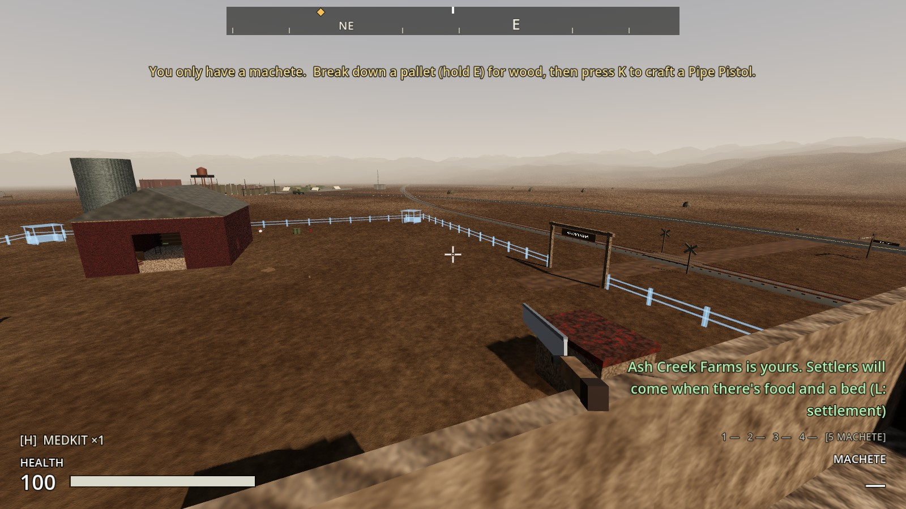

| A site: what it needs | The settlement screen's Building column |
|---|---|
| 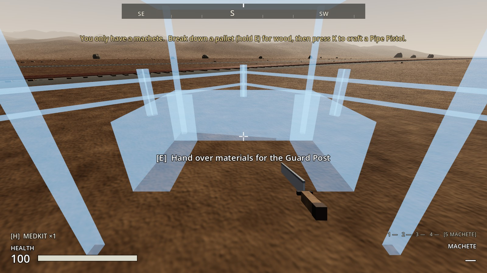 | 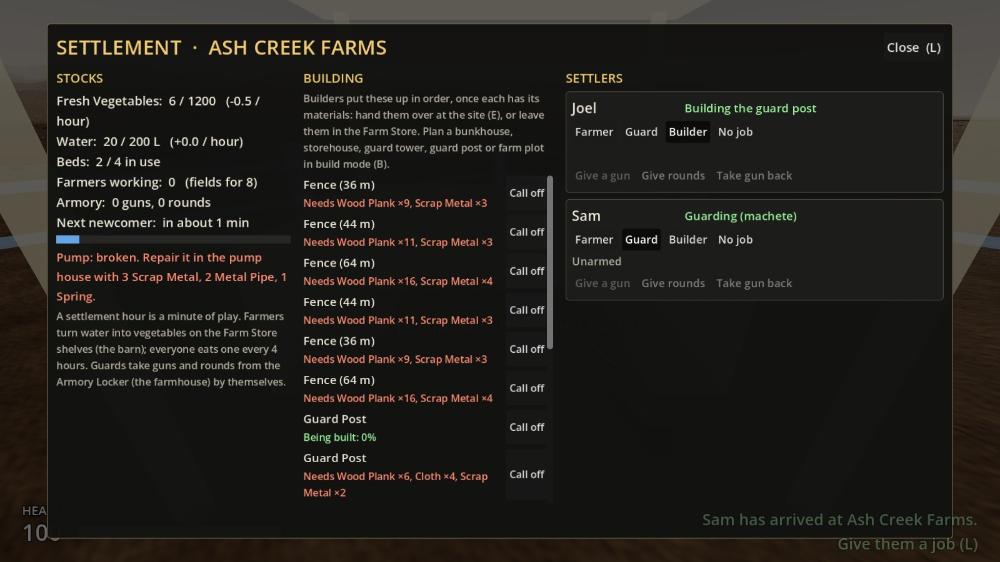 |

| A Builder at work | The guard post, built |
|---|---|
| 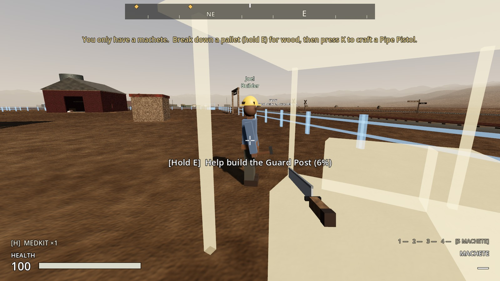 | 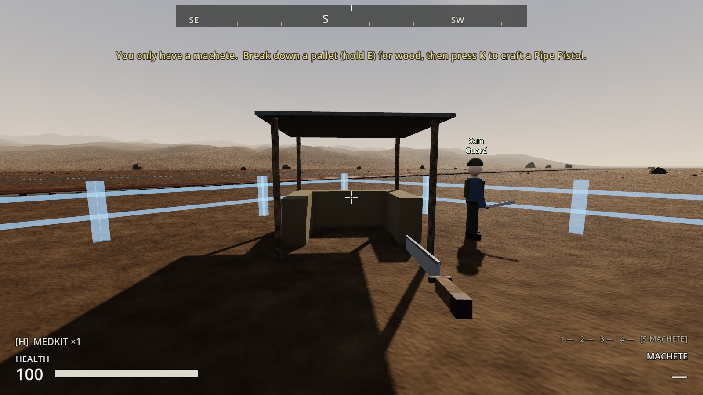 |

| The fence going up, a length at a time | Planning a bunkhouse (B) |
|---|---|
| 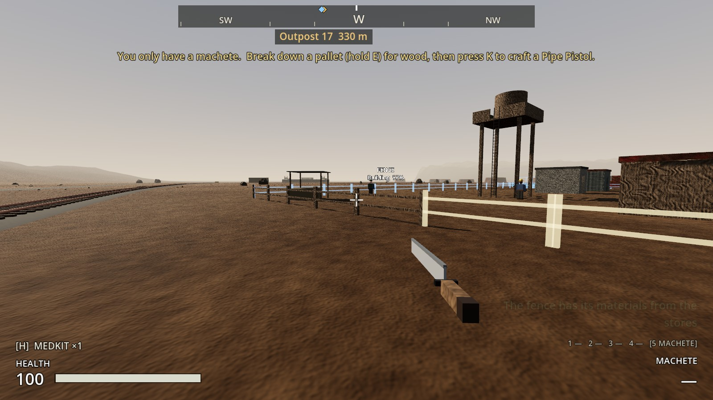 | 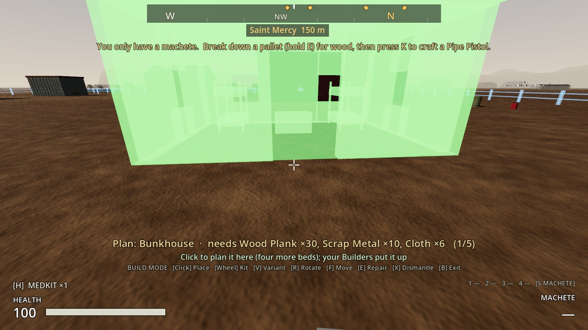 |

| All built, from above | The fields fenced, and a farm plot |
|---|---|
| 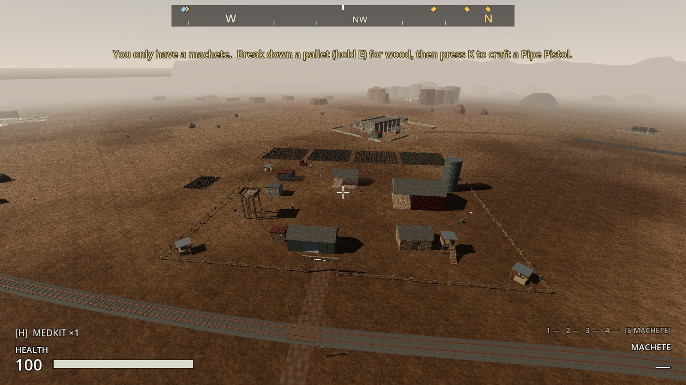 | 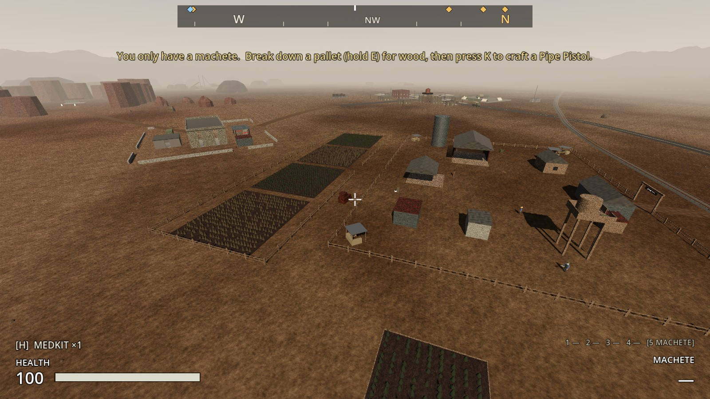 |

| Inside the bunkhouse | A guard tower and the storehouse |
|---|---|
| 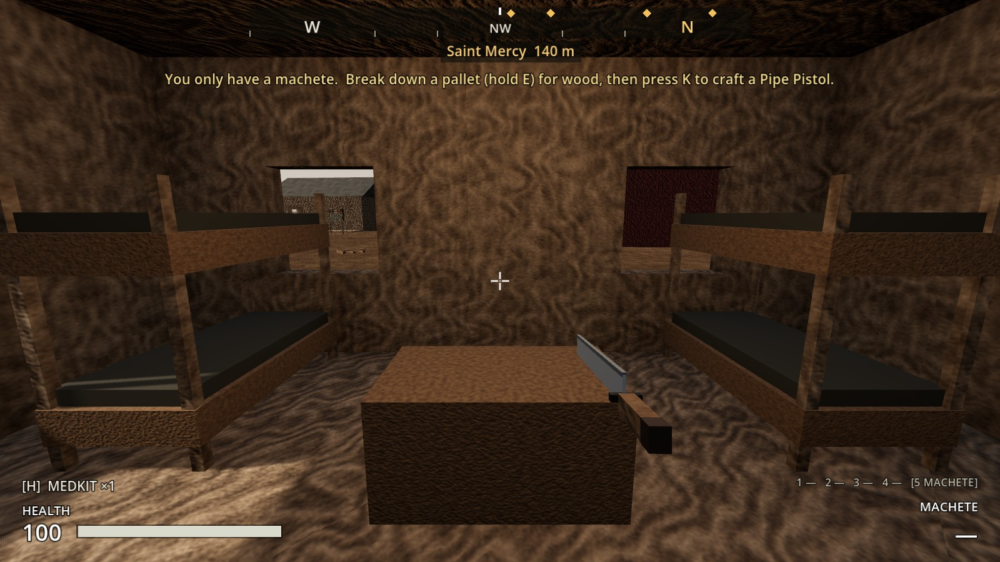 | 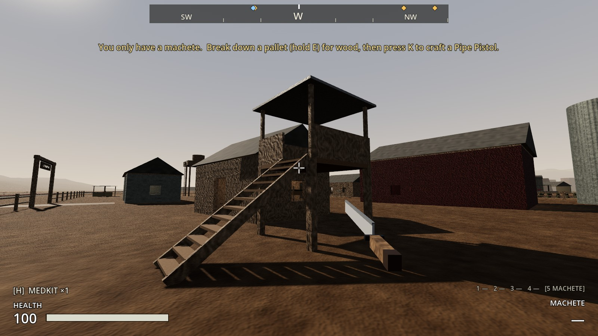 |

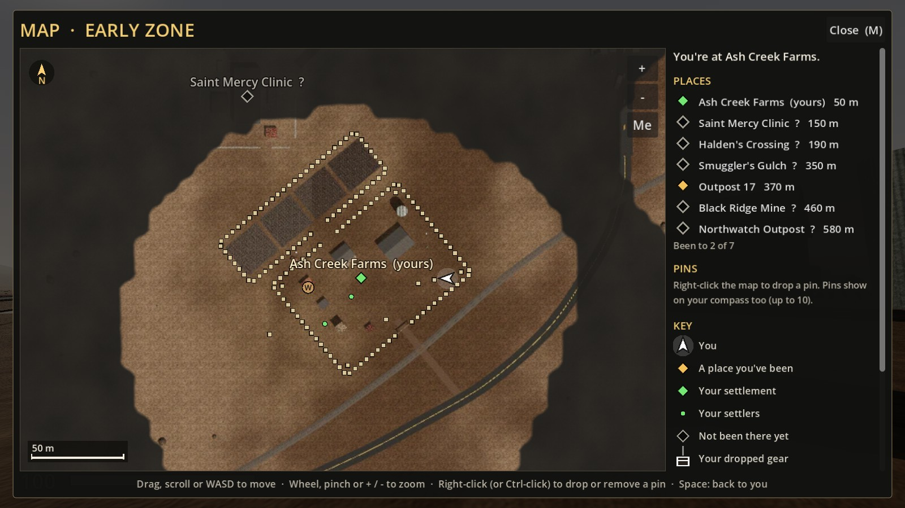

## How it's built

- **`SettlementPlans`** (`scripts/settlement/settlement_plans.gd`): what can be built, its cost and hours. Fences are priced per 4 m length.
- **`ConstructionSite`** (`construction_site.gd`, scene `scenes/settlement/construction_site.tscn`):
  - An Interactable Area3D under the Settlement's `Sites` node.
  - It holds a plan, pieces (where each finished Structure goes), what's been handed over, and the work done.
  - Ghosts are copies of the finished scene's meshes; the sign is a Label3D.
  - `take_from()`, `add_work()` (spawns each piece as the work passes it), `work_point()`, and save/load.
- **`SettlementBuilding`** (`settlement_building.gd`) extends `Structure`:
  - `beds`, a `%Storage` container, and `GuardSpots/*` and `FarmSpots/*` markers.
  - It belongs to the settlement whose claim radius it stands in.
- **`tools/build_settlement_buildings.gd`** builds the six scenes in `scenes/settlement/` and their definitions in `resources/structures/settlement/`. The bunkhouse and storehouse are site-kit buildings.
- **`Settlement`:**
  - Plans and sites: `lay_out_plans()` (from the `Plans` markers, on claiming), `sites()`, `current_site()`, `request_place_site/deliver/help_build/cancel_site`, and `_supply_sites()` (from the stores, every 2 s).
  - What the buildings add: `buildings()`, `total_beds()`, `stores()`, `guard_posts()`, `patrol_points()` and `farm_spots()`.
  - Builders' hours go into `simulate()`.
  - Saved with `plans_laid`.
- **`Settler`:** `Role.BUILDER` (its hard hat, tool belt and hammer are built by `tools/build_settler.gd`), plus `no_field`. Guards take a post each.
- **`BuildMode`:** `plans` after the kits, `current_plan()`, and a ghost placed by its near side. `PlayerController` adds `request_place_site`, `site_refusal_reason`, `request_deliver_to_site`, `request_help_build` and `settlement_at`.
- **`build_sites.gd`:** the farm's plan is `FENCES` and `GUARD_POSTS`, and the tractor wreck moved off the back fence line.

## Tests (`tests/test_settlement_building.gd`)

1. **What settlers can build:** six definitions and scenes. A fence is 4 m; a bunkhouse has four beds; a storehouse has 60 slots; the posts and tower have guard spots (the tower's up on its deck); a farm plot has two farm spots. Five plannable buildings; the fence costs check out.
2. **Claiming lays out the plan:**
   - Nothing before claiming. After: 11 fence runs (132 lengths) and 4 guard posts.
   - The gateway stays clear and the posts face out.
   - Claiming again doesn't lay it out twice.
3. **Hand over materials, and a Builder builds it:**
   - You hand over only what it needs, and E shows what it needs.
   - No Builder means no progress. A Builder in a hard hat with a hammer gets it half done in an hour, and holding E helps.
   - Then the site goes and a guard post stands there, with a notice and a guard spot.
4. **Materials from the stores, a length at a time:** planks and scrap are taken from the Farm Store; four lengths are up after an hour, then all nine, each on the line.
5. **Call off:** the planks come back to you and the site leaves the plan.
6. **Plan in build mode:**
   - Nothing to plan before you hold the farm.
   - B with no kits lists the bunkhouse, the ghost is valid, and placing it makes a site.
   - You can't plan on top of a site, past the farm, or a fence by hand.
7. **A bunkhouse brings more people:** 4 beds become 8.
8. **A storehouse holds more food:** room for 2,400; food overflows into it and is eaten from both.
9. **Farm plots make room for more farmers:** with nine farmers, eight work and one has "No field free"; with a plot, all nine work.
10. **Guards stand at the posts:** each guard heads for a post of their own, and the navmesh reaches the tower's deck.
11. **Sites and buildings are saved:** a half-built fence run, a bunkhouse's planks and a built guard post all come back, and nothing is planned twice.
12. **A farm claimed before builders gets its plan** when the save loads.
