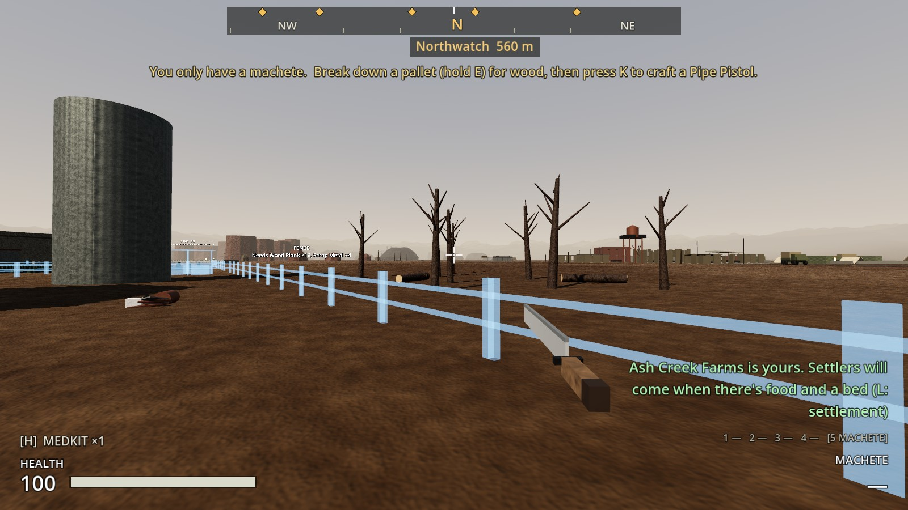
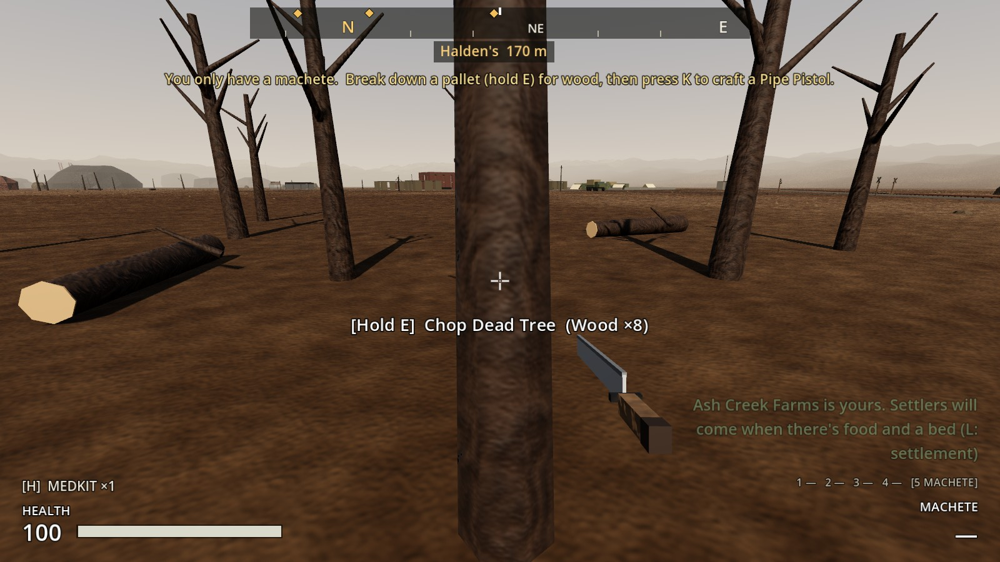
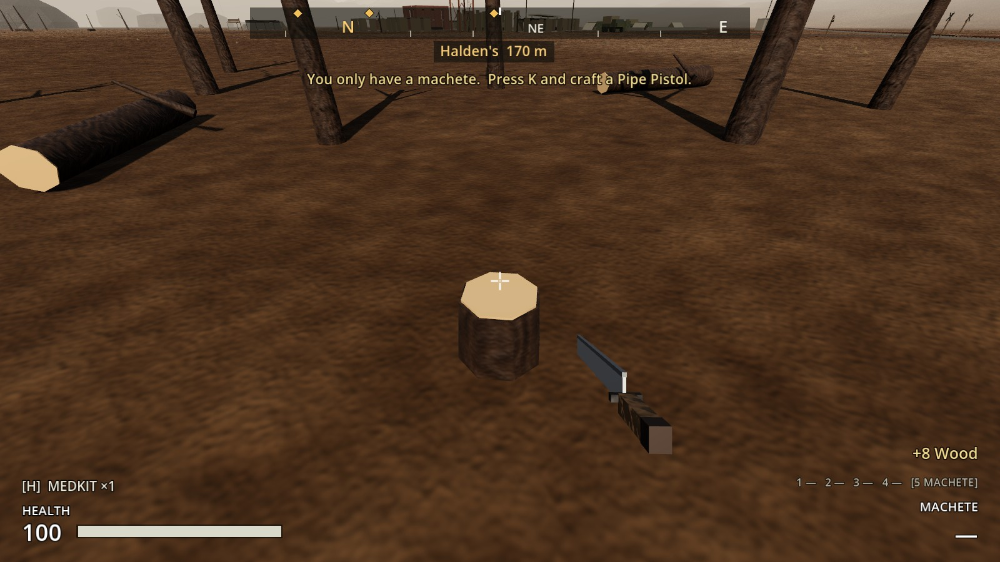
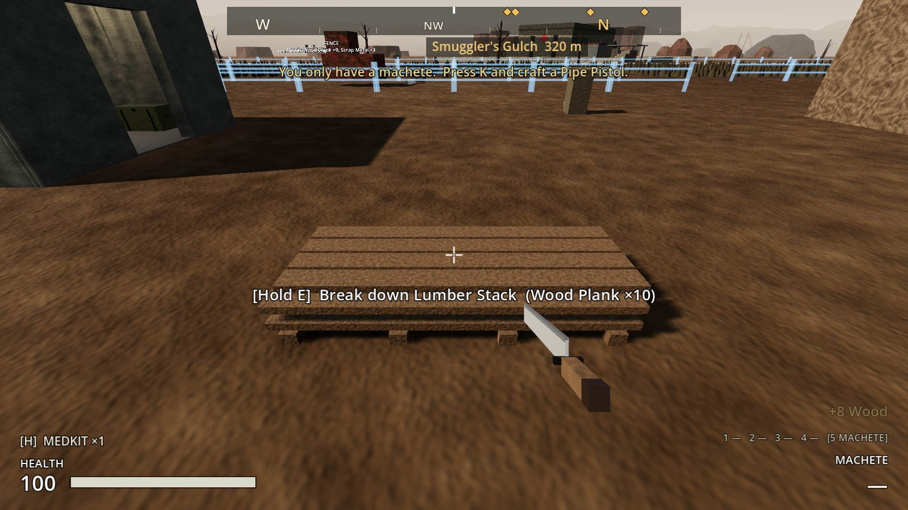
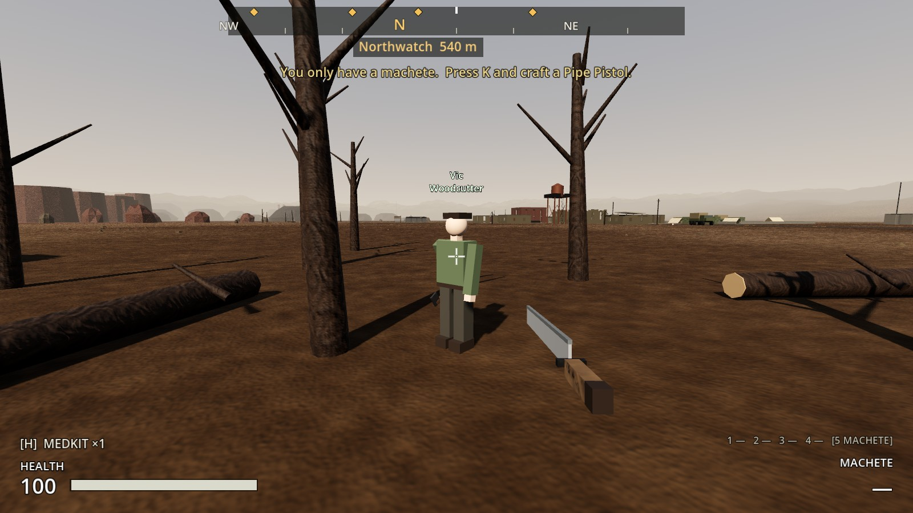
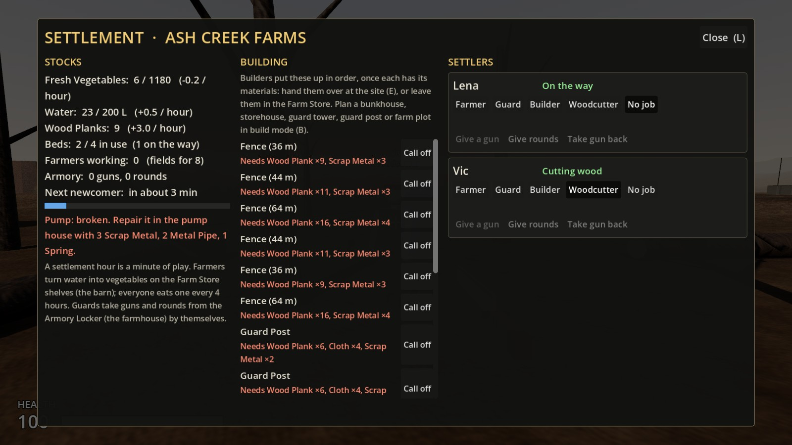
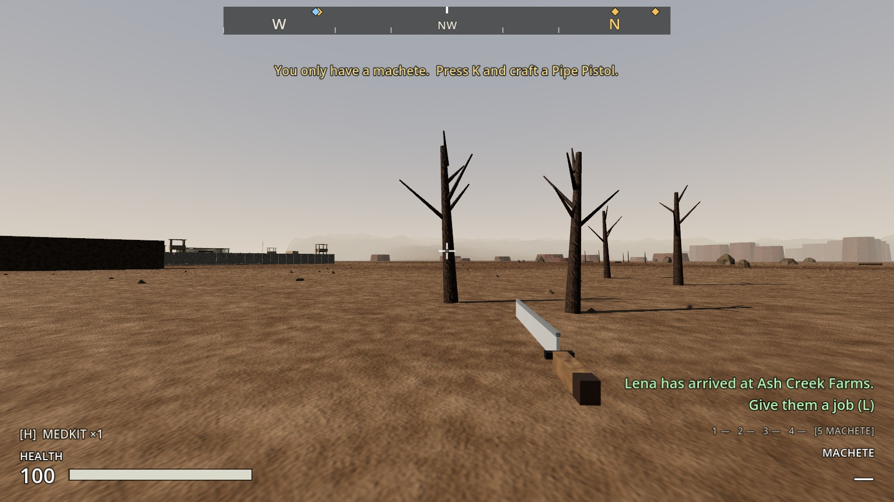

# Increment 19.7: wood

**Status:** complete. 418 automated tests pass in headless Godot 4.7, 8 of them new in `tests/test_wood.gd`.

From your notes on 19.6: wood was hard to collect, and there was no wood source that comes back. Your picks were wood round the farm, a Woodcutter job, and trees that grow back.

## What's new

**Dead trees and fallen logs you can chop.**

| | Hold E | Gives | Afterwards |
|---|---|---|---|
| **Dead Tree** | 3 s | 8 Wood | A stump; the tree **grows back** after 72 settlement hours (72 min of play) |
| **Fallen Log** | 2.5 s | 6 Wood | Gone; it **grows back** after 72 settlement hours |
| **Lumber Stack** | 2 s | 10 **Wood Planks** | Gone for good (a one-off find by the tool shed) |

- **Planks:** wood goes into your backpack; craft it into Wood Planks by hand (**K**, 1 wood → 1 plank).
- **A full backpack:** you take what fits and the rest stays in the tree.
- **Saved:** stumps, and how long each has until it grows back.

**Where it is:**
- **The woodlot,** just east of the yard's fence and inside the farm: 8 dead trees and 2 logs.
- **Round the farm:** another 6 dead trees and 3 logs, outside the yard and the field fences.
- **Across the zone:** 64 trees and logs in 8 clumps in the open country, away from the places, roads, railway and rocks. Two clumps are near the farm (west and east of it), and others lie between Outpost 17 and the farm, north of the outpost, and round Halden's and Black Ridge.

**The Woodcutter job** (settlement screen, with an axe):
- **What they do:** a Woodcutter walks out to the woodlot and chops there. Each one adds **3 Wood Planks an hour** to the farm's stores (180 an hour of play, 3 a minute).
- **Builders use them:** sites take materials from the stores themselves, so a Woodcutter and a Builder together keep the farm's plan going with no hauling from you. You still bring the scrap metal and cloth.
- **What it needs:** the woodlot. A Woodcutter at a settlement with no woodlot just helps out.
- **The settlement screen** shows **Wood Planks** in the stores and how many an hour.
- **Store space:** planks sit on the Farm Store's shelves alongside the food, so they take space the food could use (the screen's food capacity drops a little). A storehouse adds more room.

## The real-window run

The game's own main scene, in a real window:
- Looked over the woodlot from the yard.
- Held **E** on a dead tree for 3 s: +8 Wood, and a stump.
- Broke down the lumber stack for 10 planks.
- Made a newcomer, Vic, a Woodcutter. He walked to the woodlot and was "Cutting wood" among the trees.
- After 3 settlement hours the stores held 9 Wood Planks (+3.0 / hour).
- Found a clump of dead trees out in the zone.
- The map, re-rendered, shows the woodlot.

| The woodlot, east of the yard | Hold E to chop |
|---|---|
|  |  |

| A stump left (it grows back) | The lumber stack |
|---|---|
|  |  |

| A Woodcutter in the woodlot | Wood Planks on the settlement screen |
|---|---|
|  |  |

## How it's built

- **`Timber`** (`scripts/world/timber.gd`), an Interactable:
  - Settings: `wood`, `chop_time` and `regrow_hours`.
  - `cut_down()` / `regrow()`: the `%Standing` tree or log (with its collision) and the `%Stump`.
  - Saves `remaining`, `cut` and `regrow_left`.
- **`tools/build_timber.gd`** builds `scenes/world/timber/dead_tree.tscn`, `fallen_log.tscn` and `lumber_stack.tscn` (a SalvagePile).
- **`build_sites.gd`:** the farm's `Timber` group (`WOODLOT_TREES`, `WOODLOT_LOGS`, `FARM_TREES`, `FARM_LOGS`), the lumber stack, and the Settlement's `WoodSpots` markers.
- **`build_early_zone.gd`:** `TIMBER` clumps, placed by `_timber()` into the zone scene's `Timber` node, using the rocks' rules and avoiding the rocks.
- **Settlement:** `Role.WOODCUTTER`, `woodcutter_planks_per_hour`, `wood_spots()` and `planks()`. Planks go into `simulate()`, `rates()["planks"]` reports them, and partial-plank progress is saved.
- **Settler:** `_cut_wood()` walks to a wood spot and swings at the nearest standing tree. The axe is built by `tools/build_settler.gd`.

## Tests (`tests/test_wood.gd`)

1. **Chop a dead tree and it grows back:** 8 wood, a stump, nothing more to chop and walkable. 72 hours later it's back, solid again.
2. **A full backpack leaves the rest** in the tree, and E says why.
3. **Fallen logs and the lumber stack:** 6 wood with no stump; 10 planks, then gone.
4. **Wood round the farm:** a woodlot of 10 east of the yard inside the farm, 4 Woodcutter spots, 9 more round the farm, none in the way of the fences.
5. **Wood out in the zone:** at least 56 pieces, outside every place and off every road.
6. **Cut trees are saved:** a stump stays a stump after loading, with its time to grow back.
7. **A Woodcutter keeps the stores in planks:**
   - An axe, "Cutting wood", 3 an hour: 6 planks in two hours.
   - Heads for the woodlot.
   - A Builder's fence takes the planks from the stores.
8. **No woodlot, no wood.**
