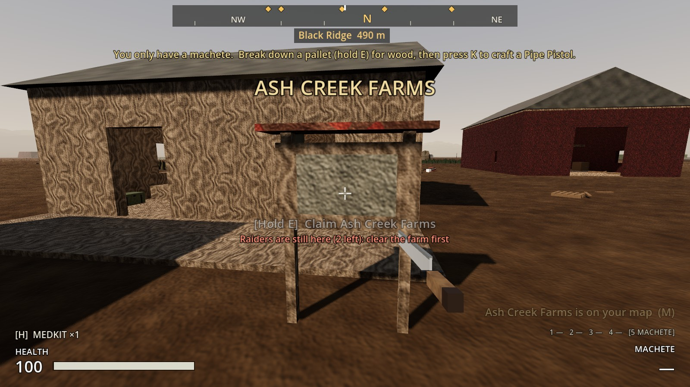
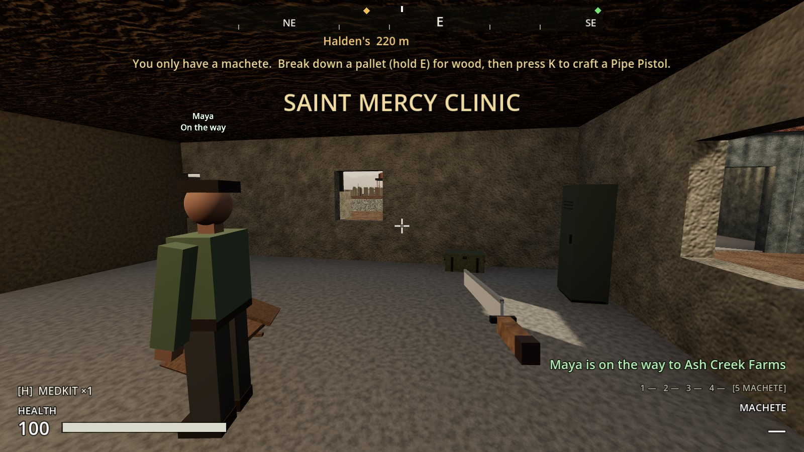
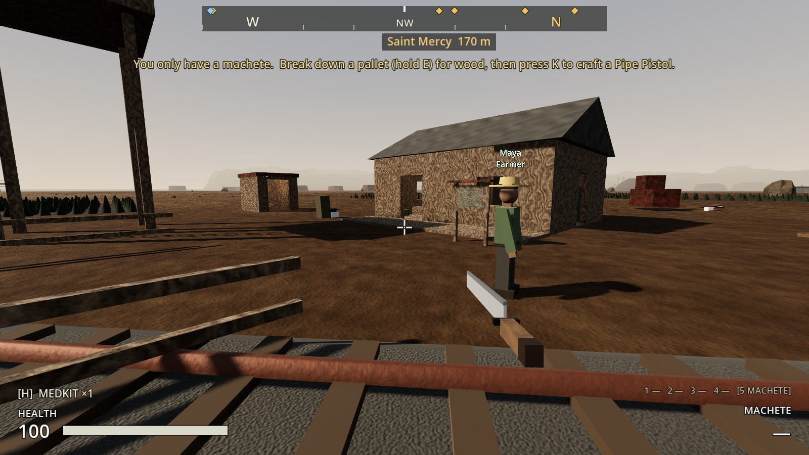
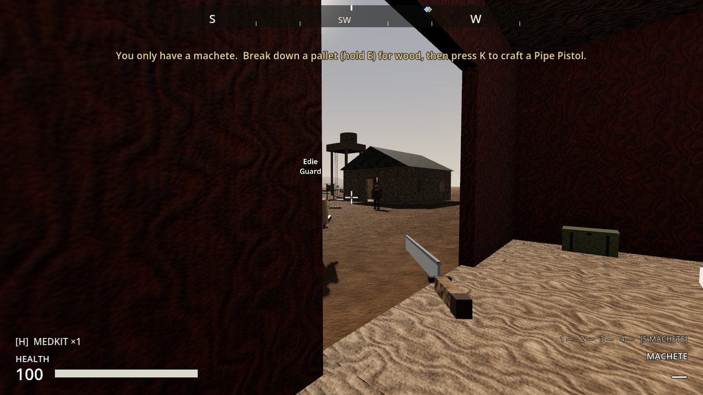
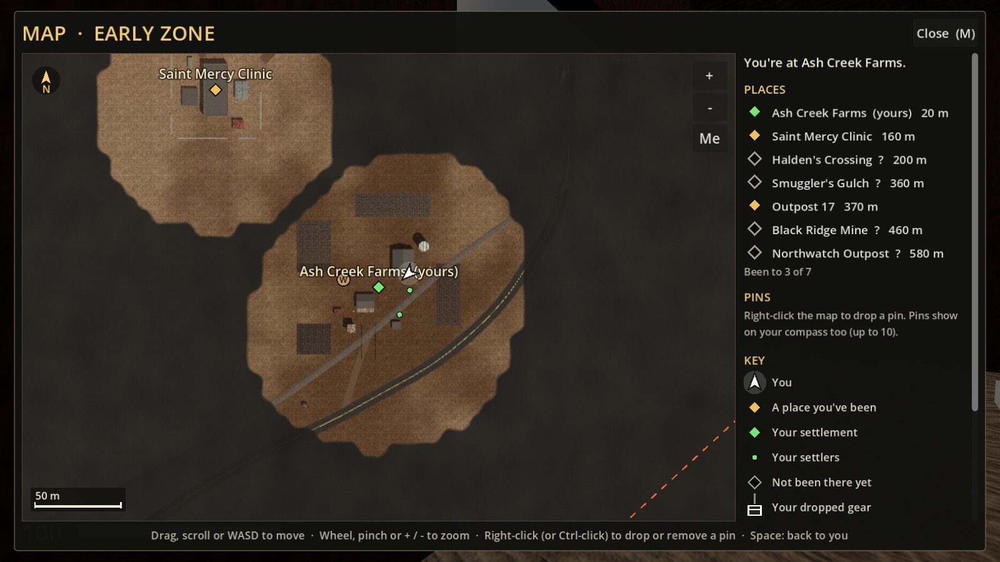
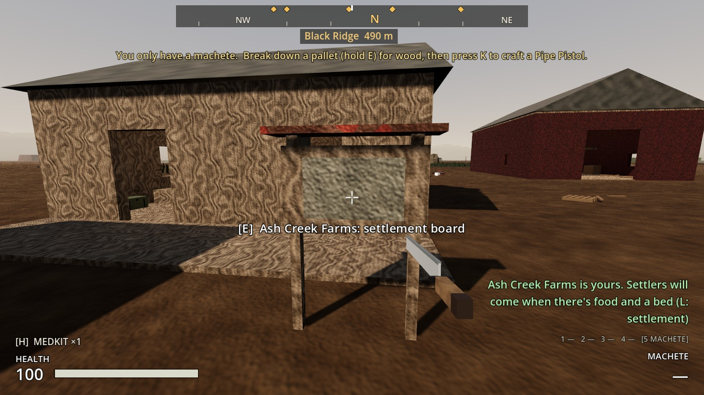
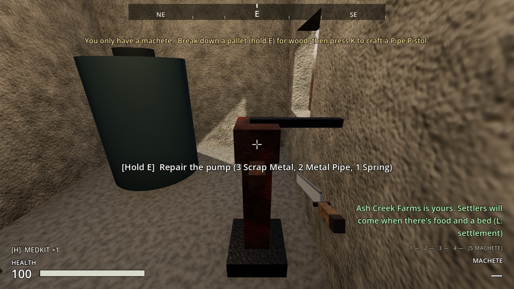
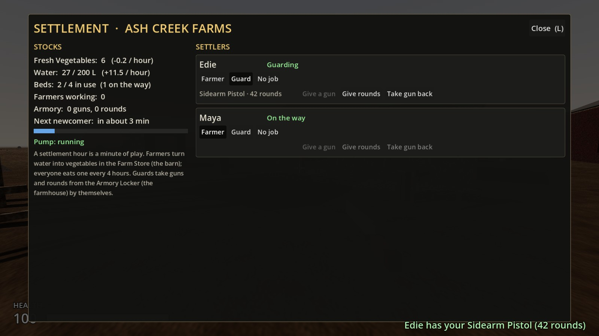

# Increment 19: Ash Creek Farms, the first settlement

**Status:** complete. 391 automated tests pass in headless Godot 4.7, 12 of them new in `tests/test_settlement.gd`.

Phase 3 begins. **Ash Creek Farms becomes yours:** clear its raiders and claim it. Then fix its pump, take in settlers, and give them jobs: farmers grow food, guards defend it. This is the first of three steps:
1. **19:** claiming it, settlers, jobs, water and food, the settlement screen. *(this one)*
2. **20:** raids on the farm, and what happens while you're away.
3. **21:** your own hunger, and eating.

**A real-window run** of the game's own main scene, with real key presses:
- **Claiming it:** at the board with the farm's two raiders alive: "Raiders are still here (2 left)". With them dead, holding **E** claimed it.
- **The pump:** holding **E** with the parts repaired it.
- **A newcomer, Edie,** walked in along the lane, with "Edie / No job" over her head.
- **Maya** at Saint Mercy agreed to come ("Maya is on the way to Ash Creek Farms"). She walked out of the hospital, turned up at the end of the lane while I was at the farm, and walked in.
- **On the settlement screen (L)** Maya became a farmer and Edie a guard, and I gave Edie my spare pistol and its rounds.
- **In the yard,** Maya worked in her straw hat and Edie stood guard in a helmet and vest. A raider walked into the yard: Edie shot it dead.
- **The map** shows "Ash Creek Farms (yours)" in green, with the settlers as green dots.

**The run caught five problems, fixed:**
- **The pump couldn't be reached:** its spot was inside the tank. It's now a pump head of its own, beside the tank.
- **Names floating over people were huge up close.** They now stay the same size on screen.
- **Long notices ran off the edge of the screen.** They now wrap, and stay up a little longer.
- **A survivor sent to the farm walked the whole way** (about 140 m from Saint Mercy) even when you weren't with them. Now, left alone, they turn up at the end of the lane and walk in.
- **The map's place list showed your farm amber.** It's now green.

The tests caught three more:
- **On load, the settlement turned the farm's raider spawner back on,** overriding a spawner that was meant to be off. It now only switches off spawners it turned off itself.
- **A new bed overlapped the farmhouse's bedroom chest.** It's moved.
- **The first spot for the pump head blocked the Pump Parts footlocker.** It's now on the south side of the pump house.

| Maya, on her way | A farmer and a guard at work |
|---|---|
|  |  |

| Edie defends the farm | Yours, on the map |
|---|---|
|  |  |

## Claiming it

1. **Clear the farm's raiders** (there are two).
2. **Hold E at the notice board** in front of the farmhouse porch: "Claim Ash Creek Farms".
   - While raiders are left within 75 m: "Raiders are still here (2 left): clear the farm first".

**Once it's yours:**
- The farm's raiders stop coming.
- It shows **green** on the compass, and on the map as "Ash Creek Farms (yours)".
- The Farm Store starts with 6 vegetables and the tank with 20 L of water.
- From then on the notice board opens the settlement screen.

## Water and food

A **settlement hour is one minute of play**, so a day is 24 minutes.

| | Each hour |
|---|---|
| **The pump**, once repaired | +12 L water (the tank holds 200 L) |
| …before that, the rain barrel | +1 L |
| **A working farmer** | uses 2 L water, grows 1.5 **Fresh Vegetables** |
| **Everyone** | a meal every 4 hours: 1 vegetable and 2 L water |

**The pump** starts broken. Hold **E** at the pump head in the pump house, with **3 Scrap Metal, 2 Metal Pipe and a Spring**, to fix it.

**Vegetables** go into the **Farm Store**, a crate in the barn. Open it like any container: take vegetables to sell, carry or haul in the truck, or put some in. That's where everyone eats from. It's a new item, **Fresh Vegetables**, and the FOOD category is ready for Increment 21.

**Going without:**

| Without food or water for | What happens |
|---|---|
| 1 hour | They're **hungry** and stop working |
| 8 hours | They **leave**: "Ada has left Ash Creek Farms: nothing to eat" |

A farmer with no water to use stands idle: "No water to farm". One farmer feeds about six people.

## Settlers

The farmhouse has **beds for four**. People come in two ways:
- **Newcomers walk in** along the lane every 3 hours, if there's a free bed and at least 4 vegetables in the store. The first comes about an hour after you claim it.
- **Survivors you meet:** three are waiting elsewhere. Talk to them (**E**) and they'll come once you have a free bed. Before then they tell you their story.

| Survivor | Where | |
|---|---|---|
| **Maya** | Saint Mercy Clinic, the south ward | "I hid in the pharmacy when the raiders came…" |
| **Tomas** | Halden's Crossing, in the diner | "The diner's been my home since the town fell…" |
| **Old Jeb** | Black Ridge Mine, the bunkhouse | "Forty years I worked this mine…" |

**Getting to the farm:** they walk while you're with them. Left alone, they turn up at the end of the farm's lane and walk in, or simply arrive if nobody's at the farm either.

**Their names** float over them when you're close, with their job once they live at the farm. They're shown as green dots on the map.

## Jobs

| Job | What they do |
|---|---|
| **Farmer** | Works the fields (bent over, hoeing); the farm grows vegetables while they do |
| **Guard** | Walks between the guard posts (porch, lane, barn, water tower, yard) and looks around. A raider within 40 m and in sight, inside the farm's defended area (90 m), gets shot at, or attacked with a machete if the guard has no gun |
| **No job** | Helps out round the farmhouse |

Farmers wear a straw hat; guards a vest and helmet, with their gun or machete in hand.

## Arming guards

- **From your backpack.** On the settlement screen, **Give a gun** lists the spare guns in your backpack. The guard takes it, with up to 60 of your rounds for it. **Give rounds** tops them up, and **Take gun back** returns the gun and its rounds to you (or to the armory if you're full).
- **The Armory Locker** in the farmhouse kitchen. Put guns and rounds in it: an unarmed guard takes the best gun there, and a guard running low takes rounds.
- **When a guard dies or leaves,** their gun goes back to the armory.

Guards fire at their gun's rate and accuracy (slower than you, at most about two shots a second), reload from their rounds, and only shoot raiders. Raiders hear the shots.

## The settlement screen (L)

**Opening it:** press **L**, talk to someone who lives there, or use the notice board.

**Stocks (left):**
- vegetables and water, with how much each changes an hour
- beds in use (and anyone on the way)
- farmers working
- what's in the armory
- when the next newcomer may come, or what's stopping one
- the pump, and what it needs

**Settlers (right):** each person's status (Farming, Guarding, Hungry: not working, On the way…), the **Farmer / Guard / No job** buttons, their gun and rounds, and **Give a gun / Give rounds / Take gun back**.

**Before you've claimed it,** the screen tells you how to.

## Saving

All of it is saved:
- **The settlement:** claimed, water, pump, the next arrival.
- **Each settler:** name, job, gun and rounds, health, meals, and whether they've arrived.

**Older saves:** the farm is unclaimed and the survivors are waiting, the same as a new game. The save version stays 4.

## How it's built

**AUTHORITY.** Everything runs on the host. Players change things through `Settlement.request_*` and `PlayerController.request_claim` / `request_repair_pump` / `talk_to`, which validate.

**Settlement** (`scripts/settlement/settlement.gd`), at the farm's centre. Its children:

| Child | What it is |
|---|---|
| `ClaimPoint` | The notice board |
| `WaterPump` | The pump |
| `FarmStore`, `Armory` | Containers |
| `FarmSpots`, `GuardPosts` | Markers where farmers work and guards stand |
| `ArrivalPoint`, `Hangout` | Where newcomers walk in, and where everyone gathers |
| `Settlers` | The newcomers, made as they arrive |

`simulate(hours)` runs the water, crops, meals and arrivals. It's called every physics tick, and tests call it directly.

**Settler** (`scripts/settlement/settler.gd`, `scenes/npcs/settler.tscn` built by `tools/build_settler.gd`):
- **Pathing:** walks the zone navmesh like a raider.
- **States:** WAIT (a survivor), TRAVEL, the job states (WALK, WORK, PATROL, IDLE), FIGHT, LEAVING, DEAD.
- **Look:** shirt and skin colours from `look_seed`.
- **Talking:** a `SettlerTalk` interactable.
- **Saving:** newcomers are recreated from the save; placed survivors stay in the scene and are hidden if they're gone.

**Built by the tools.**
- `tools/build_sites.gd -- ash_creek_farms` builds just the farm. It adds the board, pump, store, armory, three beds and the markers.
- `tools/build_early_zone.gd -- zone-only bake` places the survivors (`SURVIVORS`) and rebakes the navmesh.

## Files

| File | What |
|---|---|
| `scripts/settlement/settlement.gd` | **Settlement**: stocks, rates, claim, pump, jobs, guns, arrivals, meals, save |
| `scripts/settlement/settler.gd` | **Settler**: the AI, jobs, guarding and shooting, travel, looks, save |
| `scripts/settlement/settler_talk.gd` | Talk (E) |
| `scripts/settlement/claim_point.gd` | The notice board |
| `scripts/settlement/water_pump.gd` | The pump |
| `scripts/ui/settlement_screen.gd` | The settlement screen (L) |
| `tools/build_settler.gd` → `scenes/npcs/settler.tscn` | The settler |
| `resources/items/vegetables.tres`, `scenes/items/models/vegetables.tscn`, `assets/icons/vegetables.png` | Fresh Vegetables |
| `tests/test_settlement.gd` | 12 tests |

**Changed:**

| File | Change |
|---|---|
| `tools/build_sites.gd` | Ash Creek's settlement, and `-- <place>` to build only some places |
| `tools/build_early_zone.gd` | `SURVIVORS`; `-- zone-only bake` |
| `levels/ash_creek_farms/…`, `levels/early_zone/…` | Rebuilt |
| `scripts/player/player_controller.gd` | `request_claim`, `request_repair_pump`, `talk_to`, `best_settlement_for_recruit`; signals `settler_talked`, `settlement_board_opened` |
| `scripts/ui/hud.gd` | The settlement screen; settlement notices; greetings |
| `scripts/ui/map_view.gd`, `map_screen.gd` | Your settlement in green, your settlers as dots, both in the key |
| `scripts/inventory/item_definition.gd` | The FOOD category |
| `scripts/vehicles/truck.gd` | The truck doesn't run your settlers over |
| `scripts/ui/inventory_screen.gd` | Not over the settlement screen |
| `project.godot` | The `settlement` action (L) |

## Testing

`godot --headless --path . -s res://tests/test_runner.gd -- test_settlement`: 12 tests, all in the real zone.
- **The farm:** waiting to be claimed (its parts, four beds, three survivors standing on the navmesh).
- **Claiming:** blocked while raiders are left, then the claim (spawner off, green, starting stocks, only once, the board turns into the screen).
- **The pump:** the parts it needs, and the water filling.
- **Newcomers:** they arrive, farm and eat. They need a bed and food, and get unique names.
- **Going hungry:** they stop working, get back to work when fed, then leave.
- **Survivors:** their greeting before you've claimed it, coming when asked, walking, arriving, and no bed means no.
- **Guards:** your pistol and rounds given and taken back, and the armory.
- **Defending the farm:** a guard shoots a raider dead, an unarmed one uses the machete, and farmers don't fight.
- **Saving:** claimed, the pump, water, settlers with jobs and guns, Maya, and the compass colour.
- **The screen:** how to claim, opening by talking or from the board, stocks, the pump, job buttons, giving a gun.
- **The map:** your settlement and settlers.

## Troubleshooting

- **No settlers arrive:** check the screen. A newcomer needs a free bed and 4+ vegetables in the Farm Store. The first one comes an hour (a minute) after you claim it.
- **Farmers aren't growing anything:** they need water. Fix the pump; the rain barrel alone is too slow.
- **A survivor won't come:** you need a claimed settlement with a free bed.
