# Increment 20.1: repairs, survivors' paths and a better pump

**Status:** complete. 430 automated tests pass in headless Godot 4.7, 4 of them new in `tests/test_repairs_and_water.gd`.

This fixes three problems from your playtest of raids.

## 1. Broken fences go back on the building list

When raiders break a length of fence, a guard post or anything else your settlers built, it doesn't just vanish:

- **A notice:** for example, "Raiders broke a fence: it's on the building list to put back".
- **An outline where it stood,** marked "Fence (rebuild)". It costs what the piece cost the first time: 1 Wood Plank and 1 Scrap Metal for a 4 m length of fence.
- **Builders rebuild it** like any other site, using materials from the Farm Store or ones you hand over at the outline (E).
- **Taking something down yourself (X) doesn't put it back on the list.** That only happens when raiders break it.
- **Saved** like any other site.

**Builders mend what's damaged, too.** A fence, post or tower that raiders have hacked at but not broken gets mended:

- **What it costs:** the piece's repair cost, taken from the Farm Store once, when the Builder starts on it.
- **How fast:** about 400 health an hour, so a badly hacked guard post (600 health) takes an hour or so.
- **What comes first:** mending comes before new building, worst damage first. If the stores don't have the materials, Builders carry on with the plan until they do.
- **Your own walls:** player-built walls and barricades inside the farm are mended the same way.
- **The settlement screen:** shows "Repairs: N damaged". A Builder at work says "Mending the guard post".
- **Mending it yourself:** you can still repair anything with **E** in build mode (B).

## 2. Survivors don't get stuck any more

Maya at Saint Mercy, Tomas at Halden's diner and Jeb at Black Ridge now walk out and on toward the farm.

**What was wrong:**
- **Settlers were wider than the gaps the navmesh allows for.** Their collision capsule (0.35 m radius) was bigger than the navmesh's agent radius (0.25 m), so they wedged in doorways and between tables. Tomas stuck in the diner, and Maya on the hospital's door frame.
- **They re-planned their route several times a second,** and at a fork round a building they could flip between two equal routes and dither.

**What changed:**
- **A slimmer capsule** (0.2 m).
- **They keep to the route they chose** unless where they're going moves.
- **Getting stuck is judged by progress.** The test is whether they got any closer to the next point on the path, not how fast they're moving at that moment. Pressed against a corner they jitter, which looked like moving.
- **When they're snagged,** they step aside, away from the wall they walked into, so a door jamb sends them into the doorway.
- **After a few failed tries,** they hop on to the next point on the path.
- **They also walk a little faster** on the way to their new home.

## 3. Upgrading the pump

Once the pump's repaired, hold **E** at it with the parts to upgrade it:

| Pump | Water | Tank | Parts |
|---|---|---|---|
| Hand Pump (repaired) | 12 L an hour | 200 L | 3 Scrap Metal, 2 Metal Pipe, a Spring |
| **Bigger Pump** | **24 L an hour** | **300 L** | 4 Metal Pipe, 2 Springs, 6 Scrap Metal |
| **Motor Pump** | **40 L an hour** | **400 L** | 2 Electronics, 2 Metal Plate, 2 Metal Pipe, 2 Fuel Cans |

- **What the pump shows:** "Upgrade to a Bigger Pump: 24 L an hour (…parts)". Without the parts it says what's missing.
- **It looks the part:** the Bigger Pump gets a pressure tank and pipe, the Motor Pump an engine with an exhaust and belt.
- **The settlement screen** shows the pump, its rate and the next upgrade.
- **Saved,** tank and all.

**Is that enough water?** A farmer uses 2 L an hour, and everyone drinks about half a litre an hour.
- **A Hand Pump** just keeps four farmers and eight people going.
- **A Motor Pump** is enough for a dozen farmers and twice that many people.

## The real-window run

**Maya walks out of Saint Mercy.**
- She stopped for a moment at an inner corner and at the door jamb, stepped aside and was out the east door in about 11 seconds.
- Then she set off up the trail toward the farm.

| Out of the door | On her way |
|---|---|
| 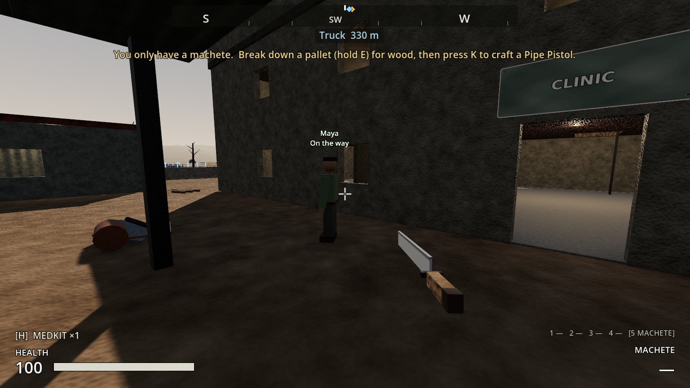 | 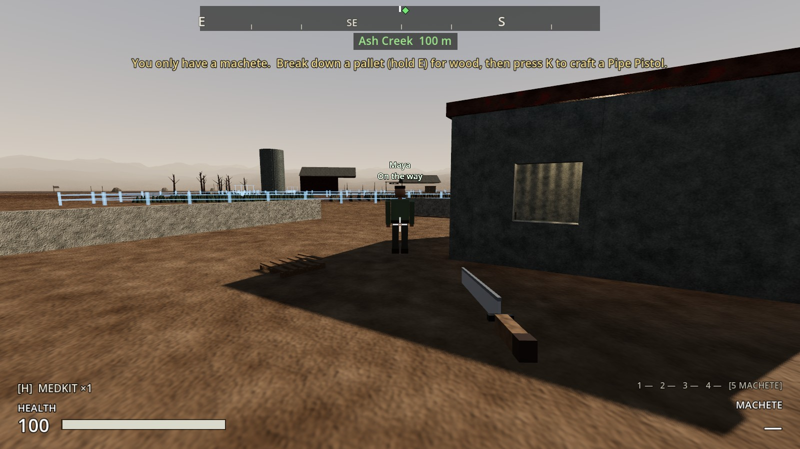 |

**A fence broken and rebuilt.**
- A length of the yard fence broken: the notice, and the outline where it stood.
- Hank, a Builder, rebuilt it from planks and scrap in the Farm Store.

| Broken: back on the list | Rebuilding | Whole again |
|---|---|---|
| 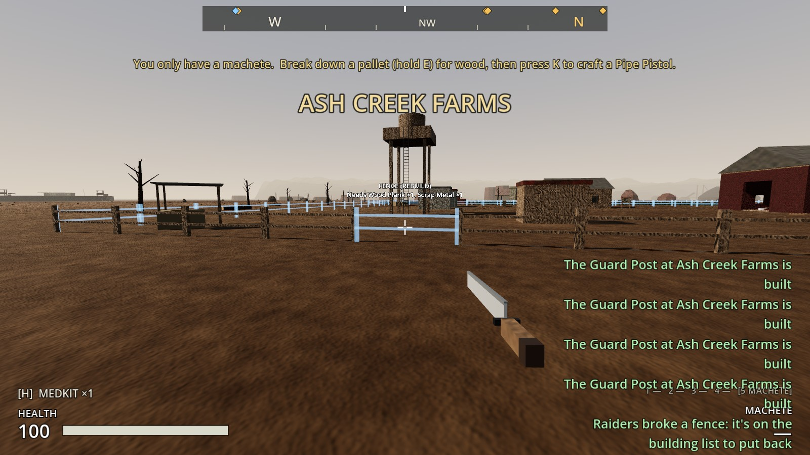 | 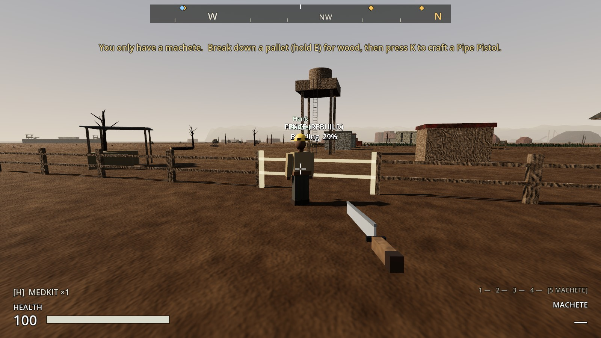 | 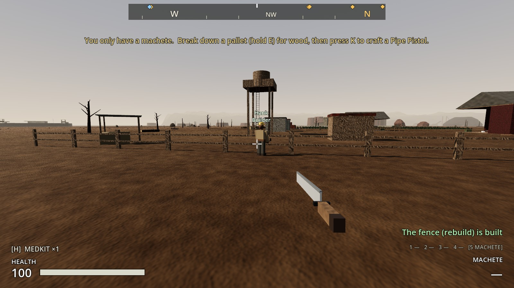 |

**A guard post mended.**
- A guard post knocked down to 40%.
- Rosa, a Builder, mended it with cloth and a plank from the stores.

| Mending the guard post | The settlement screen |
|---|---|
| 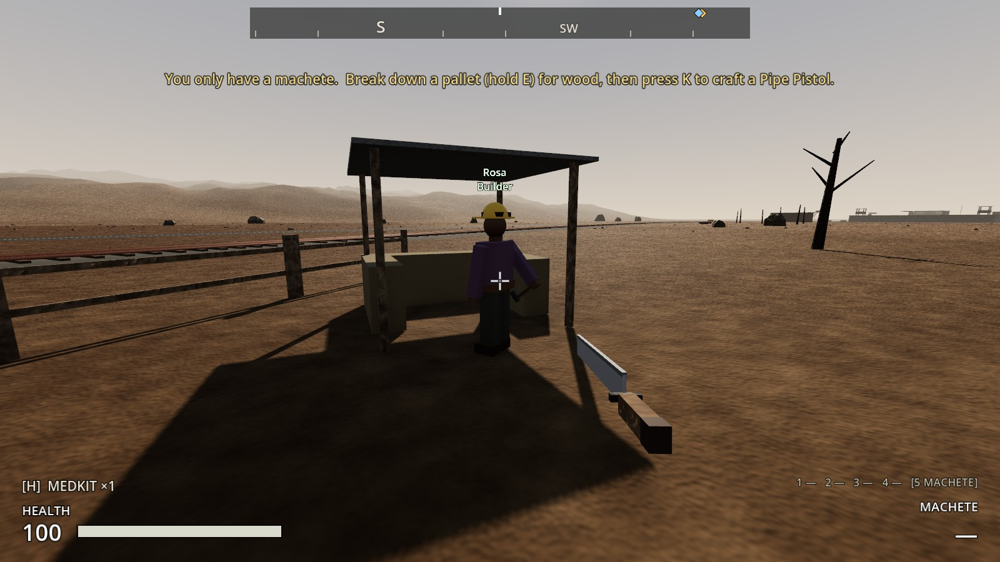 | 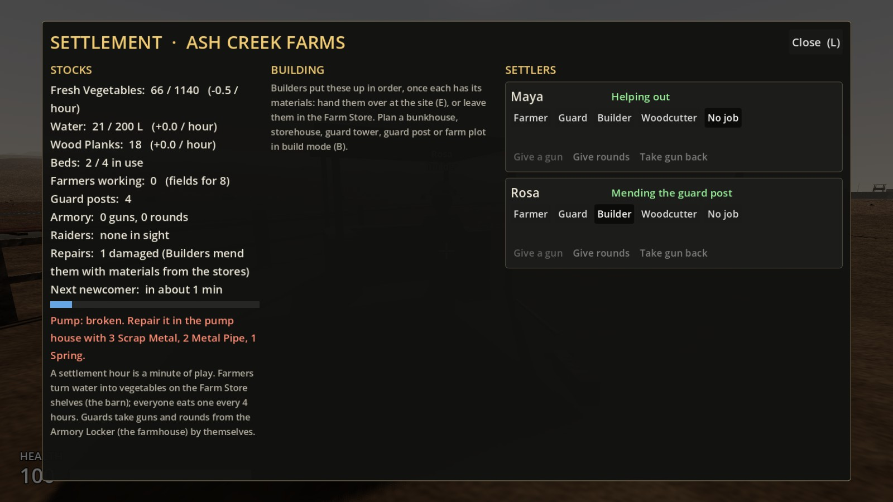 |

**The pump, repaired and then upgraded twice.** The settlement screen then showed water at +39 L an hour.

| The upgrade on offer | Bigger Pump | Motor Pump | The settlement screen |
|---|---|---|---|
| 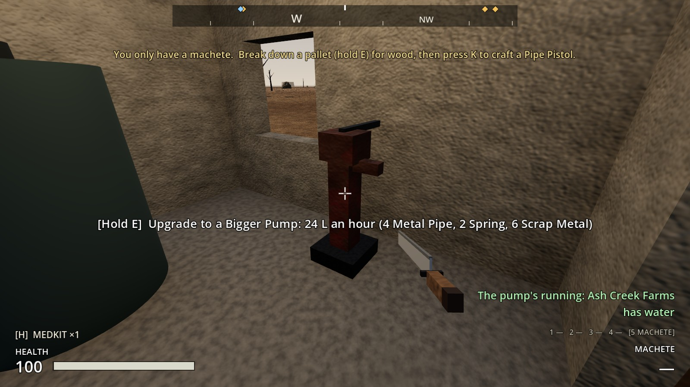 | 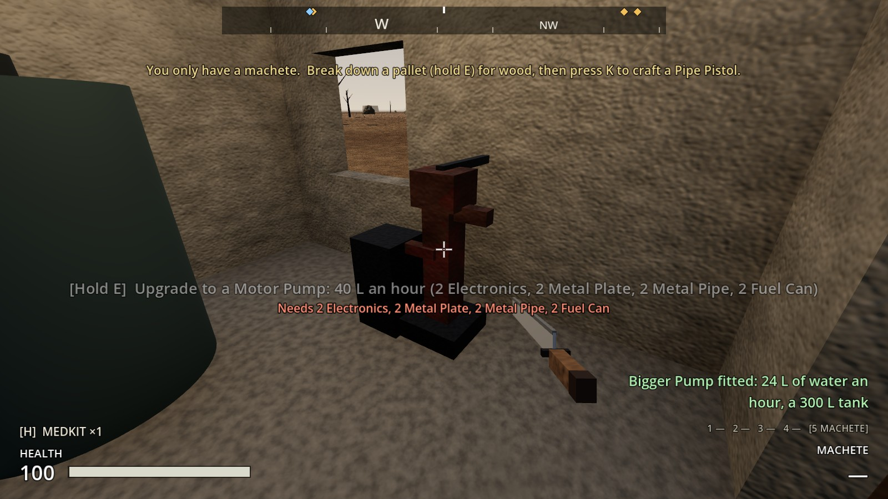 | 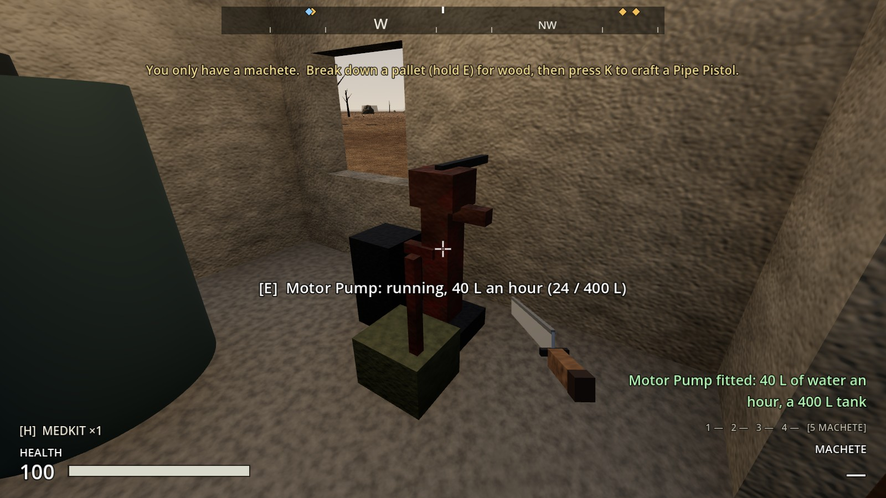 | 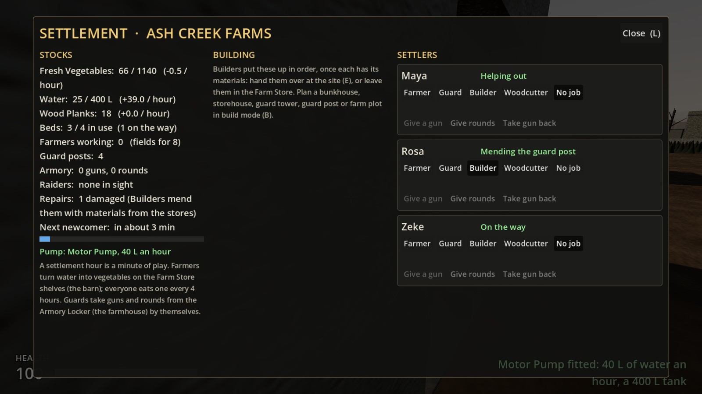 |

## How it's built

**`Settlement`:**
- **The pump:** `PUMP_LEVELS` (name, parts, L an hour, tank) and `pump_level`. Calls: `pump_rate()`, `next_pump_upgrade()`, `upgrade_refusal_reason()`, `request_upgrade_pump()`, and `_apply_pump_look()`, which sets the tank size and shows the PumpHead's `Upgrade2` and `Motor` parts.
- **Repairs:** `builder_job()`, which mends first and then builds, plus `damaged_structures()` and `repair_with_stores()`.
- **Rebuilds:** `on_building_destroyed()` makes a `Rebuild<N>` site.

**`SettlementBuilding.destroy()`** tells the settlement first.

**`ConstructionSite.rebuild`** is saved, and the site's name shows "(rebuild)".

**`Settler._move_to()`:**
- Keeps its path.
- A progress probe every 0.4 s.
- `_away_from_wall()` to pick the side to step to.
- A hop on to the next path point.

**`tools/build_settler.gd`:** the capsule radius is 0.2.

**`tools/build_sites.gd`:** the pump head's upgrade parts.

**`WaterPump`:** the upgrade prompt and the hold.

**Settlement screen:** shows the pump level and repairs.

## Tests (`tests/test_repairs_and_water.gd`)

1. **A broken fence goes back on the building list:**
   - A broken length leaves a "Fence (rebuild)" site where it stood, at the same cost, with a notice.
   - Once built, the line is whole again.
   - Taking one down yourself isn't a rebuild.
2. **Builders mend what raiders damage:**
   - Not without materials in the stores. With them, "Mending the guard post".
   - An hour's work mends it, and the repair cost comes out of the stores.
3. **Recruited survivors walk out of where they were found:** Maya, Tomas and Jeb each get out and 40 m or more on their way in 30 seconds.
4. **Upgrade the pump:**
   - Repaired, then Bigger Pump and Motor Pump: 12, 24 and 40 L an hour, with 200, 300 and 400 L tanks.
   - Refused without the parts. The pump's prompt and look change.
   - Saved and loaded with a full 400 L tank.

**The tests caught one problem, fixed:** a full tank above 200 L came back from a save cut down to 200, because the water was loaded before the tank's size.
