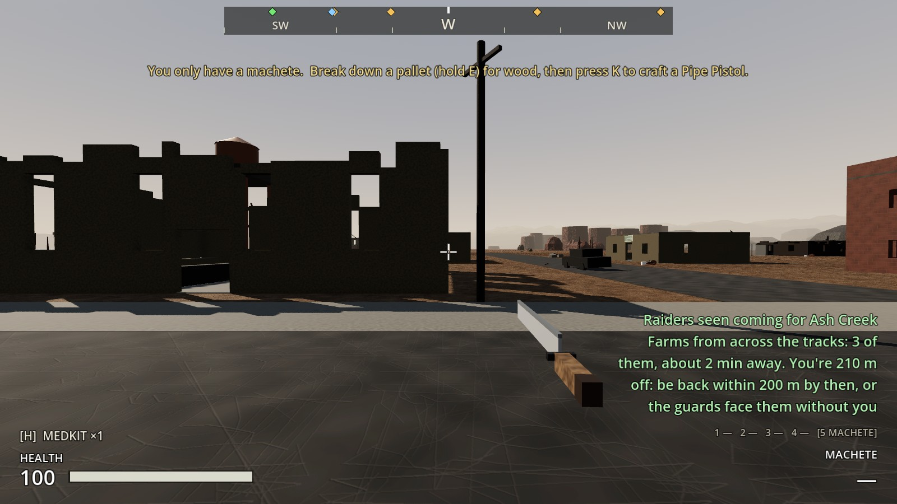
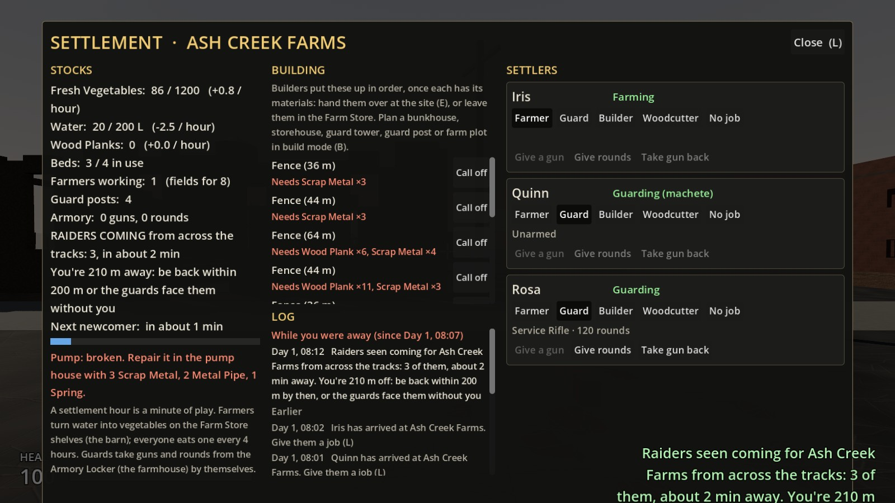
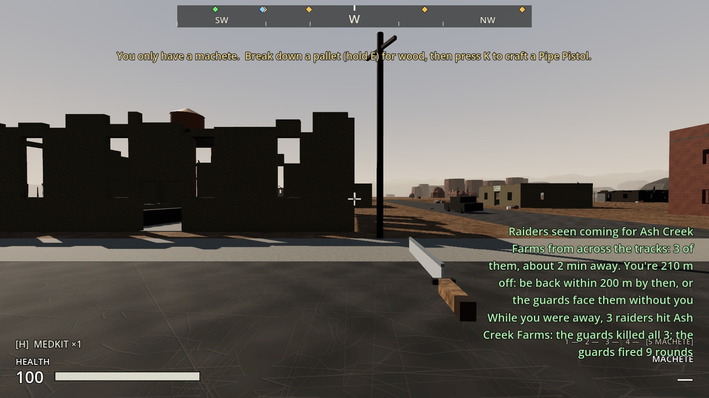
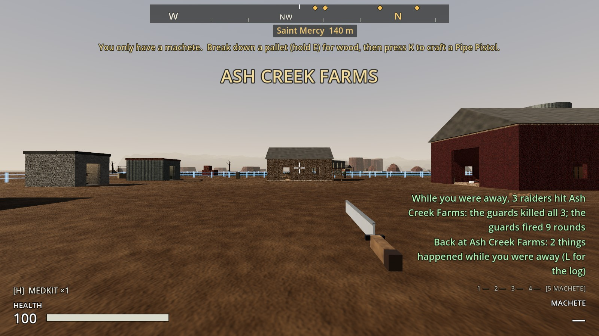
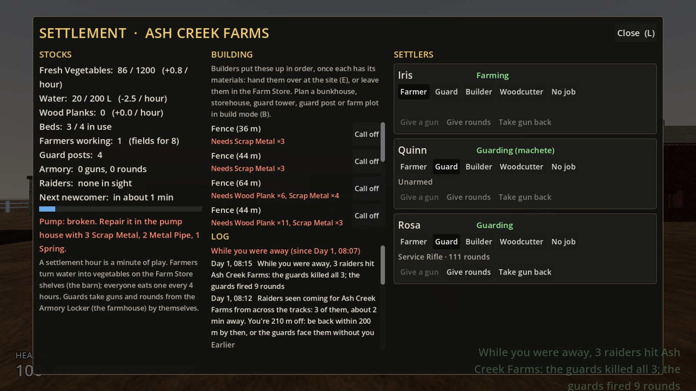
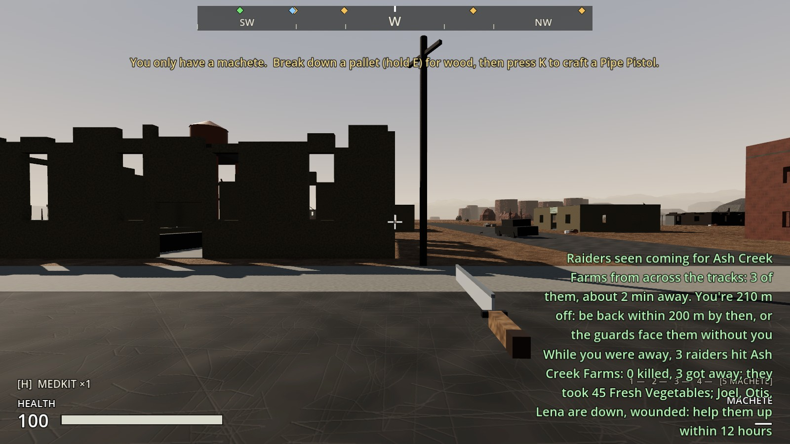
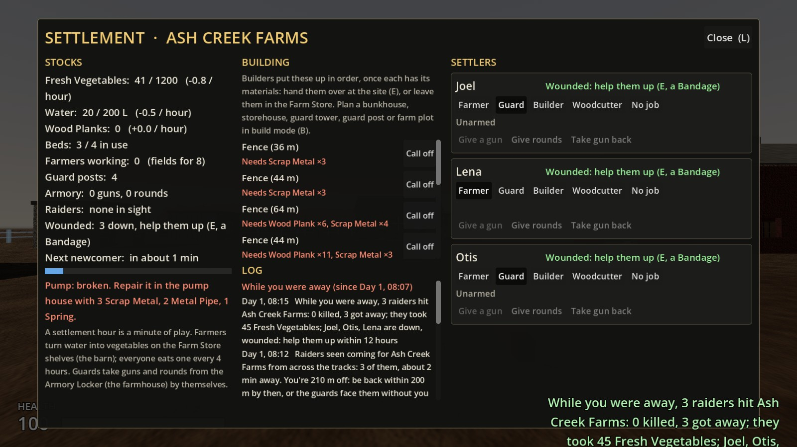
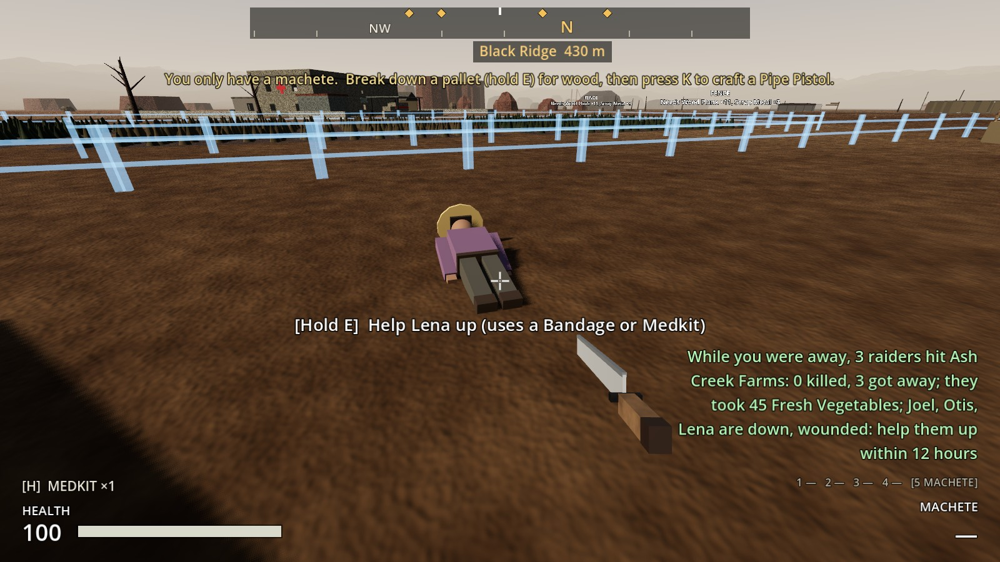

# Increment 20.5: the farm while you're away

**Status:** complete. 437 automated tests pass in headless Godot 4.7, 7 of them new: 6 in `tests/test_away.gd` and 1 in `tests/test_raids.gd`.

Phase 3, step 2, the second half: raids you aren't there for. Your picks:
- **Away means out of range:** more than 200 m from the farm when the raiders arrive.
- **Same odds as when you're there.** Wounded settlers left 12 hours still die.
- **A notice when it's settled, plus a log** on the settlement screen.

## How it plays

**The warning still reaches you wherever you are,** 2 settlement hours (2 minutes) ahead, and now says how far off you are. For example: "Raiders seen coming for Ash Creek Farms from the west: 3 of them, about 2 min away. You're 210 m off: be back within 200 m by then, or the guards face them without you." The settlement screen says the same.

**Back within 200 m when they arrive:** the raid is played out for real, as in Increment 20.

**Still away:** nobody is put in the world. The fight is settled on the spot, behind the scenes, with your settlers' real numbers:
- each guard's gun, the rounds in their magazine and pack, and their health
- the raiders' health and machete damage (a Raider Veteran is tougher)
- what's in the Farm Store and on the shelves

**What it costs is the same as a real raid:**
- **What they take:** raiders who get away take up to 15 vegetables and 8 Wood Planks each. Raiders the guards kill don't get away with anything; what they'd grabbed goes back on the shelves.
- **Rounds:** the guards' rounds go down by what they fired.
- **Health:** hurt guards keep their wounds.
- **Wounded:** anyone beaten goes down wounded. Help them up (hold E, a Bandage or a Medkit) within 12 settlement hours, or they die.
- **Fences:** if raiders had no way in round the fences, they break through the piece in their way. It goes back on the building list (20.1).
- **The next raid** is a couple of days off, as usual.

**A notice:** for example, "While you were away, 3 raiders hit Ash Creek Farms: the guards killed all 3; the guards fired 9 rounds", or "…: 0 killed, 3 got away; they took 45 Fresh Vegetables and 20 Wood Planks; Finn, Nora are down, wounded: help them up within 12 hours".

**Coming back** within 200 m: "Back at Ash Creek Farms: 3 things happened while you were away (L for the log)."

**The log** (settlement screen, under Building) lists what happened at the farm, newest first, each with the time ("Day 2, 14:00"):
- **What's listed:** raids, arrivals, things built and broken, settlers who left or died.
- **While you were away:** what happened since you last left comes first, under that heading. The rest is under "Earlier".
- **Saved** with the game: the last 40 entries.

## Guards answer a raid (a fix to Increment 20)

Settling raids on paper meant first finding out how real raids go, so they were played out for real 20 times, headless (below). That turned up a problem with Increment 20: **guards only fought raiders they could see from their posts.** A raid from the east came in round the barn unseen, so two guards with rifles fired 0 rounds while the barn was emptied. That happened in 2 of 4 runs.

**Now:** during a raid, a guard with no raider in sight goes to the nearest raider inside the farm, then fights as before. Hungry guards still don't. With that fixed, two rifles killed all three raiders every time, from every side.

## How "the same odds" was checked

Five farms, raided for real four times each from random sides, with the player away, then on paper 200 times each:

| Farm | Raiders | Real (4 raids each) | On paper (average of 200) |
|---|---|---|---|
| No guards, 2 farmers | 3 | All 3 got away with 45 vegetables and 20 planks; every farmer down | All 3 away with 45 vegetables; every farmer down |
| 1 guard with a machete, 1 farmer | 3 | All 3 away; the guard down in every raid, the farmer too | 2.96 away; guard and farmer down |
| 2 guards with rifles, 1 farmer | 3 | All 3 killed, 10–15 rounds, nobody hurt | All 3 killed, 12 rounds, nobody hurt |
| 1 guard with a pipe pistol, 3 farmers | 4 | All 4 away with 60 vegetables; everyone down; 5 rounds | 3.8 away with 58 vegetables; everyone down; 4 rounds |
| 4 guards (2 rifles, pistol, shotgun), 4 farmers | 6 (1 veteran) | All 6 killed, 22–36 rounds; a guard down once in 4 | All 6 killed, 32 rounds; nobody down |

One thing that showed: **sheltering in the farmhouse only helps while a guard's still standing.** With nobody to stop them, raiders find and beat the settlers inside. That was already how real raids went, so the paper fight does the same.

## The real-window run

**A raid you won from Halden's Crossing,** 210 m away. The farm had a guard with a service rifle (120 rounds), a guard with a machete and a farmer.
- The warning said how far off you were. The guards killed all three raiders, firing 9 rounds.
- Back at the farm, the log led with "While you were away".

| The warning, from Halden's | The settlement screen |
|---|---|
|  |  |

| Settled while you were away | Back at the farm | The log |
|---|---|---|
|  |  |  |

**A raid you lost:** the same farm, but both guards with only machetes.
- All three raiders got away with 45 vegetables, and all three settlers were left down.
- Back at the farm, Lena lay by the fields: "Hold E: Help Lena up".

| The notice | The log and the wounded | Lena, waiting for a bandage |
|---|---|---|
|  |  |  |

## How it's built

**`RaidOnPaper`** (new, `scripts/settlement/raid_on_paper.gd`) plays the fight out in quarter-second steps:
- **Raiders** go APPROACH (under fire), then FIGHT (a standing guard, machete swings) or LOOT (no guard standing). After that, HUNT (after the sheltering settlers) and FLEE (under fire again).
- **Guards** shoot with their gun's fire rate, magazine, reloads, spread and falloff, at about 14 m. Without a gun, or out of rounds, they use the machete.
- **Seeded,** so a test can repeat a fight.

**`Settlement`:**
- **Away:** `away_range` (200 m), `player_distance()` and `player_near()`. `start_raid()` calls `settle_raid_on_paper()` when nobody's near.
- **The report** carries `rounds`, `broke` and `on_paper`, plus `paper_summary()` for the notice.
- **Break-ins:** `_paper_break_in()` asks the navmesh for a way in, and breaks the nearest piece on the straight line if there isn't one.
- **The log:** every notice is logged as `log_entries` (hour, text, away), with `clock_hours`, `left_at_hour` / `back_at_hour`, `away_entries()` and `clock_text()`. All of it is saved.

**`Settler`:**
- **`knock_down()`** for anyone beaten on paper.
- **`_nearest_raid_raider()`:** during a raid, guards head for the nearest raider.
- **`is_dead()`** is true for a settler who bled out.

**Settlement screen:** the LOG panel, plus the away line while raiders are coming.

## Tests (`tests/test_away.gd`, and one more in `tests/test_raids.gd`)

1. **On paper, the odds follow the guards:**
   - Four rifles hold off two raiders (at least 17 times in 20).
   - With no guards, three get away with everything they can carry.
   - A machete guard is beaten by three more often than not.
   - The same seed gives the same fight.
2. **A raid while you're away is settled on paper:**
   - The warning says you're far off.
   - No raiders are put in the world, and the next raid is days off.
   - What they took left the stores, the guards' rounds dropped by what they fired, and who's down matches the report.
   - A notice, and an entry in the log.
3. **Losing while away costs the same:** all three got away with 45 vegetables and every plank. A settler knocked down bleeds out after 12 hours.
4. **With you there, it's a real fight:** the raiders are put in the world.
5. **Coming back tells you what happened:**
   - The farm knows when you left.
   - A "Back at…" notice when you return.
   - The screen's log starts with "While you were away", with times.
6. **The log is saved,** with its clock and when you left.
7. **Guards go to raiders they can't see** (`test_raids.gd`): a guard round the far side heads for raiders coming from the east and kills both. Without the fix, both got away with 30 vegetables.

The Increment 20 raid tests now set `away_range` very large, so their raids are still played out for real.
