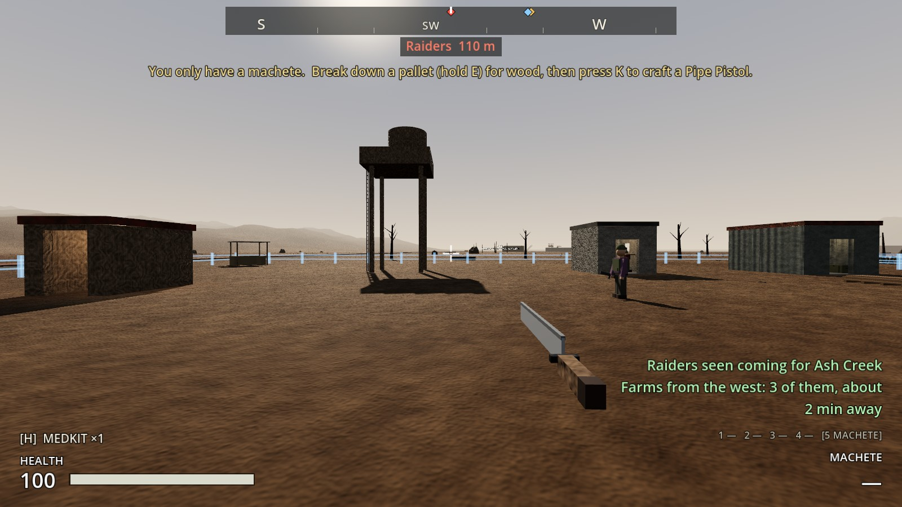
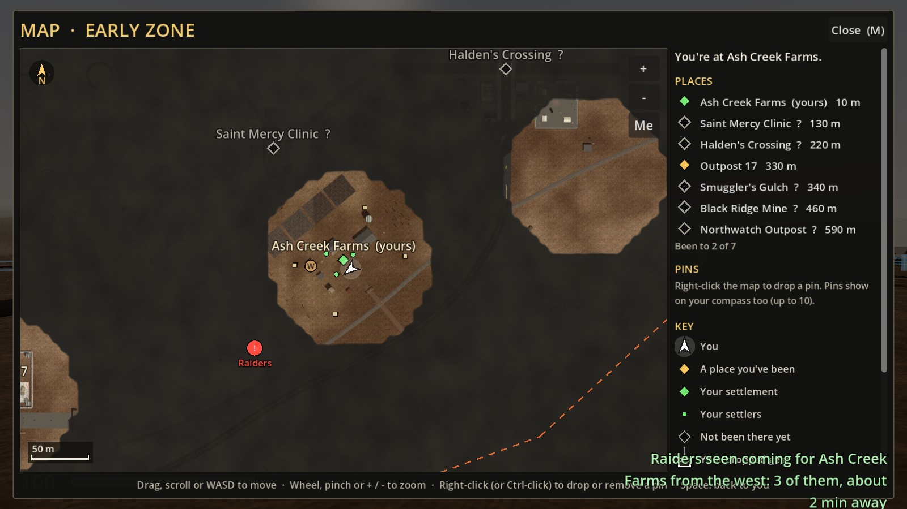
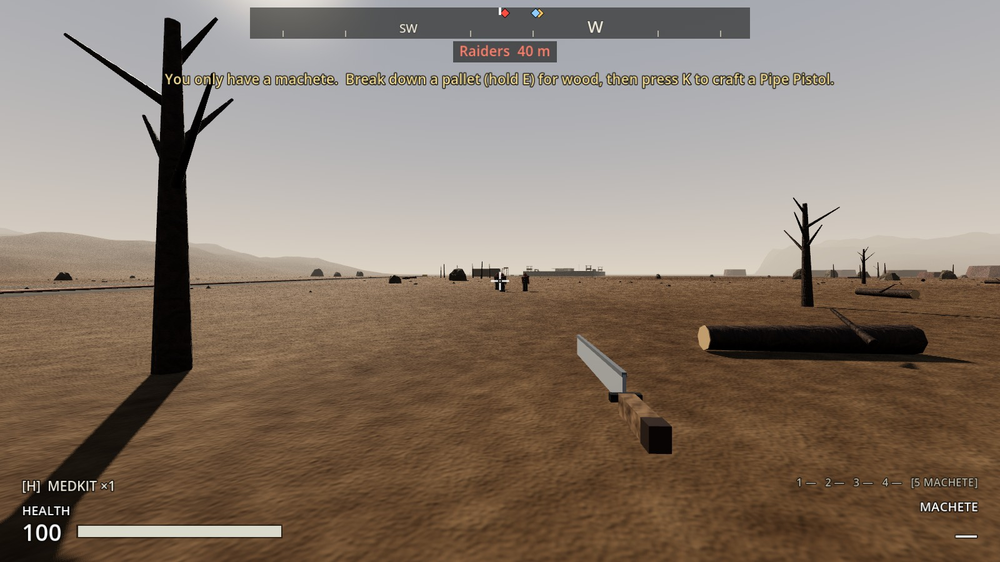
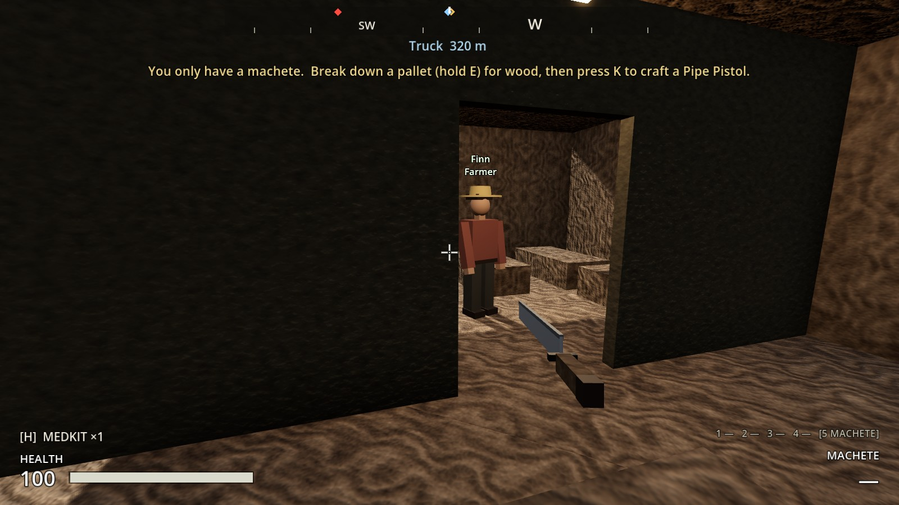
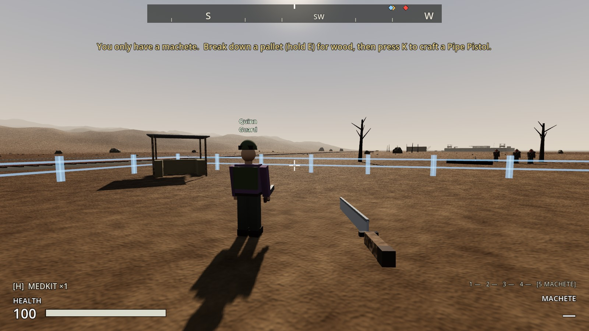
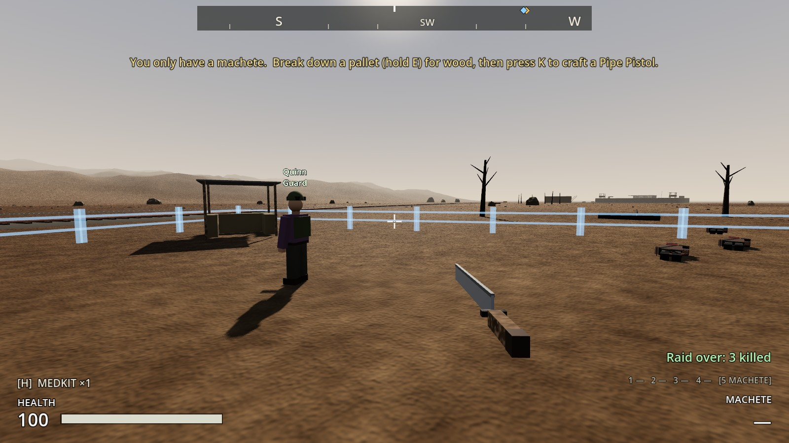
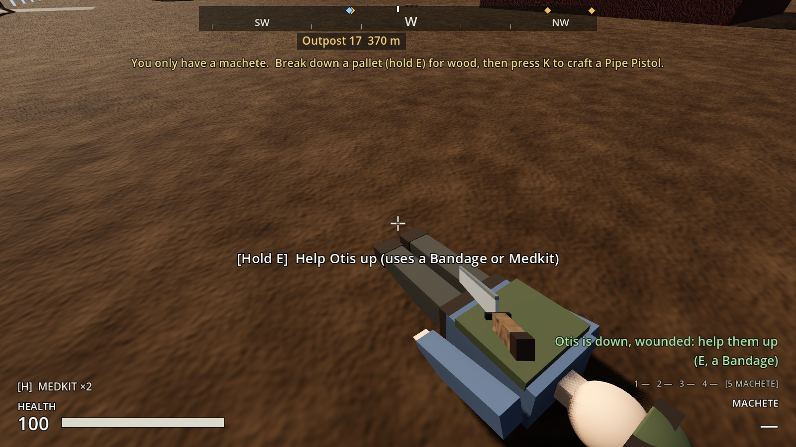
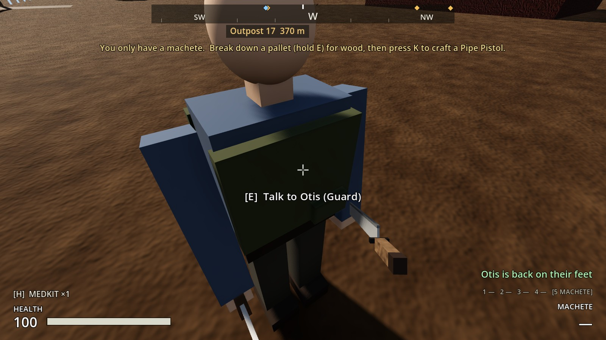

# Increment 20: raids on Ash Creek

**Status:** complete. 426 automated tests pass in headless Godot 4.7, 8 of them new in `tests/test_raids.gd`.

Phase 3, step 2, the first half: raids while you're there. The farm while you're away on paper is Increment 20.5.

Your picks:
- **How often:** about every 48 settlement hours.
- **Warning:** 2 hours ahead.
- **What a lost fight costs:** raiders steal and hurt. Settlers go down wounded, not dead, unless you leave them.

## How a raid goes

**When.**
- **The first raid:** about two days after you claim the farm, give or take a quarter (36–60 settlement hours: 36–60 min of play).
- **After that:** the same again after each raid.
- **Nothing before you claim it.**

**The warning,** 2 settlement hours (2 min of play) before they arrive:
- **A notice:** "Raiders seen coming for Ash Creek Farms from the west: 3 of them, about 2 min away".
- **A red Raiders marker** on the compass and the map, where they were seen.
- **On the settlement screen:** "RAIDERS COMING from the west…".
- **Where they come from:** east of the farm, west of it, or from across the tracks.

**How many:** 2, plus 1 for every 2 people living there, up to 8. Every fourth one is a Raider Veteran.

**What they do.**
- **Coming in:** they head in to the Farm Store at the back of the barn. A fence or anything you've built in their way gets hacked through. They also snag less on door frames: a raider caught on a corner steps aside.
- **Fighting:** they go for any settler they see, and for you.
- **Stealing:** at the shelves, each raider loads up with up to 15 vegetables and 8 Wood Planks, then runs back out the way it came.
- **Getting away:** a raider who gets away keeps what it took.
- **Killed:** a raider you or the guards kill drops whatever it was carrying, so you can pick it back up.

**Your people.**
- **Guards** stand at their posts and towers and fight. Arm them!
- **Everyone else** shelters in the farmhouse until it's over ("Sheltering from the raid").
- **A settler a raider beats goes down, wounded,** not dead.
  - **Raiders leave the downed alone.**
  - **Helping them up:** hold **E** on them, using a **Bandage** (back up at half health) or a **Medkit** (full health).
  - **If nobody helps them,** they die after 12 settlement hours.
  - **The settlement screen** counts the wounded and says how to help.

**When it's over** (every raider dead or gone), a notice reports it, for example: "Raid over: 2 killed, 1 got away, they took 15 Fresh Vegetables and 8 Wood Planks, wounded: Otis". The marker goes, and the next raid is a couple of days off.

**Saved:**
- **The raid clock.**
- **A raid on its way:** comes back with the same direction, size and time.
- **A raid under way when you saved:** comes back as raiders at the edge of the farm, about to come in.
- **Wounded settlers** stay down.

## The real-window run

- Claimed the farm, built its four guard posts, and took in two guards (Quinn with a service rifle, Otis unarmed) and a farmer, Finn.
- **The warning:** "Raiders seen coming … from the west: 3 of them". The red marker was 110 m out on the compass and on the map.
- **The raid:** they came in across the open ground past the woodlot. Finn sheltered in the farmhouse while the guards fought.
- **The result:** all three raiders killed, nothing taken. "Raid over: 3 killed."
- **Helping up:** then a wounded Otis on the ground: "Hold E: Help Otis up". A bandage got him back on his feet.

| The warning | On the map |
|---|---|
|  |  |

| Raiders coming in | The farmer sheltering in the farmhouse |
|---|---|
|  |  |

| A guard at their post | Raid over |
|---|---|
|  |  |

| Wounded: help them up | Back on their feet |
|---|---|
|  |  |

**The tests caught three problems, fixed:**
- **A raider got stuck on the barn's door frame** and never reached the shelves (now it steps aside).
- **A raid saved mid-attack came back hours away** instead of about to arrive.
- **A raid saved while on its way** could come back from a new direction.

## How it's built

- **`Settlement`:**
  - **Settings:** `raid_every_hours` 48, `raid_warning_hours` 2, `raid_carry_food` 15, `raid_carry_planks` 8 and `bleed_out_hours` 12.
  - **The raid's progress:** `RaidPhase` (NONE, WARNED, ACTIVE), `next_raid_in`, `raid_from` and `raid_size`, with `_simulate_raids()` running inside `simulate()`.
  - **Calls:** `warn_raid()`, `start_raid()`, `end_raid()`, `raid_steal()`, `raid_escaped()`, `raid_recovered()`, `on_settler_down()`, `request_help_up()` and `raid_summary()`.
  - **Markers:** the red `RaidMarker` Landmark, plus `RaidPoints/*` (where raids come from, each with a "label") and `Shelter`.
  - **Signals:** `raid_warned`, `raid_started` and `raid_ended(report)`.
- **`Raider`:**
  - **Targets:** `target` can be a settler now, using `is_alive_target()` and `aim_point()`.
  - **Raiding:** `join_raid()` and `RaidPhase` (APPROACH, LOOT, FLEE). `_break_through()` hacks through structures or steps aside, and `_drop_carried()` drops loot on death.
  - **Who they go for:** settlers in sight while raiding, and a guard who shoots at them.
- **`Settler`:** `State.DOWN`, `is_down()`, `help_up()` and `bleed_out()`. Settlers shelter during raids, and being down is saved.
- **`SettlerTalk`:** "Help X up" is a 2 s hold.
- **Map and screen:** the map shows a red **!** for raids, and the settlement screen shows raid status and the wounded.

## Tests (`tests/test_raids.gd`)

1. **Raids come every couple of days, with a warning:**
   - None before you claim the farm. After, the first comes in 36–60 hours.
   - Two hours out: a notice, a red compass marker out where they were seen, and on the map.
   - Then 2 raiders arrive, raiding.
2. **Bigger farms draw bigger raids:** six settlers bring five raiders, one of them a veteran.
3. **Raiders take from the stores and run off:**
   - They reach the barn and load up; two take 30 vegetables and 16 planks.
   - Both get away, and the report says so.
   - The next raid is days off and the marker's gone.
4. **Guards fight them off,** and nothing is lost.
5. **Settlers shelter, or go down wounded:**
   - A farmer heads for the farmhouse.
   - Beaten, they're down but not dead, still living there, on the report, and left alone by raiders.
   - No bandage: refused. With one: back up at half health.
6. **Left down too long, they die:** still alive at 11 hours, dead at 12.5.
7. **Raiders hack through fences in the way:** one boxed in by fences hacks its way out.
8. **A raid on its way is saved:** the same side, size and time, with its marker. One saved mid-raid comes back about to come in.
