# Increment 21.5: the Kitchen, the Cook, and animals

**Status:** complete. 453 automated tests pass in headless Godot 4.7, 7 of them new in `tests/test_kitchen_and_animals.gd`.

From your notes and picks:
- **A Cook,** who can't be hired until a Kitchen is built. The Kitchen has a stove you can cook at too.
- **The Cook's work:** turns the stores' wood into planks, cooks the farm's food over them, and keeps the dishes in the Kitchen's fridge.
- **Pens:** animals arrive when a pen is built, and they breed while fed.
- **A Rancher** looks after the animals.
- **What the animals give:** meat when butchered, eggs from chickens, and hides from cows, kept for clothing and armour later.
- **Who eats it:** settlers eat the cooked food first, and you can take from the fridge too.

## The Kitchen and the Cook

**The Kitchen** is planned in build mode (B) like a bunkhouse, and settlers build it. It costs 24 Wood Planks, 8 Scrap Metal, 2 Metal Pipes and 1 Electronics, and takes 5 hours. Inside:
- **A Cooking Stove.** You can cook at it yourself (E).
- **A Fridge** (30 slots) for what's cooked. Open it with E to take from it. Raiders don't loot it; they go for the Farm Store.
- **A counter and a table.**

**The Cook** is a new job (an apron and a chef's hat).
- **Hiring:** the job button stays greyed until a Kitchen stands: "Build a Kitchen first: plan one in build mode (B)".
- **What they do:** they work at the stove, making 2 dishes an hour. They always cook the most filling dish the stores have the makings of. Each dish burns a Wood Plank.
- **Fuel:** with no planks in the stores, they cut a piece of Wood into 2 planks.
- **Where it goes:** the dishes go in the fridge.
- **Holding back:** they leave 10 vegetables in the stores, for the animals and anyone eating raw.
- **Their status:** "Cooking meat stew", "Fridge full", "Nothing to cook: needs vegetables, meat or eggs in the stores", or "No planks or wood for the stove".

**Cooking, for you and the Cook:**

| Dish | Makings (plus a Wood Plank) | Fills you | Feeds settlers |
|---|---|---|---|
| Meat Stew | 1 Raw Meat, 2 Fresh Vegetables | 75 | 5 meals |
| Vegetable Stew | 3 Fresh Vegetables | 60 | 4 meals |
| Cooked Meat | 1 Raw Meat | 40 | 2 meals |
| Fried Eggs | 2 Eggs | 25 | 2 meals |

All of them cook on a stove or a workbench. **Cooking now burns a Wood Plank, not Wood,** so you and the Cook follow the same recipes. Vegetable Stew changed to match. Craft planks from wood by hand (K).

**Settlers eat from the fridge first.** One dish feeds several of them before anyone touches the raw vegetables. Water's still needed for each meal. Newcomers count the fridge's meals as food when deciding whether to come.

## Pens, animals and the Rancher

**Three pens to plan in build mode.** When one's finished, **a pair arrives**: "A pair of pigs has arrived at the pig pen".

| Pen | Size | Holds | Costs | What they give |
|---|---|---|---|---|
| Chicken Coop | 8 × 6 m, a hen house and a wire run | 8 | 12 planks, 4 scrap, 2 cloth (3 h) | Eggs, and 2 Raw Meat each |
| Pig Pen | 10 × 8 m, a trough, mud, a shelter | 6 | 16 planks, 6 scrap (3 h) | 5 Raw Meat each |
| Cow Pasture | 16 × 12 m, a trough, hay, a lean-to | 4 | 28 planks, 8 scrap (4 h) | 8 Raw Meat and a **Raw Hide** each |

- **Getting in:** each pen has a gap in its front fence to walk in by. The animals stay inside on their own.
- **What they do:** they wander about, peck or graze, and walk with a little bounce.

**The Rancher** is a new job (a wide-brimmed hat). The job button stays greyed until a pen is built.
- **Where they work:** from trough to trough.
- **Feeding:** they feed the animals Fresh Vegetables from the stores. A chicken eats one a day, a pig one every 8 hours, a cow one every 6.
- **While they're fed:**
  - **Births:** every pair has young: chickens every 12 hours, pigs every 24, cows every 48. That goes on up to the pen's size.
  - **Eggs:** a chicken lays an egg every 12 hours, into the stores.
- **When a pen is full,** they butcher it back to half, keeping a pair at least, so the breeding goes on. The meat (and any hides) go in the stores. For example: "Finn butchered 4 chickens: 8 Raw Meat into the stores".
- **With no Rancher,** or no vegetables, the animals don't starve. They just don't breed or lay.

**Butchering one yourself:** hold **E** on an animal (3 s) inside its pen.
- **What you get:** the meat (and a cow's hide) goes in your backpack. Anything that doesn't fit goes in the stores.
- **Raw Meat and Eggs have to be cooked first.** Eating them is refused with "Cook it first".

**The settlement screen** has two new jobs (greyed with the reason until they can be given). The Stocks list shows:
- **Fridge:** the dishes and the meals they'll make.
- **Animals:** for example, "6 / 8 chickens, 3 / 6 pigs, 3 / 4 cows".
- **Eggs, Raw Meat and Raw Hides** in the stores.

**Saved:** each pen's animals, how close the next birth and egg are, and whether they've been fed. The fridge, and the Cook and Rancher, are saved too.

## The real-window run

- **The Kitchen:** planned in the open ground at the front of the farm, built, and Kit hired as Cook. With vegetables, meat, eggs and wood in the stores, there were three Meat Stews in the fridge an hour and a half later. You then cooked a meat stew yourself at the Kitchen's stove.
- **The pens:** a Chicken Coop and a Pig Pen beside the Kitchen, and a Cow Pasture west of the farm. Finn was hired as Rancher, and he was "Tending the animals" in the coop.
- **Butchering:** a pig, by hand: 5 Raw Meat.

| Planned | Built | The Cook at the stove |
|---|---|---|
| 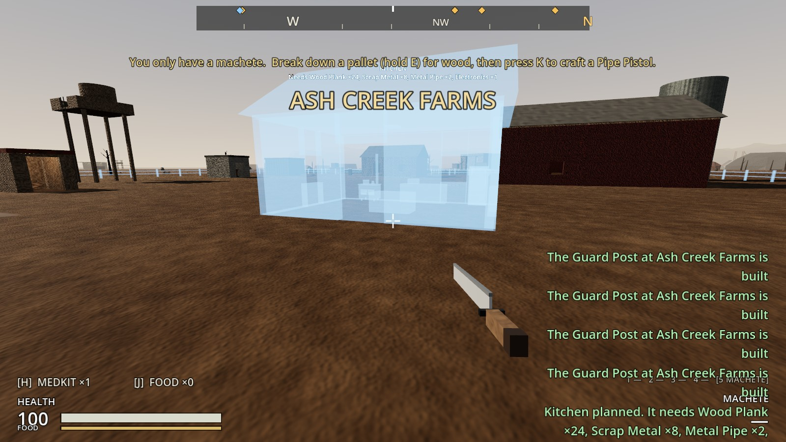 | 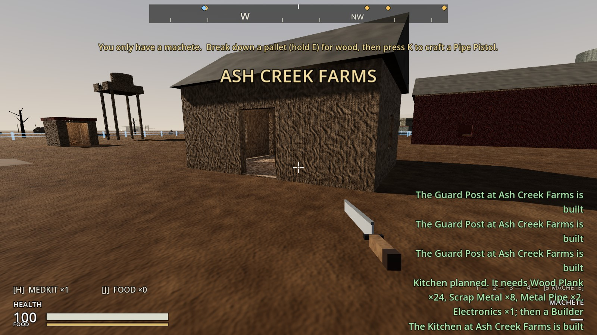 | 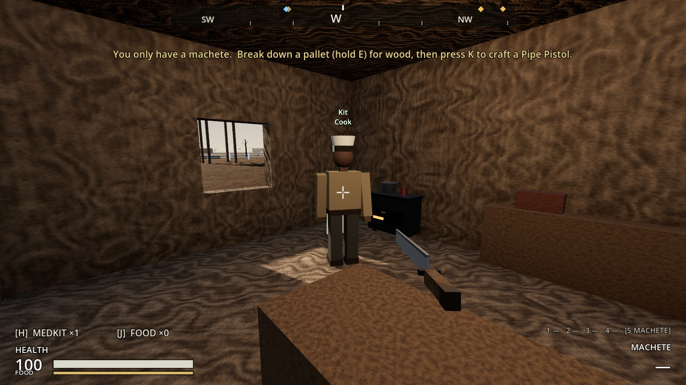 |

| The fridge | Cooking yourself | The settlement screen |
|---|---|---|
| 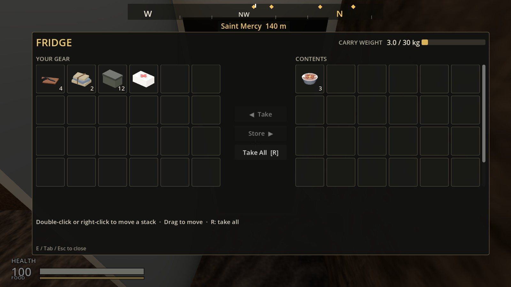 | 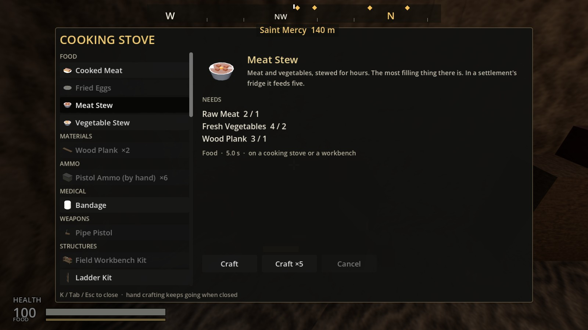 | 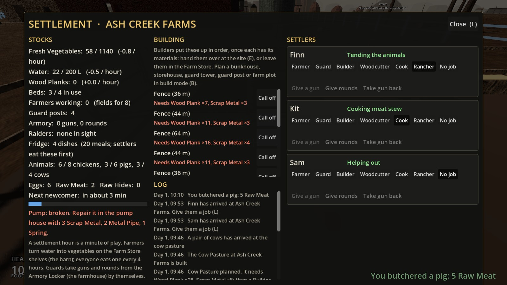 |

| Chicken Coop | Pig Pen | Cow Pasture |
|---|---|---|
| 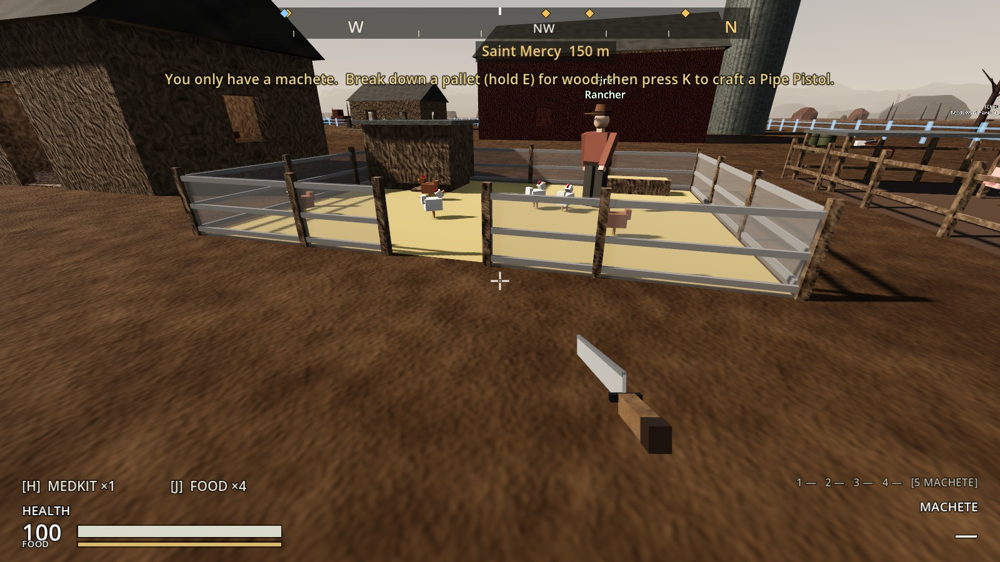 | 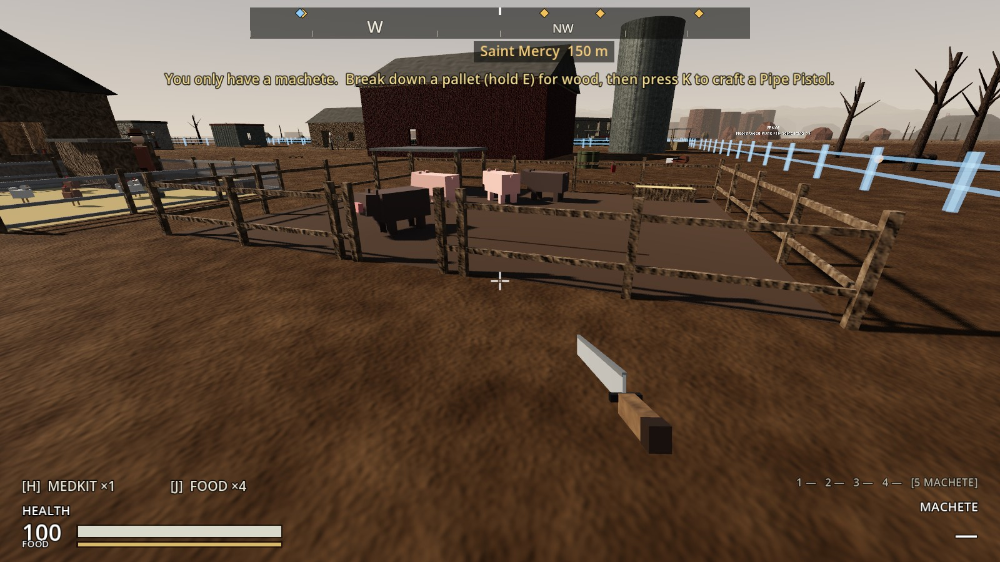 | 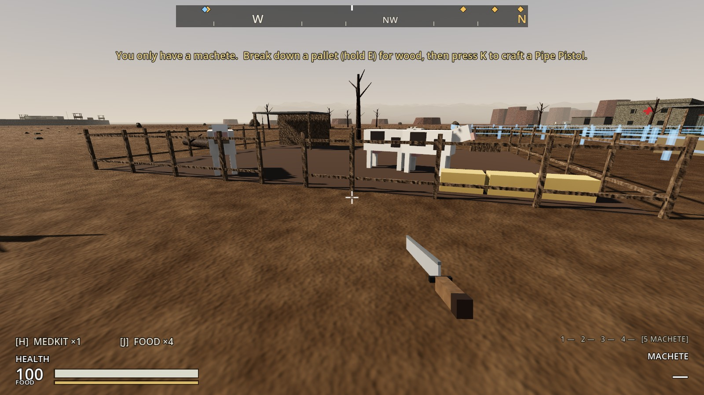 |

| The Rancher | Hold E: butcher | Butchered |
|---|---|---|
| 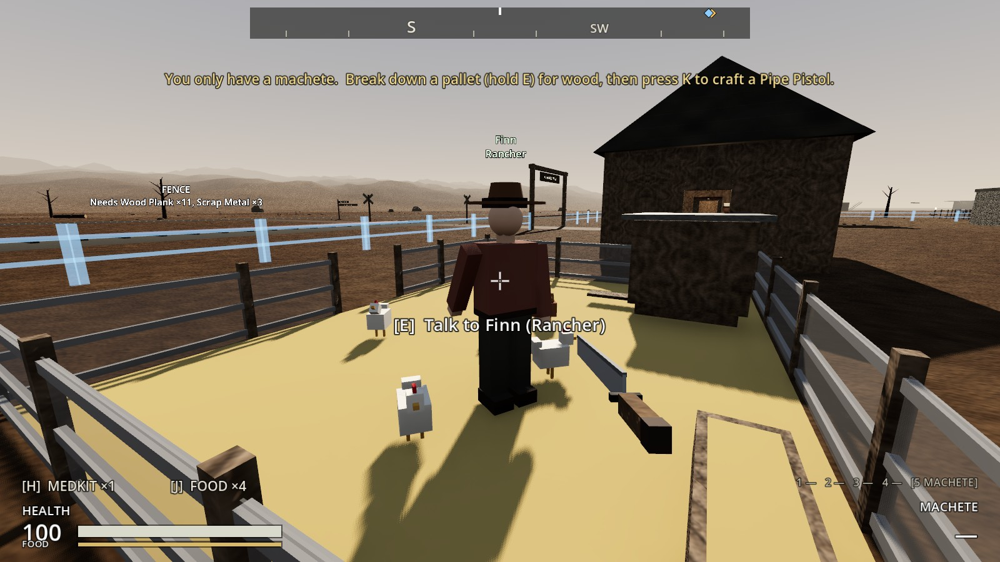 | 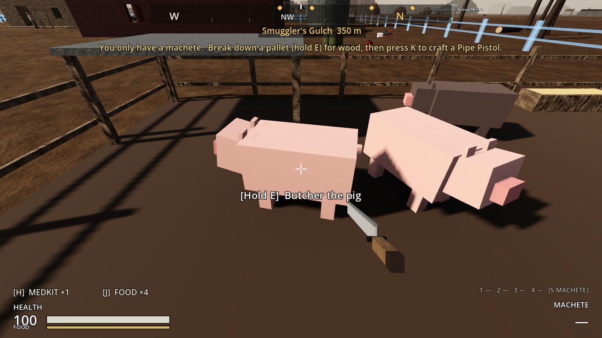 | 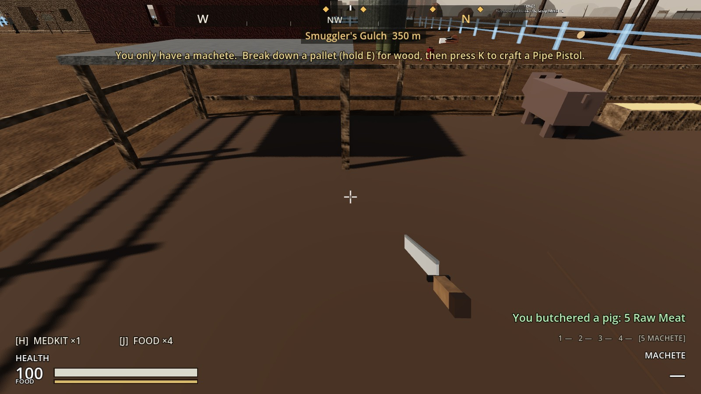 |

**A note on room:** the Cow Pasture is big (16 × 12 m), and the open ground at the front of the farm was taken by the Kitchen and the other two pens. It fitted west of the farm, past the pump house.

## How it's built

**Buildings:**
- **`SettlementPlans`:** `kitchen`, `chicken_coop`, `pig_pen` and `cow_pasture`.
- **`tools/build_settlement_buildings.gd`:** `_kitchen()` (the stove scene, `%Fridge` and CookSpots) and `_pen()` (a fence with a gap, a trough, a shelter, AnimalArea and TendSpots).

**`SettlementBuilding`:**
- **The fridge:** `fridge` (%Fridge, not part of the stores).
- **Pens:** `animal_kind` and `animal_capacity`, `animal_count` (-1 until the pair arrives), and the `breed_progress`, `egg_progress` and `feed_owed` counters.
- **Calls:** `animals()`, `set_count()`, `remove_animal()` and `random_animal_spot()`.
- **Saved** in `save_state()`.

**`FarmAnimal`** (new, an Interactable): built from boxes in code. It wanders inside its pen's AnimalArea, and "Butcher the pig" is a hold of E.

**`Settlement`:**
- **Animals:** `ANIMALS`, `_simulate_animals()` and `rancher_status()`.
- **Cooking:** `_simulate_cooking()` and `_cook_one()` (the most-meals recipe first, wood cut into planks), plus `cook_status()`.
- **Meals:** `_take_meal()` (the fridge first) and `fridge_meals()`.
- **Requests:** `role_refusal_reason()` and `request_butcher()`.
- **Lookups:** `kitchens()`, `pens()`, `fridges()`, `animal_counts()` and `butcher_yield()`.

**`Settler`:**
- `Role.COOK` and `Role.RANCHER`, with `_cook()` and `_tend()` built on `_work_at()`.
- The apron, chef's hat and wide-brimmed hat come from `tools/build_settler.gd`.

**Items and scenes:**
- **`ItemDefinition.settler_meals`.**
- **`tools/build_food.gd`** now makes:
  - the Raw Meat, Egg and Raw Hide items
  - Meat Stew, Cooked Meat and Fried Eggs
  - the four recipes, all burning a plank
  - the fridge (`scenes/world/containers/fridge.tscn`)
- Icons rendered.

## Tests (`tests/test_kitchen_and_animals.gd`)

1. **The new buildings and food:**
   - All four can be planned.
   - The kitchen has a 30-slot fridge, a stove and a place to cook. The pens hold 8, 6 and 4.
   - Butchering gives 2, 5, or 8 meat and a hide.
   - Every dish burns a plank. Meat stew feeds five and is the Cook's first choice. Raw things need cooking.
2. **Cook and Rancher need their buildings:** both are refused with the reason, and once a Kitchen is built, a Cook can be hired.
3. **The Cook fills the fridge:**
   - An hour: two meat stews, the wood cut into planks and burned.
   - The last 10 vegetables are left alone.
   - Then vegetable stews and fried eggs.
   - "No planks or wood for the stove" when there's nothing to burn.
4. **Settlers eat cooked food first:** one stew makes four meals before any vegetable is eaten.
5. **A coop, its chickens and the Rancher:**
   - The pair arrives, inside the coop, with a notice.
   - No Rancher: nothing happens.
   - With one: a chick in 12 hours, eggs, and feed taken from the stores.
   - Full: butchered back to half, with "butchered 4 chickens: 8 Raw Meat".
6. **Cows give hides, and you can butcher:** "Butcher the cow" (3 s) gives 8 meat and a hide, and raw meat is "Cook it first".
7. **Pens, kitchens and jobs are saved:** five pigs, the next piglet's progress, the fridge's stews, the Cook and the Rancher.

**Older tests changed:**
- `test_hunger.gd`: the stew now burns a plank.
- `test_settlement_building.gd`: nine things to plan, not five.
