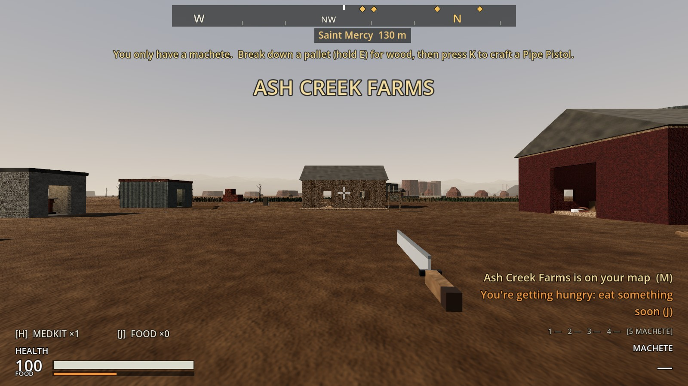
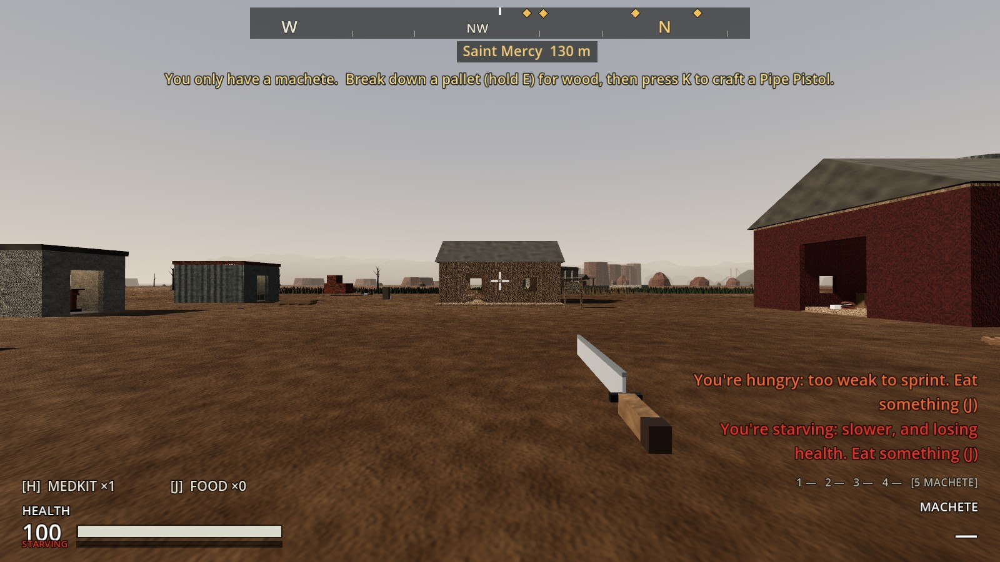
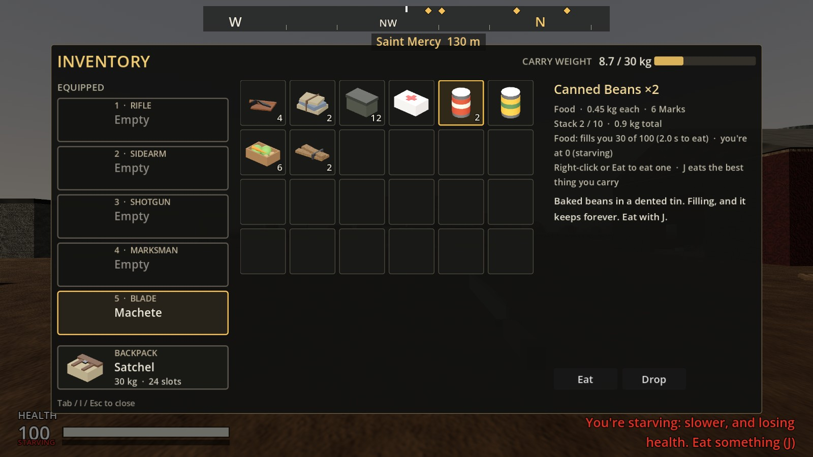
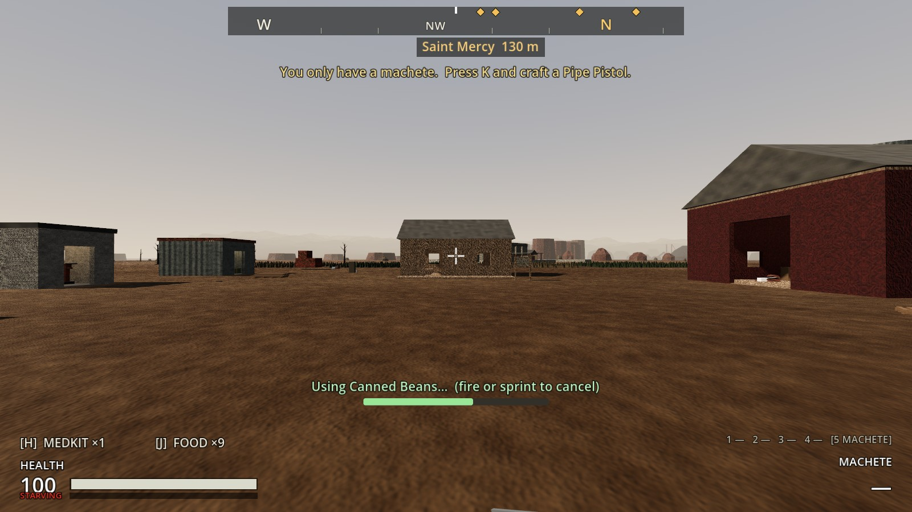
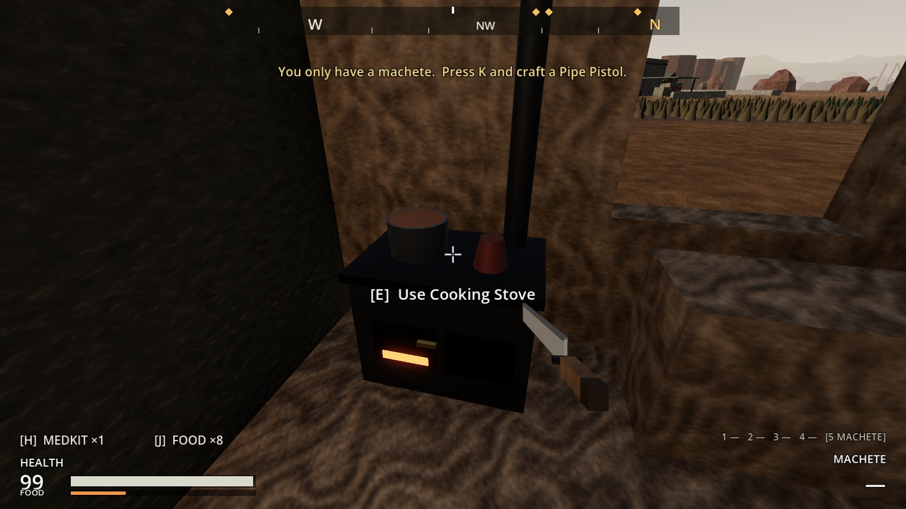
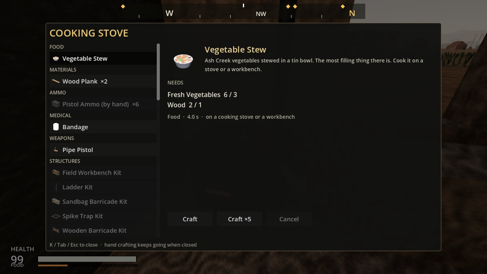
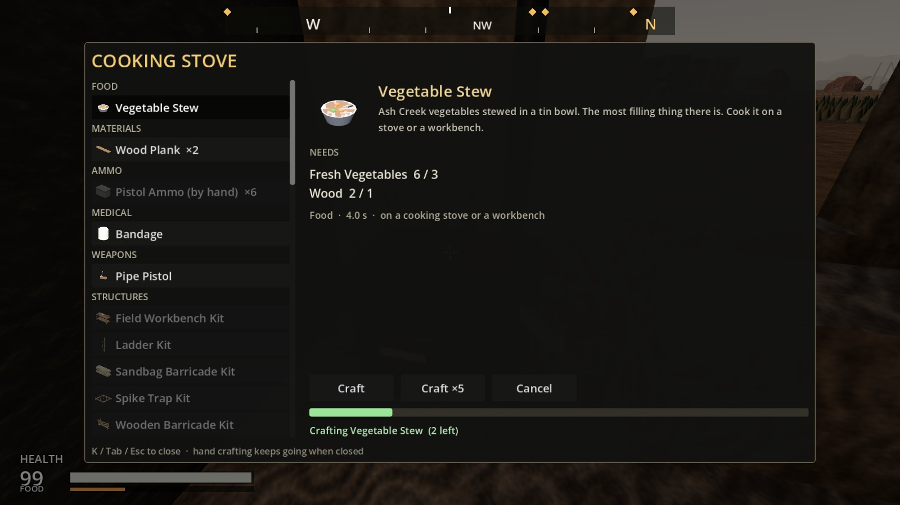
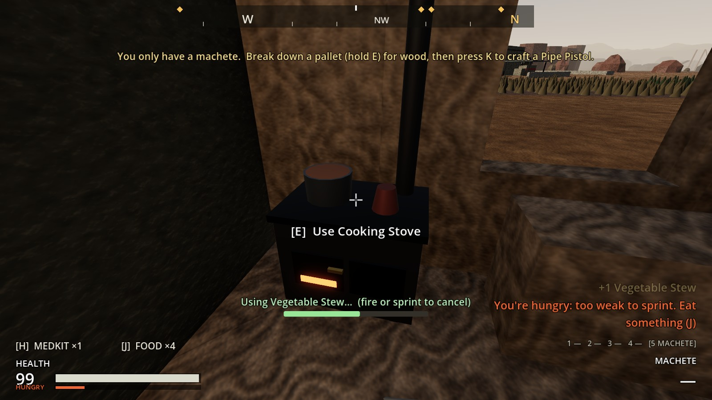

# Increment 21: hunger

**Status:** complete. 446 automated tests pass in headless Godot 4.7, 9 of them new in `tests/test_hunger.gd`.

Phase 3, step 3. Your picks:
- **About 20 minutes of play between meals.**
- **It gets worse the longer you go, but it can't kill you.**
- **Food:** Fresh Vegetables, canned food in loot, and stew cooked on a stove.

Your fourth pick, raising chickens, pigs and cows for meat, is Increment 21.5.

## How it plays

**The FOOD bar** sits under your health bar. It empties over about **40 minutes** of play, so you'll want to eat roughly every 20. **Sprinting burns it three times as fast.**

| Stage | When | What it does |
|---|---|---|
| Fed | over half | nothing |
| Peckish | under half | a notice: "You're getting hungry: eat something soon (J)" |
| Hungry | under a quarter | **no sprinting**. The bar's title says HUNGRY |
| Starving | empty | **slower** (three-quarter walking speed), and **health drains** a quarter of a point a second, **never below 25**. No hurt flash, and hunger never kills you |

**Eating:**
- **J** eats the best thing you carry for how hungry you are: the most filling one that wastes no more than a little.
- **In the inventory:** right-click a food, or select it and press **Eat**. Its details show how much it fills you and how hungry you are now.
- **Interrupted:** sprinting or firing stops you eating, and nothing is used up. You can't eat when you're full.
- **The HUD** shows `[J] FOOD ×n` beside `[H] MEDKIT ×n`.

| Food | Fills | To eat | Where it comes from |
|---|---|---|---|
| Fresh Vegetables | 12 | 1.5 s | Ash Creek's Farm Store |
| Canned Peaches | 20 | 2 s | Loot: households, town supplies, stashes, raider caches, footlockers; Raider Veterans |
| Canned Beans | 30 | 2 s | Loot: households, town supplies, stashes, raider caches, military crates, Northwatch's quartermaster, the mine, the barn loft; raiders sometimes carry a tin |
| **Vegetable Stew** | **60** | 2.5 s | **Cooked:** 3 Fresh Vegetables and a piece of Wood (for the fire), 4 s |

**Cooking:**
- **The Cooking Stove** in Ash Creek's farmhouse kitchen, beside a shortened counter. At the stove, the crafting screen lists cooking first.
- **A workbench works too:** a burner on the bench. Not by hand.
- **On the map,** the stove shows as an **S** once you've seen it.

**Kept:**
- **Saving:** how hungry you are is saved. Older saves start you full.
- **Respawning:** you come back with at least 60, a meal in you.

## The real-window run

**Getting hungry by the farm:** peckish, then hungry (too weak to sprint), then starving (the HUD notices and the bar).

| Peckish | Hungry | Starving |
|---|---|---|
|  |  |  |

**Eating:** a tin of beans in the inventory, then J. Eating it took the bar from 0 to 30, back to peckish.

| The inventory | Eating (J) | After |
|---|---|---|
|  |  |  |

**Cooking:** the stove in the farmhouse kitchen, E to cook, two stews from 6 vegetables and 2 wood. Then, hungry again, J ate a stew.

| The stove | Cooking | Under way | Eating the stew |
|---|---|---|---|
|  |  |  |  |

## How it's built

**`PlayerHunger`** (new, `scripts/player/player_hunger.gd`) is a child "Hunger" the PlayerController makes in `_ready`:
- **Settings:** `food` 0–100, `full_to_empty_seconds` (2,400), `sprint_multiplier` (3), the starving speed multiplier (0.75), the health drain and `starving_health_floor` (25).
- **Calls:** `stage` (FED, PECKISH, HUNGRY, STARVING), `tick()`, `eat()`, `can_sprint()` and `speed_multiplier()`.
- **Signals:** `food_changed` and `stage_changed`.

**`PlayerController`:**
- Ticks hunger in `_physics_process`.
- No sprint when hungry, and slower when starving (`_target_speed`).
- `request_eat()` for J (`InputFrame.eat`, the `eat` action).
- FOOD items are refused when you're full, and `food_value` is added when one is eaten.
- Saved as `"food"`, and set to at least 60 on respawn.

**Items:**
- **`ItemDefinition.food_value`.**
- **`PlayerInventory`:** `find_best_food()` and `count_food()`.
- **New:** Canned Beans, Canned Peaches and Vegetable Stew, with models, icons and sounds (`eat`, `eat_can`, synthesised in `tools/audio/synth_sounds.py`).
- **Built by `tools/build_food.gd`:** the items, the stew recipe, the stove scene and the canned food in loot tables.

**Cooking:**
- **`RecipeDefinition`:** `Station.STOVE` and `Category.FOOD`. A stove recipe can also be made at a workbench.
- **Where:** `scenes/world/stations/cooking_stove.tscn`, placed in Ash Creek's farmhouse kitchen by `build_sites.gd`. The navmesh was rebaked for it.

**HUD and screens:**
- The FOOD bar, the `[J]` slot and the stage notices.
- The inventory's Eat button and food details.
- Cooking first at a stove in the crafting screen.
- The map's S.

## Tests (`tests/test_hunger.gd`)

1. **Hunger drains, faster when you sprint:** a quarter in 10 minutes, half in 20, starving at 40. Sprinting is ×3.
2. **Hungry, you can't sprint; starving, you're slower:**
   - Fed and peckish: sprint.
   - Hungry: walking speed.
   - Starving: 0.75 × walking speed.
   - Each stage is told.
3. **Starving hurts but never kills:** a quarter of a point a second, down to 25 and no further. No hurt flash, and nothing taken when you're already below 25.
4. **Eating:**
   - J refuses with nothing to eat, and when you're full.
   - J eats a vegetable (+12, 1.5 s). So does using it from the inventory.
   - Sprinting off cancels it, and nothing is used.
5. **J picks what to eat:** stew when very hungry, beans when half empty, peaches when a bit hungry, a vegetable when peckish. The items are real, with icons, models and a sound.
6. **Stew cooks on a stove or a workbench:**
   - Not by hand ("Needs a Cooking Stove or a Workbench"), and not at the gun bench.
   - E opens the stove, which cooks two stews. A workbench cooks one more.
7. **The farm has a stove, and loot has cans:** the stove is in the farmhouse kitchen, canned food is in 9 loot tables, and raiders carry beans.
8. **Hunger is saved, and respawn feeds you:** saved and loaded. An older or broken save starts you full. Respawning gives you at least 60.
9. **The HUD shows hunger:** the bar halves at half, the title says HUNGRY, the [J] slot counts food, and the notice shows.

**One older test changed:** `test_crafting.gd` counted three kinds of station, and now counts four.
