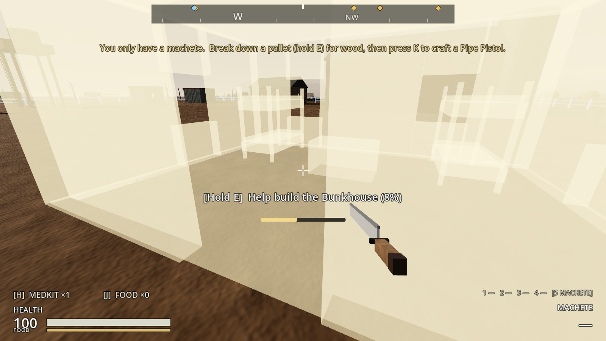
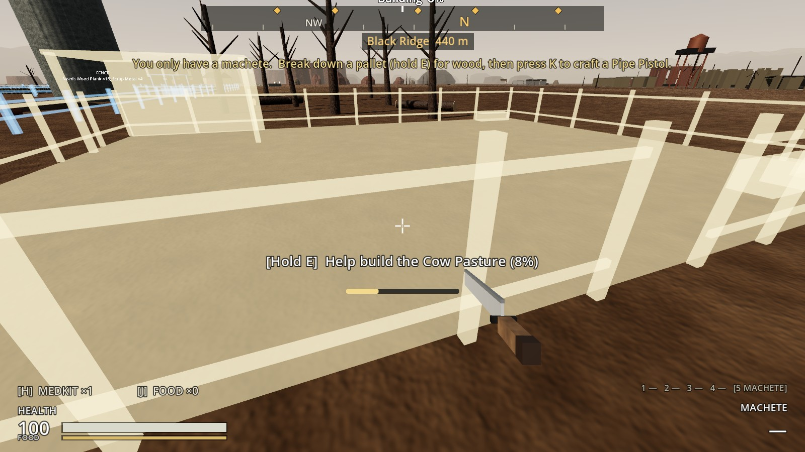
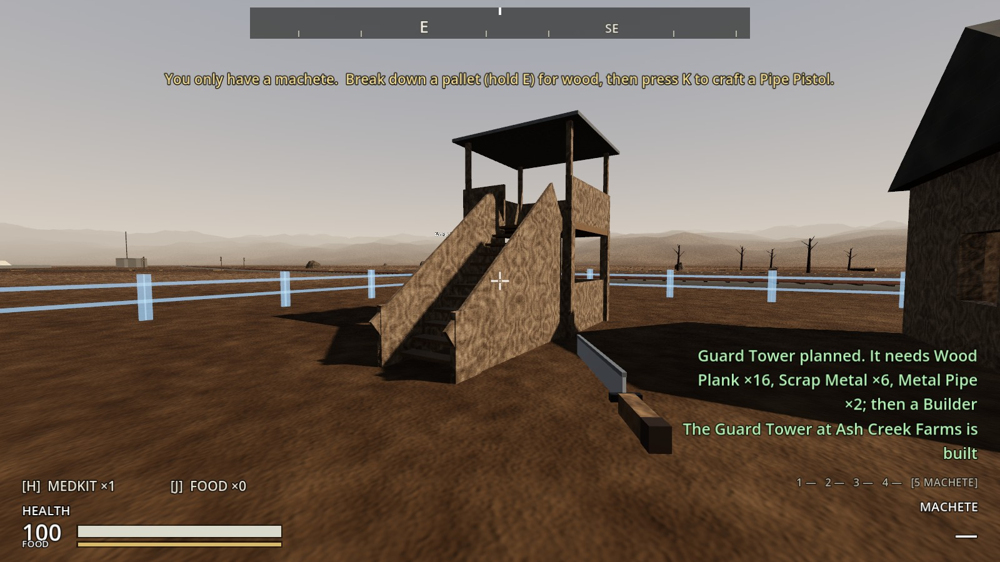
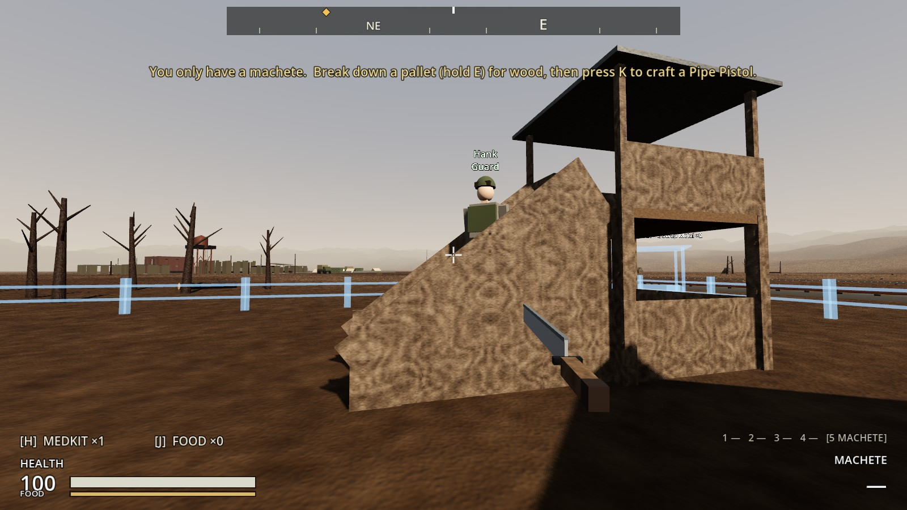
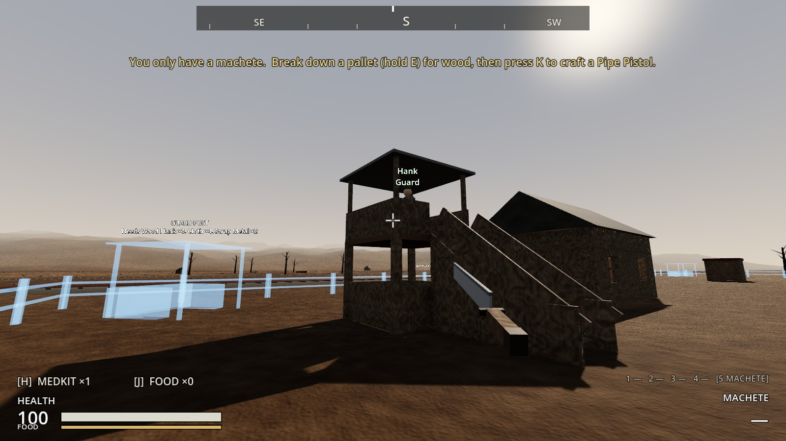
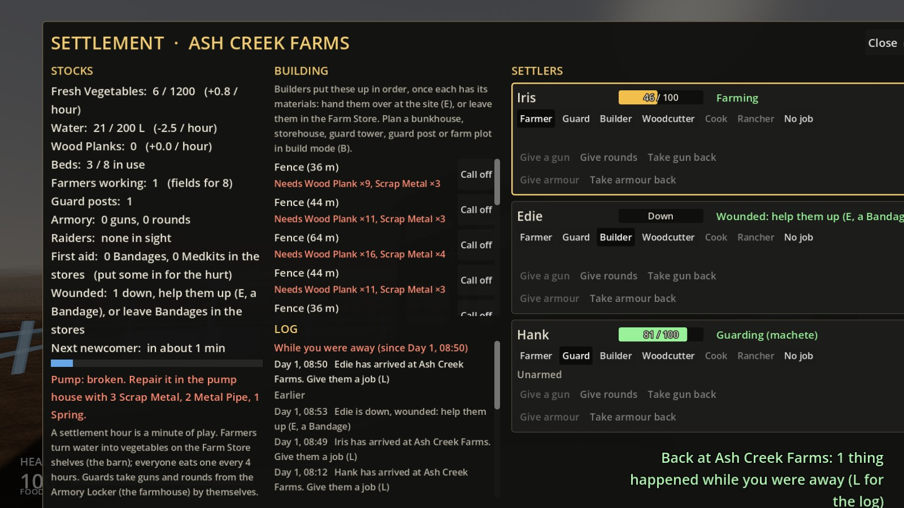
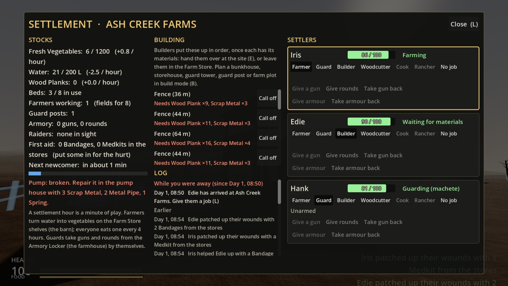
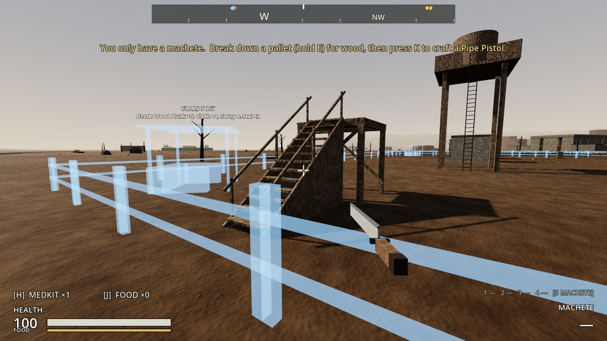
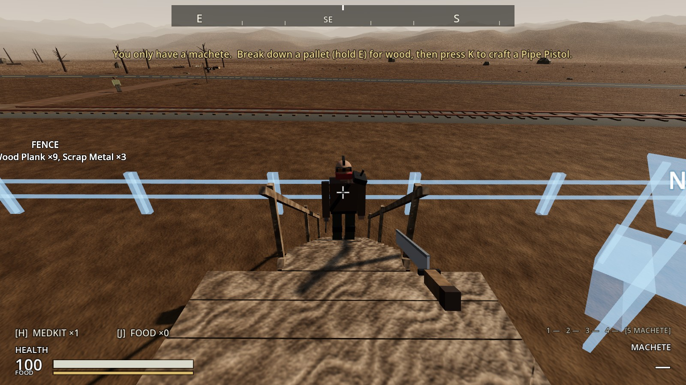
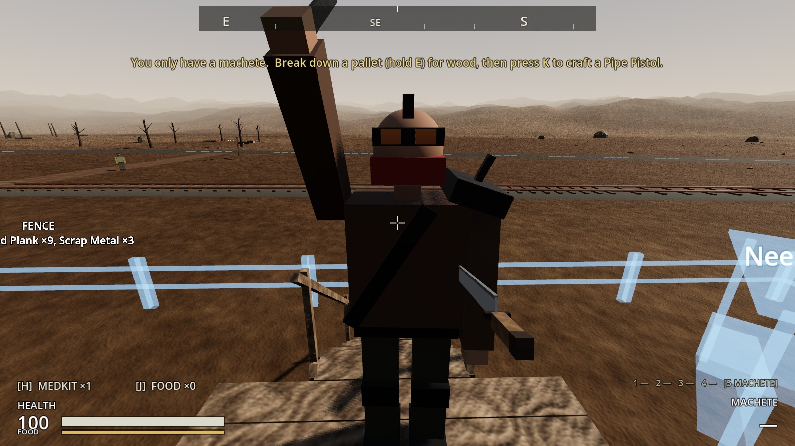

# Increment 22.1: settler health, first aid, building help, stairs

**Status:** complete. 468 automated tests pass in headless Godot 4.7, 7 of them new in `tests/test_health_and_stairs.gd`.

From your playtest of 22:
- The settlement screen should show each settler's health.
- Bandages and Medkits put in the stores should get used by settlers to heal themselves.
- Holding E only helped build the bunkhouse; nothing else went up.
- Settlers and raiders struggled with stairs: guards never got up their towers.

## How it plays

**Health on the settlement screen.** Each settler's row has a bar next to their name:
- **Healthy:** "86 / 100", green.
- **Hurt:** amber below 70, red below 35.
- **Down** for the wounded, **Dead** for the dead.

The stocks list a **First aid** line: how many Bandages and Medkits are in the stores.

**First aid from the stores.** Leave Bandages and Medkits in the Farm Store or a storehouse.
- **The hurt patch themselves up:** a settler 20 or more short of full health uses what's there, until they're within 20 of full. Medkits (+40) go on big wounds, Bandages (+20) on the rest. Fighting guards wait until the fight's over.
- **The wounded are helped up:** once a raid is over, whoever's standing helps a downed settler up with a Bandage (half health) or a Medkit (full). That includes raids settled on paper while you're away (20.5), so a stocked farm doesn't lose its wounded.
- **During a raid:** nobody stops to bandage.
- **What you're told:** each use is a notice and goes in the log ("Iris helped Edie up with a Bandage from the stores", "Edie patched up their wounds with 2 Bandages from the stores").

**Helping build: every site, all the way.**
- **The cause:** how close you were was measured from your eyes to the middle of the outline's footprint. Only something as small as a guard post or Tanning Rack had its middle in reach from its edge; a bunkhouse's was a metre too far, a cow pasture's seven. Tapping E to hand over materials had the same problem.
- **Now:** reach is measured to the nearest edge of the outline.
- **Holding E keeps helping:** each 1.5 s is another 0.15 hours of work, without letting go and pressing again.

**Stairs.**
- **Guard towers:** the stair is now solid underneath, 1.5 m wide, with handrails down both sides and a newel post at the foot, and the space under the deck is boarded in.
  - Before, the stair was a sloping board. The navmesh joined it from the side where it was already knee-high, so guards walked into its edge and stopped. Some also stood under the deck, directly below their spot, and counted that as being there.
  - Now the only way on is from the front, and "there" means on the same level.
- **Your wooden stairs:** solid underneath too, with boarded sides. Raiders follow you up them.
- **Steps:** settlers and raiders now step up anything up to 42 cm (a kerb, a step, the side of a ramp near its foot), but not furniture or a knee-high wall.
- **Corners:** they follow a path's corners more closely (they used to turn for the next point 0.8 m early, cutting round a newel post and into it).

**Fixed underneath (this one touched everything you build).** When something is built, the navmesh tiles around it are rebaked. The rebaked tile didn't always reach the navigation server: the new mesh was there, but paths were worked out on the old one. So a new guard tower, wall or fence was sometimes missing from everyone's paths until something else made that tile rebake. Now:
- The finished mesh is handed to the server directly.
- Each tile takes it in there and then (one 100 m tile is quick).
- The zone-wide map still updates on its own thread, about a second later.

The navmesh also no longer counts spaces too low to stand in (under a deck, a table or a low roof) as somewhere to walk. The zone's navmesh was rebaked for that.

## The real-window run

- **Helping build:** a supplied Bunkhouse, from its front edge. Holding E for 5 s put in 0.45 hours (8%, three helps in a row). A Cow Pasture, from its edge: 0.30 hours in 3.3 s.
- **A guard tower:** a guard newcomer walked across the farm, up the stair and onto the deck by their spot.
- **First aid:**
  - **Before:** Iris at 46, Edie down, Hank at 81, nothing in the stores.
  - **The stores:** 3 Bandages and a Medkit in the Farm Store.
  - **After:**
    - Iris helped Edie up with a Bandage.
    - Iris used the Medkit (86).
    - Edie used 2 Bandages (90).
    - Hank was within 20 of full and left alone.
- **Your stairs:** a platform with stairs, you on top, and a raider who came up the stairs after you.

| Helping build a Bunkhouse | A Cow Pasture, from its edge |
|---|---|
|  |  |

| The tower's new stair | A guard on the way up | On the deck |
|---|---|---|
|  |  |  |

| Health on the screen | After first aid from the stores |
|---|---|
|  |  |

| Your stairs | A raider coming up | On your deck |
|---|---|---|
|  |  |  |

## How it's built

**Helping build:**
- **`ConstructionSite`:** `is_within_reach()`, `get_focus_point()` and `nearest_point()` measure to the nearest unbuilt piece of the outline. Sites set `repeat_hold`.
- **`Interactable.repeat_hold`** (new): keep holding to do it again. `PlayerInteractor` starts the next hold straight away while E is held.

**Stairs:**
- **`NpcStep`** (new, `scripts/npcs/npc_step.gd`): `step_up()`, called by `Settler` and `Raider` after they move. Walked into something low with room on top, they're lifted onto it.
- **`Settler._move_to()`:** "arrived" also needs the same level (within 1.2 m up or down).
- **Settlers and raiders:** `agent.path_desired_distance` is 0.45 (was 0.8).
- **The guard tower** (`tools/build_settlement_buildings.gd`): the stair is a solid wedge (`ConvexPolygonShape3D`), with boarded sides, handrails, newel posts, and `UnderDeck` and skirts below the deck.
- **The wooden stairs** (`scenes/structures/wooden_stairs.tscn`): a solid wedge, with its side boards merged into its one mesh.

**Navigation:**
- **`NavRebaker`:** hands the baked mesh to the server (`region_set_navigation_mesh`), and turns off the tile's own threaded update (`region_set_use_async_iterations(false)`).
- **`tools/build_early_zone.gd`:** `filter_walkable_low_height_spans`; the zone navmesh is rebaked.

**Health and first aid:**
- **`Settlement._simulate_first_aid()`**, with `first_aid_below` (20) and `first_aid_stock()`.
- **`SettlementScreen`:** a health bar per row (`_show_health()`) and the First aid line.

## Tests (`tests/test_health_and_stairs.gd`)

1. **Holding E helps build everything:** every one of the ten plans, from its edge, through the player's own interaction ray. Held for 4.6 s on a bunkhouse, three helps in a row.
2. **Reach is to the nearest edge:** a cow pasture's middle is out of reach from its edge, but the edge isn't; 5 m off, it is.
3. **Guards climb to their towers:** three towers facing three ways; all three guards walk up to their decks. There's nowhere to stand under a deck.
4. **NPCs step up low steps:** a 30 cm step, up it; a 75 cm box, not.
5. **Stairs are solid underneath:** your wooden stairs and the tower's stair are solid wedges, and the tower has its handrails, newels and boarded-in base.
6. **Health on the screen:** 74 / 100, then Down; the First aid line.
7. **First aid from the stores:**
   - **Nothing in the stores:** nothing happens.
   - **A Medkit and two Bandages:** a settler 50 short uses the Medkit (90) and leaves the bandages.
   - **A downed settler:** left alone while raiders are there, helped up after, then patched up with the last Bandage (70).

**Changed tests:** none.
