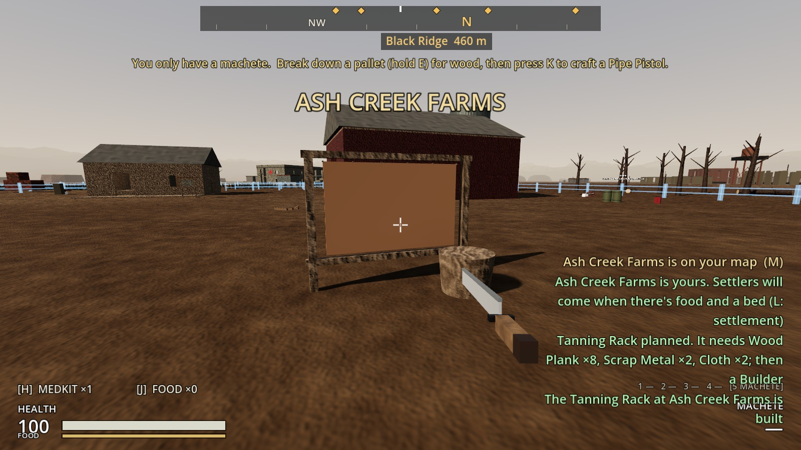
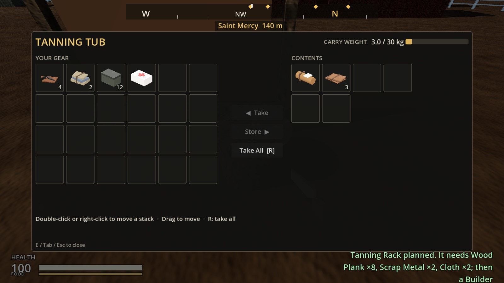
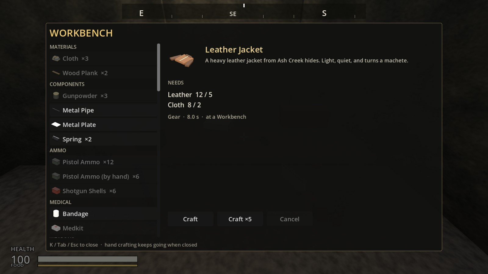
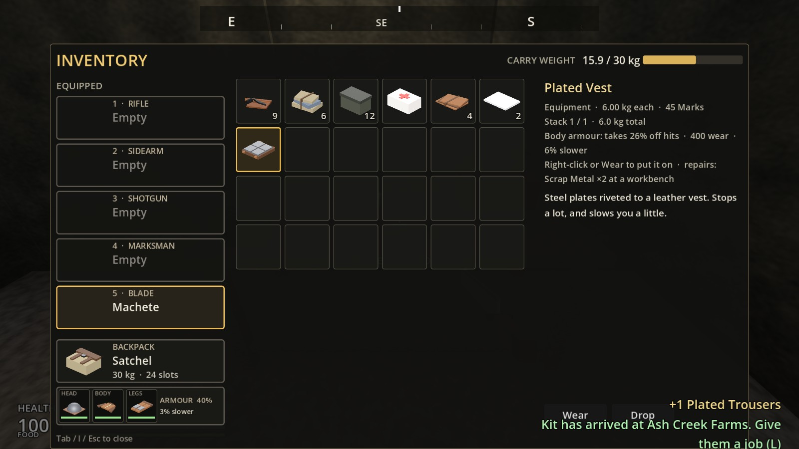
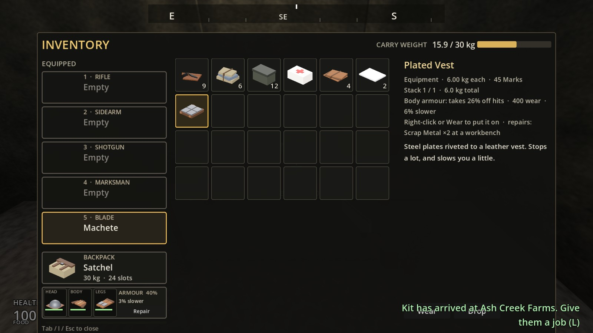
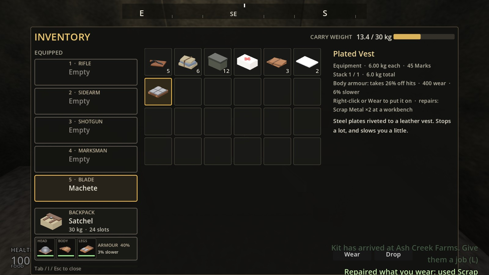
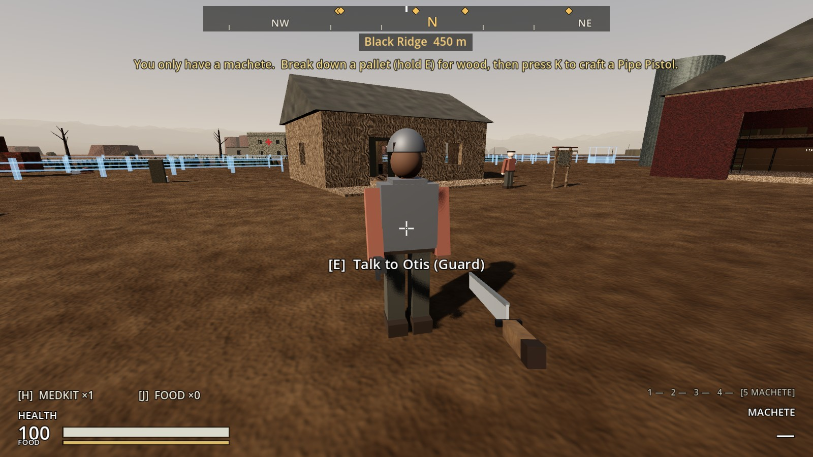
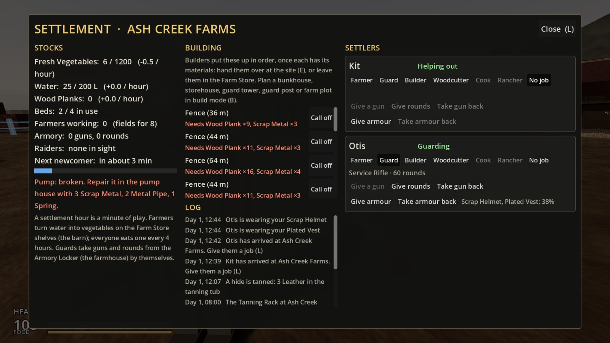

# Increment 22: clothing and armour

**Status:** complete. 469 automated tests pass in headless Godot 4.7, 8 of them new in `tests/test_armour.gd`.

Your picks:
- **Slots:** head, body and legs.
- **What it does:** armour cuts the damage you take, and wears out and needs repairing.
- **Leather:** hides are tanned on a **Tanning Rack**, then made into pieces at a workbench.
- **Guards** can wear it too.

## How it plays

**Leather.** Plan a **Tanning Rack** at the farm in build mode (8 planks, 2 scrap, 2 cloth; 2 hours' work).
- **Tanning:** put Raw Hides in its tub (E). Each comes out as **3 Leather** after **4 farm hours**, one at a time, with a notice.
- **Where hides come from:** butchered cows (21.5).
- **Leather to find:** households, scavenger stashes, footlockers and raider caches.

**Six pieces, made at a workbench:**

| Piece | Slot | Takes off hits | Wear | Speed | Made from | Repaired with |
|---|---|---|---|---|---|---|
| Leather Cap | Head | 6% | 120 | | 2 Leather, 1 Cloth | 1 Leather |
| Scrap Helmet | Head | 12% | 300 | | 1 Leather, 4 Scrap, 1 Metal Plate | 2 Scrap |
| Leather Jacket | Body | 14% | 200 | | 5 Leather, 2 Cloth | 1 Leather |
| Plated Vest | Body | 26% | 400 | 6% slower | 3 Leather, 2 Metal Plate, 4 Scrap | 2 Scrap |
| Leather Trousers | Legs | 8% | 160 | | 3 Leather, 2 Cloth | 1 Leather |
| Plated Trousers | Legs | 14% | 300 | 3% slower | 2 Leather, 1 Metal Plate, 3 Scrap | 2 Scrap |

- **A full set of leather** takes 28% off hits.
- **A full set of plate** takes 52% off, and you move about 9% slower.
- **The most any set can take off is 60%.**

**Wearing it.**
- **Putting it on:** right-click a piece in your backpack, or select it and press **Wear**. It goes in the new **ARMOUR** row under your backpack (head, body, legs). Whatever was in that slot goes back in the grid.
- **Taking it off:** right-click a piece in the ARMOUR row.
- **Weight:** worn pieces don't count against your carry weight, but plate slows you.
- **What it stops:** blows, bullets and blasts. Not falls, the ash storm or hunger.

**Wear and repair.**
- **Wearing down:** each piece wears by its share of what it stopped. A bar under each piece shows how much it has left.
- **Worn out:** you're told ("Your Leather Jacket is worn out: repair it at a workbench"), and it protects nothing until it's mended.
- **Repairing:** stand at a workbench, open your inventory and press **Repair**. It mends everything you wear for the costs above, which the button's tooltip shows.
- **Taking a piece off keeps its wear:** put the same piece back on later and it's as worn as before.

**Dying** drops what you wear into your gear chest with everything else. Pieces keep their wear when you pick them back up.

**Saved:** what you wear, how worn it is, and the wear of pieces you've taken off.

**Guards.**
- **Equipping them:** on the settlement screen, **Give armour** hands a guard a piece from your backpack, and **Take armour back** returns everything.
- **The Armory Locker:** a guard with an empty slot takes the best piece for it from there.
- **What it does for them:** it cuts their hits like yours, in real raids and in raids settled while you're away (20.5), and it wears down there too.
- **You can see it on them:** a leather or plated coat, helmet and trousers instead of the green vest and helmet.
- **When a guard leaves or dies,** their armour goes to the armory.

## The real-window run

- **Tanning:** a Tanning Rack at the front of the farm with two hides in its tub. Four hours later the first was 3 Leather.
- **Making the pieces:** at the tool shed's workbench, a Leather Jacket, a Scrap Helmet and Plated Trousers.
- **Wearing them:** all three on gave 40% off hits and 3% slower.
- **Repairing:** after a beating, Repair at the bench mended the lot with 4 Scrap and 1 Leather.
- **A guard in plate:** Finn, a guard, in a Plated Vest and Scrap Helmet. The settlement screen showed "Scrap Helmet, Plated Vest: 38%".

| The Tanning Rack | Leather in the tub |
|---|---|
|  |  |

| At the workbench | Wearing it |
|---|---|
|  |  |

| Worn: Repair | Repaired |
|---|---|
|  |  |

| A guard in plate | On the settlement screen |
|---|---|
|  |  |

**The run also caught something:** the ARMOUR row first came out too tall and nearly ran off the bottom of the inventory window at 1600 × 900. It's now one compact row, and its text no longer gets cut off.

## How it's built

**Items:**
- **`ItemDefinition`:** `armour_slot`, `armour_protection`, `armour_durability`, `armour_speed`, `armour_repair` and `is_armour()`.
- **`tools/build_armour.gd`:** Leather and the six pieces (models, items and workbench recipes), plus Leather in the loot.

**`ArmourSet`** (new, `scripts/inventory/armour_set.gd`): what someone wears, with wear left per piece.
- **Calls:** `protection()` (capped at 60%), `speed()`, `absorb()`, `wear_down()`, `put_on()`, `take_off()` and `repair()`.
- **Saving:** `to_data()` and `from_data()`.

**`HealthComponent.damage_modifier`:** a hook that lets armour take its share before a hit lands.

**`PlayerController`:**
- **The set:** `armour`, with `request_wear_armour()` and `request_take_off_armour()`.
- **Repairs:** `request_repair_armour()` (near a workbench), `armour_repair_cost()` and `near_workbench()`.
- **Wear kept:** `armour_wear_kept` for pieces you take off.
- **Speed:** slower in plate.
- **Also:** saved, and dropped with your gear by `DeathCache`.

**`ArmourSlotsRow`** (new): the ARMOUR row in the inventory screen.

**The Tanning Rack:**
- **The building:** a `tanning_rack` SettlementBuilding with a `%Rack` tub, built by `tools/build_settlement_buildings.gd`.
- **The tanning:** `Settlement._simulate_tanning()` (4 hours a hide, 3 Leather), with the progress saved.

**Guards:**
- **Settlement:** `request_give_armour()`, `request_take_armour()` and `_return_armour()`, plus the armory in `_supply_guards()`.
- **`Settler.armour`:** saved and shown, via `ArmourHead`, `ArmourBody` and `ArmourLegs` in `tools/build_settler.gd`.
- **`RaidOnPaper`:** a guard's `protection` and what it `stopped`.

## Tests (`tests/test_armour.gd`)

1. **The pieces:**
   - Six to wear, two for each slot, each made from leather at a workbench.
   - Plate protects more and slows you, and a full set is under the 60% cap.
   - Leather mends leather and scrap mends plate.
   - Leather is in 4+ loot tables, and the Tanning Rack can be planned.
2. **Armour cuts hits and wears down:**
   - A jacket and helmet take 26% off blows and bullets, but not falls.
   - Worn right out, you're told and it stops protecting.
3. **Plate slows you:** a plated vest and trousers give 91% of your speed.
4. **Swapping and taking off keep the wear:**
   - Putting on a vest puts the jacket back in the grid.
   - The jacket comes back as worn as it was, and can be taken off.
   - Saved and loaded. An older save wears nothing.
5. **Repair at a workbench:**
   - "Nothing you wear needs repairing", "Repair it at a workbench", and "Needs…" without the materials.
   - Then mended for 1 Leather and 2 Scrap.
6. **Dying drops what you wear:** it's in your gear and off you, and as worn as before when picked back up.
7. **The Tanning Rack:**
   - Planned and built, with a 6-slot tub.
   - Not ready at 3.9 hours; at 4 hours a hide is 3 Leather, with a notice.
   - Saved part-way, and the second hide finishes after loading.
8. **Guards wear armour:**
   - A vest from your backpack, seen on them, takes its share off a raider's hit.
   - A raid settled on paper wears it.
   - Taken back. With an empty slot, a guard takes the best legs from the armory.

**One older test changed:** `test_settlement_building.gd` now counts ten things to plan in build mode.
