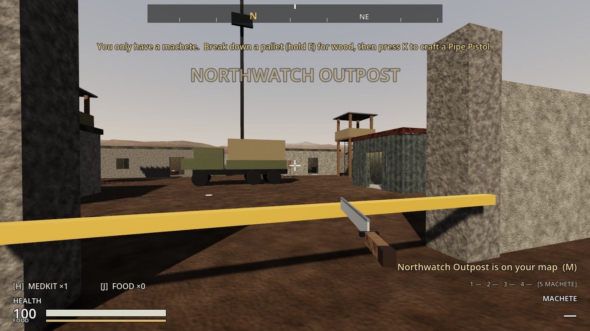
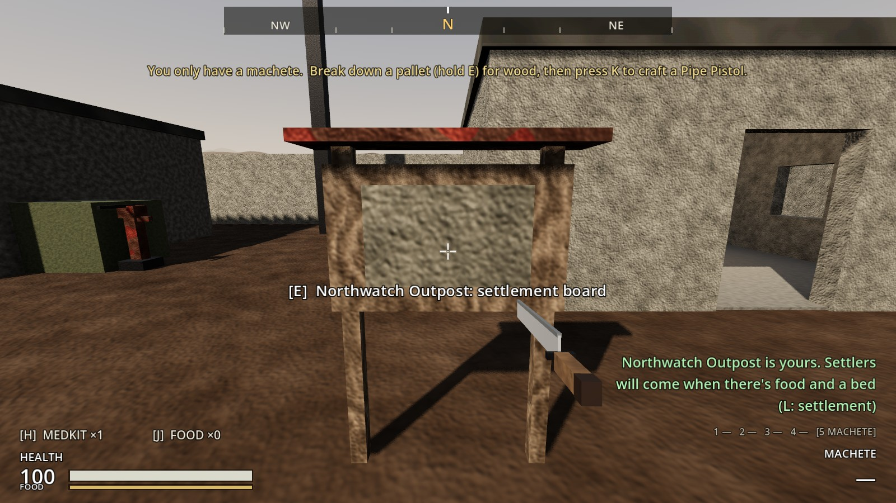
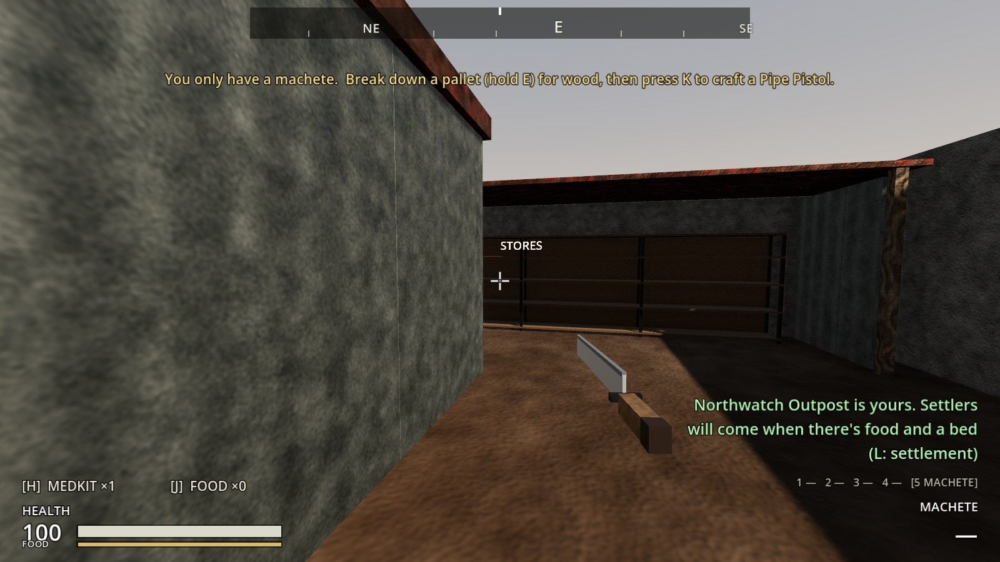
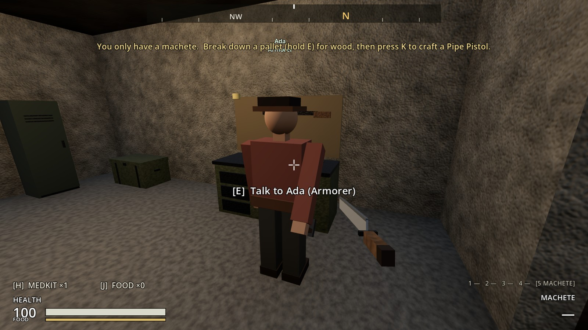
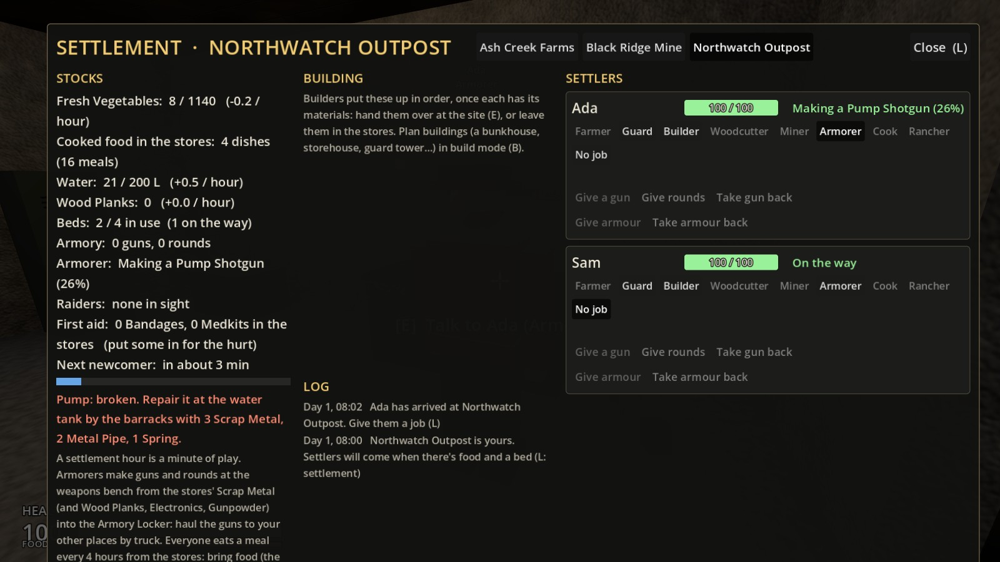
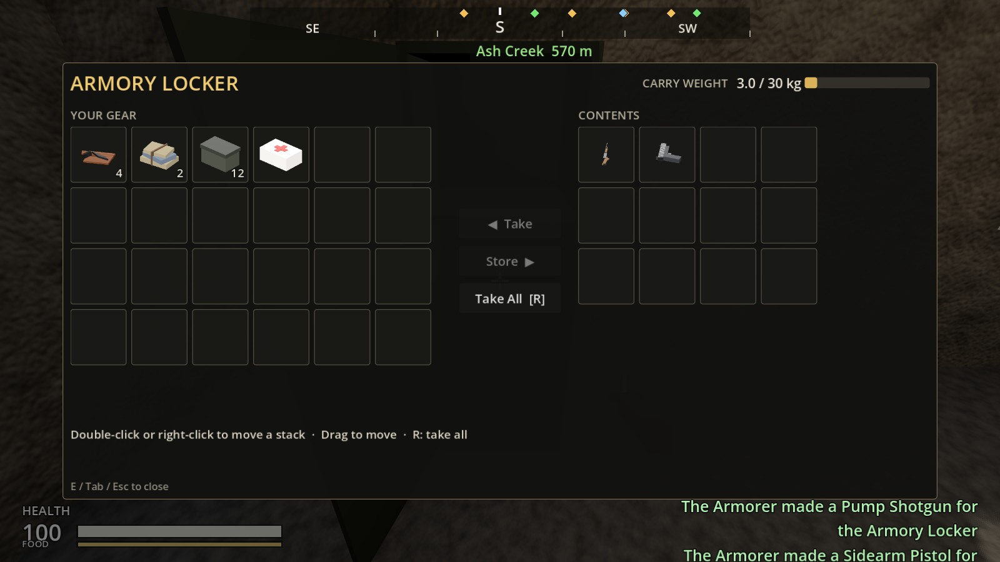

# Increment 23.5: Northwatch Outpost and its Armorer

**Status:** complete. 482 automated tests pass in headless Godot 4.7, 6 of them new in `tests/test_northwatch.gd`.

The second half of your plan for the mine and Northwatch:
- **Workers:** each place has its own settlers.
- **Moving goods:** you haul goods by truck.
- **Northwatch's armory:** makes guns and rounds from the mine's metal, so Ash Creek can arm more guards.
- **Raids:** raiders come for it like the other places.

## How it plays

**Claiming Northwatch.**
- **Clear it:** its garrison (two Raider Veterans) and the raiders outside.
- **Claim it:** hold E at the notice board in the yard, in front of the command post.
- **Once it's yours:**
  - The garrison and raiders stop coming, and it turns green on the compass and map.
  - The Stores get 8 vegetables, and there's a little water.

**What's there.**

| | Where |
|---|---|
| **Stores** (60 slots) | Shelves under a lean-to along the inside of the east wall |
| **Water** | A water tank by the barracks, with a hand pump (repaired and upgraded like the others) |
| **Armory Locker** | In the armory, beside the weapons bench |
| **Beds** | Four, in the barracks (where everyone shelters in a raid) |

**The Armorer** (a new job; goggles, hammer, tool belt) works at the armory's weapons bench.
- **Same recipes as you:** Armorers follow the recipes you craft with, making the parts on the way: pipes, plate and springs from Scrap Metal; receivers, barrels, trigger groups, magazines and stocks.
- **Where the materials come from:** everything comes out of Northwatch's Stores when they start an item. Anything left over from a part goes back (a spring recipe makes two).
- **Speed:** a gun takes **4 hours**, a box of rounds **1 hour**. Finished items go into the Armory Locker.
- **Where:** only at a weapons bench. At the farm and the mine the job is greyed: "No weapons bench here: Armorers work at Northwatch's armory".

**What they make, in order.**
1. **Rounds** for the guns in the locker (and carried by Northwatch's guards), up to 90 of each kind.
   - **Makings:** each box needs Gunpowder.
   - **Gunpowder:** made from Chemicals and Wood if there's none.
2. **Guns**, until there are 4 in the locker: the best the Stores have the makings of.

| Gun | Makings (from the Stores) |
|---|---|
| Service Rifle | 16 Scrap Metal, 2 Wood Planks, 1 Electronics |
| Pump Shotgun | 17 Scrap Metal, 2 Wood Planks |
| Sidearm Pistol | 16 Scrap Metal |
| Pipe Pistol | 4 Scrap Metal, 1 Wood |

**How it fits together.**
- **Black Ridge:** a Miner digs 2 Scrap Metal an hour, so a pistol is 8 Miner-hours.
- **Truck it to Northwatch:** the scrap, plus Wood Planks from Ash Creek's Woodcutters and any Electronics and Gunpowder you find.
- **Truck the guns back:** to Ash Creek or the mine.
- **Arming guards:** put the guns in that place's Armory Locker, and its unarmed guards take the best gun there themselves, or give them out on the settlement screen.

**On the settlement screen:**
- **Stocks:** an **Armorer** line ("Making a Pump Shotgun (26%)", "Armory stocked", or what's missing).
- **Settler rows:** the Armorer's status.
- **Jobs:** the job buttons now wrap onto a second line when they don't fit.
- **Tabs:** with all three places yours, there are three tabs.

**Saved:** the item the Armorer is making and how far along it is (its makings are already out of the Stores), plus everything the mine and farm save.

## The real-window run

- **Claiming it:** through the gate to the notice board; holding E claimed Northwatch. The Stores are on the east wall.
- **The Armorer:**
  - A newcomer made Armorer walked into the armory and went to work at the weapons bench.
  - With 34 Scrap Metal and 2 Wood Planks in the Stores, the screen read "Making a Pump Shotgun (26%)", with tabs for all three places.
  - Eight hours later a Pump Shotgun and a Sidearm Pistol were in the Armory Locker, with notices for each.
- **Hauled to Ash Creek:** taken to Ash Creek's Armory Locker, the shotgun was picked up by an unarmed guard there.

| Through Northwatch's gate | Claimed | The Stores |
|---|---|---|
|  |  |  |

| The Armorer at the bench | The screen, three tabs | Guns in the locker |
|---|---|---|
|  |  |  |

## How it's built

**Northwatch's settlement:** `tools/build_sites.gd` `_northwatch_settlement()` builds:
- the notice board and `ClaimPoint`;
- the tank and pump (`PumpHead`, `WaterPump`) and the `StoreShed` with the shelves (`FarmStore`, "Stores");
- the `Armory` locker;
- markers: `ArmorerSpots` (at the weapons bench), `GuardPosts`, `ArrivalPoint`, `Hangout`, `RaidPoints` (the road, the east, the west) and `Shelter` (the barracks).

The zone's navmesh is rebaked.

**`Settlement`:**
- **The armory:** `armorer_spots()`, `armory_guns()`, `armorer_status()` and `_simulate_armory()`.
- **Choosing and starting a job:** `_start_armory_job()`.
- **Working through the recipes:** `_commit_recipe_for()` and `_plan_make()` follow the recipes from what's in the stores, making parts as needed, then take it all out, putting spare parts back.
- **Settings:** `armory_gun_target` (4), `armory_round_target` (90), `armory_gun_hours` (4) and `armory_ammo_hours` (1).
- **Saved:** the job and its progress.

**`Settler`:** `Role.ARMORER` and `_forge()`. **`tools/build_settler.gd`:** `Goggles`.

**`SettlementScreen`:** the Armorer line, and the job buttons in an `HFlowContainer`.

## Tests (`tests/test_northwatch.gd`)

1. **Northwatch is a settlement:**
   - Its notice board, pump, Stores, an Armorer's place at the armory's weapons bench, and the Armory Locker beside it.
   - Every marker is on the navmesh.
   - Claimed once its garrison's gone; its spawners stop.
2. **The Armorer makes guns from scrap:**
   - 15 Scrap Metal: nothing, and nothing's taken.
   - 16: a Sidearm Pistol, its makings out of the Stores at the start, done in 4 hours.
   - 17 and 2 planks: a Pump Shotgun, with a spare spring left on the shelves.
   - With an Electronics part: a Service Rifle.
   - 4 scrap and a piece of wood: a Pipe Pistol.
   - Then four guns: stocked, and it says rounds need Gunpowder.
3. **The Armorer makes rounds:**
   - **Batches:** a pistol in the locker means 12 rounds an hour, up to 90 and a box over.
   - **Gunpowder:** with none, it's made from Chemicals and Wood (3 at a time, 2 left over).
4. **The Armorer works at the bench:** walks into the armory to the weapons bench, and works.
5. **Guns from Northwatch arm the farm:** three places, three tabs; a shotgun in Ash Creek's locker arms its guard.
6. **The armory is saved:** half a pistol, saved and loaded, is still half a pistol, and finishes.

**Changed tests:** none.
