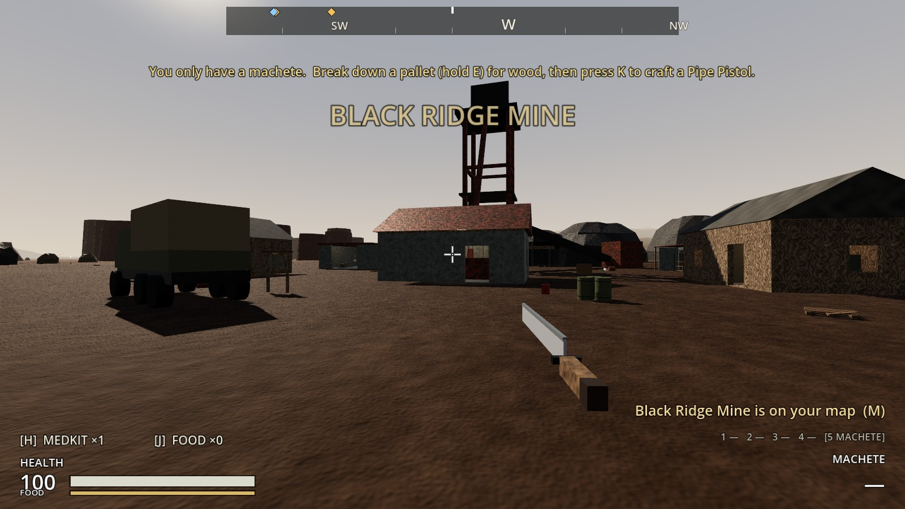
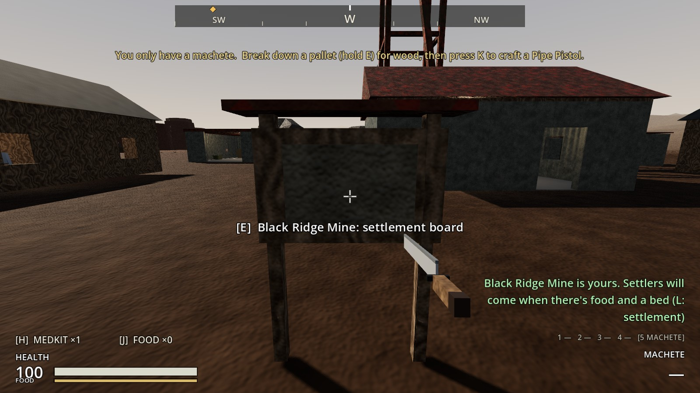
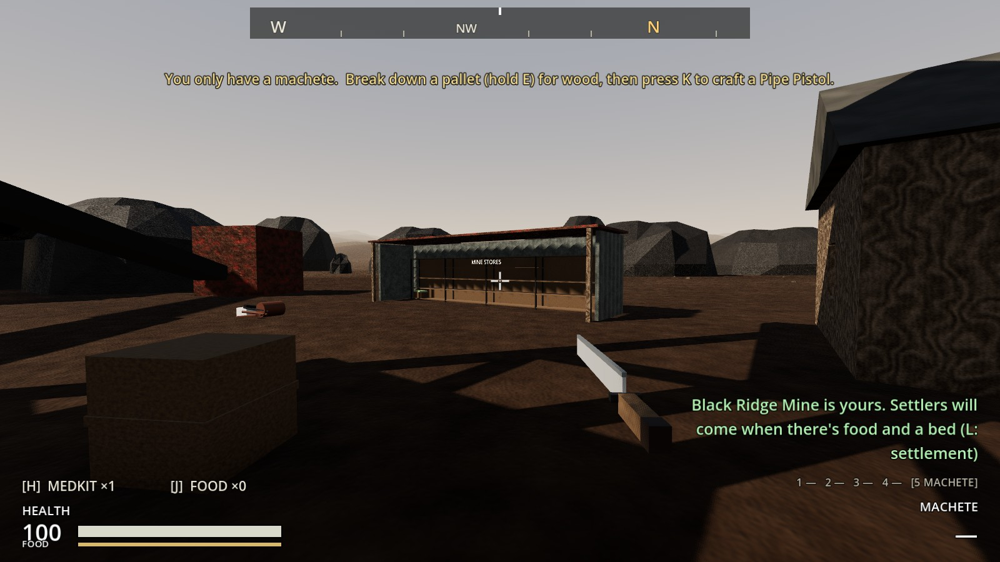
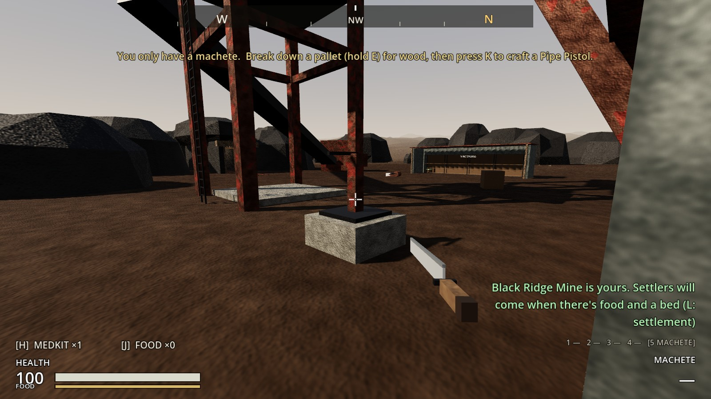
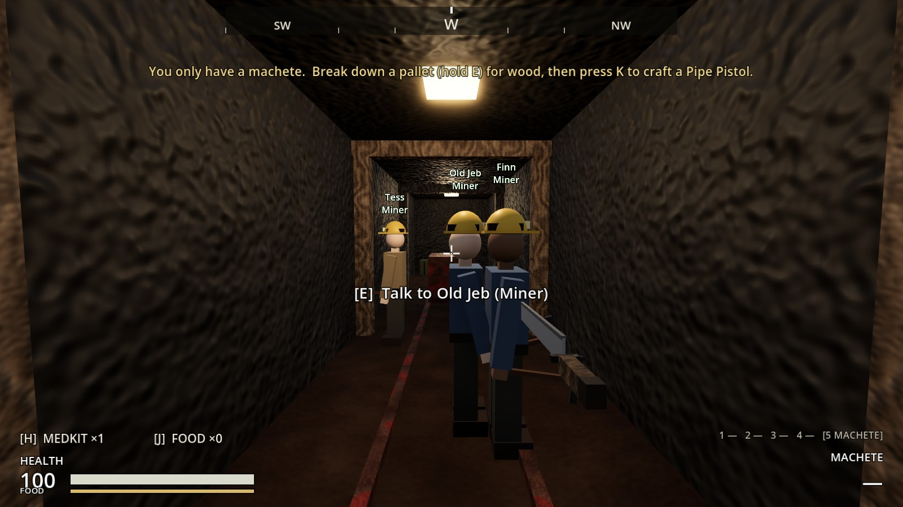
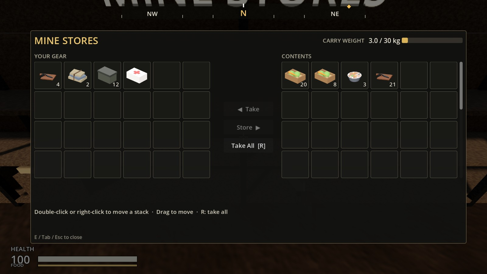
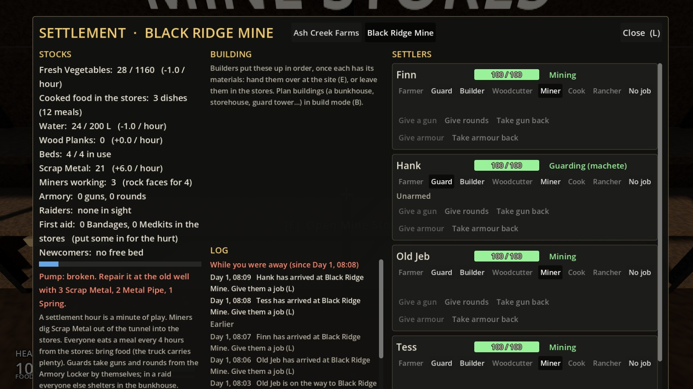
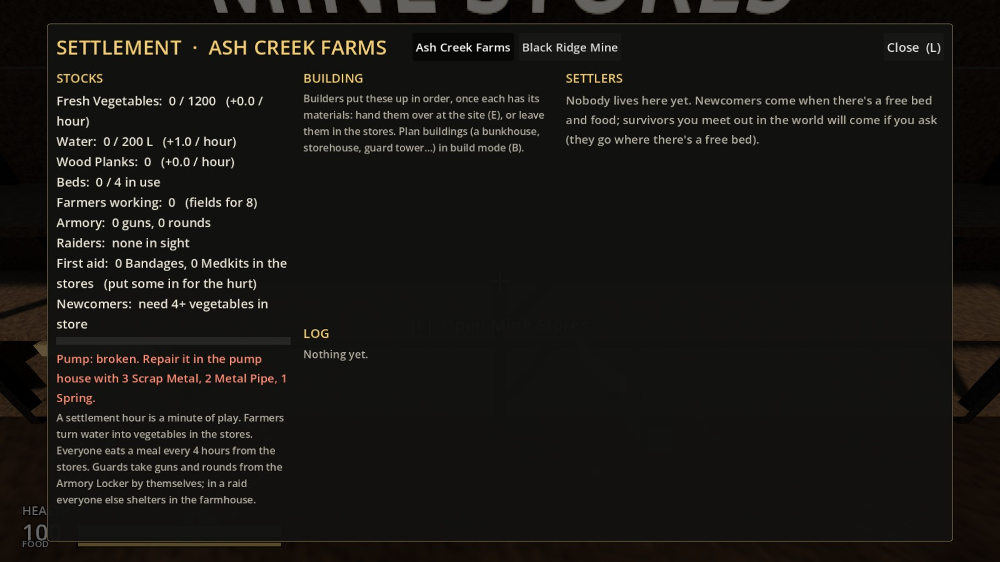
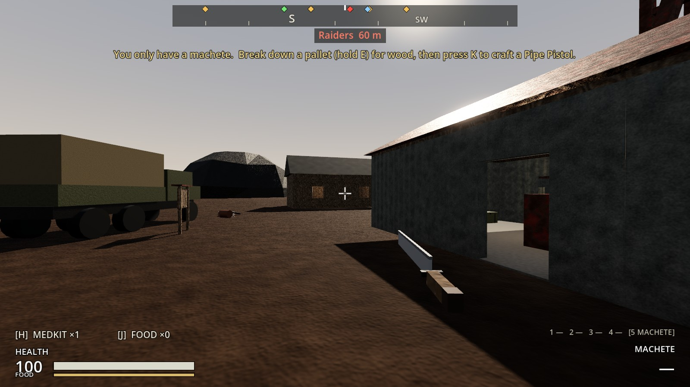

# Increment 23: Black Ridge Mine, your second settlement

**Status:** complete. 476 automated tests pass in headless Godot 4.7, 8 of them new in `tests/test_black_ridge.gd`.

Your picks for the mine and Northwatch:
- **Workers:** each place has its own settlers.
- **Moving goods:** you haul goods between places by truck.
- **Northwatch's armory:** makes guns and rounds.
- **Raids:** raiders come for the new places like Ash Creek.

This increment is the mine; Northwatch and its armory come next (23.5).

## How it plays

**Claiming the mine.**
- **Clear it:** clear Black Ridge's four raiders.
- **Claim it:** hold E at the notice board by the road, east of the hoist house.
- **Once it's yours:**
  - Its raiders stop coming, and it turns green on the compass and the map.
  - The Mine Stores get 8 vegetables, and the well gets a little water.

**What's there.**

| | Where |
|---|---|
| **Mine Stores** (60 slots) | Shelves under a lean-to in the yard, north of the headframe |
| **Water** | A hand pump on the old well beside the headframe. Repaired and upgraded like the farm's pump (the rain barrel gives 1 L an hour until then) |
| **Armory Locker** | The foreman's room of the mine office |
| **Beds** | Four, in the bunkhouse (where everyone shelters in a raid) |
| **Rock faces** | Four, down the tunnel |

**Miners** (a new job; hard hat with a lamp, pickaxe):
- **Output:** each digs **2 Scrap Metal an hour** into the Mine Stores, at a rock face of their own (four faces, so four Miners).
- **Where:** only at a mine. At Ash Creek the job is greyed: "No mine here: Miners work at Black Ridge Mine".
- **Not other jobs:** the mine has no fields or woodlot, so Farmer ("No fields here: plan a Farm Plot") and Woodcutter are greyed there.

**Food comes by truck.**
- **What they eat:** settlers anywhere now eat cooked dishes left in the stores, not only the fridge. One Vegetable Stew feeds four, a Meat Stew five.
- **Supplying the mine:** cook at Ash Creek, or haul vegetables, and drive them to Black Ridge.
- **Newcomers** count those dishes as food.
- **The screen:** a "Cooked food in the stores" line.

**Old Jeb stays at the mine.** A survivor you ask goes to the nearest place of yours with a free bed. Jeb, in Black Ridge's bunkhouse, stays at the mine once it's yours; Maya at Saint Mercy still goes to the farm.

**The settlement screen (L) switches between places.**
- **Which one L opens:** the place you're at, otherwise the nearest one you hold.
- **Tabs:** with more than one, a tab for each sits next to the title.
- **Each place shows its own:**
  - stocks: the mine has Scrap Metal, Miners working and rock faces, but no Farmers line;
  - how it works and where everyone shelters;
  - where its pump is;
  - its log.

**Raids on the mine.**
- **Like the farm:** about every 48 hours, with 2 hours' warning naming the mine, from the road, the south or over the ridge.
- **Fought:** the guards fight, and everyone else shelters in the bunkhouse.
- **Away:** settled on paper when you're more than 200 m away.
- **What's taken:** raiders take vegetables and planks from the Mine Stores, not scrap.

**Saved:** the mine is saved like the farm: claimed, water, pump, its settlers and jobs, and the part-dug Scrap Metal. Older saves start with the mine unclaimed.

## The real-window run

- **Arriving:** up the road to Black Ridge, then holding E at the board claimed it ("Black Ridge Mine is yours…"), with 8 vegetables in the stores.
- **The yard:** the Mine Stores' lean-to and the well with its hand pump.
- **The miners:**
  - Old Jeb, asked at the bunkhouse, stayed at the mine.
  - Two newcomers made Miners walked down the tunnel to their rock faces and dug.
  - Three settlement hours later: 21 Scrap Metal in the Mine Stores (3 Miners at 2 an hour, plus what they'd already dug).
- **The screen:** tabs for Ash Creek Farms and Black Ridge Mine; the mine's stocks with Scrap Metal +6 an hour and Miners working 3 of 4.
- **A raid:**
  - **The warning:** 4 raiders, named for the mine.
  - **The defence:** a guard with a service rifle killed all 4 before they reached the stores.

| Arriving | Claimed at the board |
|---|---|
|  |  |

| The Mine Stores | The well's pump |
|---|---|
|  |  |

| Miners in the tunnel | Scrap in the stores |
|---|---|
|  |  |

| The mine on the screen | The farm's tab |
|---|---|
|  |  |

| Raiders coming for the mine |
|---|
|  |

## How it's built

**The mine's settlement:** `tools/build_sites.gd` `_black_ridge_settlement()` builds:
- a `Settlement` with `settlement_id` black_ridge;
- the notice board and `ClaimPoint`;
- the well (`PumpHead`, `WaterPump`) and the `StoreShed` with the shelves (`FarmStore`, "Mine Stores");
- the `Armory`;
- markers: `MineSpots`, `GuardPosts`, `ArrivalPoint`, `Hangout`, `RaidPoints`, `Shelter`.

The zone's navmesh is rebaked.

**`Settlement`:**
- **Per place:** `place_word`, `claim_hint`, `shelter_name`, `pump_where` and `store_sign`, for its wording.
- **Mining:** `mine_spots()`, `scrap()`, `miner_scrap_per_hour` (2), with scrap in `rates()` and the part-dug scrap saved.
- **Food:** `_meal_containers()` (fridges, then stores) and `stored_dishes()`.
- **Jobs:** `role_refusal_reason()` greys Miner, Farmer and Woodcutter where there's nowhere to do them.

**`Settler`:** `Role.MINER`, `_dig()` (one Miner to a rock face, facing it, swinging), a `HeadLamp` and `Pickaxe` (`tools/build_settler.gd`).

**`SettlementScreen`:** tabs (`_refresh_tabs()`, `show_settlement()`), `_default_settlement()`, and `_how_text()`.

**`PlayerController.best_settlement_for_recruit(near)`:** the nearest place of yours with a free bed.

## Tests (`tests/test_black_ridge.gd`)

1. **The mine is a settlement:**
   - Its notice board, pump, stores, armory, four rock faces and four beds.
   - Every place settlers and raiders walk to is on the navmesh.
   - Not claimable with raiders about; claimed, it has food and water, its raiders stop, and it's green on the compass.
2. **Miners dig Scrap Metal:**
   - Two Miners, three hours: 12 Scrap Metal.
   - Four rock faces, four Miners.
   - Hungry, they stop.
   - No Miners at the farm, no Farmers or Woodcutters at the mine.
3. **Miners walk to the rock face:** down the tunnel to their spot, and dig.
4. **Settlers eat cooked food from the stores:** two stews on the shelves are 8 meals; a Miner eats from one.
5. **Old Jeb stays at the mine,** and Maya still goes to the farm.
6. **The screen switches between places:**
   - At the mine, L opens the mine.
   - Tabs; the mine's own stocks and wording; the Miner job.
   - The farm's tab shows the farm.
7. **Raids come for the mine:** a warning naming it; settled on paper when you're away, reported, and the next one due; the farm untouched.
8. **The mine is saved:** claimed, its scrap and its Miner, and the part-dug scrap carries over.

**Changed tests:** none.
