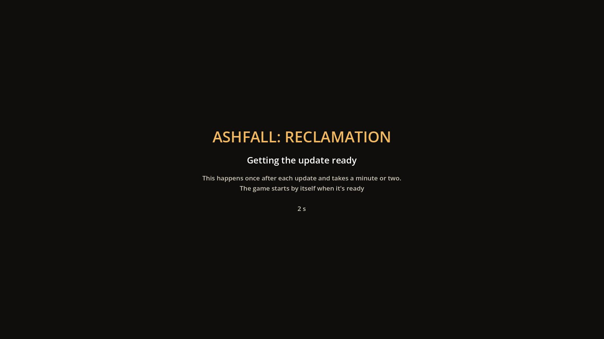
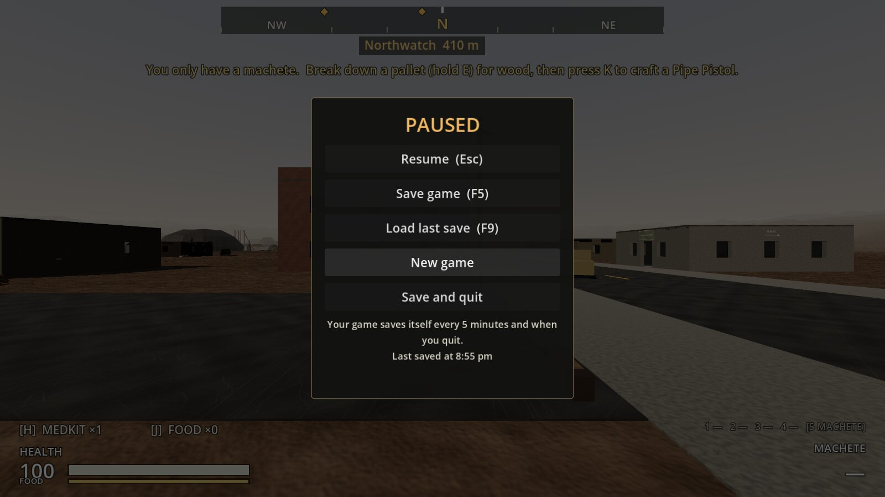
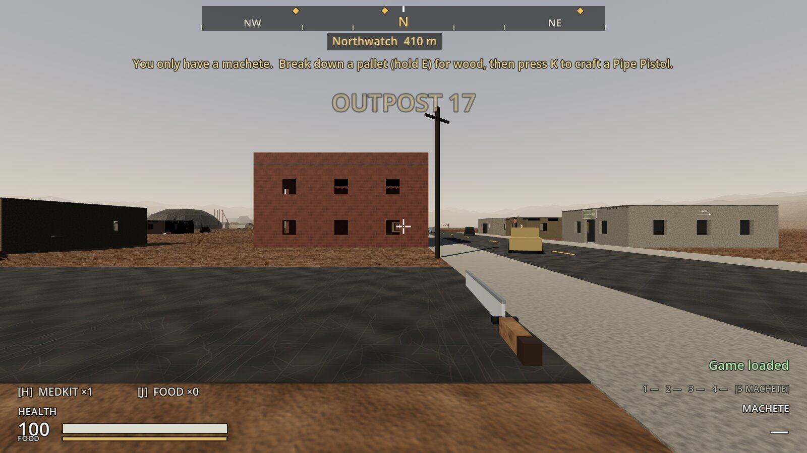
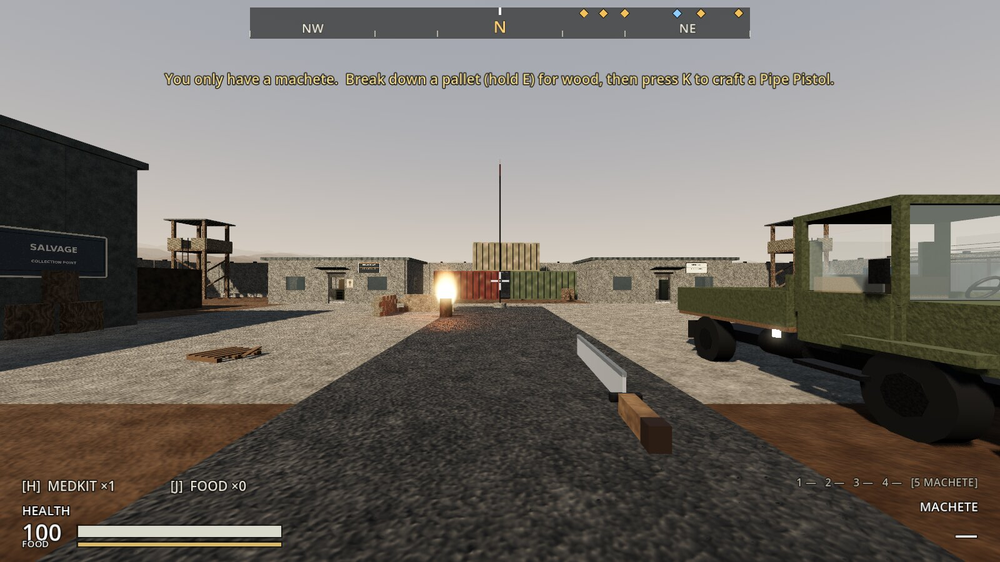

# Increment 24.1: play with Run, autosave and continue

**Status:** complete. 494 automated tests pass in headless Godot 4.7, 6 of them new in `tests/test_run_and_continue.gd`.

Your question: why can't you ever play with **Run**? You'd like to play, keep your progress, and get updates as you go.

**Why Run didn't work:** Godot keeps lists of the game's scripts and imported art in the hidden `.godot` folder, and only the editor rebuilds them. After a pull that added scripts or art, **Run** started the game with the old lists: the new pieces didn't load and the game froze on a red-tinted screen. **Edit** worked because opening the editor rebuilds the lists first.

**Your progress was already kept**, but only by hand: F5 saved, F9 loaded. Saves live outside the project, so pulling never touched them, and older saves are upgraded when loaded. But nothing saved by itself, and every launch began a new game until you pressed F9.

## How it plays

**Run works after every pull.** The game now starts at a **boot screen**.
- **Checking the lists:** it looks at every script and imported file and checks Godot's lists know them (about 25 ms).
- **When they're out of date** (an update brought something new), it shows **"Getting the update ready"** with a seconds counter. It runs the editor's import in the background (the same thing opening the editor does), then **restarts the game by itself**.
  - **How long:** a minute or two after a big update; seconds after a small one.
  - **Only once:** the restart is marked, so it never loops. If the import couldn't run, it starts anyway (opening with **Edit** still fixes it).
- **When they're up to date,** it goes straight on.

**Continue.** Each launch carries on from your **latest save**: the autosave or your F5 quick save, whichever is newer. With no save yet, it's a new game. The "Game loaded" notice shows when it's picked up.

**Autosave.**
- **When:** every **5 minutes** of play, and **when you close the window**.
- **Notice:** a quiet "Autosaved".
- **Not while you're dead:** it tries again half a minute later, without a notice.
- **Separate slots:** it saves to its own slot, so your F5 quick save is never overwritten by it.

**The Esc menu.** Esc now opens a **pause menu**, and the game stops while it's open. If another window is open (inventory, map, settlement screen), Esc closes that first, as before.

| Button | What it does |
|---|---|
| **Resume (Esc)** | Back to the game |
| **Save game (F5)** | Saves to the quick-save slot ("Saved") |
| **Load last save (F9)** | Loads the newest save (autosave or quick save) |
| **New game** | Asks first ("Start over? Click again"), then starts again at Outpost 17. Your saves stay until the game saves over them: the next autosave, 5 minutes in, or quitting. |
| **Save and quit** | Autosaves, then closes the game |

Under the buttons: "Your game saves itself every 5 minutes and when you quit", and when it last saved ("Last saved at 8:55 pm", or "on 26 Oct" for an older one).

**Updates keep your game.** Two real saves are now loaded by the tests on every run:
- **One made in this update:** Ash Creek and Black Ridge claimed, three settlers with jobs, stores, food shares, your backpack and health.
- **One of your playtest saves from 26 October:** version 3, before settlements.

If a future update breaks loading either, the tests fail before it reaches you.

**Where saves are on your Mac:** `~/Library/Application Support/Godot/app_userdata/ASHFALL: Reclamation/saves/` (`autosave.json`, `quicksave.json`). Run, the editor's F5 and the tests' own folders are all separate from the project folder.

## The real-window run

The game was started the way Run starts it (the Godot binary with `--path`, no editor), with a playtest save from 26 October in the save folder.

1. **Continue:** the boot screen went straight on and loaded the October save, with a "Game loaded" notice.
2. **The Esc menu:**
   - It paused the game and said when it last saved.
   - **Save game** wrote the quick save.
   - **Save and quit** wrote the autosave and closed the game.
3. **Next launch:** it continued from the autosave, where the player had walked to (Northwatch 410 m, was 420 m).
4. **New game:** after the second click, a fresh game at Outpost 17.
5. **After an update:** in a copy of the project, Godot's lists were put out of date (one class taken out, one texture's import deleted).
   - **Run:** "Getting the update ready", the import ran, and the game restarted by itself with `--after-update` and continued the save.
   - **The lists afterwards:** they knew the class and the texture again.

| After an update | The Esc menu |
|---|---|
|  |  |

| Continued from the autosave | New game |
|---|---|
|  |  |

## How it's built

**The boot scene:** `scenes/boot/boot.tscn` and `scripts/core/boot.gd`, now the main scene in `project.godot`.
- **No `class_name`, and only engine types:** it has to run while the lists are out of date.
- **The check:** `stale_reasons()` combines `missing_classes()` and `unimported_files()`.
  - `missing_classes()`: every `class_name` in the project's scripts that `ProjectSettings.get_global_class_list()` doesn't have at that path.
  - `unimported_files()`: every `.import` whose `dest_files` aren't in `.godot/imported`.
- **When it runs:** only on the editor's Godot (`OS.has_feature("editor")`, true for Run and F5).
- **Rebuilding:**
  - It runs `OS.create_process(<godot>, ["--headless", "--path", <project>, "--import"])` and waits for it to finish (giving up after 15 minutes).
  - Then it starts `<godot> --path <project> -- --after-update` and quits.
  - `--after-update` stops a second rebuild.
- **Starting:** `-- --new-game` on the command line skips the continue.

**`SaveManager`:**
- **Autosave:** `AUTO_SLOT` ("autosave"), `autosave_minutes` (5) and `autosave_enabled`.
  - **Who turns it on:** the boot scene does. Tests and tools never autosave.
  - **Quitting:** while it's on, closing the window is caught (`NOTIFICATION_WM_CLOSE_REQUEST`) and saves first.
  - **The functions:** `autosave()` saves quietly, and only with a living player.
- **Continue:** `latest_slot()` (the newest of the autosave and the quick save, by file time), `continue_game()` and `latest_save_time()`.

**`PauseMenu`** (`scripts/ui/pause_menu.gd`):
- **Built by the HUD:** `hud.pause_menu`.
- **While open:** `PROCESS_MODE_ALWAYS`, and it pauses the tree.
- **Esc:** opens it only when no other window is open, you're alive and not in a container.

**HUD:** "Autosaved" for the autosave slot.

## Tests (`tests/test_run_and_continue.gd`)

1. **The game starts at the boot screen:**
   - It's the main scene and opens the early zone.
   - It has no class_name.
   - Nothing is out of date here.
2. **The boot screen spots an update:**
   - A new script with a class Godot doesn't know, and a new texture that isn't imported: both are found.
   - So it would rebuild; and nothing once they're gone.
   - The restart is marked.
3. **Autosave and continue:**
   - **Off by default:** autosave is off unless the boot scene turns it on, and there's nothing to continue with no save.
   - **Autosaving:** every 5 minutes, with "Autosaved".
   - **Continue:** it takes the newest of the autosave and a later quick save, and loads it.
   - **Not while dead:** no autosave and no notice; it tries again in 30 seconds.
4. **The pause menu:**
   - **Esc:** opens it and pauses; Esc again resumes; not over another window; not while dead.
   - **The buttons:** Save writes the quick save and says when; Load last save loads it.
   - **New game:** asks first, and asks again next time.
5. **A save from Increment 24 still loads:**
   - **Places:** the farm and the mine are claimed; Northwatch isn't.
   - **Settlers:** Dale (Farmer), Zeke (Guard) and Edie (Miner).
   - **Stores:** 9 planks and 13 scrap.
   - **Food shares:** 67 and 30.
   - **You:** health 65, 11 scrap and 3 medkits, standing at the farm.
6. **A save from 26 October (version 3) still loads:** you're where it was saved, and nothing is claimed.

**Changed test:** `test_early_zone.gd` checks the game starts in the early zone after the boot screen (the main scene is now the boot scene).

## Troubleshooting

| What you see | Why, and what to do |
|---|---|
| "Getting the update ready" for more than a few minutes | The import is slow (a big art update) or stuck. It gives up after 15 minutes and starts anyway; or close it and open the project once with **Edit**. |
| A red-tinted frozen screen | The lists are still out of date. Open the project once with **Edit**, then Run works again. |
| You want to start fresh | Esc → **New game** (click twice). |
| You want an old save back | Each slot is a JSON file in the saves folder above: copy one aside before trying something risky. |
