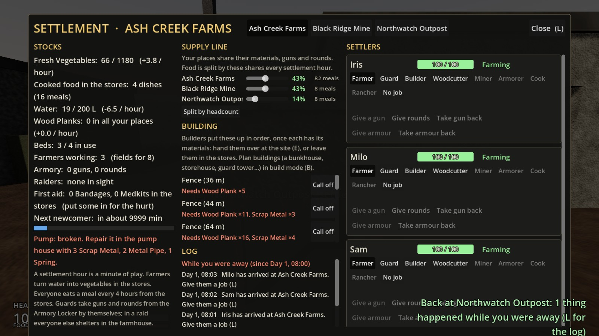
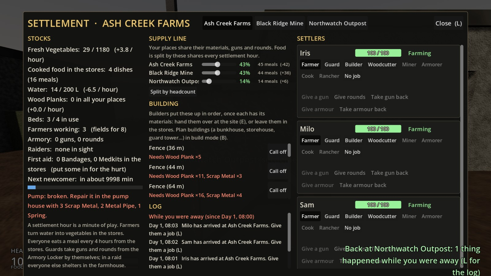
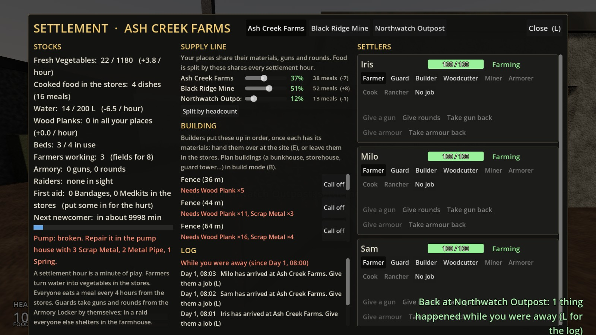
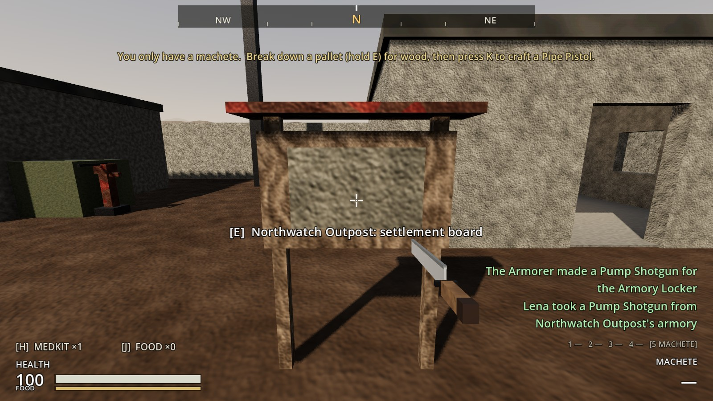

# Increment 24: the supply line

**Status:** complete. 488 automated tests pass in headless Godot 4.7, 6 of them new in `tests/test_supply_line.gd`.

Your note: moving materials and food between settlements should be automatic, with somewhere to choose how much food goes to each place, so settlers aren't lost.

Your picks:
- **Transport:** an instant supply line.
- **Food:** a share per place, starting by headcount.
- **Shared automatically:** building materials, scrap and parts for the armory, and guns and rounds. Water stays with each place.

## How it plays

**Linked as soon as you hold two places.** Every place you hold is on the supply line. Nothing travels, nothing is lost on the way, and there's nothing to deliver.

**Materials are shared.** Anything that isn't food is used from **any** of your places' stores, the place's own first:
- **Builders:** planks, scrap and cloth.
- **Repairs.**
- **The Armorer:** Northwatch's Armorer works straight from the mine's scrap and the farm's planks.
- **The Cook:** fuel.
- **First aid:** Bandages and Medkits.
- **Gunpowder and parts.**

What a place makes still goes into its own stores (the mine's scrap stays on the mine's shelves) until somebody uses it.

On the settlement screen, Wood Planks and Scrap Metal are counted "in all your places".

**Guns and rounds are shared.** An unarmed guard anywhere takes the best gun from **any** of your Armory Lockers, plus rounds for it and armour for empty slots. Their own place's locker comes first. The notice says where it came from ("Lena took a Pump Shotgun from Northwatch Outpost's armory"). So guns the Armorer makes at Northwatch arm guards at the farm and the mine by themselves.

**Food is split by shares.**
- **What's split:** vegetables and cooked dishes on the stores' shelves.
- **When:** every settlement hour (a minute of play), food moves from places with more than their share to places with less. Vegetables go first, then whole dishes.
- **What isn't moved:**
  - the Kitchen's fridge (it stays where it's cooked);
  - raw meat and eggs (they're for the Cook);
  - a store that's full takes only what fits.
- **Who eats what:** settlers eat from their own place's food, which the line keeps topped up.

**Setting the shares.** On the settlement screen (L), the **SUPPLY LINE** panel at the top of the middle column shows each place you hold with:
- a **slider**;
- its **share of the food** as a percentage;
- the **meals** there now, with what the line brought (+) or sent (−) last hour.

How the shares work:
- **By headcount at first:** a place with nobody yet counts as one, so newcomers have food to come for.
- **Moving a slider** sets the shares by hand. The other places keep what they had, and the percentages are each slider against the total.
- **A slider at 0** sends that place nothing.
- **"Split by headcount"** goes back to the automatic split.

**Saved:** each place's share.

## The real-window run

- **Three places:** Ash Creek, Black Ridge and Northwatch, all claimed. 3 Farmers at the farm, 2 Miners and a guard at the mine, an Armorer at Northwatch.
- **Stocked:** 60 vegetables and 4 stews at the farm, 20 Scrap Metal at the mine, 6 planks at the farm.
- **An hour on, by headcount (3 : 3 : 1):** the farm 45 meals (−42), the mine 44 (+36), Northwatch 14 (+6).
- **The mine's slider to 60:** 37% / 51% / 12%, and an hour's share-out moved 8 more meals to the mine.
- **Northwatch's Armorer** started a Pump Shotgun from the mine's scrap and the farm's planks. The farm's fence plan took the rest of the scrap.
- **The shotgun armed the mine's guard:** "Lena took a Pump Shotgun from Northwatch Outpost's armory".

| The supply line | Shared by headcount |
|---|---|
|  |  |

| The mine's share raised | A guard armed from Northwatch |
|---|---|
|  |  |

## How it's built

**`Settlement`:**
- **The line:** `network()` (this place, then every other place you hold), `shared_stores()` and `shared_armories()`.
- **Which stores:** `_stores_for(item)` decides where settlers look: food in their own stores, everything else in all of them. `_stores_count()`, `_stores_have()`, `_take_from_stores()` and `_supply_sites()` go through it, so builders, repairs, the Armorer, the Cook's fuel and first aid all share.
- **Guards:** `_supply_guards()` looks in every Armory Locker on the line.
- **Food:**
  - `food_share` (−1 is "by headcount"), `food_shares()`, `set_food_share()`, `reset_food_shares()` and `food_meals()`.
  - `_simulate_supply()`: once an hour, the first place you hold runs `share_out_food()`, which uses `_move_food()`. `supply_last` is shown on the screen.
  - `food_share` is saved.

**`SettlementScreen`:** the SUPPLY LINE panel (`_refresh_supply()`, `_update_supply_rows()`), "in all your places" for planks and scrap, and wording for food and guns arriving down the line.

## Tests (`tests/test_supply_line.gd`)

1. **Materials are shared:**
   - **The line:** no line with one place; linked with two, each first in its own list; unclaimed places aren't on it.
   - **The Armorer:** Northwatch's makes a pistol from the mine's scrap.
   - **Building:** a guard post planned at the mine gets its materials from the farm.
   - **First aid:** a hurt Miner uses the farm's bandage.
   - **Food isn't pooled that way.**
2. **Guards arm from any armory:** the farm's guard takes a shotgun and shells from Northwatch's locker, with a notice naming it.
3. **Food is shared by headcount:**
   - **The split:** three at the farm and one at the mine is 75% and 25%, so 40 vegetables become 30 and 10.
   - **Hourly:** it happens every hour by itself.
   - **An empty place** counts as one.
4. **Food shares set by hand:**
   - **Setting one:** the others keep their headcount share; 25 and 25 is half each.
   - **Moving food:** stews move whole (12 meals each).
   - **A share of 0** gets nothing.
   - **Back to headcount.**
5. **The supply line on the screen:**
   - **When it shows:** hidden with one place; with two, a share for each.
   - **The slider:** sets the share (a third).
   - **"Split by headcount"** resets them.
   - **Planks** are counted across your places.
6. **Shares are saved.**

**One older test changed:** `test_black_ridge.gd` checks the farm's own stores for scrap, since `scrap()` now counts all your places.
