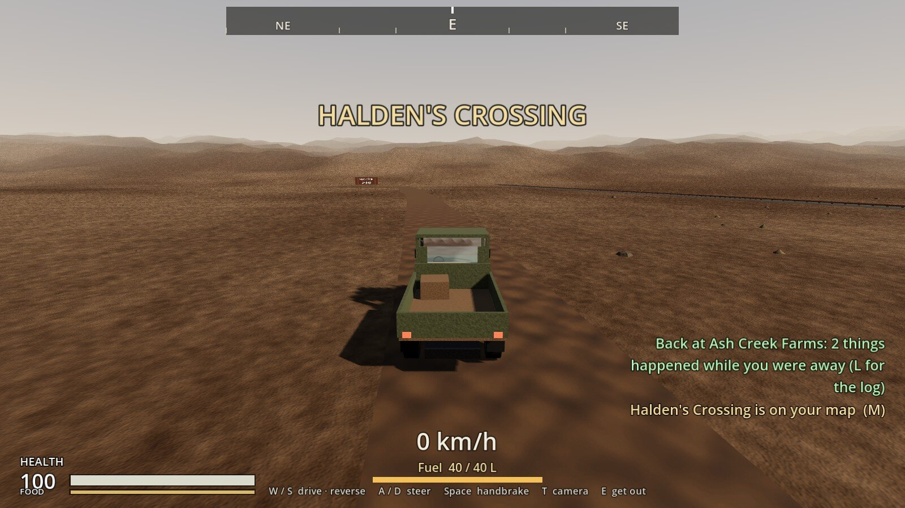
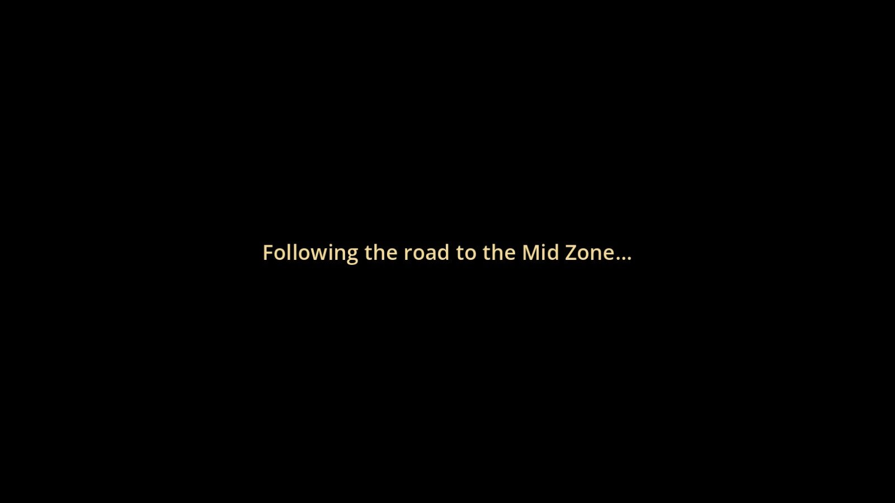
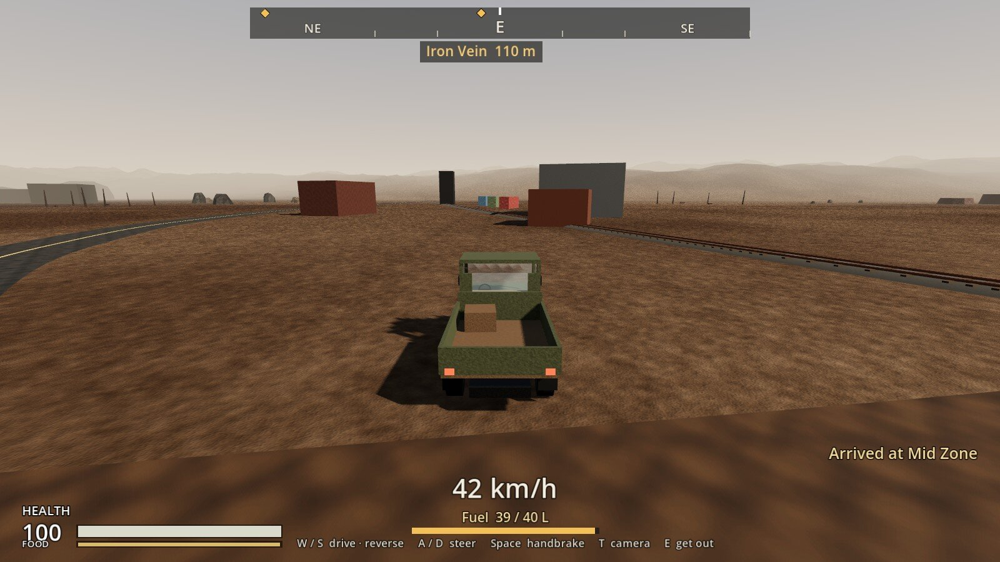
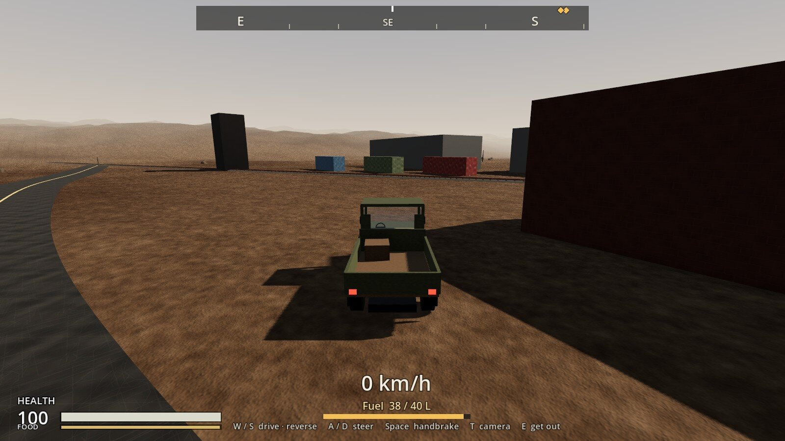
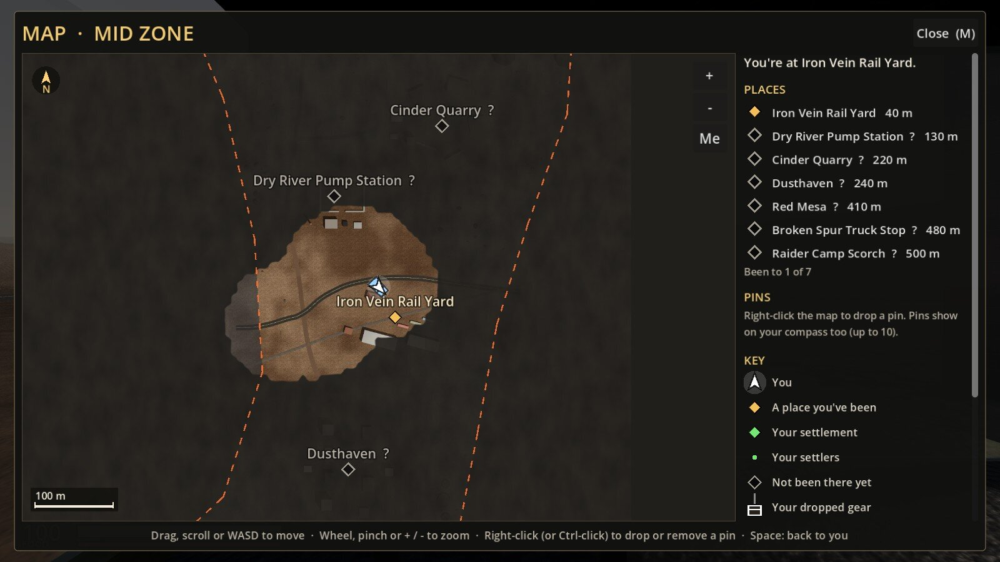
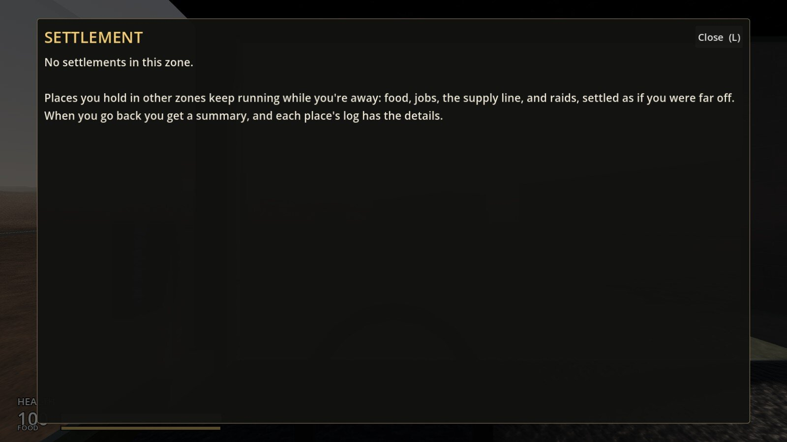
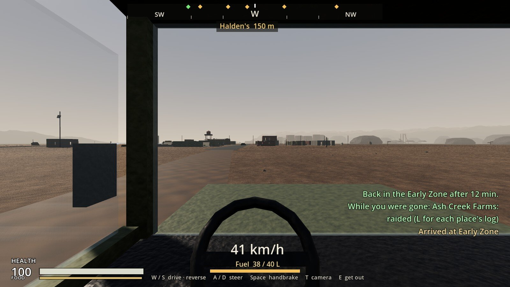
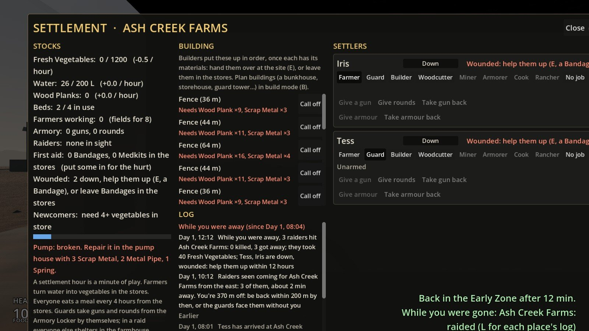

# Increment 25: the mid zone, and the road in

**Status:** complete. 503 automated tests pass in headless Godot 4.7, 9 of them new in `tests/test_mid_zone.gd`.

Your picks for the expanded map:
- **What:** the mid zone, a second zone east of the early zone.
- **Getting there:** drive (or walk) out the east road; your truck and its cargo come with you.
- **Your settlements:** they keep running while you're away.
- **Layout:** laid out from your Regional Buildout Map (now in the repo as `docs/art/regional_buildout_map.png`).

This increment is the zone and the way in. Its seven places are **blockouts**, rough shapes where each one stands, with its name on the compass and the map. **Increment 26 builds them out:** buildings, loot, salvage and tougher raiders.

## How it plays

**The road east.** The gravel road east out of Halden's Crossing now runs on through a **gap in the ash storm**, past a sign: **MID ZONE AHEAD**.
- **Inside the gap:** the storm doesn't hurt, and the warning says "The road leads on through the storm to the Mid Zone".
- **Off the road:** the storm is as it was.
- **Crossing:** drive or walk over the edge in the gap. The screen fades ("Following the road to the Mid Zone…") and you come in on the same road on the mid zone's side. A sign there reads **EARLY ZONE AHEAD** for the way back.
- **Raiders chasing you:** they still stop you leaving ("Raiders are on your tail"); try again once you've lost them.

**Your truck comes with you.** If you're driving, the truck, its fuel and everything in its bed come through with you, still moving, and you're at the wheel.
- **Park it in the mid zone and walk home:** it stays there. It isn't at Outpost 17 until you drive it back.
- **Saves:** they know which zone the truck is in.

**The mid zone.** A band of country round the early zone's east side, about 760 × 1,200 m, the same map frame as the early zone. Roads from the way in:

| Place | Where | Getting there |
|---|---|---|
| **Iron Vein Rail Yard** | Just east of the way in, astride the railway | The east road runs along its north side |
| **Dry River Pump Station** | North, a walled reservoir with a pump house | The road north |
| **Cinder Quarry** | North-east, spoil heaps and a crusher tower | Off the road north |
| **Red Mesa** | Far north, a ruined town under the red mesas | The end of the road north |
| **Dusthaven** | South, a town with a few tall blocks | The road south runs down its main street |
| **Broken Spur Truck Stop** | South-west, fuel canopy, diner and garage | The end of the road south |
| **Raider Camp Scorch** | South, a scrap-walled camp in the red rocks | A trail from Dusthaven |

- **Also there:** the railway runs on through the rail yard, and there are signposts at the junctions, red mesas, dead trees to chop and scattered rocks.
- **The map (M):** it has its own map that fills in as you explore, like the early zone's.
- **Dying:** you respawn where the road comes in.
- **No raiders or loot yet** (26).

Two places moved a little from the drawing. The map put Dry River Pump Station and Broken Spur Truck Stop inside the early zone as it was built, so they're 100–150 m further east and south, in the same order relative to everything else.

**Your settlements keep running.** While you're in the mid zone, the game counts the time you're away from the early zone. It's saved, and it doesn't count while paused.
- **Catching up:** when you come back, each place you hold catches up hour by hour, a minute of play to an hour as always. That covers water, crops, meals, jobs, the Armorer, the supply line, animals, first aid and **raids**. Raids are settled as if you were far off (the same odds as now), with the guards' real guns and rounds.
- **The summary:** you get one on the way in: "Back in the Early Zone after 12 min. While you were gone: Ash Creek Farms: raided, 1 left (L for each place's log)". Each place's log has the details.
- **A week at most:** a very long absence stops at 168 hours.
- **In the mid zone:** the settlement screen (L) says your places elsewhere keep running.

**Fixed along the way:**
- **Settlers who are down wounded** no longer walk out hungry: they stay down to be helped up, or bleed out.
- **The place-name banner** no longer flashes "OUTPOST 17" while you travel.

## The real-window run

1. **Setting up:**
   - Ash Creek claimed, a Farmer and an unarmed Guard, 30 vegetables in the store, raiders due in 4 hours.
   - The truck on the east road with a full tank, 12 Scrap Metal and 8 Wood Planks in the bed.
2. **The way in:** driving east past the sign and over the edge in the gap, the fade read "Following the road to the Mid Zone…".
   - **Arriving:** the truck came in at 42 km/h on the mid zone's side, cargo and all ("Arrived at Mid Zone"), with "Iron Vein 110 m" on the compass.
3. **In the mid zone:**
   - **Iron Vein:** up the road to the rail yard's blockout.
   - **The map (M):** filled in round the yard, with the other six places marked.
   - **L:** "No settlements in this zone…".
4. **Twelve minutes away, then home:** the farm caught up 12 hours.
   - **The raid:** raiders came while you were away, beat the unarmed guard and took 40 vegetables, with Tess and Iris left down wounded.
   - **The summary:** "Back in the Early Zone after 12 min. While you were gone: Ash Creek Farms: raided".
   - **The log:** it had every step.

| The road east | Following the road |
|---|---|
|  |  |

| Into the mid zone | Iron Vein Rail Yard (blockout) |
|---|---|
|  |  |

| The mid zone's map | L in the mid zone |
|---|---|
|  |  |

| Home, with the news | The farm's log |
|---|---|
|  |  |

## How it's built

**The zone builder is shared.**
- **The data:** `tools/build_early_zone.gd` works from variables (places, edge, roads, rail, rocks, tints, timber, signposts, vehicles, survivors), set from its `EARLY_*` constants. `tools/build_mid_zone.gd` extends it and sets the mid zone's.
- **New data:** `EXITS` (the roads out, each with its sign) and `ARRIVALS` (where you come in).
- **Rebuilding the early zone's scene:** it only added the exit, the sign and the arrival marker; everything else came out the same.
- **Commands:**
  - Building: `godot --headless --path . -s res://tools/build_mid_zone.gd` (5 s), with `-- zone-only [bake]` as for the early zone.
  - The map picture: `godot --path . -s res://tools/render_map.gd -- mid_zone`.

**The mid zone's files:** `levels/mid_zone/` holds `mid_zone.tscn`, `terrain.scn`, `roads.scn`, `rocks.scn`, `navigation.scn`, `map.webp` / `map.tres` and the environment. Its `Blockouts` are a solid body per place, made from the `BLOCKOUTS` table.

**`ZoneExit`** (`scripts/world/zone_exit.gd`): a road out through the storm, placed under the zone's `ZoneBoundary`. It has `target_level`, `arrival_id`, `destination_name` and `gap`.

**`ZoneBoundary`:** `exit_at()` and `exits()`. Inside a gap there's no damage and the warning names the destination; crossing the edge there calls `WorldManager.request_travel` (again after 3 s if refused).

**`WorldManager`:**
- **Travel:** it takes a RegionExit or a ZoneExit.
- **The truck:**
  - When you leave, `capture_region(root, carry, to_level)` keeps the truck you're driving (and its cargo) out of the zone's state, in `carried_vehicle`.
  - When you arrive, `_bring_vehicle()` makes it at the arrival marker, moving, with you at the wheel.
  - `vehicle_zones` (saved) says where it is, and `settle_vehicles()` takes it out of a zone it isn't in.
- **Time away:** `away_seconds` per zone, counted in `_process` (not while paused or travelling) and saved with the zone's state.
- **Catching up:** `catch_up(root, seconds)` runs each claimed settlement hour by hour (`Settlement.catching_up` keeps its notices quiet), then emits `caught_up(summary)`. `describe_news()` turns the new log entries into "raided, 1 died, 2 left, 1 arrived".

**`SaveManager`:** saves `vehicle_zones` and each zone's `away_seconds`. Older saves load as before: the truck is wherever its zone's scene puts it.

**The rest:**
- **`Settlement`:** `catching_up`; a settler who's down doesn't leave hungry.
- **`HUD`:** shows the catch-up summary and keeps a catching-up place's notices quiet.
- **`CompassBar`:** no place banners while travelling.
- **`SettlementScreen`:** the empty-zone text.

## Tests (`tests/test_mid_zone.gd`)

1. **The mid zone:**
   - **A zone:** it's a zone of its own, and you start inside it, on the road.
   - **The places:** seven of them on the compass, each well inside the edge and blocked out, and you can walk from the road to every one.
   - **Its map:** it covers all of it.
2. **The zones meet:**
   - **The shapes:** they don't overlap, and the mid zone is bigger.
   - **The way through:** at the same spot in both, each leading to the other, with an arrival just inside and a sign.
3. **The road through the storm:**
   - **On the road:** no damage past the edge, and the warning names the Mid Zone.
   - **Off it:** storm damage and "Turn back".
4. **Walking there and back:**
   - **Going:** crossing the edge on the road travels; you arrive where the road comes in, with your things and health ("Arrived at Mid Zone").
   - **While you're there:** the early zone is remembered, and L says your places keep running.
   - **Coming back:** back on the road home, and now the mid zone's remembered.
5. **The truck comes too:**
   - **Driving in:** the truck and cargo are carried, not left behind; you drive in at the wheel, at the road, facing on.
   - **Parked:** it stays in the mid zone and isn't at Outpost 17.
   - **Saves:** a save knows where it is; going back, it's waiting, still loaded; loading a save made with it away leaves it away.
6. **Settlements keep running:**
   - **The setup:** a farm with two settlers and raiders due.
   - **The catch-up:** 12 hours went by there.
   - **The raid:** settled as if you were far off.
   - **The summary:** "Ash Creek Farms: raided … 12 min".
   - **A long absence:** it stops at a week.
7. **The news in a few words:** quiet, the headlines (raided, died, left, arrived), raids counted, anything else counted.
8. **The wounded don't walk out hungry.**
9. **Time away is counted and saved:** not while paused, and nonsense in a save counts as none.

**Changed tests:**
- **`test_early_zone.gd`:** its storm tests walked east into the storm just beside the road, which now leads through to the mid zone; they're 10 m further south.
- **`test_farm_layout.gd` and `test_wood.gd`:** they read the builder's `EARLY_RAIL`, `EARLY_PLACES` and `EARLY_ROADS`.
