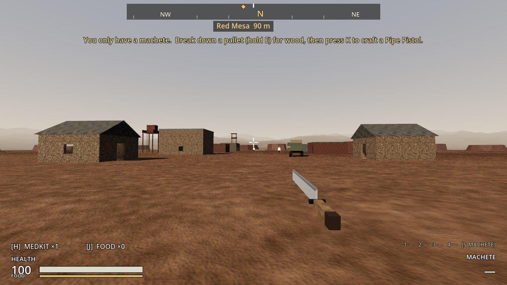
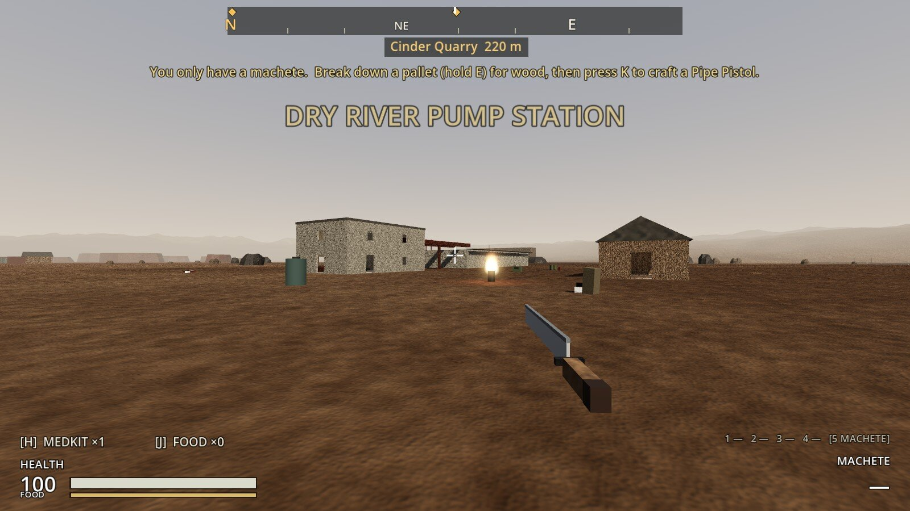
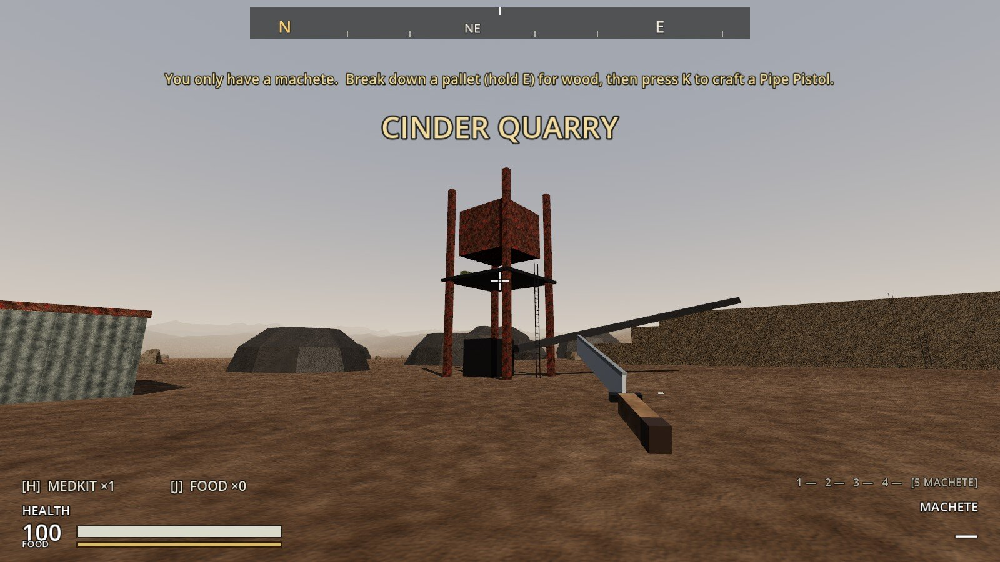
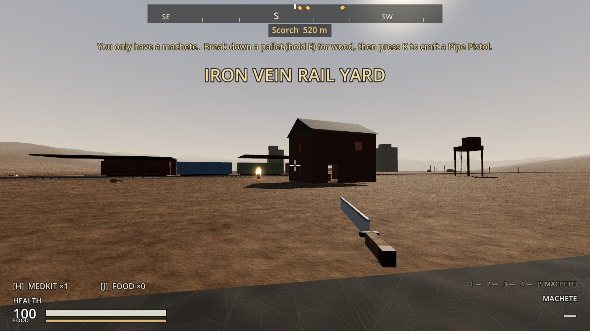
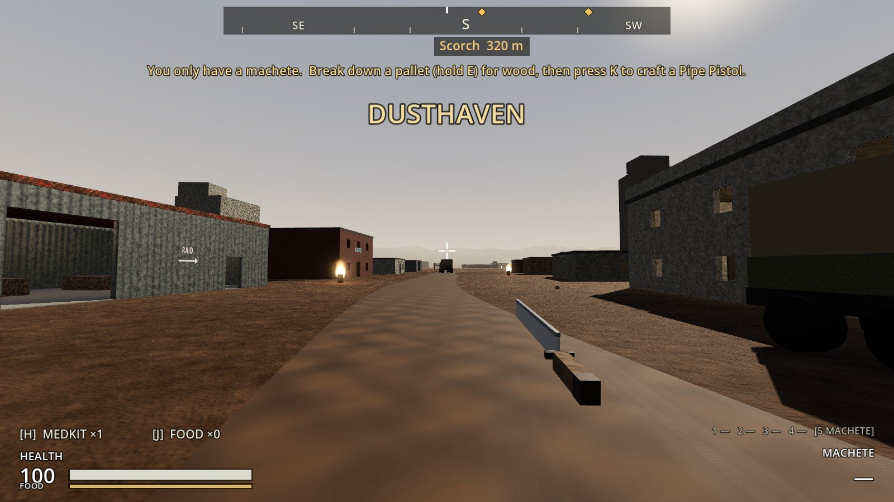
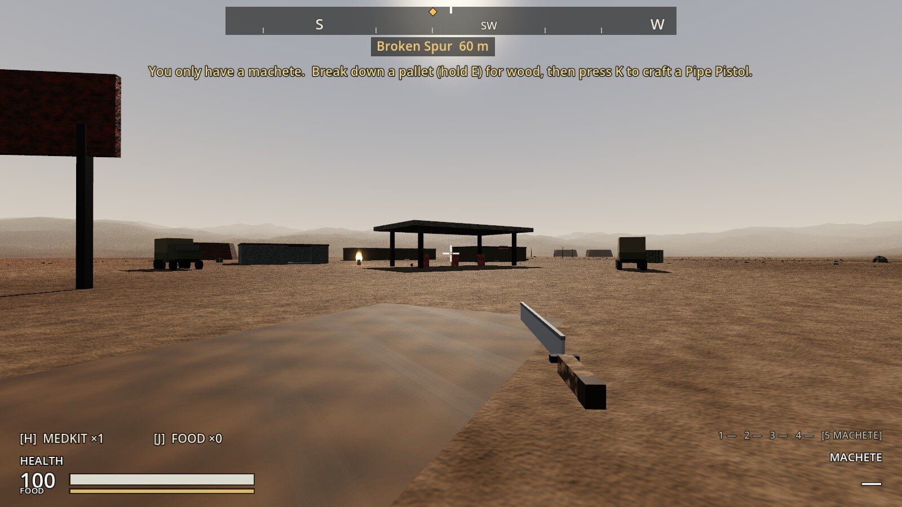
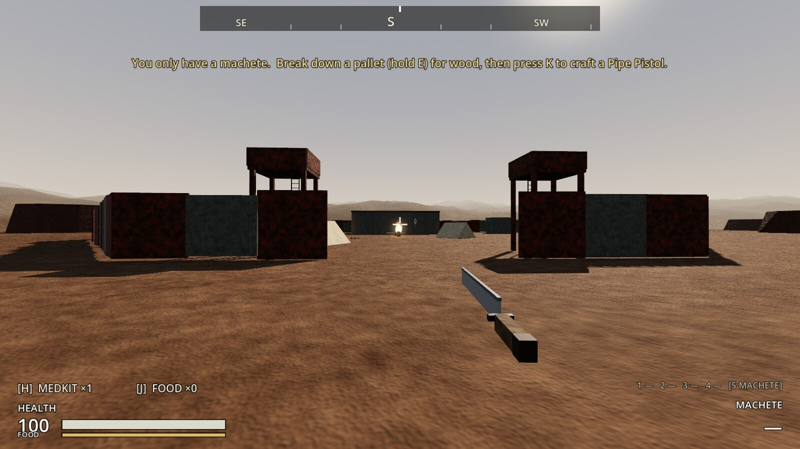
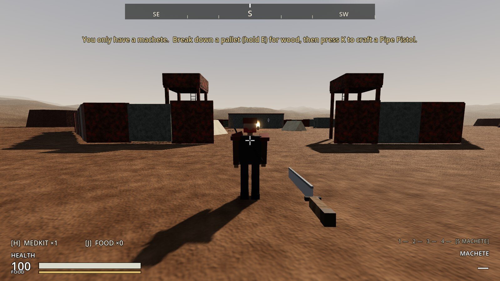
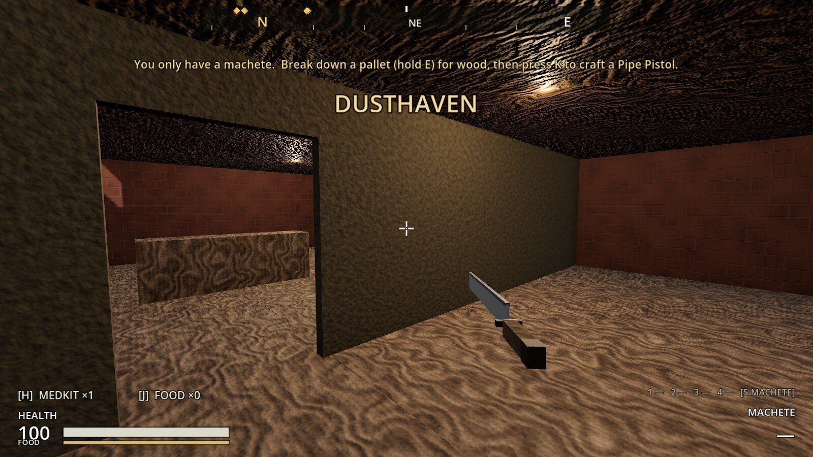
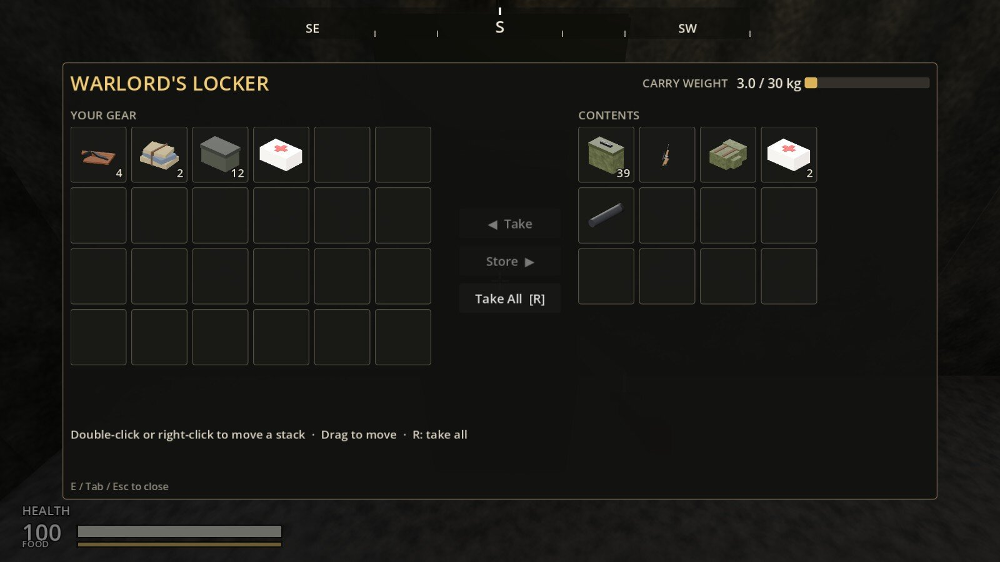

# Increment 26: the mid zone's places

**Status:** complete. 511 automated tests pass in headless Godot 4.7, 8 of them new in `tests/test_mid_sites.gd`.

Increment 25 laid out the mid zone with its seven places as blockouts. This increment builds them out, the way Increment 16 built the early zone's: buildings to go into, furniture, searchable containers, salvage, pickups, ladders to high ground and raiders. You said "continue", so I made the calls; they're listed under **Choices made**.

## What's there

| Place | What you'll find | Raiders |
|---|---|---|
| **Red Mesa** | A ruined town at the foot of the red mesas, its main street running on from the road. On the west, a house, a two-storey **saloon**, the **general store** and a roofless **church** whose **bell tower** is a lookout (ladder, a sniper's cache). On the east, a house, the **sheriff's office** (a **gun rack** that always holds a pistol or shotgun) and a **garage** with a workbench. A **water tower** behind the store | Raider Veterans; **Scorch Marauders** by the church |
| **Dry River Pump Station** | A raised **reservoir**, full, with a ladder up to the walkway on its dam wall and a sluice cabinet. The **pump house** (pumps below, a control room up a ladder, a workbench), **workers' quarters** and a **chemical store**. Pipes run overhead to the reservoir | Raiders, Raider Veterans |
| **Cinder Quarry** | The **quarry face** in three benches (4, 8 and 12 m) climbed by ladders, with a **blaster's cache** on the top. The **crusher** (a deck at 8 m), spoil heaps, an **equipment shed** with a workbench, the **site office** and the **explosives magazine** | Raider Veterans, a Scorch Marauder |
| **Iron Vein Rail Yard** | The **engine shed** with a locomotive in it and a workbench, the **freight warehouse** (three freight crates), the two-storey **yard office**, a **signal box** on stilts, an engine **water tower**, and a rake of **wagons** on a siding. The main line runs through on its slant, clear | Raiders, Raider Veterans |
| **Dusthaven** | A town either side of the road south: two-storey **apartments** (a rooftop stash) and **hotel**, the **clinic**, the **bar**, the **bank** (a vault), the **market hall**, the **police station** (an armory that always holds a shotgun, rifle or pistol, and sometimes a scrap helmet or plated vest) and the **garage**. Tall ruined blocks behind. The road runs clear down the main street | Raiders, Raider Veterans |
| **Broken Spur Truck Stop** | The **fuel canopy** over three pumps, the **diner** with a **cooking stove** in its kitchen, the **garage** (car lift, workbench, two parts bins), a **motel** of four rooms, wrecks and a billboard | Raiders, a Raider Veteran |
| **Raider Camp Scorch** | The Scorch Marauders' camp: a **ring of scrap walls** with a **gate** to the north between two **gate towers** (caches up top), the **Warlord's Hall** (a weapons bench and the **Warlord's Locker**: always a Service Rifle or Marksman Rifle, with rounds and the best attachments, often a plated vest), shacks, cages, caches and fires | **Scorch Marauders**, Raider Veterans, Raiders |

**Totals:**
- 33 buildings, plus towers, the quarry face, the crusher and the reservoir to climb.
- 67 containers, 45 salvage piles and 42 pickups.
- 17 ladders.
- 6 workbenches, a cooking stove and a weapons bench.

**The Scorch Marauder:** the mid zone's tougher raider.
- **Its plate:** scrap plate on its chest, shoulders and head takes **a quarter off bullets, blows and blasts** (not falls or the storm).
- **Stats:** 260 health (a Veteran has 170) and hits for 34 (Veterans 28). It sees and hears further and runs a little faster.
- **Drops:** it **always drops loot**: rounds, parts, plate, leather, medkits, sometimes a **scrap helmet**.
- **Where:** in Red Mesa, Cinder Quarry and Scorch.

**Richer loot:** 11 new loot tables.
- **Armouries that always hold a gun:** the sheriff's gun rack, Dusthaven's police armory and the Warlord's Locker.
- **The rest:** freight, pump parts, water-treatment chemicals, the quarry and rail offices, the diner's pantry, motel rooms and Scorch's caches. These turn up leather, armour pieces, gun parts and attachments more often than the early zone's.

**The map (M)** shows the places from above; it was re-rendered.

## Choices made

- **Raiders, not settlements:** the seven places are to explore, loot and clear, like the early zone's were in 16. Whether any become settlements of yours (Dusthaven? Broken Spur?) is on the roadmap's open questions.
- **Tougher raiders:** one new kind, the armoured **Scorch Marauder**, plus more Raider Veterans than the early zone has. Raiders still fight with blades; raiders with guns would be a bigger change, and is a question for you.
- **Better loot, not more of it:** the same mix of containers and salvage as the early zone's places, from richer tables.
- **The quarry:** it's a face you climb rather than a pit, since the ground in a zone is flat.

## The real-window run

The mid zone was opened, and each place was looked at from its road in.

| Red Mesa | Dry River Pump Station |
|---|---|
|  |  |

| Cinder Quarry's crusher | Iron Vein Rail Yard |
|---|---|
|  |  |

| Dusthaven's main street | Broken Spur Truck Stop |
|---|---|
|  |  |

| Scorch's gate | A Scorch Marauder |
|---|---|
|  |  |

| Inside Dusthaven's hotel | The Warlord's Locker |
|---|---|
|  |  |

- **Scorch:** at the gate, the camp's Marauders were about inside: 260 health, a quarter off bullets.
- **The Warlord's Locker** held a Marksman Rifle, 39 rifle rounds, a suppressor, a military pack and two medkits.

## How it's built

- **The sites:** `tools/build_mid_sites.gd` extends `build_sites.gd`. It writes the seven site scenes (`levels/<place>/<place>.tscn`) and the mid zone's loot tables (`MID_LOOT`).
  - **New helpers:** `_tower()` (a deck on legs with rails and a ladder), `_water_tower()`, `_shack()` and `_scrap_wall()`.
  - **The rail yard:** it's laid out along its slanted tracks with `_rail_at(along, across)`.
- **The Marauder:** `tools/build_marauder.gd` builds `scenes/enemies/raider_marauder.tscn` from the Raider Veteran: stats, Scorch colours, shoulder plates and a helmet. `Raider` has a new `armour` export (a share of bullets, blows and blasts it stops), and the site kit knows it as `"marauder"`.
- **The zone:** `build_mid_zone.gd`'s `_add_places()` places the site scenes where the blockouts stood (`SITE_FOLDERS`).
  - **Rebuild order:** `build_mid_sites.gd`, then `build_mid_zone.gd -- zone-only bake`, then `render_map.gd -- mid_zone`.
- **The site kit:** `water` and `rock_tan` materials.

## Tests (`tests/test_mid_sites.gd`)

1. **The places are built:**
   - Each is a real site where the map puts it, with buildings, containers, salvage, loot and the right raiders.
   - No blockouts are left.
   - Workbenches to find.
2. **The new loot tables:** they load, and the three armouries always hold a gun.
3. **The Scorch Marauder:**
   - **Tougher than a Veteran:** more health and harder hits.
   - **Its plate:** it takes a quarter off a bullet, but not off a fall.
   - **Drops:** always loot, sometimes armour. Veterans wear none.
4. **Containers:** clear of walls and props, standing on something, searchable from the front.
5. **Everything reachable:** from the road in, on foot, or by a ladder up to what's high, and each place reachable from where you come into the zone.
6. **Salvage and pickups placed sensibly.**
7. **The roads stay open:** Red Mesa's street, Dusthaven's main street and the way in from the north, the east road past the rail yard and the road past Dry River.
8. **Raiders wait at each place:** awake when you come, on the ground and the navmesh, Scorch Marauders where they should be.

**Changed tests:** `test_mid_zone.gd` checks each place is built (not blocked out).
