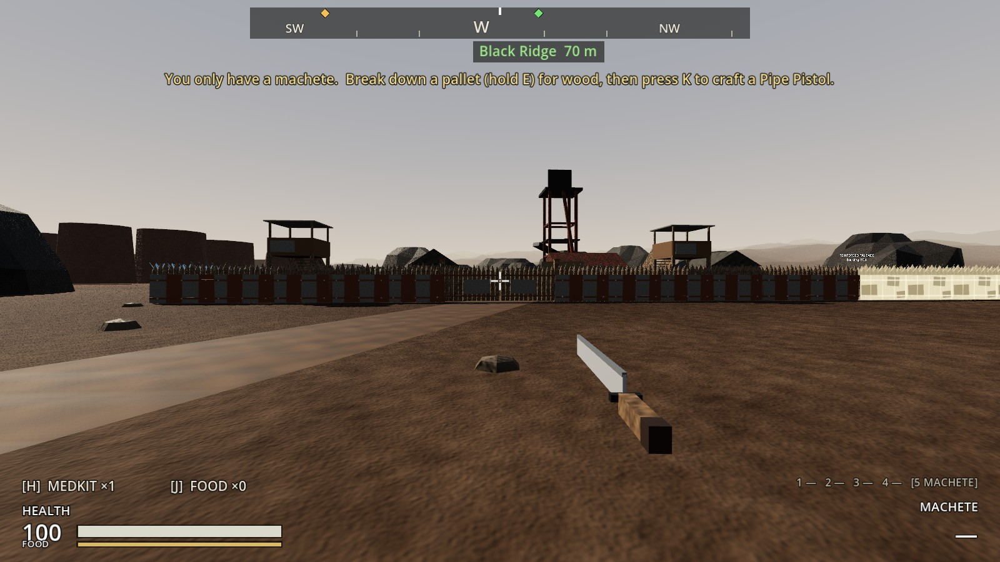
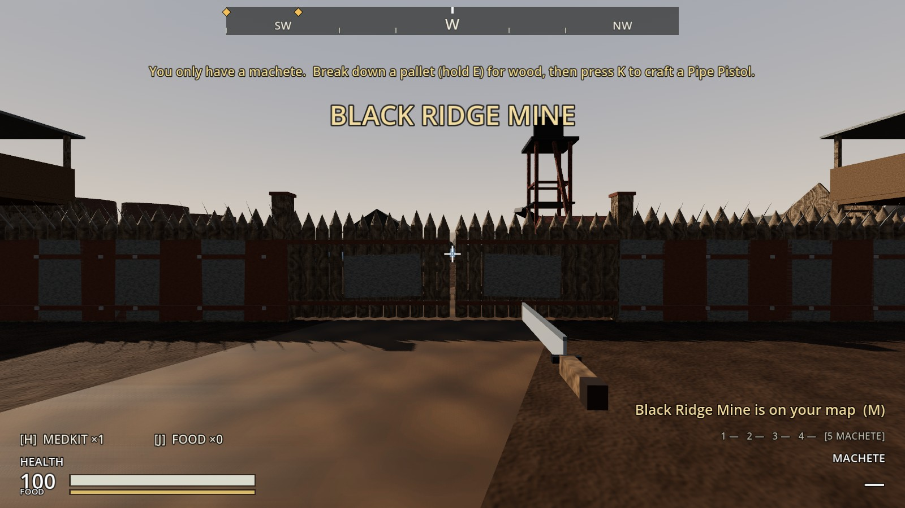
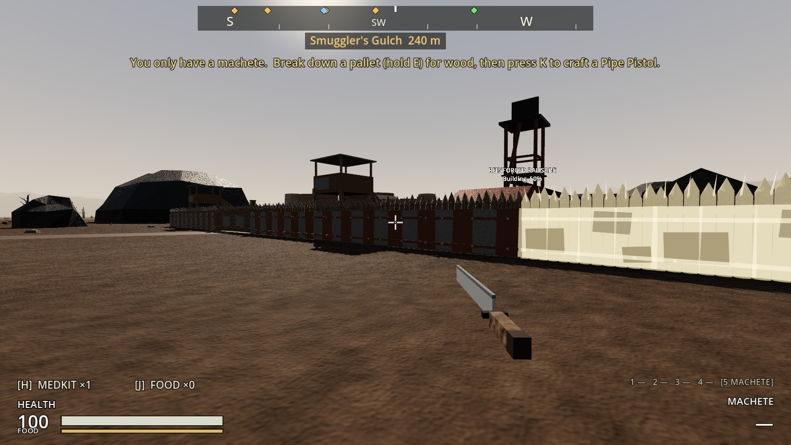
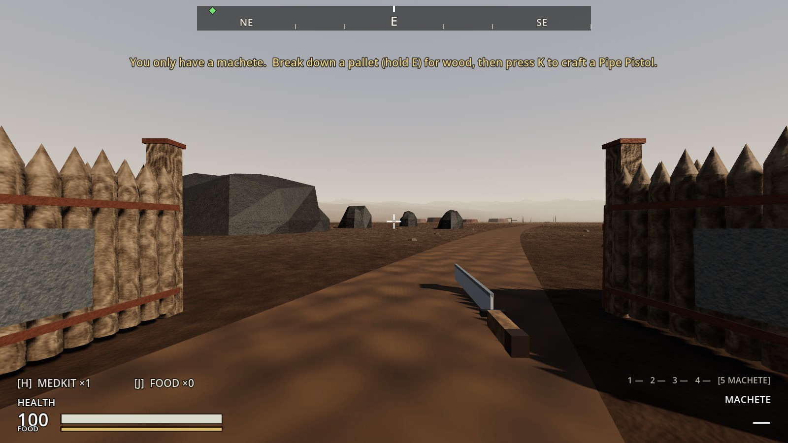
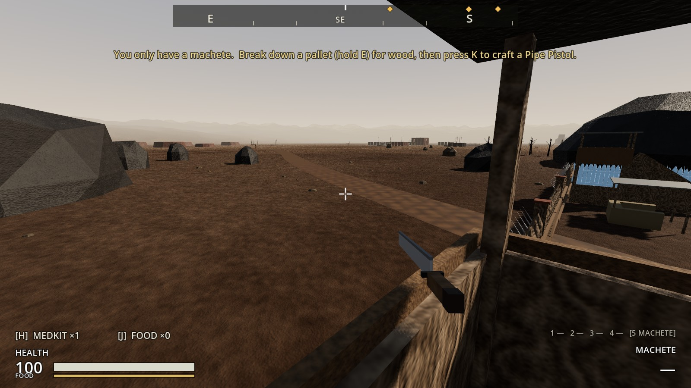
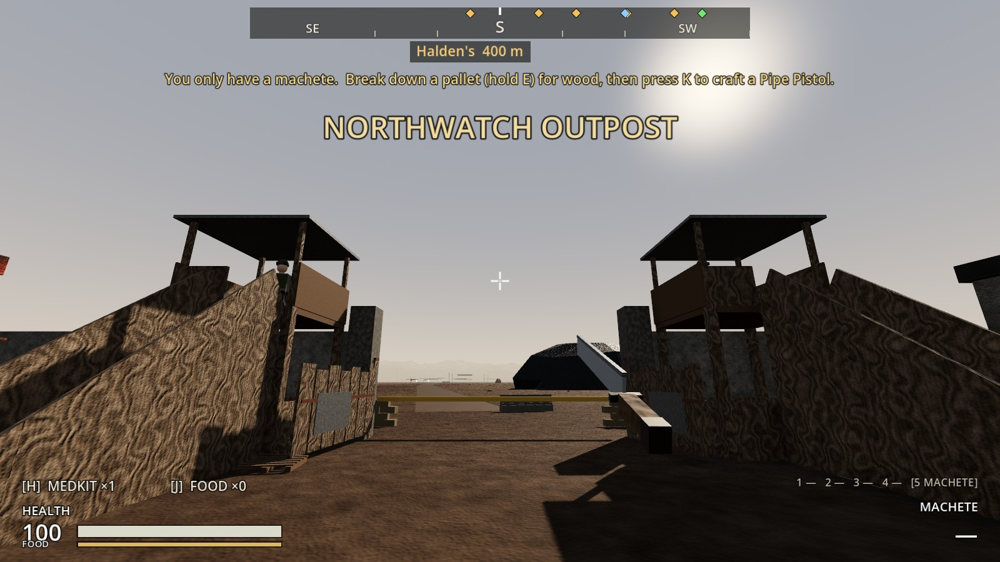

# Increment 27.1: the mine's palisade, its upgrades, and gates you can walk through

**Status:** complete. 527 automated tests pass in headless Godot 4.7, 6 of them new in `tests/test_palisade_and_towers.gd`.

After 27 you said:
- **The mine's fence** looked like a farm fence, not something protective.
- **Upgrades:** once it's built, you'd like a reinforced version that uses more scrap, then guard towers guards can climb into, as automatic upgrades.
- **A bug:** the gates looked open but there was still an invisible barrier.

Your picks: a scrap palisade, and tougher (it costs more).

## The gate fix

A gate's leaves are physics bodies hung from hinges. The gate swings by turning the hinges, but the leaves were set to update their collision only when they themselves moved. So the planks swung on screen and the collision stayed shut. Now the collision follows the hinges.

- **Fixes every gate,** including any already built in your game, since a built gate comes from its scene.
- **A new test** walks through each kind of gate when it's open, and checks it can't be walked through when shut.

## The palisade

| | Palisade | Reinforced Palisade |
|---|---|---|
| **Looks** | Tall sharpened stakes (2.2–2.6 m) on two rails, patched with rusty scrap sheet | The same stakes clad in scrap sheet outside, banded with steel and spiked along the top |
| **Health** (a length) | 600 | 1,200 |
| **Each 4 m length** | 2 Wood Planks, 1 Scrap Metal, 18 min of work | 1 Wood Plank, 3 Scrap Metal, 18 min of work |

The farm fence has 250 health a length, for comparison. Each length is solid 2.4 m up, so it can't be jumped. It's drawn as one mesh, so the 330 m round the mine stays cheap to draw.

**The Palisade Gate** is a double gate of stakes, 8 m across, on heavy posts. It has 1,400 health and costs 10 planks and 6 scrap. It works like the other gates: it opens for your people, stays shut with a raider near, and raiders have to break it down.

**Ash Creek keeps its split-rail fences.** The palisade is only round the mine.

| The mine's palisade gate from the road | Walk up: it opens, and you can walk through |
|---|---|
|  |  |

| The east side reinforced, the next stretch still an outline, a watchtower behind | Walked through (with the real controls), looking back out of the open gate |
|---|---|
|  |  |

## The defences come in stages

When everything in a place's first stage is built, the next is laid out by itself, with a notice: "Black Ridge Mine's defences are built. Next, the Builders start on: watchtower, reinforced palisade".

| Place | Stage 1 | Stage 2 |
|---|---|---|
| **Black Ridge Mine** | The palisade (82 lengths), its gate, and two guard posts by the gate: 186 planks, 92 scrap, 8 cloth | **Four watchtowers:** two near the gate, two at the far corners. Then **the palisade reinforced**, length by length where it stands: 162 planks, 278 scrap, 8 Metal Pipe |
| **Ash Creek Farms** | Gates in its three fence gaps | **Two watchtowers** by the front gate |
| **Northwatch Outpost** | A gate in its gateway | **Two watchtowers**, one either side of it |

- **Reinforcing:** each reinforced length takes the place of the palisade length where it stands. If raiders break a reinforced length, it goes back on the list as a reinforced length.
- **The towers are listed first,** so they go up before the reinforcing.

## Watchtowers

A **Watchtower** is a guard tower with its deck at 3.4 m (the Guard Tower's is 2.6 m), boarded round with a scrap shield, up a longer stair. It has 1,100 health and costs 20 planks, 8 scrap and 2 Metal Pipe.

- **Placement:** each stands hard against the wall, and its guard stands at the front of the deck.
- **Why:**
  - From the mine's gate tower, a guard sees a raider at the gate or at the foot of the wall over the palisade.
  - A guard on the ground inside can't.
- **Guards take the highest spots first,** so towers are manned before guard posts. In the test, two guards climbed Northwatch's watchtowers, one each.

| From the watchtower's deck | Northwatch's guards on their watchtowers |
|---|---|
|  |  |

## Your game from 27

When it loads, the mine's fence and gate plans become palisade plans:
- **Materials** already handed over to them go back into the stores.
- **What's already built** (fence lengths, the old gate) keeps standing until the palisade length or gate built at the same spot takes its place, so the mine is never left open.
- **The mine's guard posts** and Ash Creek's and Northwatch's gates are left as they were.

A save made in 27 (`tests/fixtures/save_27.json`) is loaded by the tests every run, along with the older ones.

## The real-window run

- **The mine:** claimed, its first stage finished, then its four watchtowers and the east side's south end reinforced, with the next stretch half done.
- **The gate:** from the road, it opened as the player walked up. Walking on with the real controls took them through the gateway and 13 m inside.
- **The tower:** from the gate tower's deck you look over the wall.
- **Northwatch:** two new guards climbed its two watchtowers, one each.

## Choices made

- **Two stages.** The watchtowers come first in stage 2, then the reinforcing. A third stage (stone? more towers?) is up to you.
- **Watchtowers at all three places.** You asked for towers as an automatic upgrade; I gave Ash Creek and Northwatch two each by their gates.
- **One guard per tower.** A watchtower has one guard spot. Guards beyond the towers and posts patrol, as before.
- **Roof posts:** a watchtower's roof posts don't block anything, so its guard can look along the wall past them.
- **Northwatch's fuel drums** moved out of the west watchtower's way.

## How it's built

- **The scenes:** `tools/build_settlement_buildings.gd`.
  - `_palisade(reinforced)`; `_gate(…, palisade)` with `_palisade_leaf()`; `_tower(…, h)` (the Guard Tower and the Watchtower).
  - `_merged()` combines a piece's parts into one mesh per material.
  - The gate leaves have `sync_to_physics = false`.
- **Plans:** `SettlementPlans` has `palisade`, `reinforced_palisade`, `palisade_gate` and `watchtower`, plus a `replaces` list, `replaces()` and `upgrades_of()`.
  - `ConstructionSite._build_piece()` frees what a piece replaces, and builds nothing where something better already stands.
- **Stages:**
  - Plan markers carry `stage` and `since` metas.
  - `Settlement` has `defence_stage` and `defences_version` (both saved), `_advance_defences()` (checked as sites finish, every couple of seconds, and on load), and `_lay()`.
  - `guard_posts()` lists the highest spots first.
- **The sites:** `tools/build_sites.gd` has `MINE_FENCE` (palisade), `MINE_TOWERS`, `FARM_TOWERS`, `NORTHWATCH_TOWERS` and `_plan_towers()`. The three sites and the zone were rebuilt.

## Tests (`tests/test_palisade_and_towers.gd`)

1. **The palisade and its gate:**
   - Health, costs and work.
   - Few meshes.
   - What each replaces.
   - Solid 2.2 m up, end to end.
2. **Gates open to walk through:** at Northwatch and the mine, shut you can't walk through, open you can.
3. **The defences come in stages:**
   - The second waits for the last of the first.
   - The towers come first.
   - The notice.
   - Reinforcing costs more scrap and replaces each length where it stands.
   - A broken reinforced length is rebuilt as one.
   - Ash Creek and Northwatch get their towers.
4. **Watchtowers see over the wall:**
   - All eight are clear of everything.
   - From the mine's gate tower a guard sees a raider at the shut gate and along the wall; on the ground, it can't.
5. **Guards climb the watchtowers:** two guards, one up each of Northwatch's towers.
6. **A 27 save gets the palisade:**
   - Its plans are replaced and the materials go back to the stores.
   - The old fence and gate stand until replaced.
   - Ash Creek is untouched.

**Shared helpers:** `tests/fortify_helpers.gd`, used by this suite and 27's.

**Changed tests:**
- `test_fortify_and_armory.gd`: the palisade.
- `test_settlement_building.gd`, `test_raids.gd`, `test_black_ridge.gd` and `test_supply_line.gd`: they keep the next stage of defences from taking their materials.
