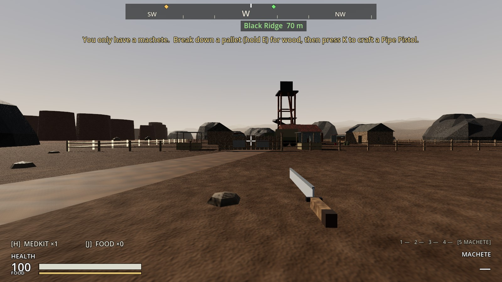
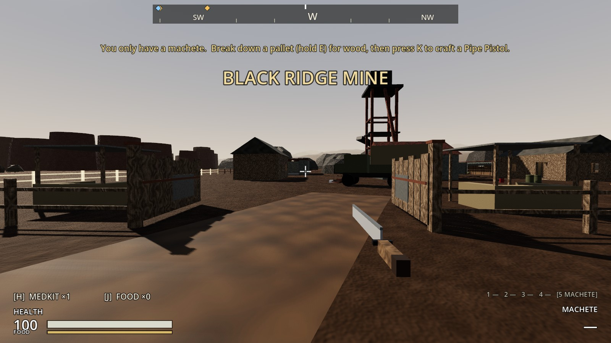
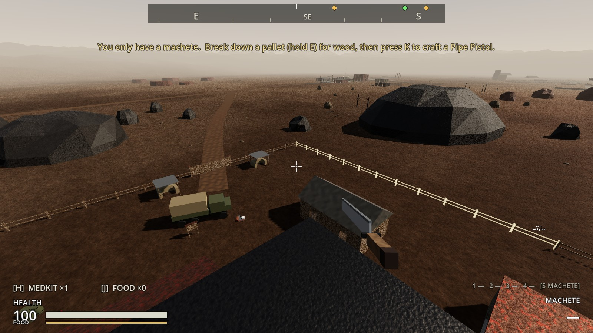
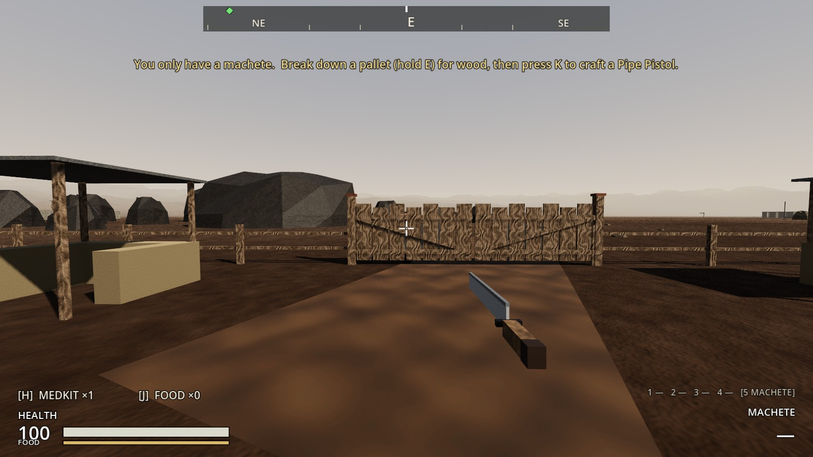
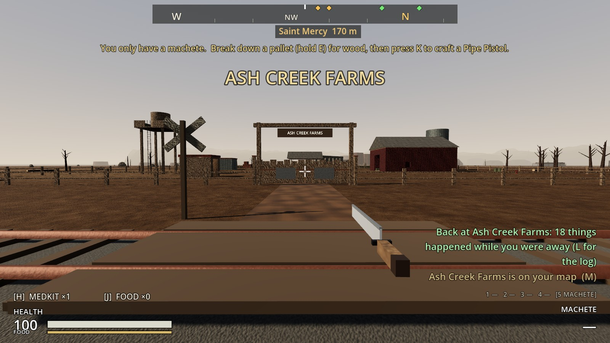
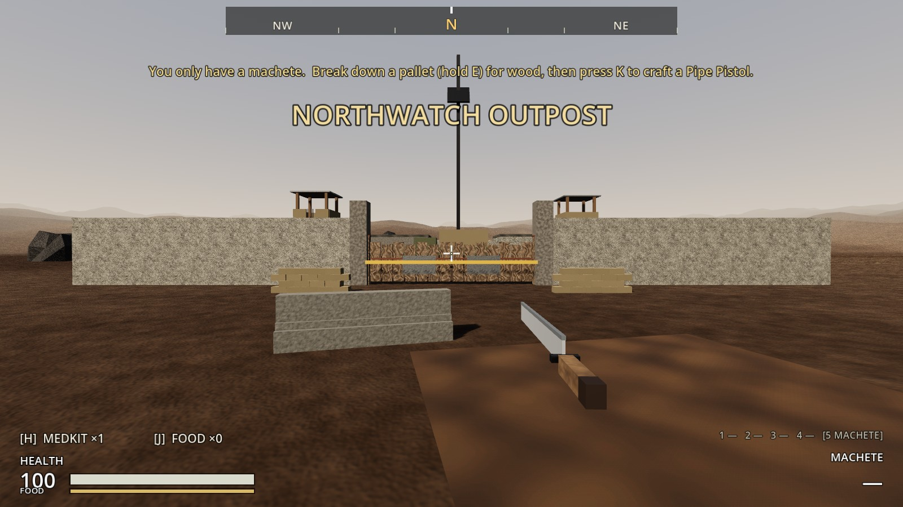
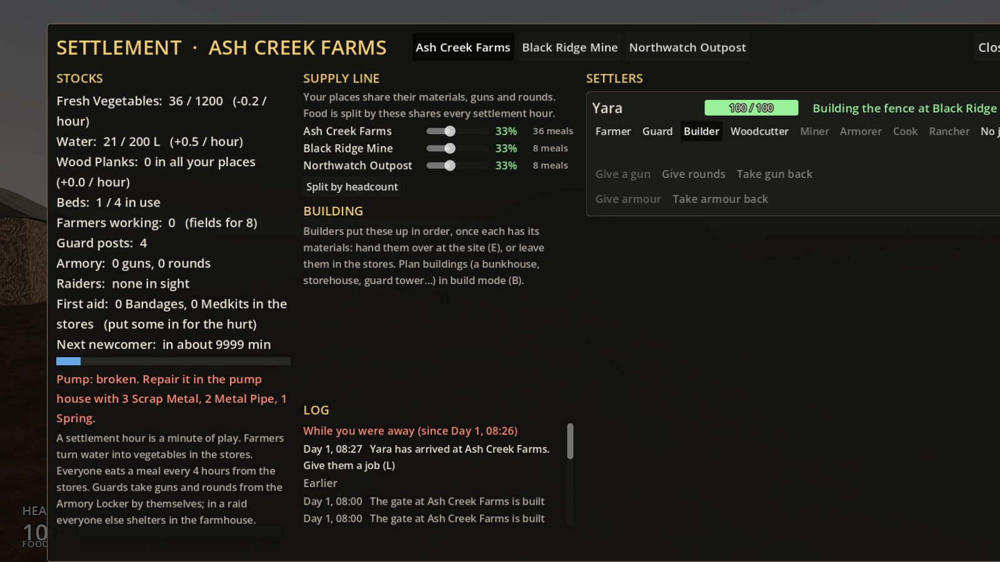
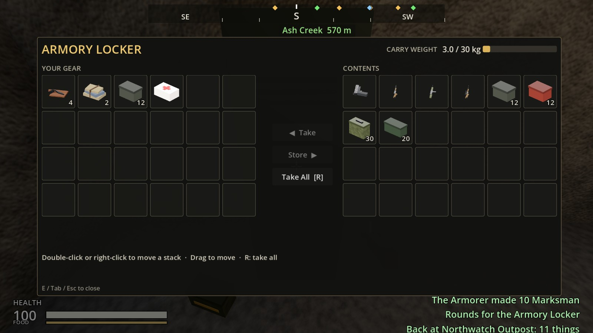
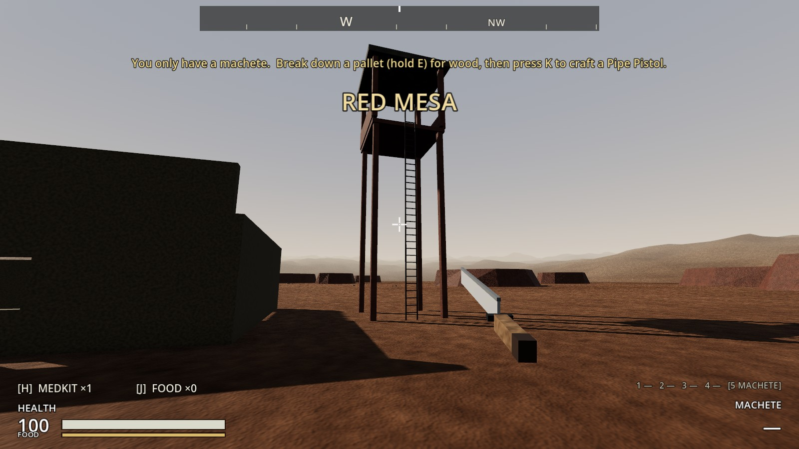
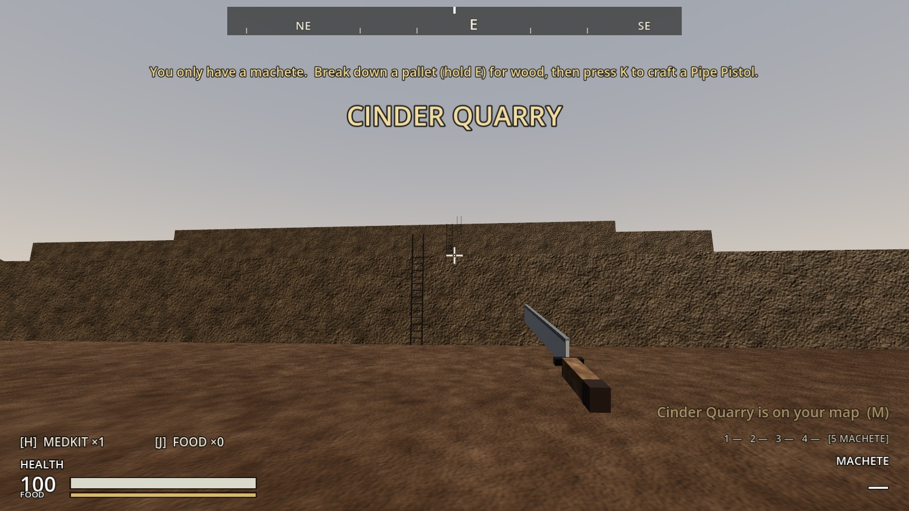

# Increment 27: your places fortified, and the armory's guns

**Status:** complete. 521 automated tests pass in headless Godot 4.7. 9 of them are new in `tests/test_fortify_and_armory.gd`, plus a ladder test in `tests/test_mid_sites.gd`.

You asked for three things:
- Builders fortify all three places with wood and scrap, with a fence right round the mine.
- The armory makes different guns and their rounds.
- The mid zone's ladders are easier to climb.

Your answers:
- **Builders** go where they're needed.
- **The gate** opens only for your people; raiders have to break it down.
- **Miners** dig up Chemicals.
- **The armory** makes one gun of each kind, then more.

## The defences

Once a place is yours, its defences go on its building list, like Ash Creek's fences did in 19.6. Places you already hold get theirs the first time the game loads after this update.

| Place | Defences | Materials | Work |
|---|---|---|---|
| **Ash Creek Farms** | A **gate** in each of the three gaps in the fences: the yard's front and back, and the field's | 24 Wood Planks, 12 Scrap Metal | 4½ hours |
| **Black Ridge Mine** | A **fence right round it**: 330 m, 82 lengths, out past the ridge. A **gate** on the road in from the east, with a **guard post** either side | 102 planks, 30 scrap, 8 Cloth | 26 hours |
| **Northwatch Outpost** | A **gate** in the gateway, which is widened to 8 m for it | 8 planks, 4 scrap | 1½ hours |

**The gate** is 8 m across: two leaves of upright planks on rails, braced and patched with scrap sheet, hung on heavy posts. It has 800 health; a length of fence has 250.
- **It opens by itself for you and your settlers** and shuts behind you. It opens when you're within 7 m, so it's open by the time a truck's nose gets there. For a settler it opens within 3 m.
- **Raiders can't open it.** If a raider is within 12 m, the gate stays shut, even on you.
- **Raiders break it down.** Paths run through the gate whether it's open or shut, so raiders head for it, find it shut and hack at it.
- **Repairs:** Builders mend a damaged gate. If one is broken down, it goes back on the building list.

| The mine's gate, shut | Walk up to it: it opens |
|---|---|
|  |  |

| From the top of the headframe: the east side, the gate and its guard posts. The south side is still going up | A raider at the gate (it took 20 off the gate in a few seconds) |
|---|---|
|  |  |

| Ash Creek's front gate | Northwatch's gate |
|---|---|
|  |  |

## Builders go where they're needed

**Where they work:** each Builder mends or builds at their own place first. When there's nothing to do there, they go to the nearest of your other places that has work.

**The work itself:** it counts by the settlement clock wherever they are, as it always has.

**The walk:**
- They walk the road there, and home again when the work's done (or when they're hungry, or there's a raid at home).
- When you're not with them, the walk is done off-screen, like a newcomer's. They turn up at the end of the other place's lane, or simply arrive there if you're not there either.

**What the settlement screen shows:**
- The Builder's job, with the place: "Building the fence at Black Ridge Mine".
- Each place's building list counts every Builder working there, wherever they're from.

**Materials** come from any of your places' stores (the supply line, 24).

## Miners dig up Chemicals

Each working Miner turns up a jug of **Chemicals** every 4 hours, as well as their 2 Scrap Metal an hour. Chemicals go into the mine's stores. The Armorer makes them into Gunpowder (one jug makes 3), so rounds no longer depend on loot.

## The armory's guns

**What the Armorer makes, in order:**
1. **One of each kind of gun** the place hasn't got: a Sidearm Pistol, a Pump Shotgun, a Service Rifle and a **Marksman Rifle** (new to the armory).
2. **Rounds for every kind of gun there**, in the locker or carried by guards. The kind with the fewest rounds comes first, up to 90 each: Pistol Ammo, Shotgun Shells, Rifle Ammo and Marksman Rounds.
3. **More guns**, the kind there's fewest of first, up to **two of each** (eight in all).
4. **At a pinch, a Pipe Pistol:** only when the stores have the makings of nothing better and the locker's empty.

**Other changes:**
- **Gunpowder** can be made with a Wood Plank where Wood's called for.
- **The Armory Locker** holds 24 stacks (it held 12), so it has room for eight guns and their rounds.
- **Its status** says what's short: for example "No makings for more guns: needs Scrap Metal (and Electronics for rifles)", or "Armory stocked; no makings for Shotgun Shells (it needs Gunpowder: Chemicals and Wood)".

## The mid zone's ladders

Every ladder in the mid zone is now climbed in the tests by walking straight at it from 3 m out, not from just in front of it. The awkward ones:

| Where | What was wrong | Now |
|---|---|---|
| Red Mesa's **bell tower** | Its ladder faced the church's back wall | It faces the street |
| Red Mesa's **water tower** | Its ladder faced away from the store | It faces the store |
| The **saloon** | The bar ran right up to the ladder to the rooms | The bar's along the back wall |
| Cinder Quarry's **benches** | The three ladders were scattered along the face | In a line: off the top of one, walk straight on to the next |
| Scorch's **gate towers** | Climbed from inside the camp | Climbed from the gate |

| The bell tower from the street | The quarry's ladders |
|---|---|
|  |  |

## Choices made

- **Wood fences, not walls.** The mine's fence is the same split-rail fence as Ash Creek's, as you described. It slows raiders and steers them to the gate, but it doesn't stop them. A sturdier palisade could come later.
- **Ash Creek keeps its own fences.** It already had fences round the yard and fields from 19.6; its defences are the gates in the gaps.
- **The gate opens by itself.** There's no key or button: it opens for any of your people close by and stays shut while a raider is near.
- **Armory numbers:** two of each kind, and 90 rounds of each.
- **Building comes first.** The defences take their materials as soon as the stores have them, so early on they compete with the Armorer for scrap.

## How it's built

- **The gate:**
  - `SettlementGate` (`scripts/settlement/settlement_gate.gd`) is a `SettlementBuilding`, so it's saved, mended and rebuilt like the rest.
  - The scene is made by `tools/build_settlement_buildings.gd`.
  - Its leaves are `AnimatableBody3D`s in the `nav_passable` group. `NavRebaker` takes them off every physics layer just while it reads the level for a bake, so the navmesh runs through the gate.
- **Plans:**
  - `SettlementPlans` has a `gate` plan and a `length` per run plan (fence 4 m, gate 8 m), with `is_run()`, `piece_length()` and `plan_for_structure()`.
  - Defence markers carry the `defence` meta.
  - `Settlement.defences_laid` (saved) makes sure a place claimed before this update lays out just its defences when the game loads.
- **The sites:**
  - `tools/build_sites.gd` has `GATES` (Ash Creek), `MINE_FENCE` and `_plan_run()`.
  - Northwatch's gateway is widened, and its two gate guard markers stand back from it so a guard there doesn't hold it open.
  - Rebuild order: `build_sites.gd -- ash_creek_farms black_ridge_mine northwatch_outpost`, then `build_early_zone.gd -- zone-only bake`.
- **Builders:**
  - `Settlement.builder_assignment()` and `builders_working_here()`.
  - `Settler._go_far()` handles the long walk.
- **The armory and the mine:**
  - `Settlement._start_armory_job()` with `ARMORY_GUNS`, `armory_per_kind` and `ARMORY_SLOTS`.
  - Miners use `miner_chemicals_per_hour`.
- **The mid zone's ladders:** `tools/build_mid_sites.gd`. The sites, the zone (`-- zone-only bake`) and the map were rebuilt.

## Tests (`tests/test_fortify_and_armory.gd`)

1. **The defences are planned:**
   - Ash Creek's three gates fill its fence gaps end to end.
   - The mine's ring closes, with everything of the mine inside it and the raid points outside.
   - Northwatch's gateway is 8 m, and its guards stand back from it.
   - Nothing is in the way of any run.
2. **Claiming lays them out:** sites, costs, 82 lengths at the mine, Northwatch's gate, Ash Creek's gates.
3. **Places claimed before get their defences:** the Increment 24 save loads with its gates and the mine's fence planned, nothing twice, and saving and loading again changes nothing.
4. **Builders go where needed:**
   - The farm's Builder works at home, then at the mine.
   - Their status says where, and the mine's screen counts them.
   - An hour of work lands at the mine.
   - They get there off-screen, and come home when there's nothing left to build.
5. **The gate opens for yours, not raiders:**
   - It opens for you, shuts with a raider near, and opens for a settler.
   - It shuts behind you.
   - Paths run through it.
   - It's saved open or shut.
6. **Raiders break the gate down:** a raider on a raid hacks at the shut gate from outside, and it never opens for them. Broken, it goes back on the list.
7. **The mine is fenced all round:**
   - From each raid point, the only way to the stores is through the gate.
   - With the gate counted as a wall, there's no way in at all.
8. **Miners dig up Chemicals:** 2 in 8 hours, alongside the scrap, saved.
9. **The armory makes each kind, then more:**
   - At a pinch, a Pipe Pistol.
   - Then one of each kind, rounds for each, then two of each.
   - Then it's stocked.

**Changed tests:**
- `test_mid_sites.gd`: every ladder is climbed walking at it from 3 m out.
- `test_northwatch.gd`: the Armorer's order.
- `test_settlement_building.gd`: Ash Creek's plan now includes its gates (18 sites).
- `test_black_ridge.gd` and `test_supply_line.gd`: they clear the new defence sites so they don't take the stores' scrap.
