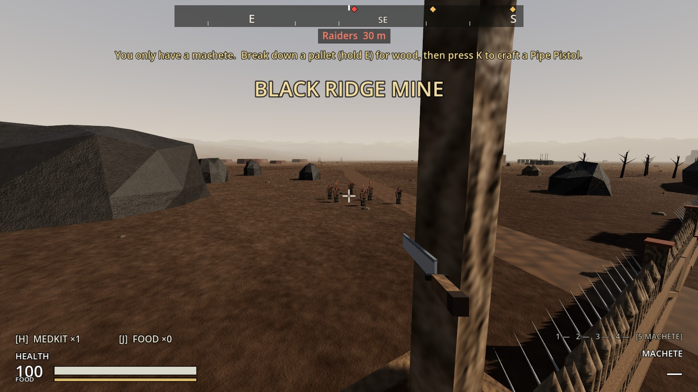
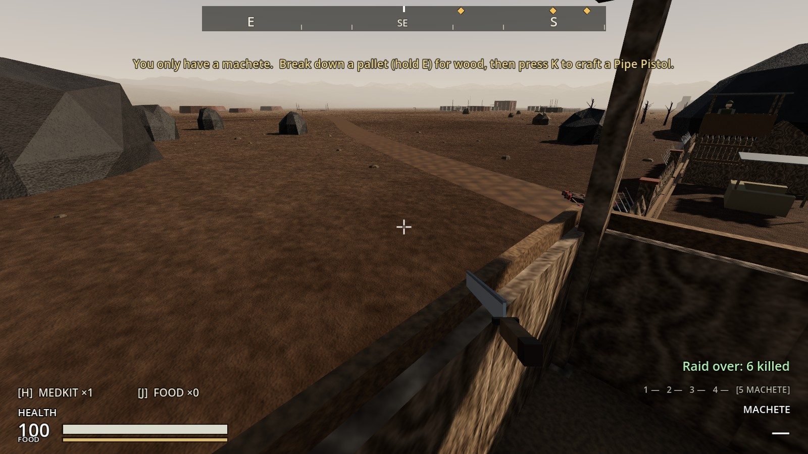
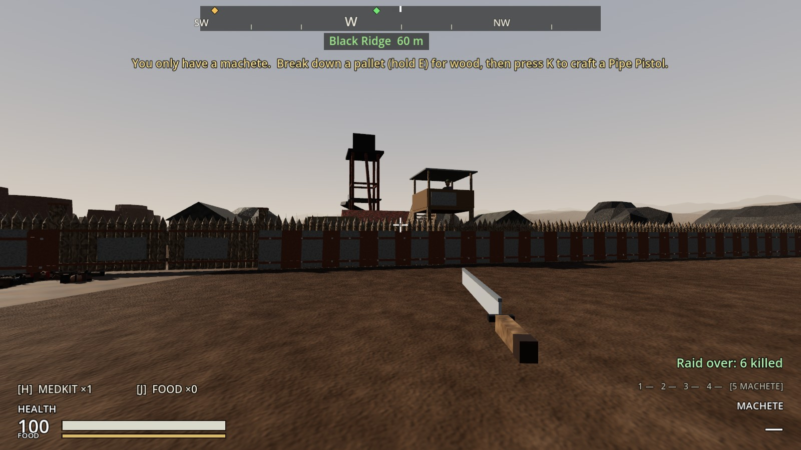
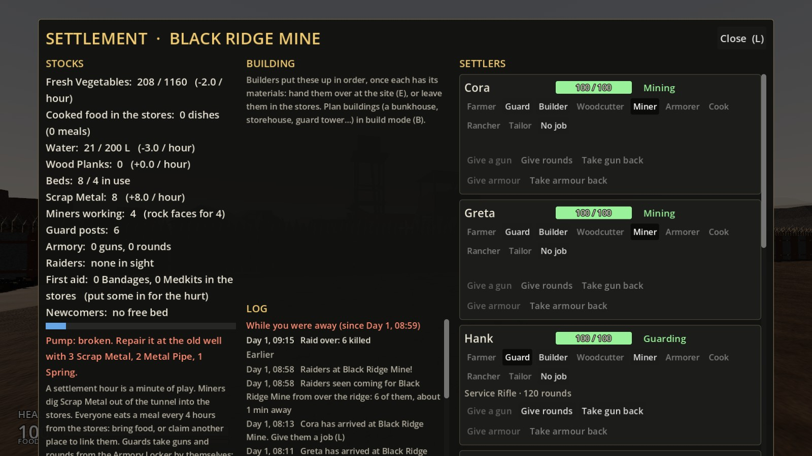

# Increment 28.1: guards hold their towers

**Status:** complete. TESTCOUNT automated tests pass in headless Godot 4.7, 6 of them new in `tests/test_tower_guards.gd`.

From your playtest at the mine: six raiders against three guards up the watchtowers. The guards left their towers, glitched through the fence and were killed by the raiders. You asked for:
- **Guards in towers to stay there** and shoot at the raiders from up there.
- **A slightly faster fire rate.**
- **The same at all the bases.**
- **Towers to give an advantage:** better sight, and seeing anyone along the wall the tower stands against.

## What went wrong

**Why they came down.** Increment 20.5 added a rule for raids: a guard who can't see any raider runs to the nearest one, so raiders can't empty the stores out of the guards' sight. That rule didn't know about towers or walls. A tower guard who lost sight of the raiders, behind the palisade or the headframe, climbed down and ran out to them.

**Why they went through the fence.** The gate stays shut while raiders are near it, so the guard got stuck against it. Settlers have an "unstuck" move from 20.1: after a few tries, they're moved up to 3 m along their path. It didn't check for walls, so it put the guard through the shut gate.

A headless run of your raid (six raiders, three rifle guards up the mine's watchtowers) reproduced it. The guards came down after about 50 seconds, went outside, and two went down.

## What guards do now

**Up a tower:**
- **They stay up it for the whole raid.** Nothing sends them down, not even raiders they can't see.
- **They see further:** 60 m, against 40 m on the ground.
- **They see along their wall:** anyone along the wall the tower stands against, right down to its foot, as they lean over the top. Their shots go over that wall too, not into it.
- **They aim steadier:** their spread is three quarters of the ground's.
- **Towers go to guards with guns first.** A guard with only a machete is never put up a tower; they take a post on the ground, or patrol.

**On the ground:**
- **They stay on their side of the walls.** They still go after raiders who get inside, which is what the 20.5 rule was for. They don't go after raiders who are outside, beyond a fence, palisade or gate. At Northwatch, whose own walls are part of the level, "outside" means the way there runs through one of its gates.
- **They shoot at what they can see** through or over a fence. Their shots never damage their own place's buildings (before, a shot into the fence chipped it).

**Everyone:** the unstuck move never puts anyone through a fence, palisade or gate.

**Fire rate:** guards shoot a quarter faster.

| Gun | Before | Now |
|---|---|---|
| Service Rifle, Sidearm Pistol | a shot every 0.45 s | every 0.36 s |
| Pump Shotgun | 0.86 s | 0.69 s |
| Pipe Pistol | 1.0 s | 0.8 s |
| Marksman Rifle | 1.25 s | 1.0 s |

## Your raid, again

The same raid at the mine (six raiders, three rifle guards up the watchtowers), from each of its three raid points:

| From | Guards off their tower | Outside the walls | Raiders killed | Guards down | Rounds | Over in |
|---|---|---|---|---|---|---|
| The road | never | never | 6 of 6 | none | 22 | 17 s |
| The south | never | never | 6 of 6 | none | 25 | 19 s |
| Over the ridge | never | never | 6 of 6 | none | 23 | 21 s |

In a real window, the same raid up the road: the three guards were up their towers before it came and still up them after, all at full health, and all six raiders were killed. Nobody came down.

| From the gate tower's deck: the six raiders coming up the road | After: the raiders fallen at the gate, the other gate tower's guard still up it |
|---|---|
|  |  |

| The gate from the road afterwards, a guard up the tower behind it | The mine's log: "Raid over: 6 killed" |
|---|---|
|  |  |

## Raids while you're away

Raids settled on paper (20.5) now know about walls and towers:
- **The gate first.** If the way in runs through a shut gate, the raiders hack at it together (its health, e.g. 1,400 for a palisade gate) before they can reach anyone. If they break it, it's broken in your game too and goes on the building list.
- **The towers shoot them the whole way in**, at the gate too, with their steadier aim. Guards on the ground see raiders at a plain gate through its gaps, but not behind a palisade.
- **Tower guards are reached last.** Raiders go for guards on the ground first, and climbing a tower's stair takes them 4 s under fire.
- **The guards' fire rate** is the same faster one.

**Checked against real raids.** Twelve real headless raids at all three places, each compared with 200 paper raids with the same guards. Each of the three raid points was tried:

| Place | Guards | Raiders | Real (each raid) | Paper (average) |
|---|---|---|---|---|
| Black Ridge Mine | 3 rifles up towers | 6 | all killed, none down; 22, 25, 23 rounds | all killed, none down; 21 rounds |
| Black Ridge Mine | 1 rifle up a tower, 1 machete | 5 | all killed, none down; 18, 25, 20 rounds | all killed, none down; 18 rounds |
| Northwatch Outpost | 2 rifles up towers | 4 | all killed, none down; 18, 19, 19 rounds | all killed, none down; 15 rounds |
| Ash Creek Farms (gates, no towers yet) | 2 rifles on the ground | 5 | all killed, none down; 28, 85, 34 rounds | all killed, none down; 23 rounds |

The real guards killed every raider before any got to a gate, so the gate-breaking part is checked by its own tests. In one Ash Creek raid the guards fired 85 rounds at raiders behind buildings and fences. That cost rounds, not the fight.

## Choices made

- **A tower guard never comes down,** even if raiders get in. Guards on the ground and at posts deal with those. A tower guard who runs out of rounds stays up until the next time guards are given their places; then the tower goes to a guard who still has rounds.
- **The 60 m and the steadier aim** are for towers (watchtowers and guard towers), not the sandbagged posts on the ground.
- **No other changes to raiders.** They still fight with blades, so a walled place with armed guards up towers now holds off a raid of six easily. If that turns out too easy in your game, bigger raids or raiders with guns are on the roadmap's open questions.

## How it's built

- **`Settler`:**
  - `holds_tower()` (given a raised spot), `up_tower()` (on its deck), `sight_range()`, and `sees()` (plain sight, or along the tower's wall via `_on_my_wall()` and `_clear_but_walls()`).
  - `across_walls()` and `wall_between()`, with `WALL_IDS`: fence, palisade, reinforced palisade and both gates.
  - `shot_interval()` (with `FIRE_RATE` 1.25), `TOWER_SPREAD` 0.75, and `tower_range` 60.
  - `_patrol()` hands out spots to guards with guns first.
  - In `_move_to()`, the unstuck move checks for walls.
- **`Settlement`:** `tower_guards()` and `_paper_gate()`.
- **`RaidOnPaper`:** the `BREACH` and `CLIMB` phases, `breach_health`, `gate_seen_from_ground`, `Fighter.raised`, and `shot_odds(w, raised)`.

## Tests (`tests/test_tower_guards.gd`)

1. **Faster, and steadier from towers:** a rifle every 0.36 s, the shotgun a quarter faster; better odds from a tower on paper; paper fires at the new rate.
2. **Your raid:** three rifle guards up the mine's watchtowers against six raiders up the road. Nobody comes down or goes outside; the raiders are killed; nobody goes down.
3. **Further and along the wall:**
   - 60 m up a tower.
   - Every raider along the gate tower's wall is seen.
   - A sight line to the very foot of the wall runs into its top, but from the tower it's seen past it.
   - A raider about 48 m off along the wall is picked out.
   - Shots hit a raider at the wall's foot and never the palisade.
   - On the ground the wall hides them.
4. **Ground guards stay inside:** a guard with no gun isn't sent up a tower. With raiders outside the palisade, they stay inside for 20 s; one raider let in, and they go for it.
5. **Nobody's moved through a wall:** a settler pressed against a shut gate, told to go just outside it, stays inside.
6. **Paper raids:**
   - One rifle up a tower behind a palisade gate against six: fewer guards down than on open ground, and as many raiders killed.
   - At the mine: the armed guard is the one counted up a tower; raiders up the road would have to break the palisade gate; broken on paper, it's broken in the game and back on the building list.
