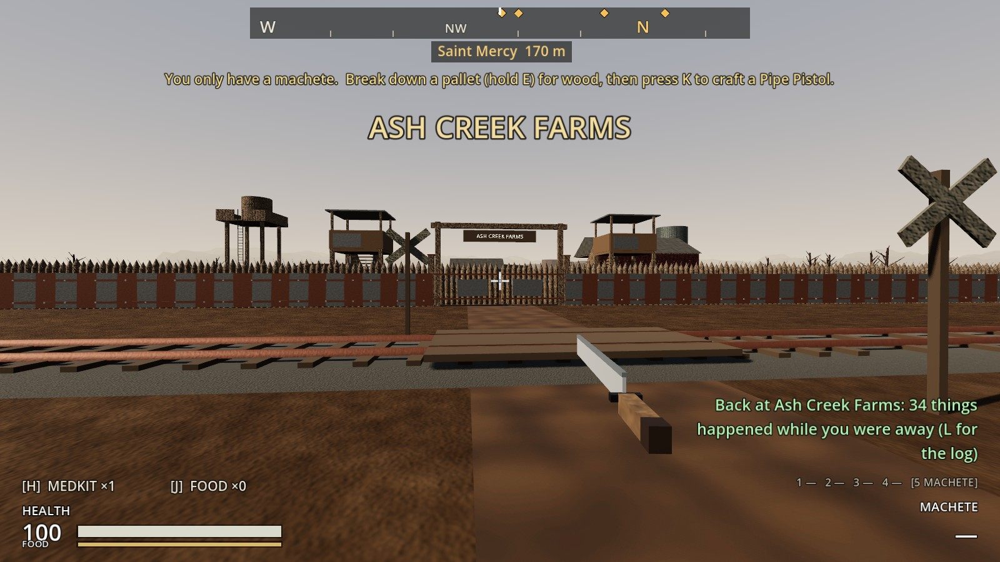
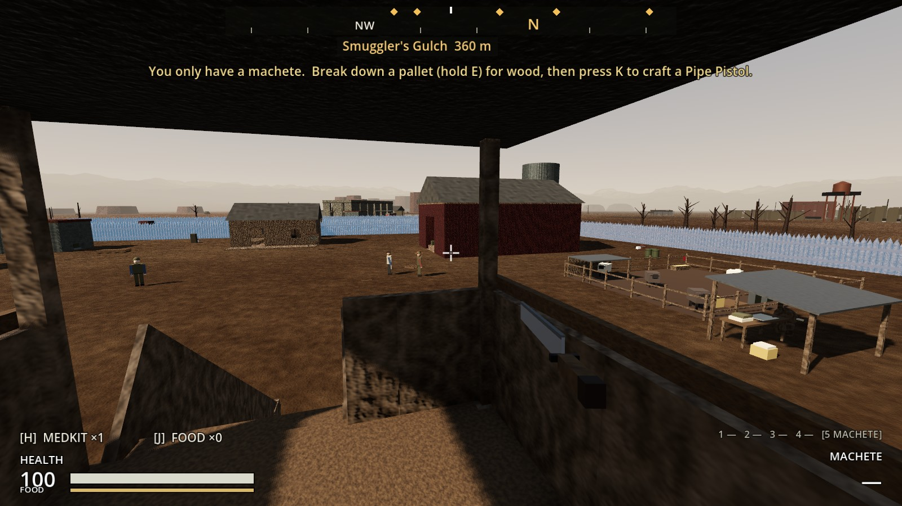
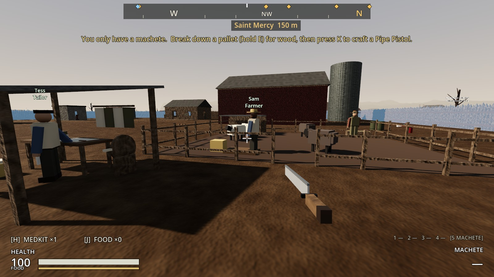
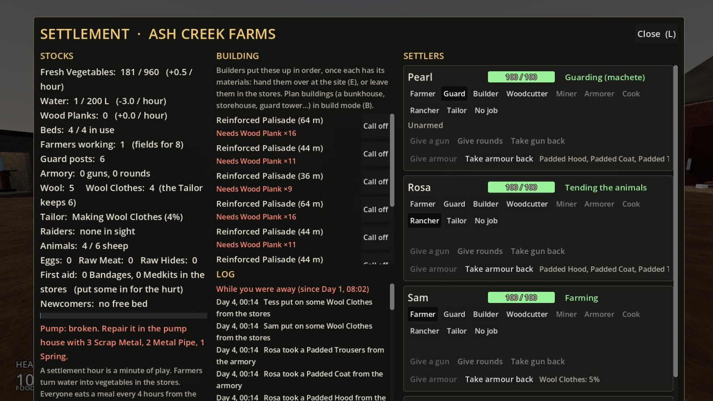
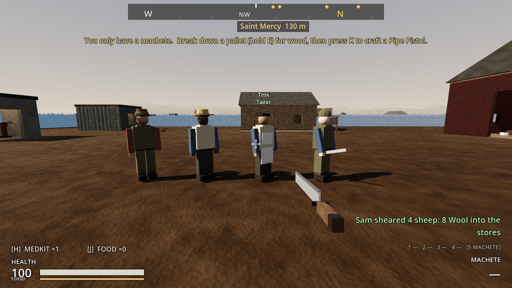
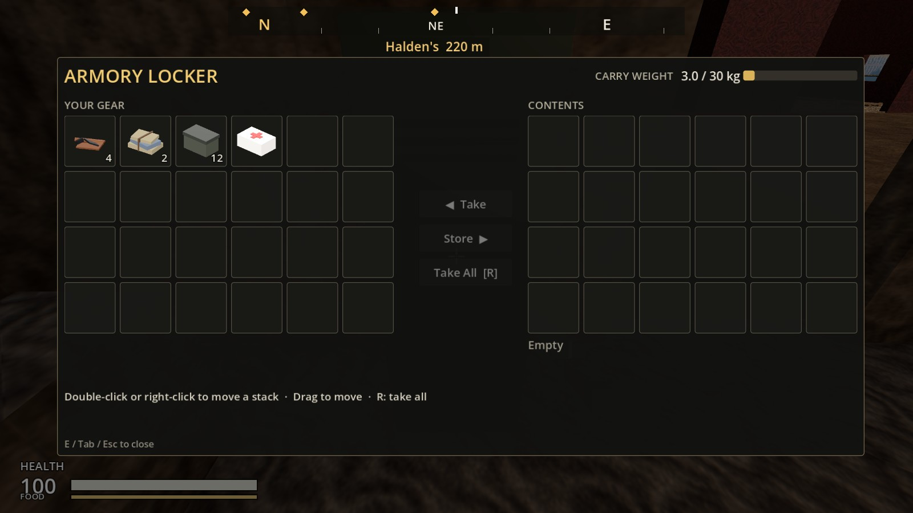

# Increment 28: sheep and wool, the Tailor, everyone dressed, Ash Creek's palisade

**Status:** complete. 532 automated tests pass in headless Godot 4.7, 5 of them new in `tests/test_sheep_and_tailor.gd`.

You asked for:
- **Ash Creek's fence** to get the same upgrades as the mine once everything there is built, to give it more of a settlement feel.
- **Sheep,** sheared by the Farmer for Wool into the stores.
- **A Tailor** who turns wool into clothes, then makes armour from clothes, leather and scrap metal that settlers can wear, with at least 6 clothes always in the stores first.

Your answers:
- **The upgrades:** the yard's and the fields' fences.
- **The 6 clothes:** stock 6, then armour.
- **Clothes:** worn, with light protection.
- **Armour:** guards first, then everyone.

## Ash Creek's palisade

Ash Creek's defences now come in four stages. Each stage starts only once **everything planned before it is built**, including its fences and guard posts, not just its defences.

| Stage | What | Materials |
|---|---|---|
| 1 | Gates in the three gaps (27) | 24 planks, 12 scrap |
| 2 | Two watchtowers by the front gate (27.1) | 40 planks, 16 scrap, 4 pipe |
| 3 | **The yard's and the fields' fences become a palisade** (132 lengths, 528 m), and **the three gates palisade gates** | 294 planks, 150 scrap |
| 4 | **The palisade reinforced**, length by length | 132 planks, 396 scrap |

- **Built in place:** each palisade length takes the place of the fence length where it stands, so the farm is never left open.
- **Raiders:** once the palisade is up, the only way into the yard from outside is through a gate.
- **The far corners:** a place's buildings now count as its own a little past its claim radius (12 m). Before, the far corners of Ash Creek's fields were 80 m out, past its 75 m, so Builders didn't mend or rebuild the fence lengths there.

| Ash Creek's front gate, palisade all round, watchtowers either side | The yard from a watchtower (the pale outlines are the reinforcing still to come) |
|---|---|
|  |  |

## Sheep

**The Sheep Pen:** plan it in build mode (B) for 18 planks and 4 scrap, 3 hours of work. It holds 6 sheep, with a lean-to and a shearing stand by the gate, and a pair arrives once it's built.

- **The Rancher** feeds them, as with the other animals: a vegetable each every 8 hours. Fed, a pair has a lamb every 24 hours.
- **A fed sheep grows a fleece** over 24 hours.
- **The Farmer shears it:**
  - The first working Farmer at the place goes to the shearing stand. Their status reads "Shearing the sheep".
  - The fleeces come off within the hour: **2 Wool each**, into the stores, with a notice.
  - Then they go back to the fields.
- **No Farmer:** the fleece stays on, one per sheep at most.
- **Butchered,** a sheep gives 3 meat and its fleece (2 Wool).

## The Tailor

**The Tailor's Table:** plan it in build mode for 12 planks, 4 scrap and 4 cloth, 3 hours of work. It has a work table with cloth and shears, a spinning wheel and a rack of hanging clothes. A **Tailor** works there; the job is greyed until there's a table.

**What the Tailor makes, in order:**
1. **Wool Clothes, until the stores hold 6.** Each takes 3 Wool and an hour.
2. **Then padded armour,** only from clothes beyond those 6. If a piece needs clothes they don't have, they make more clothes first. Each piece takes 3 hours and goes into the Armory Locker, the piece there's fewest of first, up to 2 of each.
3. **If the clothes in the stores drop below 6** (settlers put them on), they go back to making clothes.

| Piece | Slot | Takes off hits | Made from |
|---|---|---|---|
| Wool Clothes | Body | 5% | 3 Wool |
| Padded Hood | Head | 9% | 1 Wool Clothes, 1 Leather, 1 Scrap Metal |
| Padded Coat | Body | 20% (2% slower) | 2 Wool Clothes, 2 Leather, 3 Scrap Metal |
| Padded Trousers | Legs | 11% | 1 Wool Clothes, 1 Leather, 2 Scrap Metal |

The padded pieces sit between leather and plate: the coat's 20% is between the Leather Jacket's 14% and the Plated Vest's 26%. You can make all four at a workbench yourself, and wear them.

**The settlement screen** shows Wool and Wool Clothes ("the Tailor keeps 6") and what the Tailor is doing, e.g. "Making Wool Clothes (40%)" or "6 Wool Clothes in the stores; needs Leather and Scrap Metal for padded armour".

| Shearing at the Sheep Pen; the Tailor at the table | The settlement screen |
|---|---|
|  |  |

## Everyone dressed

- **Clothes:** anyone with nothing on their back puts on Wool Clothes from the stores.
- **Armour, guards first:**
  - Guards take the best piece in any of your Armory Lockers for each slot, and now **swap up**. For example, a guard in Wool Clothes changes into a Padded Coat once there's one, and a worn-out piece counts as nothing.
  - Everyone else takes armour only for a slot that no guard in any of your places is short of. Until then they wear clothes.
- **What comes off:** clothes go back on the shelves; armour goes back to the armory.
- **Raids:** armour counts for everyone in a raid, including one settled on paper, for settlers sheltering as well as guards, and wears down the same way.
- **Looks:** Wool Clothes show cream, padded pieces a quilted olive.

| The guard and the Rancher in padded armour; the Farmer and the Tailor in Wool Clothes | Padded armour in the Armory Locker |
|---|---|
|  |  |

## The real-window run

**Ash Creek:**
- Claimed, its four stages built in turn (the reinforcing begun).
- A Sheep Pen and a Tailor's Table planned and built.
- A Rancher, a Farmer, a Tailor and a Guard put to work.

**The Tailor:**
- Kept 6 Wool Clothes in the stores, then made a Padded Hood, Coat and Trousers.
- The guard took them first, then the Rancher.
- The Farmer and the Tailor put on Wool Clothes.

**The Farmer:** with the flock's fleeces grown, walked to the shearing stand. "Sam sheared 4 sheep: 8 Wool into the stores".

## Choices made

- **Shearing is the Farmer's,** as you said. Feeding the sheep (and so their fleece growing) is the Rancher's, as with the other animals.
- **Padded armour** is a new set between leather and plate, made from clothes, leather and scrap, as you described. It goes to the Armory Locker like guns, where guards and then others take it.
- **Building comes first.** Reinforcing Ash Creek takes 396 scrap, and building sites take materials as soon as the stores have them. While it's going on, the Tailor and the Armorer can be short of scrap. This is on the roadmap's open questions: should you set what comes first?

## How it's built

- **Items:** `tools/build_tailoring.gd` makes Wool, Wool Clothes and the padded pieces (items, models, workbench recipes). The icons come from `render_item_icons.gd`.
- **Buildings:** `tools/build_settlement_buildings.gd` adds `_pen(… &"sheep" …)` (with `ShearSpots`) and `_tailors_table()` (`TailorSpots`). Their plans are `sheep_pen` and `tailors_table` in `SettlementPlans`.
- **Sheep:** `FarmAnimal` has `sheep` (a woolly look). In `Settlement.ANIMALS`, `sheep` has `wool_hours` and `wool`.
  - Fleece is kept in a pen's `egg_progress`, so it's saved.
  - `_shearer()`, `pen_to_shear()` and `SHEAR_WAIT_HOURS` (the fleece waits most of an hour, so the Farmer gets there).
  - `Settler._shearing()`.
- **The Tailor:**
  - `Role.TAILOR`, added last so saved jobs keep their numbers.
  - `Settler._sew()`.
  - On `Settlement`: `_simulate_tailoring()`, `_start_tailor_job()`, `tailor_status()`, `tailor_clothes_keep` (6) and `tailor_per_piece` (2). The job in hand is saved.
- **Dressing:** `Settlement._supply_guards()` now runs `_supply_armed()` (guns, rounds and guards' armour), then `_dress_everyone()`, with `_dress()` for swapping up.
- **Ash Creek:**
  - `build_sites.gd` adds stage 3 and 4 markers for its `FENCES` and `GATES`. Its watchtowers moved 0.2 m in, to clear a reinforced wall.
  - `Settlement._advance_defences()` waits for everything planned up to the current stage.
  - `SettlementBuilding.BEYOND_RADIUS` is the 12 m margin.

## Tests (`tests/test_sheep_and_tailor.gd`)

1. **Wool, clothes and padded armour:**
   - The items, their slots and protection.
   - The workbench recipes from clothes, leather and scrap.
   - The Sheep Pen (6, a shearing stand) and the Tailor's Table to plan.
   - `Role.TAILOR` added last.
2. **Sheep grow wool and Farmers shear it:**
   - A pair arrives.
   - Fleeces grow but wait without a Farmer, one a sheep at most.
   - A Farmer goes to the shearing stand, says so, and shears 2 Wool a fleece into the stores, with a notice.
   - Then back to the fields.
   - Butchering gives meat and wool.
3. **The Tailor keeps six clothes, then makes armour:**
   - No Tailor without the table; "needs Wool" without wool.
   - Six clothes, then stop.
   - With leather and scrap, the coat first, then each piece into the Armory Locker.
   - Never fewer than six clothes left; the wool used up.
4. **Everyone dressed, guards first:**
   - The guard takes the coat and a hood; the other hood goes to someone else; the others put on clothes.
   - A plated vest goes to the guard, and the coat on to someone in clothes, whose clothes go back on the shelf.
   - A new guard in clothes gets the next coat before the others.
   - Clothes soften a blow.
5. **Ash Creek's palisade after everything:**
   - Every run is clear of anything solid.
   - The second stage waits for the fences.
   - Then watchtowers, then the palisade replacing all 132 fence lengths and the gates.
   - From each raid point, the only way into the yard is through a gate.
   - Then all 132 reinforced.

**Changed tests:**
- `test_palisade_and_towers.gd`: Ash Creek's towers wait for everything.
- `test_settlement_building.gd`: twelve things to plan.
- `test_kitchen_and_animals.gd`: the Rancher's message names the Sheep Pen.
- `test_mid_zone.gd`: it waits for the zone's navmesh to be taken in. It failed when run after other suites.
