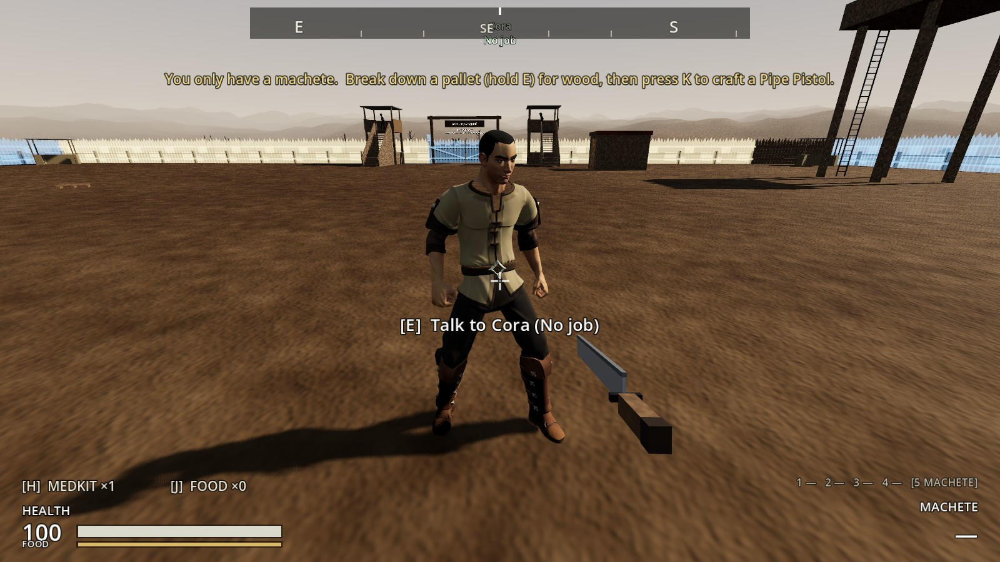
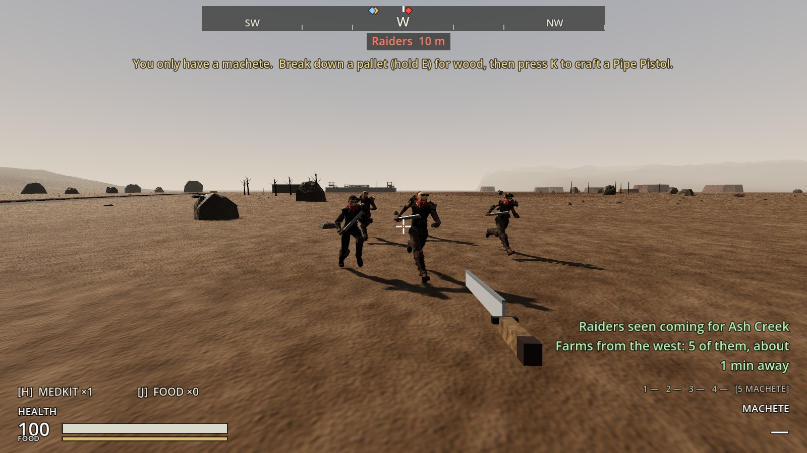
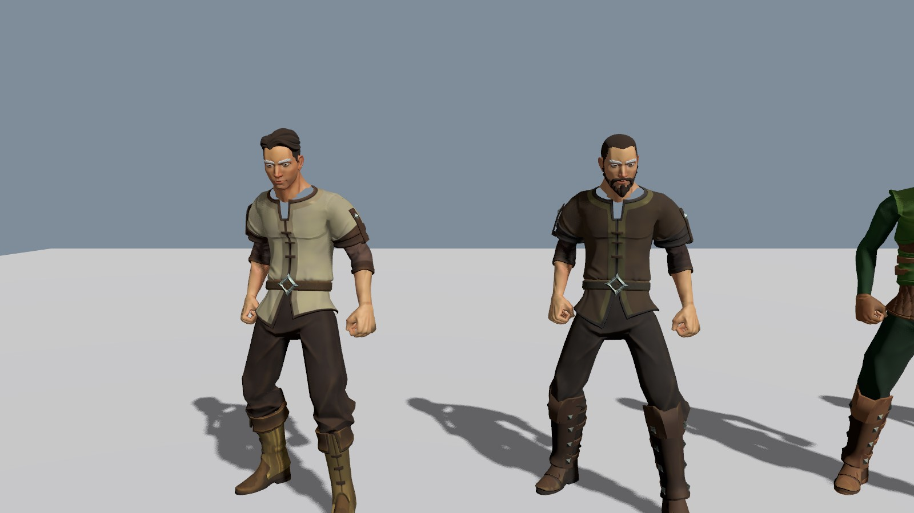
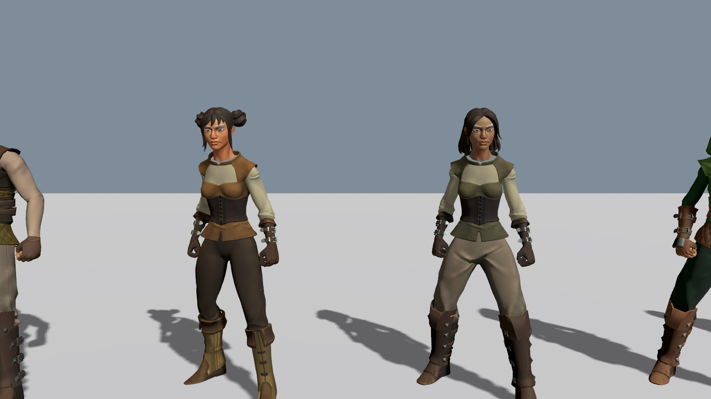
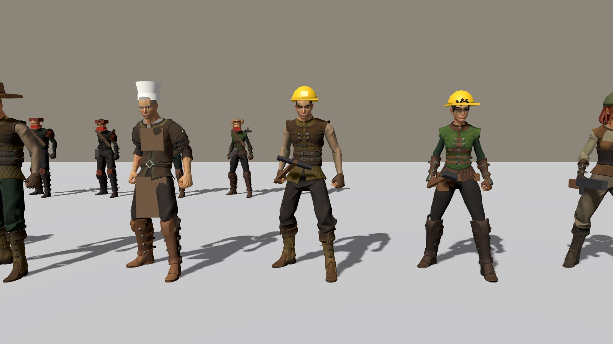
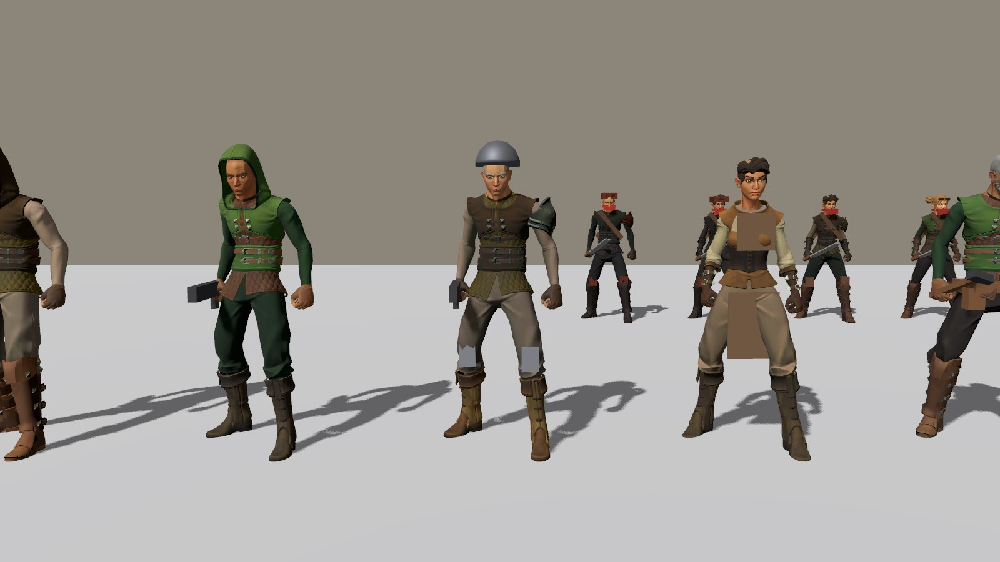
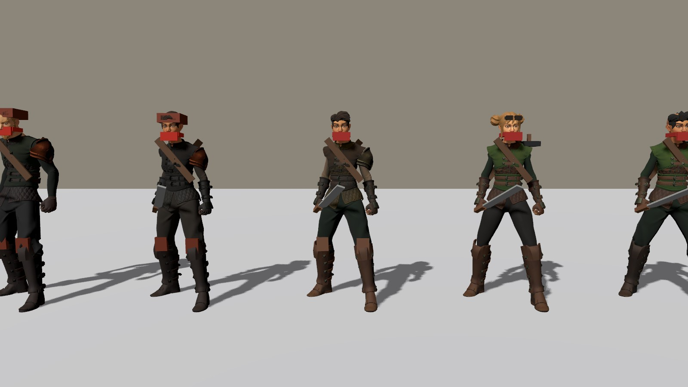
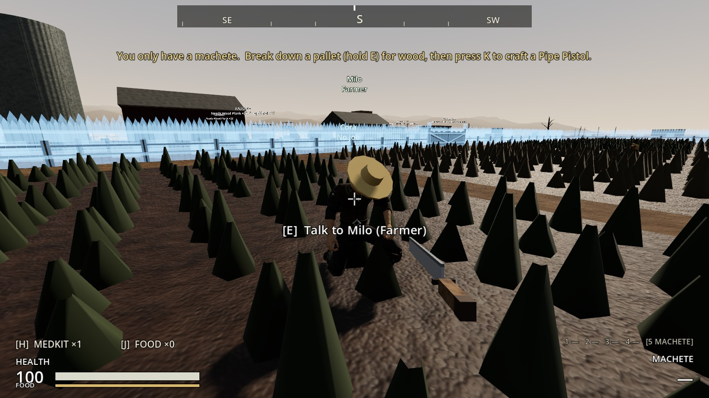
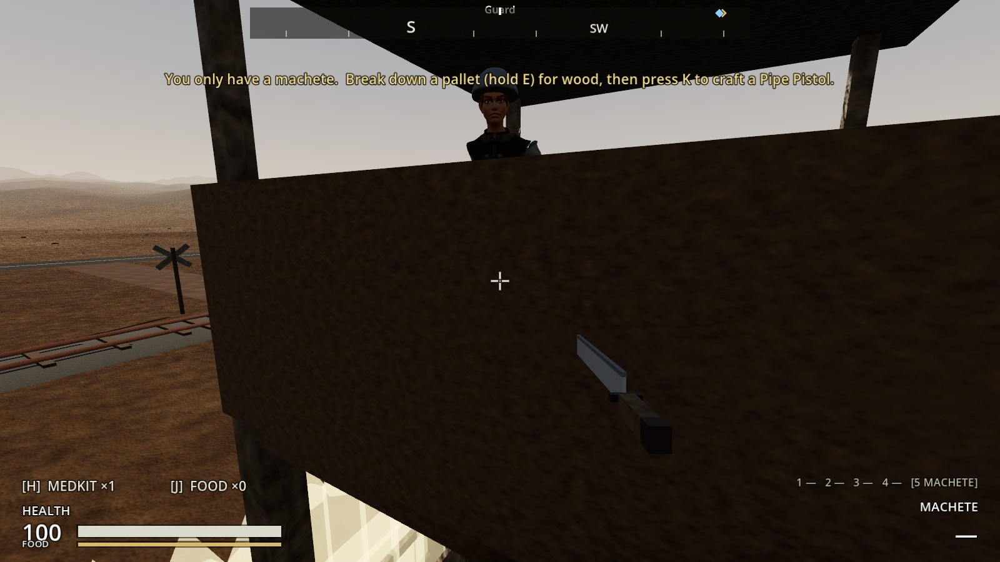

# Increment 29.1: real clothes

**Status:** complete. 548 automated tests pass in headless Godot 4.7, 4 of them new in `tests/test_outfits.gd`.

Increment 29 painted clothes onto the bodies, so everyone looked skin-tight. You downloaded Quaternius's free **Modular Character Outfits – Fantasy** (Standard), and it's now in the game. It's **CC0** like the other two packs, so it's free to use in a game you sell. The zip is in **Ashfall Assets → Characters - Quaternius** on your Desktop.

The free version has two outfits, the **Peasant** and the **Ranger**, for a man and a woman. Each comes in parts: shirt, sleeves, trousers and boots, plus the Ranger's **hood** and **pauldrons** (shoulder armour). Each outfit has two colourways.

| A settler at Ash Creek | A raid coming in |
|---|---|
|  |  |

## The people

**Each person wears their own clothes,** picked from their name with the rest of their looks and kept in saves:
- **A shirt with its sleeves:** most settlers wear the Peasant's (cream or dark brown), and some wear the Ranger's (green or brown leather).
- **Trousers and boots:** from either outfit, so they're mixed.
- **A tint:** a little washed out or faded, different for each person.

That's 4 shirts × 4 trousers × 4 boots before the tint, on two bodies, six skin tones and seven hairstyles.

Under the clothes, only the base body's **head** is drawn, as Quaternius's readme advises: no skin pokes through, and it's lighter to draw. The Ranger's bare forearms and hands are drawn in the person's own skin tone.

**Eyebrows** now take the hair colour. In 29 they were grey-white.

Lined up (both outfits in both colourways):

| Men | Women |
|---|---|
|  |  |

## Armour is drawn as clothes

What a settler wears over their clothes (22, 28) swaps in an outfit piece:

| Worn | Drawn as |
|---|---|
| Leather Jacket | The Ranger's leather coat and sleeves (brown) |
| Padded Coat | The Ranger's coat in green |
| Wool Clothes | The Peasant's shirt (cream) |
| Plated Vest | The Ranger's coat, greyed, with **pauldrons** |
| Leather or Padded Trousers | The Ranger's trousers (brown or green) |
| Plated Trousers | The Ranger's trousers, greyed, with knee plates |
| Leather Cap or Padded Hood | The Ranger's **hood** (brown or green), the hair under it (a beard still shows) |
| Scrap Helmet | A helmet, as before |

**Guards wear pauldrons** when they have no coat on. The old box vest is gone, and so are the box chest and back plates (pauldrons show plate instead). The other job gear stays: hats, hard hats, the miner's lamp, goggles, tool belts, the chef's hat. The cook's and tailor's apron is now leather and sits closer.

| The Cook, a Miner and a Builder | A guard in padded, one in plate, the Tailor in Wool Clothes |
|---|---|
|  |  |

## Raiders

Marauders, a Veteran and two Raiders, lined up.

- **Raiders** wear darker, worn clothes, mostly the Ranger's, with a red bandana, goggles, a strap and a tyre pad, as before.
- **Veterans** wear worn **pauldrons** instead of the box chest plate, and keep their knee pads.
- **Scorch Marauders** are soot-black, with **rust-red pauldrons**, knee pads and a scrap helmet.

## What didn't change

- **How they play:** collision, head-shot zones, pathing, speeds, attack timing, armour protection and the tower guards are all as before.
- **Saves:** every save still loads. Settlers keep their faces, and get clothes picked from the same seed.

## The real-window run

At Ash Creek, claimed and its first defence stages built:
- **Seven newcomers:** two farmers, a woodcutter, a builder, one with no job, and two guards with rifles, one in padded hood, coat and trousers and one in a plated vest and scrap helmet. They walked in and went to work in their own clothes.
- **A raid of five** came running up the lane from the west, Raiders and a Veteran in their darker clothes. (The fight itself is as in 28.1 and 29; this run was about how they look.)

| A farmer at work | The guard in plate |
|---|---|
|  |  |

## How it's built

- **The pack:** `assets/characters/quaternius/outfits/` holds the 20 parts (`.gltf`), with textures scaled from 4096 to 1024 px (normal and roughness maps to 1024 and 512) and the licence. It's about 11 MB, in plain git like the rest of the characters.
- **Importing:** `tools/build_character_import.gd` patches the outfits' imports like the bodies', with the same BoneMap onto Godot's humanoid profile. The outfits' skeleton matches the bodies' to within 2.5 cm (at a man's shoulders and hips), so the pieces are skinned straight onto each person's skeleton.
- **The head:** `tools/build_characters.gd` also writes `male_head.res` and `female_head.res`, just the triangles moved by the head and neck.
- **`shaders/outfit.gdshader`:** draws a piece with its colourway, normal and occlusion-roughness-metal maps, a per-person `tint` (instance uniform) and a little dirt low down. `shaders/human_body.gdshader` gained `bare` for all-skin parts.
- **`HumanBody`:**
  - `top`, `bottoms`, `footwear` and their `_way` colourways, picked in `pick_looks()`;
  - `outfit_style` ("settler" or "raider") and `cloth_tint`;
  - `pauldrons` and `pauldron_tint` (raiders);
  - `wear(region, kind)` for what's worn over the clothes, `worn()`, `outfit_of(piece)`, `piece_meshes(piece)`.
  - A piece is only rebuilt when it changes.
- **Settlers:** `Settler._update_visuals()` calls `body.wear()` for the coat, trousers and cap, and for a guard's pauldrons. `tools/build_settler.gd` no longer builds the vest or the chest plates, and the apron is leather.
- **Raiders:** `tools/build_raider_bodies.gd` and `tools/build_marauder.gd` set the raider style and tints. The Veteran's chest plate and the Marauder's shoulder plates became pauldrons.

**Rebuilding:** `build_character_import.gd`, then `--import`, then `build_characters.gd`, `build_settler.gd`, `build_raider_bodies.gd`, `build_marauder.gd`.

## Tests (`tests/test_outfits.gd`)

1. **The pack:** CC0; every piece of both outfits for a man and a woman; textures 1024 px at most.
2. **Pieces drawn right:**
   - a Ranger's shirt, Peasant trousers and Ranger boots, in the right colourway;
   - cloth in the outfit shader, bare hands in the person's skin tone;
   - skinned to the body, crouching with it.
3. **Wearing swaps pieces:**
   - nothing changed means nothing rebuilt;
   - leather is the Ranger's, wool the Peasant's, plate adds pauldrons;
   - a cap is the hood, with the hair under it;
   - taken off, their own clothes and hair come back;
   - what's worn stays on through a rebuild.
4. **Who wears what:** settlers mostly in the Peasant's shirt and not darkened; raiders darker; Marauders darkest, with rust-red pauldrons.

**Changed tests:**
- `test_characters.gd`: head-only body, dressed pieces, clothes from the seed and kept in saves, guards' pauldrons, armour as pieces, raiders' pauldrons.
- `test_armour.gd`: a vest shows as the greyed coat with pauldrons.

## Notes

- **Performance:** a person is now the head plus 4–7 pieces, about 9,000 vertices in Peasant clothes and up to about 19,000 in the Ranger's (its boots are detailed). It's a few more draw calls each than in 29, with distance LODs on every piece. If a busy place drops frames on your Mac, press F3 and tell me the numbers.
- **It's fantasy clothing:** tunics, a corset, laced boots. It reads well enough as homemade wasteland gear, but there are no jackets, jeans or gas masks. The paid Source version adds the pack's other ten outfits (a knight, a noble, a wizard…), which are more fantasy still. A post-apocalyptic outfit pack would suit the game better if one turns up.
