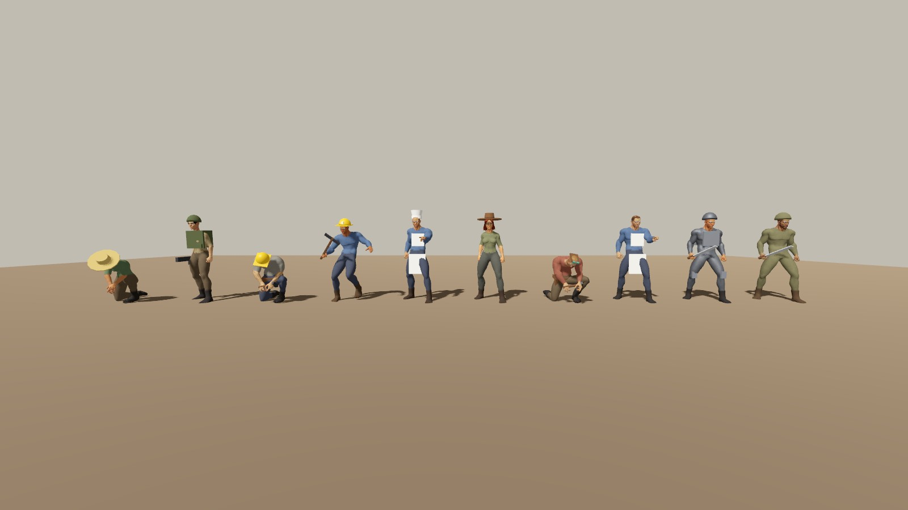
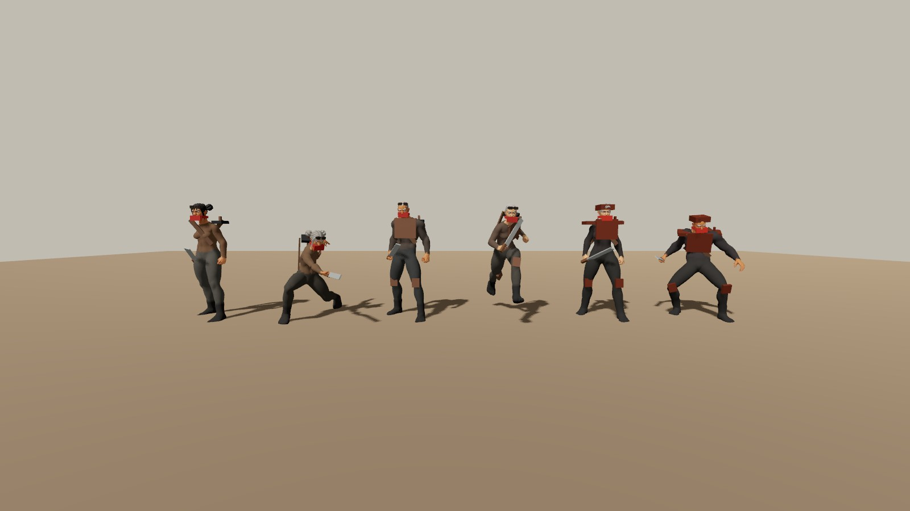
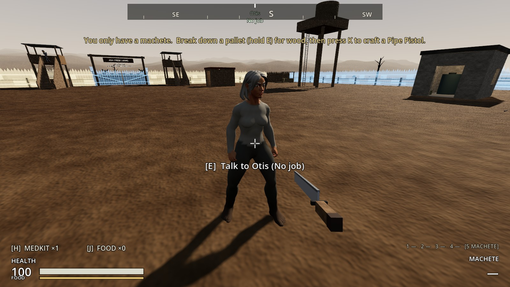
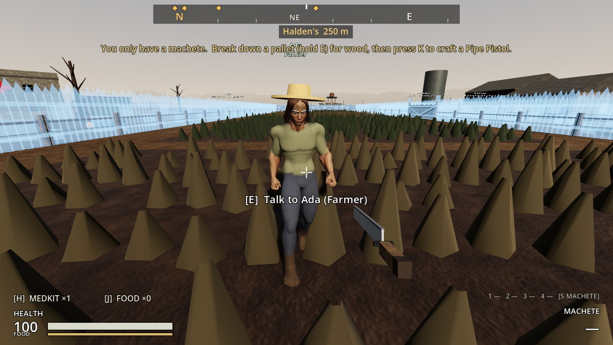
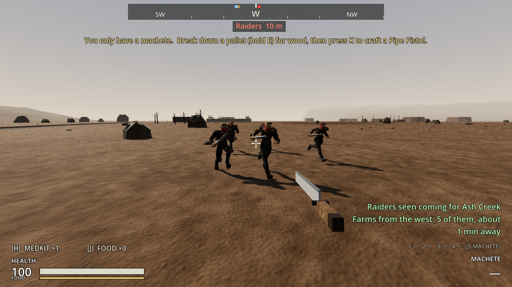
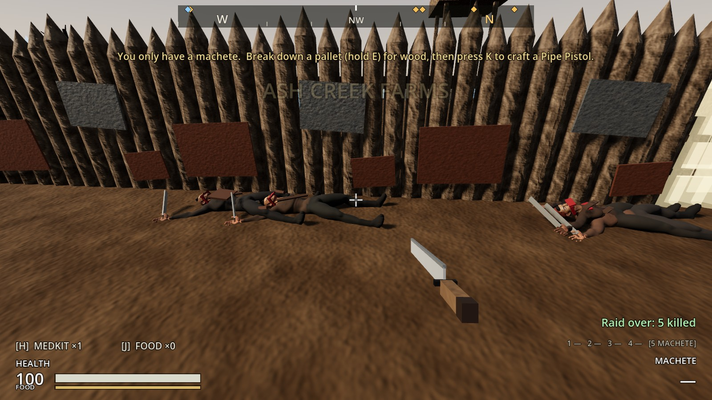
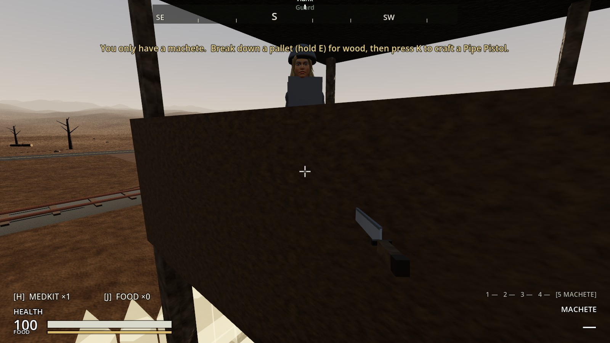

# Increment 29: real characters

**Status:** complete. 543 automated tests pass in headless Godot 4.7, 5 of them new in `tests/test_characters.gd`.

You picked characters as the first art upgrade, and downloaded two free packs by Quaternius into the **Ashfall Assets** folder on your Desktop:
- **Universal Animation Library** (Standard): 46 animations on one skeleton.
- **Universal Base Characters** (Standard): a man and a woman, light and dark skin, seven hairstyles.

Both are **CC0** (public domain): free to use in a game you sell, no credit needed (they're thanked in the licence files in the repo anyway).

Settlers and raiders were people built from boxes. Now they're real animated bodies.

| Every job: farmer, guard, builder, miner, cook, rancher, armorer, tailor, a guard in plate, a guard in padded armour | Raiders, Veterans and Scorch Marauders |
|---|---|
|  |  |

## The people

**Each settler is their own person,** picked from their name (and saved, so they look the same after a load):
- a man or a woman;
- one of six skin tones;
- a hairstyle (short, buzzed, long, buns, parted, or a beard) and a hair colour;
- their own shirt, trousers and boots, the sleeves long or rolled up.

**The clothes** are painted onto the body by region (shirt, trousers, boots), with a little weave and dirt, the skin showing at the face, neck and hands. The free bodies come in plain underwear, so this is how they're dressed. They're close-fitting; looser clothes would need modelled clothing, which isn't in the free pack.

**Their gear** sits on their bones and moves with them: the farmer's straw hat, the guard's vest and helmet, hard hats, the miner's lamp, the armorer's goggles, tool belts, the cook's apron and chef's hat, the rancher's hat. In hand: a rifle, a machete, a hammer, an axe or a pickaxe.

**Armour** (22, 28) is drawn over the clothes: a leather coat browns the shirt, a plated vest greys it and adds plates front and back, Wool Clothes are cream, padded pieces olive. Helmets and knee plates show too.

| A settler up close | A farmer in the field |
|---|---|
|  |  |

## What they do

| Doing | Animation |
|---|---|
| Walking, running | Walk, Jog (speed matched to how fast they move) |
| Standing | Idle |
| Farming, building, the Armorer at the bench, shearing | Kneeling to the work |
| Mining, cutting wood | Swinging the pick or axe |
| Cooking, sewing, ranching | Working with their hands |
| Sheltering in a raid | Crouched |
| A guard fighting | Aiming; each shot a recoil |
| A guard with a machete | On guard; each blow a swing |
| Hit | A flinch |
| Down, wounded, or dead | On the ground |

**The gun points where they're facing,** whatever the hand is doing.

**Raiders** wear dark, worn clothes (each a bit different), a red bandana over the mouth, goggles on the forehead, a leather strap and a tyre pad on the shoulder, a machete in hand. **Veterans** add a rusty chest plate and knee pads. **Scorch Marauders** are soot-black with rust-red plate on the chest and shoulders and a scrap helmet. Raiders walk, run and sprint at you, swing the machete over the attack's windup (so dodging still works the same), flinch when hit, crouch at the stores to loot, and fall when killed.

| A raid coming in | After: the raiders where they fell |
|---|---|
|  |  |

| A guard in plate up a watchtower |
|---|
|  |

## What didn't change

- **How they play:** collision shapes, head-shot zones, pathing, speeds, attack timing, the tower guards (28.1) and raids on paper are all as before.
- **Saves:** every save still loads; settlers keep their look seed, so they keep their face.

## The real-window run

At Ash Creek, claimed and its first two defence stages built:
- **Seven newcomers:** two farmers, a woodcutter, two guards with rifles (one in a plated vest and scrap helmet), a builder and one with no job. They walked in up the lane, each looking different, and went to work: the guards climbed the watchtowers, the farmers went to the fields, the builder to the palisade.
- **A raid of five** up the lane, running and sprinting at the gate. The tower guards killed all five; they fell where they were shot.

## How it's built

- **The packs:** `assets/characters/quaternius/` holds the animation library (`.glb`), the two bodies and the hairstyles (`.gltf`, textures scaled down to 1024 px), and both licences. About 16 MB, kept in plain git: Git LFS can't be uploaded to from Claude's workspace (`.gitattributes` says so).
- **Retargeting** (`tools/build_character_import.gd`): the animations' skeleton names its bones the Rigify way ("DEF-spine.001") and the bodies the Unreal way ("spine_01"). Each file is imported through a BoneMap onto Godot's humanoid profile, with the rest pose fixed, so any animation plays on any body.
- **Dressing** (`tools/build_characters.gd`): each body's mesh is baked again with its regions in the vertex colour, from which bone moves each vertex most and how high it is. `shaders/human_body.gdshader` colours each region per person (instance uniforms, so everyone shares one material).
- **`HumanBody`** (`scripts/npcs/human_body.gd`): picks a person from a seed, builds the body, hair and animation player, hangs gear on bones (laid out on the standing pose, so the bones' own axes don't matter), and plays animations with blends.
- **Settlers:** `tools/build_settler.gd` lays out the gear; `Settler._apply_look()`, `part()`, `_update_visuals()`, `_animate()`, `_act_once()` and `_update_gun()`.
- **Raiders:** `tools/build_raider_bodies.gd` (Raider and Veteran) and `tools/build_marauder.gd`; `Raider._animate()` and `_play_windup()`.

**Rebuilding:** `build_character_import.gd`, then `--import`, then `build_characters.gd`, `build_settler.gd`, `build_raider_bodies.gd`, `build_marauder.gd`.

## Tests (`tests/test_characters.gd`)

1. **The packs and the bodies:**
   - both licences CC0;
   - every animation used is in the library, walking loops and a death holds;
   - both bodies retargeted onto the humanoid profile;
   - dressed (shirt, trousers and boots marked);
   - the head at the settler's head-collision height.
2. **Looks follow the seed:** the same seed, the same person; forty settlers give men and women, several hairstyles and skin tones; a settler loaded from a save looks the same.
3. **Settlers wear their jobs:**
   - each job's gear and nothing else;
   - the hat on the head bone, going down with the head as they kneel;
   - plated vest and leather trousers recolour the clothes;
   - plates on the chest, no vest under them;
   - the rifle out, the machete away.
4. **Settlers move and work:** Walk, Jog, the Miner's swing, the Builder kneeling, the Cook's hands, Idle; a guard aiming, the recoil of a shot and back, down on the ground, the gun pointing where they face.
5. **Raiders, dressed and animated:**
   - each kind's gear on its bones;
   - Sprint, Walk, the swing, falling dead;
   - six raiders, several different looks.

**Changed tests:** the gear checks in `test_armour.gd`, `test_black_ridge.gd`, `test_northwatch.gd`, `test_settlement_building.gd` and `test_wood.gd` use `Settler.part()`.

## Notes

- **Performance:** each person is about 13,000 triangles with an animated skeleton. A dozen settlers and a raid of eight should be fine on your Mac. If a busy place drops frames, press F3 and tell me the numbers; distant people can be made cheaper.
- **More looks later:** the free bodies have one build (athletic). The paid Source pack has more builds and proper modelled clothing, if you ever want it. More animations (rifle aiming, climbing ladders) would need the second animation library.
