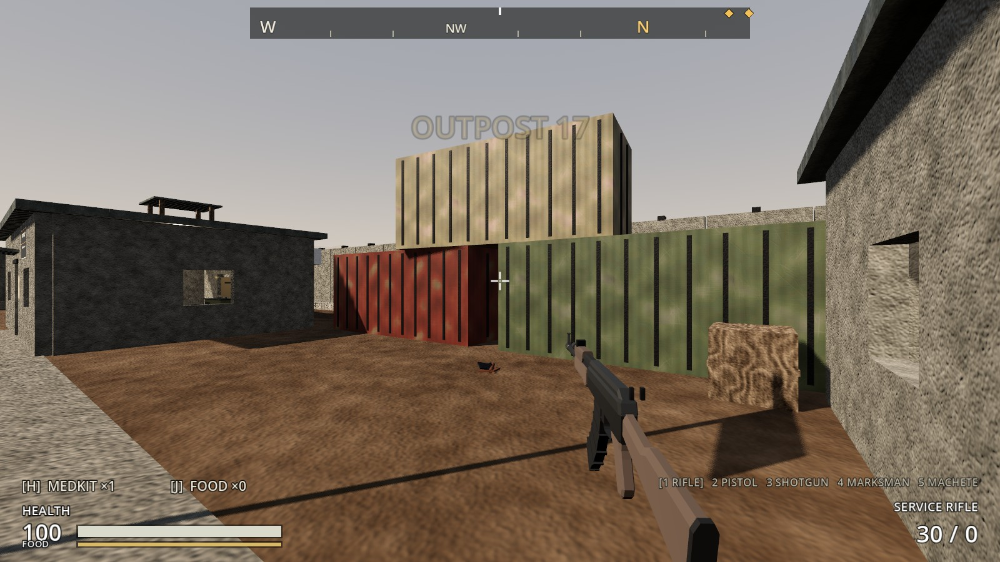
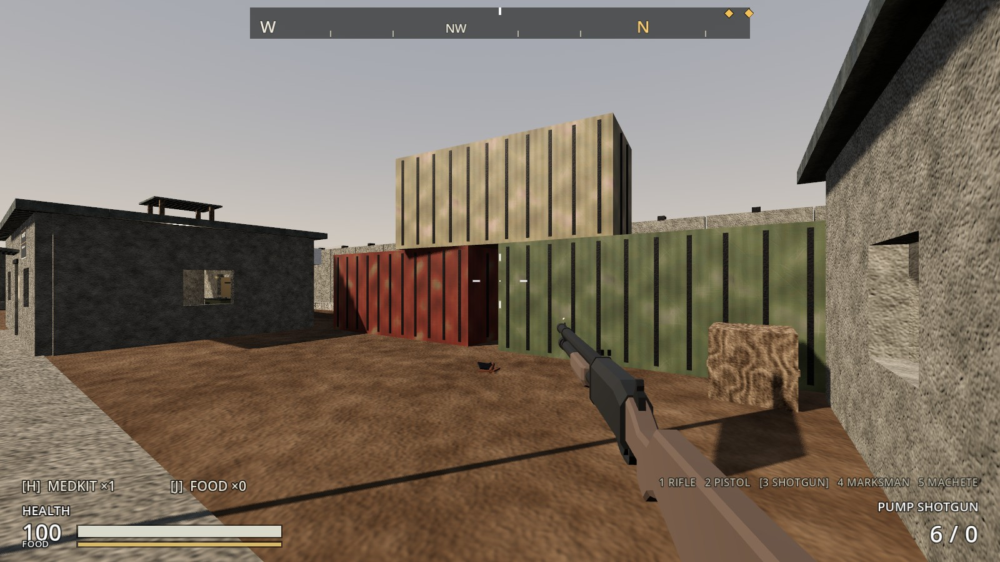
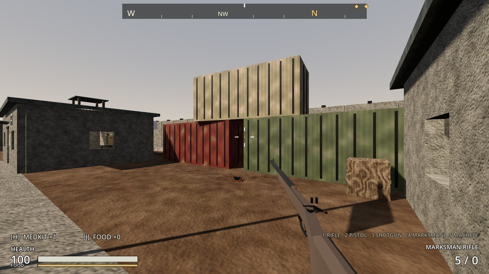
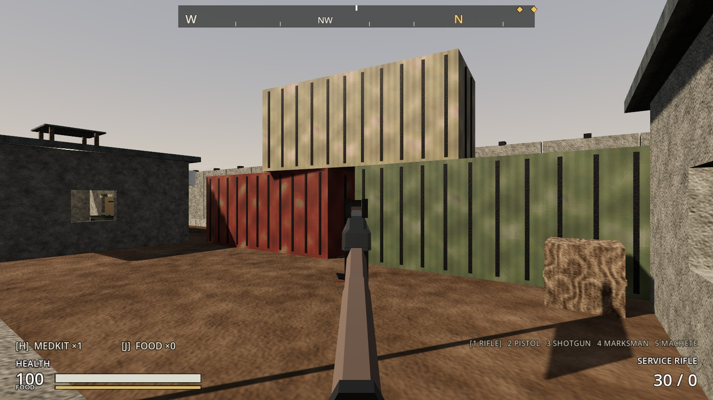
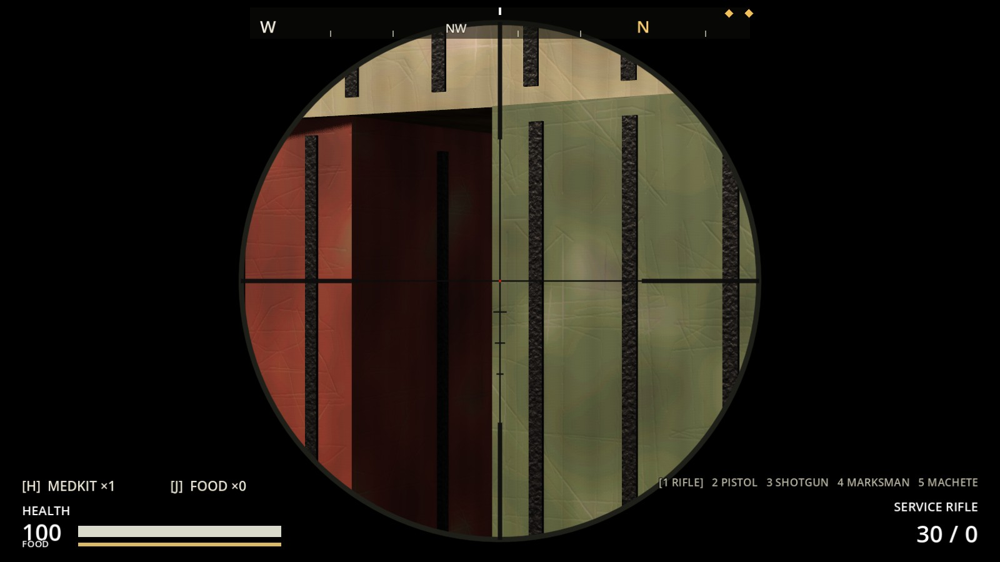
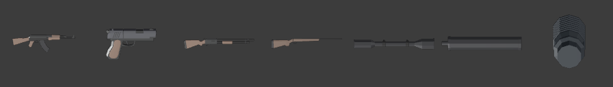
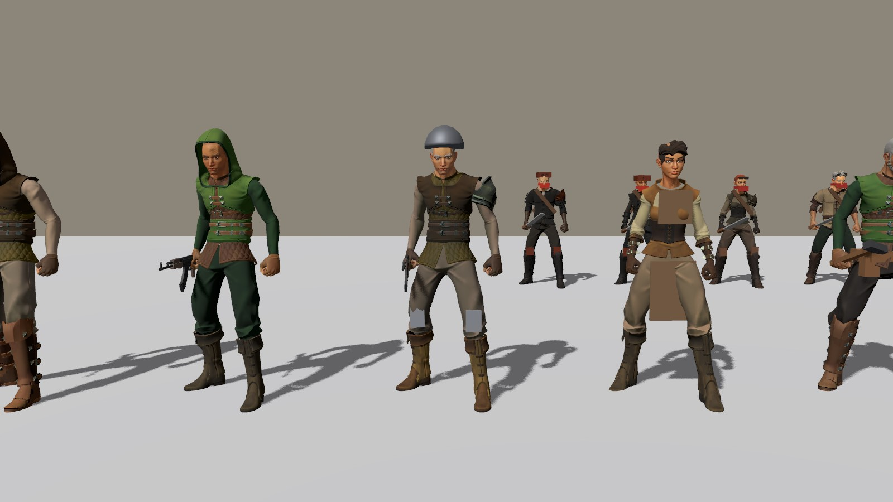
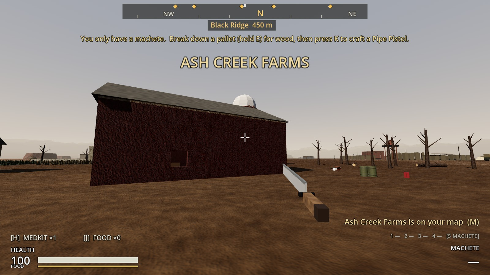
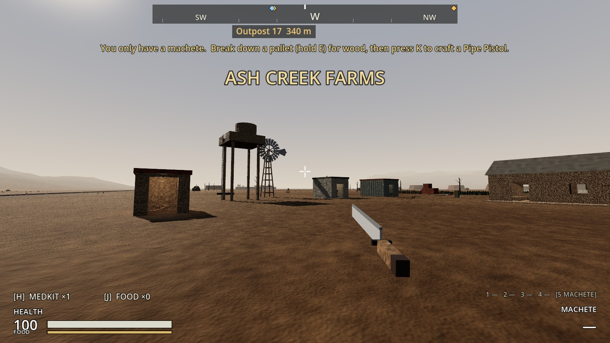
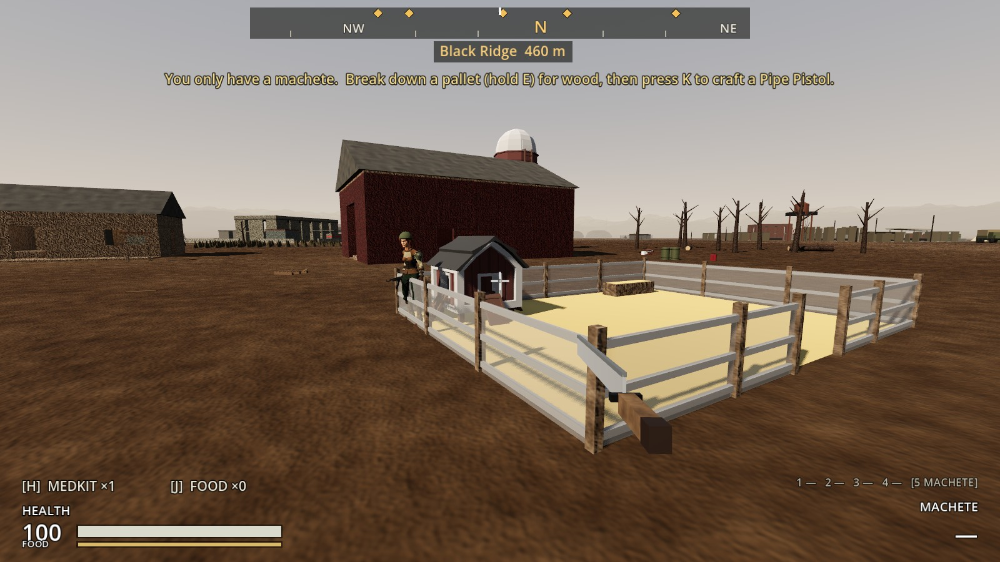

# Increment 30: real guns, and farm buildings at Ash Creek

**Status:** complete. TESTS_LINE

You downloaded three more Quaternius packs (all CC0, checked in 29.1 and listed in `docs/ASSET_LICENSES.md`) and asked for them to go in, guns first. This increment uses two of them:
- the **Ultimate Gun Pack**, for your guns, their attachments, guns on the ground and in settlers' hands;
- **Farm Buildings**, for Ash Creek.

The third, the **Downtown City MegaKit**, is for rebuilding towns. That's a bigger job of its own (see Notes).

| The Service Rifle | With a scope, suppressor and foregrip |
|---|---|
|  |  |

## Your guns

| Gun | Now | Was |
|---|---|---|
| Service Rifle | A rifle with wooden furniture and a curved magazine | Boxes |
| Sidearm Pistol | A pistol with a wooden grip | Boxes |
| Pump Shotgun | A pump-action with a wooden stock | Boxes |
| Marksman Rifle | A bolt-action hunting rifle with a wooden stock. The pack's version comes with a scope built on; that's cut off, because the 4× scope is an attachment you fit | Boxes |
| Pipe Pistol | Unchanged: it's a pipe you made, and the pack has nothing like it | |
| Machete | Unchanged: the pack has no blades bigger than a bayonet | |

| Pistol | Shotgun | Marksman Rifle |
|---|---|---|
|  |  |  |

**How they handle hasn't changed.** Each gun is exactly as long as before, with its muzzle in the same place, so recoil, muzzle flash, aiming, damage and everything else are as they were.

**The sights:**
- The iron sights now sit on the new gun's top, so the line you aim along clears the gun.
- The **4×, suppressor and foregrip** are the pack's: a real scope tube with your eye at its back, a long can on the muzzle, a ribbed grip under the handguard.
- The **red dot** looks as before (there's none in the pack). The **extended magazine** still holds 45, but no longer shows: the magazine is part of the gun's model now, so there's no separate magazine to make longer.

| Aiming the rifle | Through the 4× |
|---|---|
|  |  |

**On the ground and in the inventory:** a gun lying in the world is the same model, and its inventory icon is now drawn side-on, so you can tell the guns apart.

## Settlers' rifles

A guard with a gun carries the pack's rifle, 0.8 m long, by its grip, and it points where they face (as in 29).

## Ash Creek Farms

| The silo | A wind pump by the pump house |
|---|---|
|  |  |

- **The silo** behind the barn is the pack's red silo with its dome and ladder, as wide as the old grey cylinder and as solid (it's a little taller).
- **A wind pump** stands between the pump house and the west fence: a lattice tower with a fan and tail. Its legs are solid, and the navmesh was baked again, so settlers and raiders walk round it.
- **A chicken pen you build** has the pack's red-and-white coop in it instead of a wooden box, just as solid.
- **Weathered:** the pack's colours are bright, so they're faded and darkened a little to fit a farm that's stood empty since the ash.

**What stays:** the barn, the farmhouse and the water tower are still Ash Creek's own, because you go inside them and climb them. The pack's barns are closed shells.

## What didn't change

- **How guns play:** damage, fire rate, recoil, spread, magazines, attachments and their effects, crafting and the gunsmith.
- **Collision and saves:** every save still loads. The silo and the hen house are as solid as before; the wind pump is new and solid.

## How it's built

- **The packs:** `assets/models/quaternius/guns/` (41 guns and 15 attachments as OBJ, with the licence) and `assets/models/quaternius/farm/` (13 buildings, with a licence note: the zip had no licence file, but the pack's page says CC0). About 4 MB, in plain git.
- **Colours:** the OBJs' colours are linear, so Godot read them as nearly black. `tools/build_guns.gd` and `tools/build_farm_props.gd` convert them, make metal shinier than wood, weather the farm's, and save ready meshes in each folder's `built/`.
- **Fitting the guns** (`tools/build_guns.gd`):
  - In each gun scene and its world model, the box meshes give way to one `Gun` mesh: turned so its muzzle faces forward, scaled to the old gun's length, with the bore at the old bore's height.
  - The iron sights and sight anchor move onto the new gun's top.
  - The optic mount sits on its receiver and the underbarrel mount under its handguard.
  - The marksman rifle's own scope is cut off, with any triangle reaching above its receiver removed.
  - The attachments are fitted to the old ones' bounds; the scope's Sight marker goes on its tube at the back.
- **Icons:** `tools/render_item_icons.gd` draws guns and attachments side-on from above.
- **Settlers:** `tools/build_settler.gd`'s `_rifle()`.
- **Ash Creek:** `_farm_prop()` in `tools/build_sites.gd` (the silo, the wind pump and its collision). Then `build_early_zone.gd -- zone-only bake`.
- **The hen house:** `tools/build_settlement_buildings.gd`.

**Rebuilding:** `build_guns.gd`, `build_farm_props.gd`, `build_settler.gd`, `build_settlement_buildings.gd`, `build_sites.gd -- ash_creek_farms`, `build_early_zone.gd -- zone-only bake`, then (in a window) `render_item_icons.gd -- service_rifle,pistol,shotgun,scoped_rifle,scope_4x,suppressor,foregrip`.

## Tests (`tests/test_real_guns.gd`)

1. **The packs:**
   - both licences CC0, both in the asset register;
   - the rifle's wood brown, not black;
   - the marksman rifle without its built-in scope.
2. **The guns fitted** (pistol, shotgun, rifle, marksman rifle):
   - the pack's gun, with no box meshes left;
   - the muzzle at the gun's front;
   - nothing of the gun above the sight line between the rear sight and the muzzle.
3. **Attachments and the ground:**
   - the scope, suppressor and grip are the pack's, the scope's eye on its tube at the back;
   - each gun on the ground is the pack's;
   - a rifle with all three fitted aims through the scope, the suppressor on its muzzle.
4. **Settlers and the farm:**
   - a guard carries the pack's rifle, 0.7–0.9 m long;
   - Ash Creek's silo is the pack's and still solid;
   - the wind pump stands with solid legs;
   - the chicken pen's hen house is the pack's coop, still solid.

The existing gun tests (the pistol's and shotgun's sights lining up when you aim, the barrel pointing where you look, attachments, crafting) all pass on the new models.

## Notes

- **Next from these packs:**
  - The **Downtown City MegaKit** could rebuild Halden's Crossing, Dusthaven and Red Mesa from real brick, windows, cornices and streets. Each town is a big job, and the pieces need weathering and ruining to fit.
  - The gun pack has **more guns than the game has**: revolvers, SMGs, more rifles, a sawed-off shotgun. Those could become new guns to find or for the Armorer to make.
- **No real names:** the guns look like real designs but the game keeps its own names (Service Rifle, Sidearm Pistol…). Keep it that way.
