# Increment 31: Halden's Crossing rebuilt, and farm buildings with some style

**Status:** complete. The full run: 564 of 565 pass, 9 of them new (`tests/test_haldens_rebuilt.gd`, `tests/test_farm_style.gd`). The one failure was the mine's tower-guard raid test, which depends on timing; nothing in this increment touches the mine, and it passed twice when run again on its own.

You asked for two things: rebuild Halden's, and make the farm buildings look better using ideas from the packs. (The bug you found, getting stuck in a chicken coop as it went up, was fixed first, as Increment 30.1.)

## Halden's Crossing

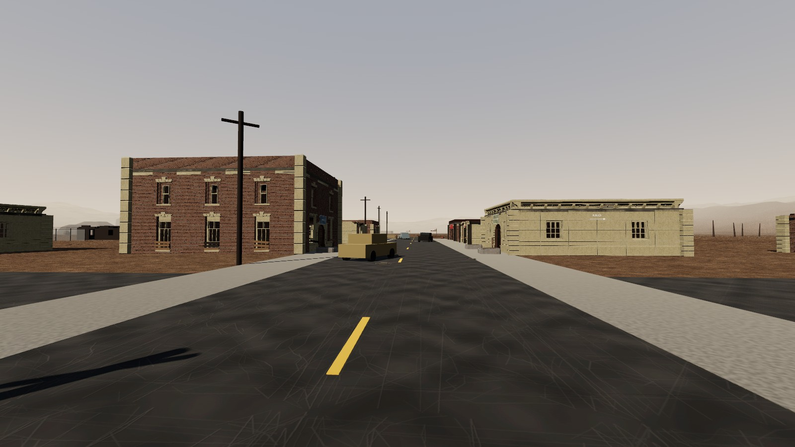

Before: plain boxes with holes in them.

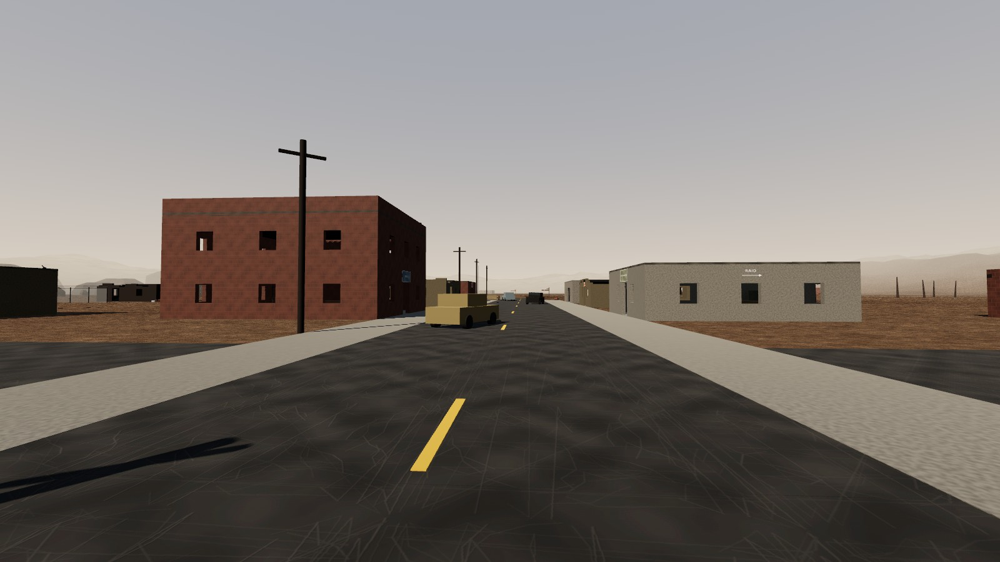

Halden's twelve buildings are now built from Quaternius's **Downtown City MegaKit** (CC0): real brick, painted stone and steel walls, windows with frames and sills, arched doorways, shopfronts, stone corner columns and cornices.

| Building | Looks like |
|---|---|
| General Store, Hotel | Red brick, a green-framed shopfront each side of an arched door, brick cornice. The hotel has trimmed sash windows upstairs and a brick parapet round its roof. |
| Bank, Clinic | Painted stone with small-paned windows; the bank has an ornate stone cornice. |
| Church | A ruin in pale brick: arched windows, a grand arched door, broken walls stepping down where its roof fell in. |
| Garage | Pale brick with big windows and its wide bay door under a steel lintel. |
| Diner | Stone, with a green-framed shopfront onto the street, half its roof gone. |
| Feed Store | A brick ruin with a loading bay. |
| Houses | Painted stone (two of them ruins), and one in pale brick. |
| Gas Kiosk | Steel and glassless display windows. |

### What stays the same

Every building keeps its **footprint, doorways, floors, upper floor, roof, ladders, furniture and loot**. Nothing that's saved has moved, so your saves load as before. Raiders still walk in through every door, and the navigation's rebaked to match the new walls.

### What's new to play

- **Windows are open.** The glass is long gone. You can see through every window and shoot through it, and so can raiders.
- **Low windows are boarded up.** Where a shopfront or window comes lower than 1 m, it's boarded up to that height. You can't step through a window, just as before.
- **Ruined buildings have broken tops.** The church, the diner, the feed store and two houses have walls broken off in steps and slants. Over doorways and under shop signs the wall's left whole.
- **The walls are as solid as they look.** Each wall's solid parts are worked out from the kit pieces themselves. So a window you can see through, you can shoot through; a column you can see stops a bullet.
- **Street furniture:** manhole covers and drains in the road, air conditioners on the flat roofs, and planters either side of the hotel's and the bank's doors.

| | |
|---|---|
| 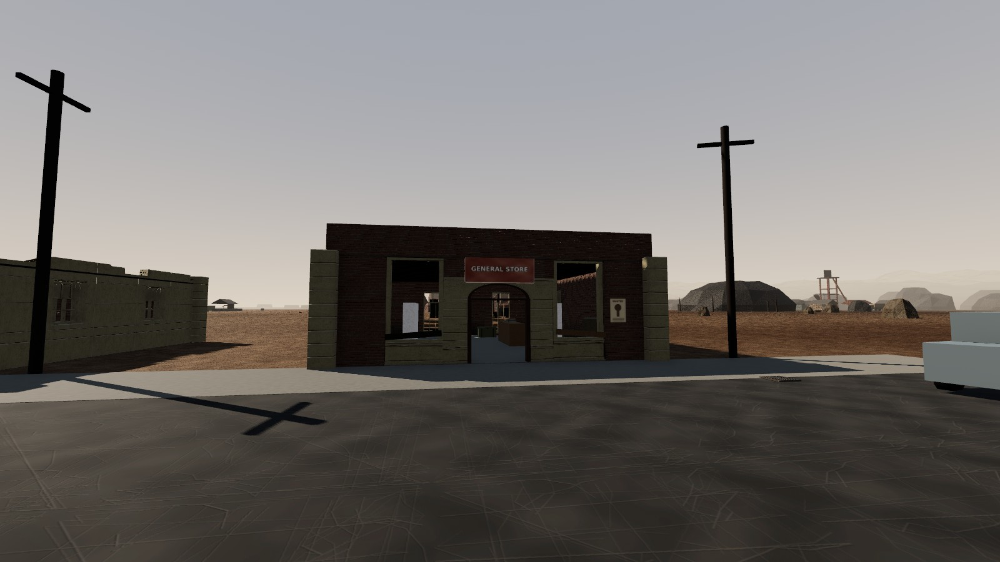 | 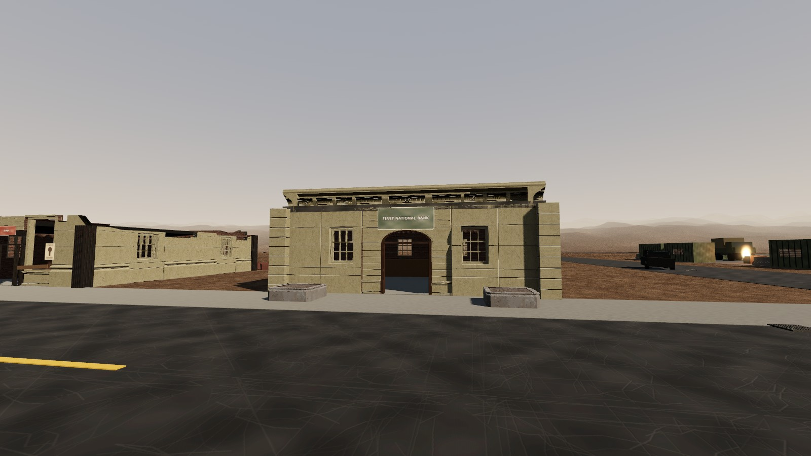 |
| 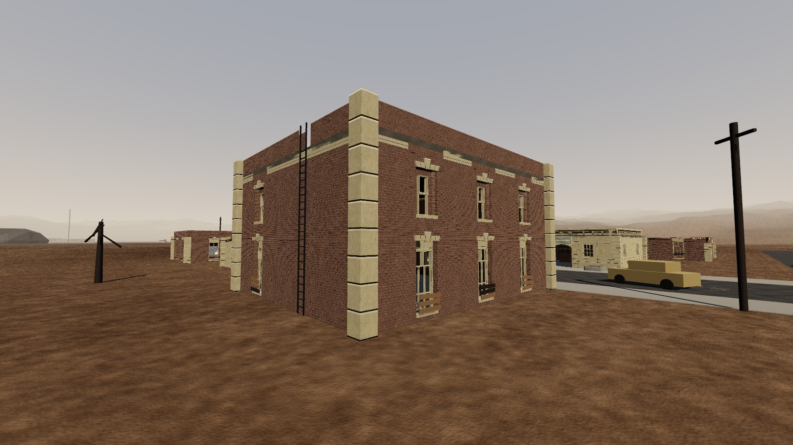 | 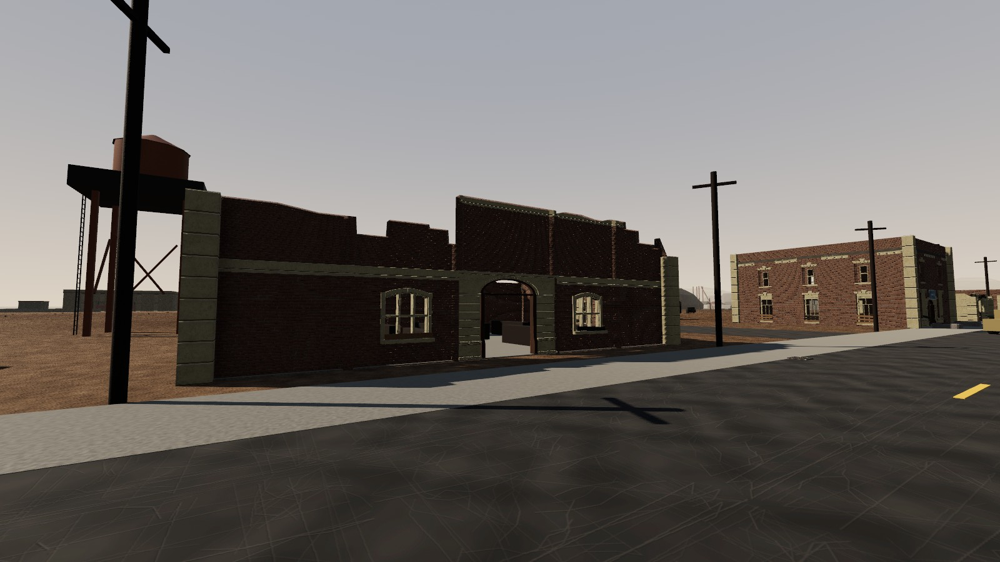 |
| 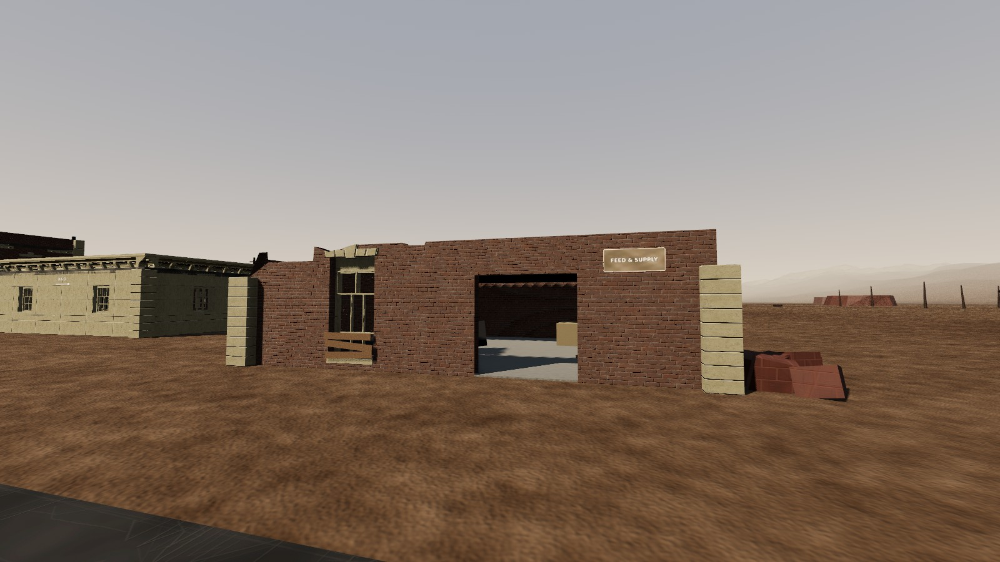 | 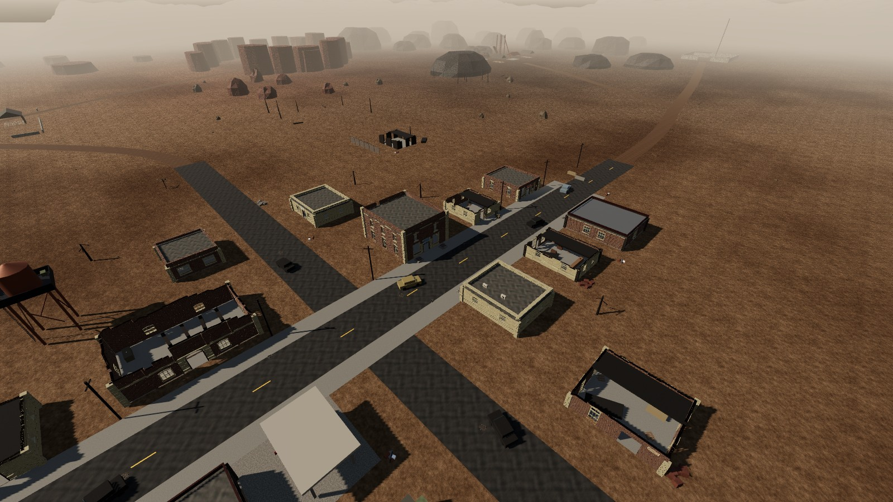 |

## Farm buildings

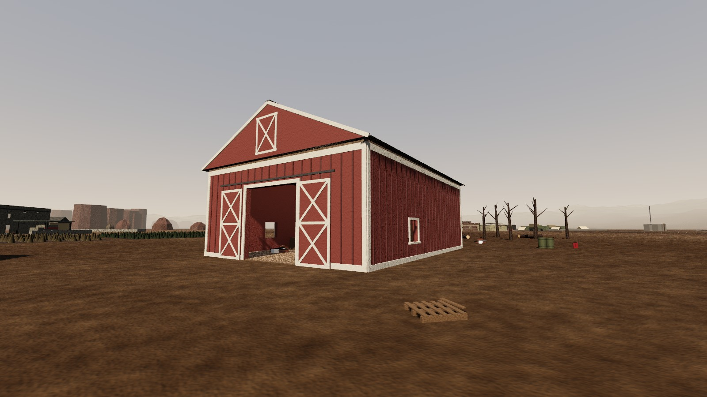

Before:

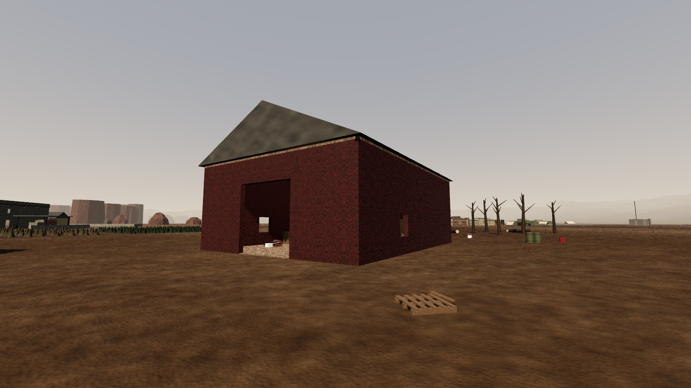

I took the look of the **Farm Buildings** pack's barns and built it onto our own buildings:

- red board-and-batten walls;
- white trim at every corner, along the eaves and round every door and window;
- sliding barn doors with white X braces, open on their rail either side of the big doorway;
- a hayloft door high in each gable;
- shingled roofs.

The farmhouse gets the matching farmhouse look: white lap siding, white trim, green shutters, a shingled roof, and a porch roof on white posts.

I didn't use the pack's barn models themselves. They're closed shells with nothing inside, and ours have the hayloft, the food store and the farmhouse's rooms. So the shapes are ours, with the pack's style on top.

| Building | Style |
|---|---|
| Ash Creek's barn | Red barn: sliding doors, hayloft doors in both gables |
| Ash Creek's farmhouse | White farmhouse, shutters, porch roof on posts |
| Ash Creek's chicken coop | Red barn |
| Bunkhouse (settlers build it) | Red barn |
| Storehouse (settlers build it) | Red barn: sliding doors on its wide doorway |
| Kitchen (settlers build it) | White farmhouse, shutters |

Only the look changes. The walls, doorways, windows and roofs are as solid (and as open) as they were.

| | |
|---|---|
| 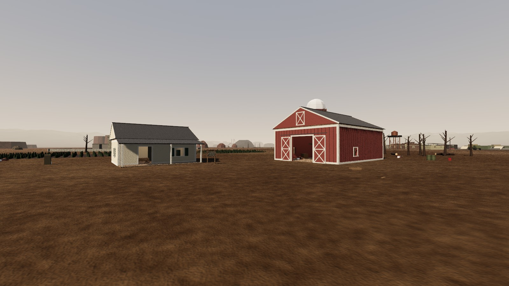 | 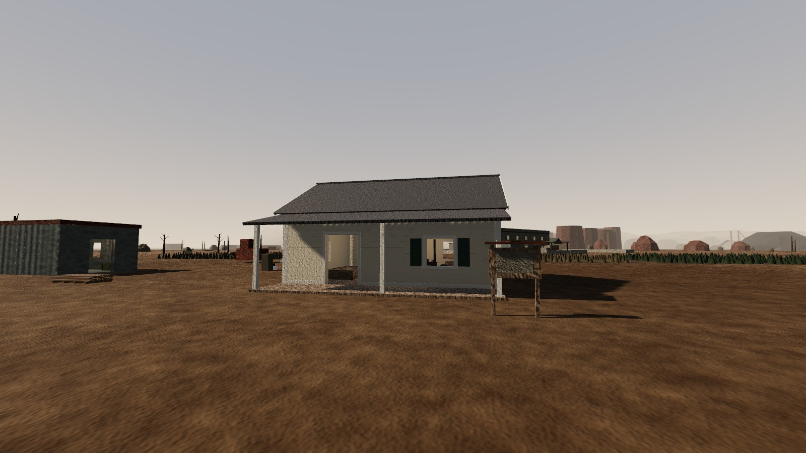 |
| 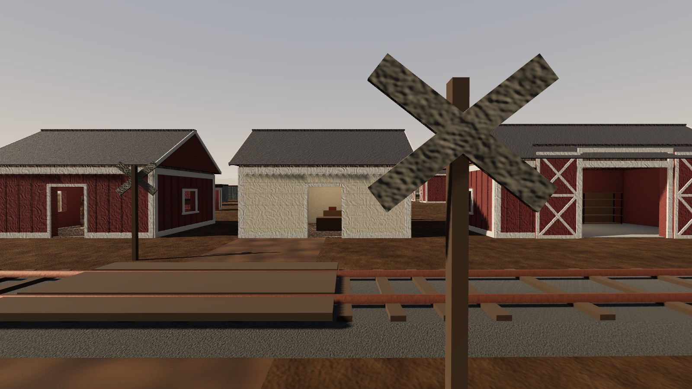 | 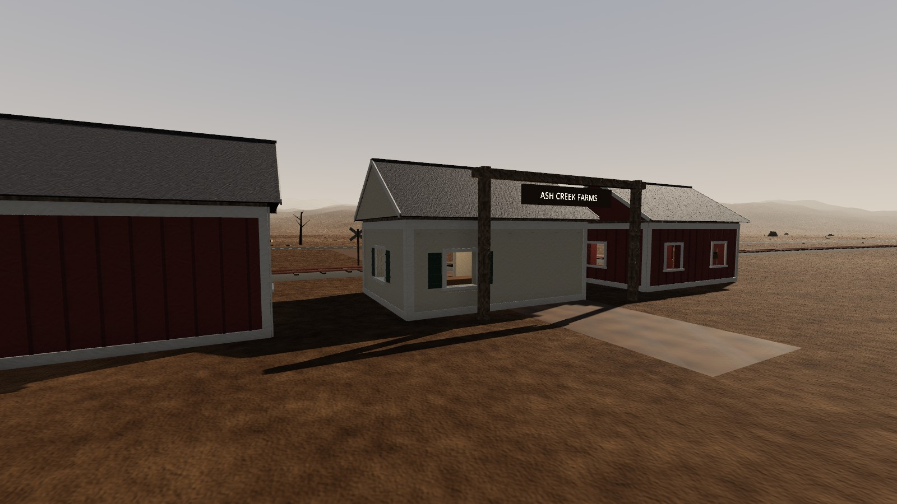 |

## Playtest

In a real window:

1. Walked up Halden's main street and in through the general store's door.
2. Looked out through its boarded shopfront.
3. Stood on the hotel's roof.
4. Walked into Ash Creek's barn through its big doors.

| | |
|---|---|
| 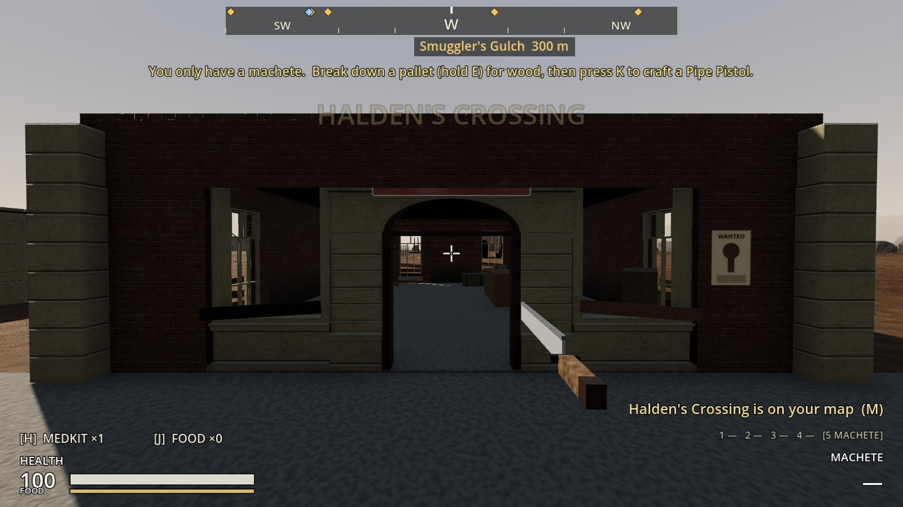 | 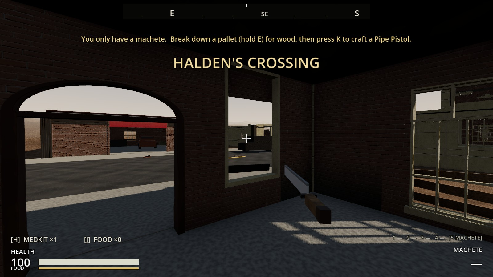 |
| 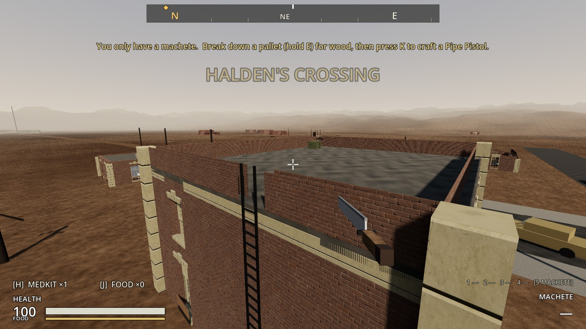 | 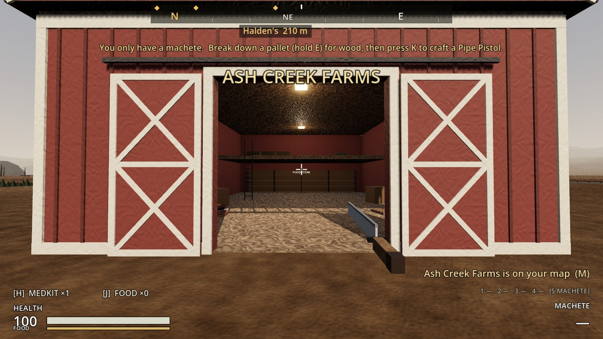 |

## How it's built

- **`tools/build_city_kit.gd`** makes the city kit's pieces ready, saving them in `assets/models/quaternius/city/built/`. It takes out the glass and the painted-on rooms behind the windows. It also makes the kit's materials shared between pieces and weathered: dustier and a little darker.
- **`tools/rebuild_haldens.gd`** rebuilds the town's walls, keeping everything else:
  1. It lays kit pieces along each wall, choosing by the building's style which piece goes where.
  2. It draws each wall, as seen from outside, onto a 10 cm grid, leaves out thin bits like window bars, and turns what's solid into boxes 0.3 m thick (like the old walls).
  3. It cuts the ruins' tops from the pieces along a stepped, broken line, capping the cut.
  - It's safe to run again. After running it, rebake with `tools/build_early_zone.gd -- zone-only bake`.
- **`tools/farm_trim.gd`**: when a building made with `tools/site_kit.gd` has a `"trim"` option (`"barn"` or `"farmhouse"`), it paints the building and adds its trim, battens or siding, doors, gables and shingles. All of that is one mesh per building, saved next to its scene (`levels/ash_creek_farms/trim/`, `scenes/settlement/trim/`).
- **`StaticBatcher`** no longer counts a building's own kit walls as "things inside it". Before this fix they were hidden beyond 70 m and cast no shadow.

## Tests

`tests/test_haldens_rebuilt.gd`:

1. **The kit and its licence:** CC0, in the licence register; every building built from kit pieces, no old box walls left; no glass in the windows.
2. **Walls where they were:** the same footprints and heights, 0.3 m walls, no wall standing in a room.
3. **Doors open, windows low shut:** every door open at waist and head height; every wall solid at waist height away from the doors; windows you can see through.
4. **Broken tops are jagged:** each ruin's wall tops vary, no lower than they were broken before.
5. **Walls cast shadows and stay in view:** the batcher doesn't treat them as things inside the building.
6. **Loot clear of the walls, and nothing new saved.**
7. **Raiders can walk in:** a navigation path in through every building's door.

`tests/test_farm_style.gd`:

1. **Ash Creek:** the barn, farmhouse and coop are painted and trimmed, with shingled roofs. The trim adds nothing solid and covers no doorway. The barn's trim reaches up the gables, and the porch posts stand clear of the farmhouse door.
2. **Settlement buildings:** the same for the bunkhouse, storehouse and kitchen.

The Pack 3 dressing test (signs and posters flat on Halden's walls) still passes. The new walls leave the wall whole under each sign.
