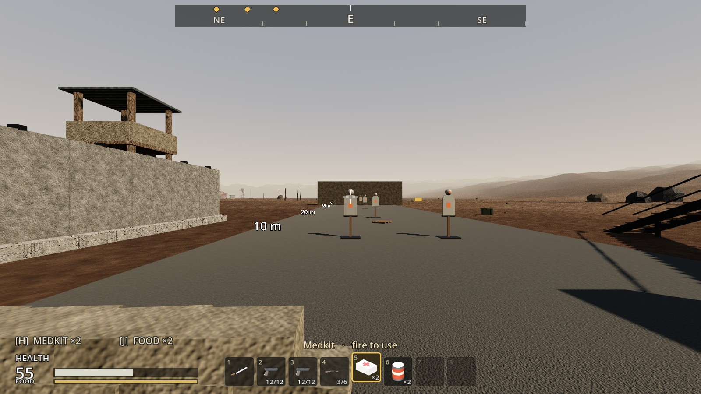
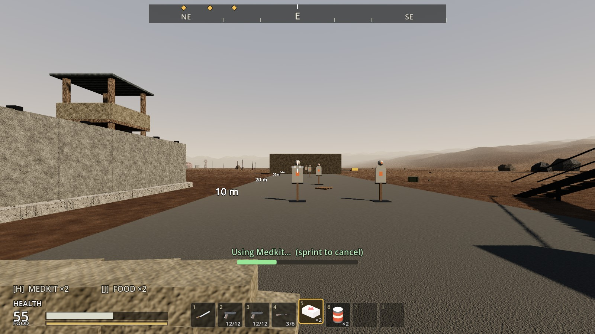
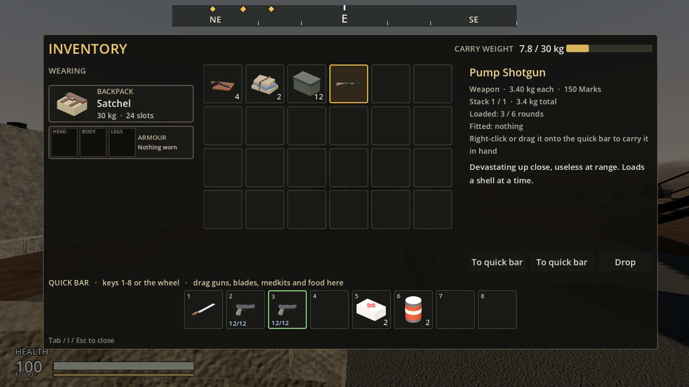
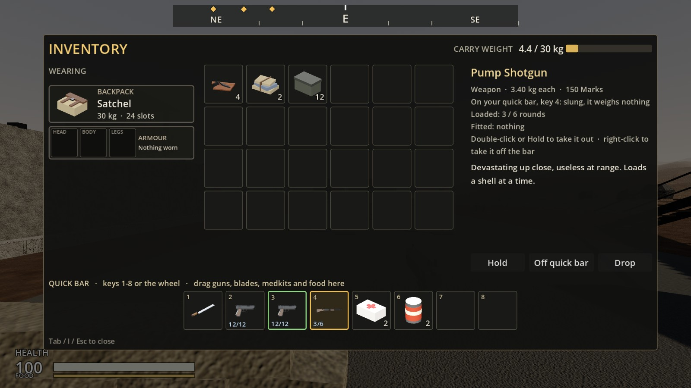
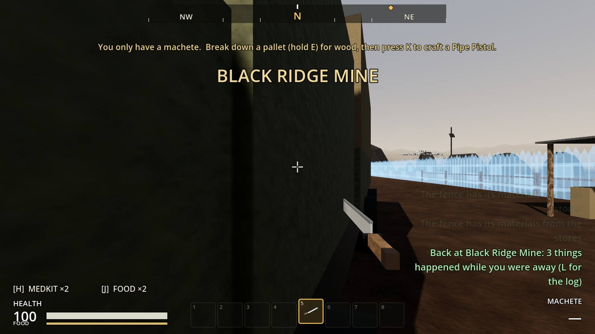

# Increment 32: the quick bar

**Status:** complete. 13 of the tests are new (`tests/test_quick_bar.gd`). In the full run, 566 of 569 passed. All three failures were fixed and pass on their own:

- **A real bug:** dying while wearing a backpack crashed the gear drop (the pack's line had no gun state). Fixed.
- **Two test timing faults:** the pause menu test checked before the HUD had run a frame, and its key presses (and the quick save test's) arrived late. The tests now wait for the HUD's first frame and flush their input.
- **The open-gate navmesh test:** it doesn't touch the quick bar, and it passed when run again.

You asked for the numbered slots to stop being given to guns automatically and become a drag-and-drop bar for anything you can hold, so that a player can carry two pistols if they want to. This is the quick bar from the proofs you approved ("8 slots, yes to medkits and food, yes to mouse wheel"). It comes first because the Field Manual, orders and achievements all build on it: the manual is something you hold on the bar.

## How it plays

- **Eight slots** along the bottom of the screen. **Keys 1–8** pick one. **The mouse wheel** goes to the next slot with something in it and skips the empty ones. The one in your hands is raised with a gold edge, and its name shows above the bar for a moment when you change.
- **What can go on it:** guns, blades, medkits and bandages, and food. Rounds stay in your backpack ("Rounds stay in your backpack"), backpacks and armour are worn ("Wear it instead"), and anything else is refused with a reason.
- **Two of the same gun:** each gun on the bar is its own gun, with its own rounds and attachments. Two pistols side by side, or three shotguns, are fine.
- **Medkits and food in your hands:** pick the slot, then **fire** (left click) uses one. Holding fire won't cancel it or use another; only sprinting cancels it. H and J still work, and use what's on the bar as well as what's in your backpack (backpack first).
- **Starting out:** a new game has the machete on slot 1 and nothing else.

## The inventory

The five weapon rows are gone from the left of the inventory. That column is now **WEARING** (backpack and armour). The **quick bar** runs along the bottom of the window: eight cells with their keys, each gun's rounds in its corner, and a green edge on the one in your hands.

- **Drag** from the backpack onto a bar cell to put it there. Whatever was there swaps into the backpack. Drag from the bar onto a backpack cell to take it off. Drag between bar cells to rearrange. Drag outside the window to drop it on the ground.
- **Right-click** a gun in the backpack to put it on the first empty bar slot. Right-click a bar cell to take it off. Right-click still uses a medkit or food in the backpack, as before.
- **Buttons:** Use (or Hold, for a bar slot), the new **To quick bar / Off quick bar**, and Drop.
- **Details** for a gun show how many rounds are loaded and what's fitted.

## Guns you find, make and drop

- A gun you **pick up, take from a container or craft** goes onto the **first empty slot**, loaded. If the bar's full it goes into your backpack, and the prompt says so: "Pick up Pump Shotgun (into your backpack: your quick bar's full)". With only a blade in your hand, it comes straight out.
- **Better guns no longer replace worse ones.** Making a Sidearm Pistol when you carry a Pipe Pistol puts the pistol beside it.
- A gun **dropped** (from the bar or the backpack) **keeps its rounds and attachments**, and is just as it was when you pick it up. So is a gun put into the backpack: it's no longer unloaded with its attachments taken off.
- **Giving a guard a gun** (settlement screen) now lists the guns on your bar as well as in your backpack. The rounds in its magazine go with it. A gun you take back comes unloaded, with its rounds returned as rounds.

## Weight

**Guns and blades on the bar weigh nothing**, as they did in the five weapon slots: they're slung and belted. **Medkits and food on the bar still weigh what they did.** A gun in the backpack weighs what it did. Moving a gun off the bar into a full backpack is refused with "Too heavy".

This keeps your game as it is: a save carrying five guns doesn't suddenly go over its weight limit.

## Dying

Everything on the bar **but your blade** goes into your dropped gear with your backpack, each gun with its own rounds and attachments. You come back with your blade (and only get a new machete if you're not carrying one). Take your gear back and the guns go back on the bar as they were.

## Your game

**Your saved game carries on.** Each gun goes onto the slot it had in the old loadout, as it was: rifle on 1, pistol on 2, shotgun on 3, marksman rifle on 4, machete on 5. The gun in your hands is still in your hands. Spare guns in your backpack stay there, loaded. Gear dropped before this update gives its guns back with their old rounds and attachments. All the test saves (`tests/fixtures/`) load.

## How it's built

- **`QuickBar`** (`scripts/inventory/quick_bar.gd`): an `InventoryComponent` with 8 slots, a child of the player's Inventory node (so `InventoryComponent.find_on(player)` still finds the backpack). It only takes holdable things, counts only non-gun weight, and shares the backpack's weight limit.
- **Guns carry their state in their slot entry:** `{"item", "qty": 1, "state": {"magazine", "attachments"}}`, in the bar, the backpack, containers, pickups and saves. Guns never stack. A gun with no state (found in a crate, or saved before this) is as found: loaded, nothing fitted.
- **`WeaponSlots`** now follows the bar: each gun entry gets one live `HitscanWeapon`, created when it arrives and freed when it leaves. Rounds and attachments are written back into the entry as they change. What's in your hands follows its entry if it moves, and a switch under way follows the slot it's switching to.
- **`PlayerInventory`** counts, finds and uses medkits and food on the bar too. A crafting check that pretends to take things away can't take them off the bar for good.
- **`PlayerController`:** `request_move_to_bar`, `request_move_to_backpack`, `request_move_in_bar` and `request_drop_bar_slot` (all validated). `receive_gun` takes a state. `request_equip_spare` and the stow functions are gone.
- **Keys 6–8** are added to the input map at runtime (`PlayerInput.ensure_bar_keys`), so `project.godot` is untouched. Network input frames carry slots 1–8.
- **HUD:** `QuickBarHud` (`scripts/ui/quick_bar_hud.gd`) replaces the text weapon strip.
- **The machete is an item now** (`resources/items/weapons/machete_item.tres`), with a world model built from the held machete (`tools/make_machete_item.gd`) and an icon.
- Weapon item descriptions no longer say "Slot 2".

## Tests

`tests/test_quick_bar.gd` (13 tests) replaces `tests/test_spare_guns.gd`. It covers:

- a new game with the machete on slot 1, and keys 1–8;
- what can and can't go on the bar;
- two pistols with their own rounds;
- the wheel skipping empty slots;
- weight;
- dragging guns back and forth as they are, swapping, rearranging, and dropping and picking up;
- a held medkit used with fire;
- saving and loading;
- an old loadout migrating;
- dying with the bar;
- an old gear chest;
- the inventory screen's bar;
- the interface fitting the smallest window.

These tests were updated for guns going onto the bar instead of fixed slots: `test_weapons`, `test_gun_crafting`, `test_gear_and_guns`, `test_regions`, `test_outpost_17`, `test_settlement` (arming guards), `test_construction` (gunsmith) and `test_save`. The quick save keys test now flushes its input events, because it was timing-dependent.

## Not in this increment

- There's no model in your hands for a held medkit or can of food yet. Your hands are empty and the HUD says "Medkit · fire to use".
- An old save keeps its machete on slot 5 with slots 1–4 for its guns, as the keys were. Drag things where you like.

## Next

**Increment 33: the Field Manual.** Sgt. Ada Vance's annotated Outpost 17 manual: **N** to read it, and a holdable item on your quick bar in a new game. It opens with chapters 1–4 (how to play), and chapters 5–7 unlock as the story reaches them. Then orders and achievements, and Act 1 of The Last Order.
