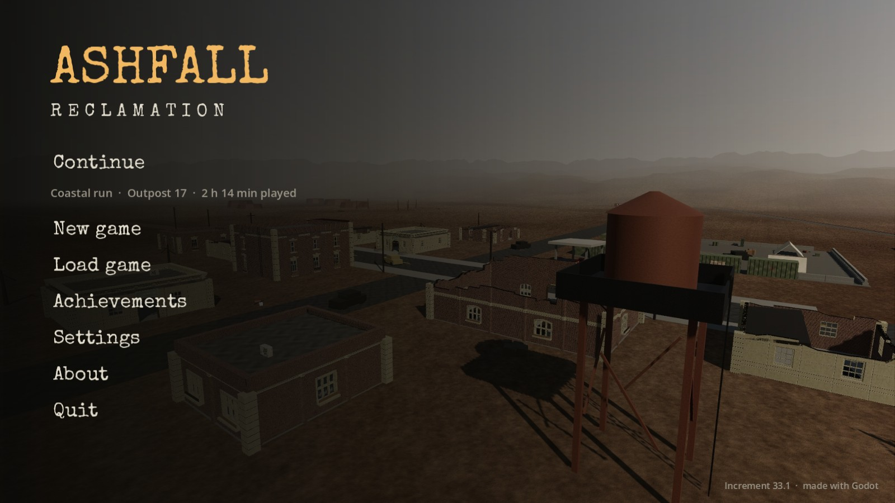
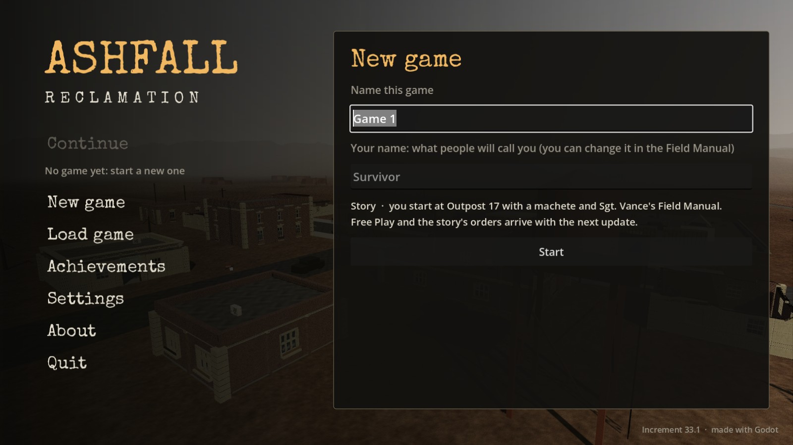
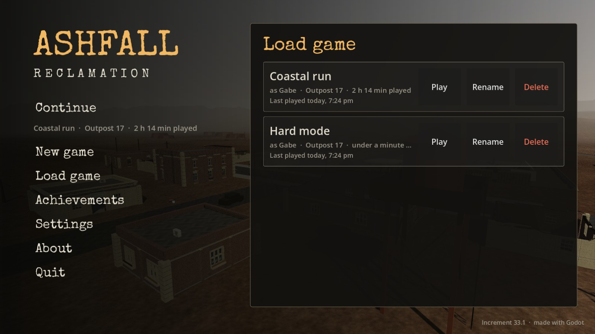
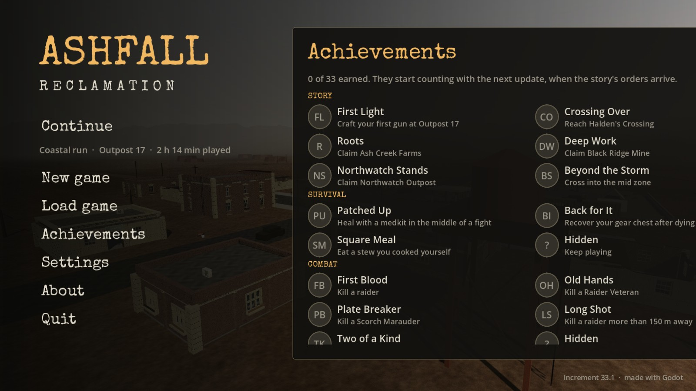
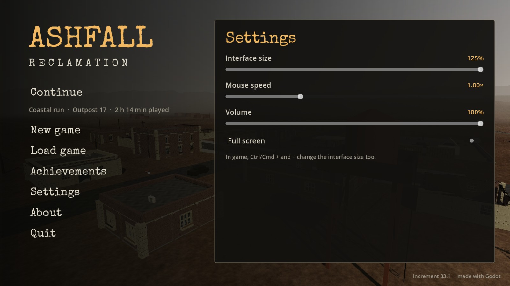
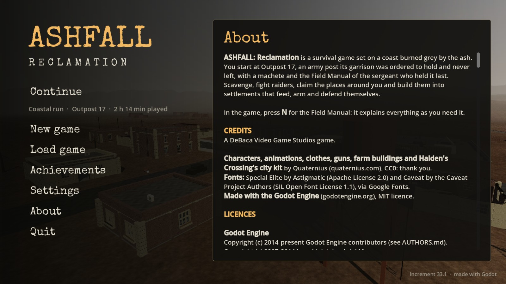
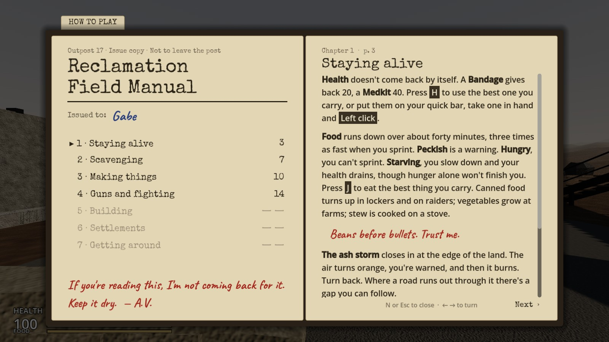

# Increment 33.1: the main menu, a thousand names, and your name

**Status:** done, 24 Nov 2026. 588 tests: 586 passed in the full run. The dry-fire click sound and the open-gate navmesh check failed there, as before, and pass alone.

You asked for three things before Increment 34:

- a main menu with your saved games, the achievements, About, and anything else that's relevant;
- far more names, because newcomers were turning up as "Drifter 7";
- a place in the manual to write your own name, so dialogue later on can use it.

The Outpost 17 rebuild, approved on its proof (bigger walls with the range inside, the stone look kept, garden plots, the range rebuilt), is Increment 33.2.

## The main menu

The game now opens on the main menu, after the boot screen's update check.

- **Continue:** carries on the game you played last, from its newest save. It shows the game's name, where you were and how long you've played.
- **New game:**
  - Name the game, and give your name (what people will call you; you can change it in the Field Manual later).
  - Then start at Outpost 17.
  - Story is the only mode for now. Free Play comes with the story's orders in 34.
- **Load game:** every game you've started, the last played first. Each card shows the game's name, your name, where you were, how long you've played and when you last played.
  - **Play** a game.
  - **Rename** it.
  - **Delete** it. You click twice; the second click deletes it and its saves for good.
- **Achievements:** all 33 from the approved proofs, by category. The hidden ones show as "Hidden · Keep playing". They start counting in Increment 34, as you asked ("page now, filled in 34").
- **Settings:** interface size, mouse speed, volume and full screen, kept at once. They're in the pause menu too.
- **About:** what the game is, the credits (Quaternius's packs, the two fonts, Godot), and the full licence texts the game must carry: Godot's MIT notice, the Caveat font's SIL Open Font License, and Special Elite's Apache 2.0. That's the "Credits screen before release" item done.
- **Quit.**

The picture behind it is Halden's Crossing from above its water tower, rendered from the game.

| | |
|---|---|
|  |  |
|  |  |

## Separate games

- **Each game is its own folder** of saves, with its own autosave and quick save. F5, F9, autosave and Continue all work inside the game you're playing. Two games never touch each other.
- **The pause menu (Esc):**
  - New game has moved to the main menu.
  - **Settings** and **Save and go to the main menu** are new.
  - Save and quit is still there.
- **Your game carries on.** The first time the menu opens, your existing saves (the autosave and quick save) become a game called **"Your first game"**, and Continue carries it on. Nothing is lost or changed in them; they've only moved into its folder.

## A thousand names

- **1,020 first names** from all over the world: 506 that usually belong to women, 452 to men, and 62 for anyone.
- **A newcomer's body follows their name:** a woman's name, a woman's body.
- **Kept out of the list:** the story's own people (Ada, Maya, Tomas, Jeb).
- **Old Drifters get a real name.** A settler called "Drifter 7" in your save is renamed when it loads, with a name that suits how they look. They keep looking exactly as before.

## Your name

The Field Manual's cover page has an **"Issued to:"** line. Click it and write your name in blue ink; Enter or Esc puts the pen down. While you're writing, keys are just letters, so I, M or N don't open other windows.

Your name is saved with your game and shown on its card in the menu. A new game can set it from the menu. Anything that speaks to you later (orders, the radio, survivors) uses it, or "Survivor" until you've written one.

## Fixed along the way

**Tailors lost their job when a game loaded.** The job came after the Armorer in the list, and loading only accepted jobs up to the Armorer, so a saved Tailor came back with no job. Fixed.

## How it's built

- **The menu:** `MainMenu` (`scripts/ui/main_menu.gd`, scene `scenes/ui/main_menu.tscn`), built in code. The boot screen opens it.
  - `-- --new-game` starts a new game straight away.
  - `-- --continue` carries on the last game.
- **Games:** `SaveManager` gains:
  - `create_game`, `use_game`, `list_games`, `game_info`, `rename_game` and `delete_game`;
  - `play_game`, `start_new_game` and `quit_to_menu`;
  - `migrate_legacy`, and each game's `game.json`.
- **Settings:** `GameSettings` (mouse speed, volume and full screen, in `user://settings.cfg` beside the interface size) and `SettingsPanel`, shared by both menus.
- **Achievements:** `Achievements` (`scripts/story/achievements.gd`), the list of 33.
- **Names:** `SettlerNames` (`scripts/settlement/settler_names.gd`), plus `Settler.sex` (saved) and `HumanBody.pick_looks(seed, sex)`.
- **Your name:** `PlayerController.player_name`, `call_name()`, `set_player_name()` and `clean_name()`; the manual's `name_field`.
- **Typing:** windows ignore their keys while a text box has focus.

## Tests

Two new suites (9 tests):

- `tests/test_names.gd` (4): the names, newcomers, old Drifters (and the Tailor fix), and your name.
- `tests/test_main_menu.gd` (5): games and their saves, old saves becoming a first game, the menu's pages, settings, and the game opening on the menu.

The pause menu test in `test_run_and_continue.gd` changed: Settings and Main menu in place of New game.

## Next

**Increment 33.2: Outpost 17 rebuilt**, from the approved proof:

- The walls pushed east to 95 × 50 m, with the range inside them.
- The stone look kept.
- The command post with Sgt. Vance's office and the radio room.
- A mess hall, the barracks with eight bunks, the stores and workshop, and a motor pool shed.
- A water tower and pump, garden plots, and the range rebuilt.
- Claimable at its notice board.
