# Increment 33.2: Outpost 17 rebuilt, and yours to claim

**Status:** done, 24 Nov 2026. 593 tests. The full run had two failures, both fixed and now passing: there was no room beside a warehouse crate to move it, and a survivor asked to come before you held a place answered for Outpost 17 rather than the place nearest her.

You asked for a full revamp of Outpost 17. It was the first area, and it still looked like a test level. You also asked that it become a place you can claim and have settlers at. This is the build you approved on its proof:

- **Footprint:** bigger, with the east wall pushed out and the range inside the walls.
- **Walls:** today's stone look.
- **Food:** garden plots.
- **Range:** rebuilt properly.

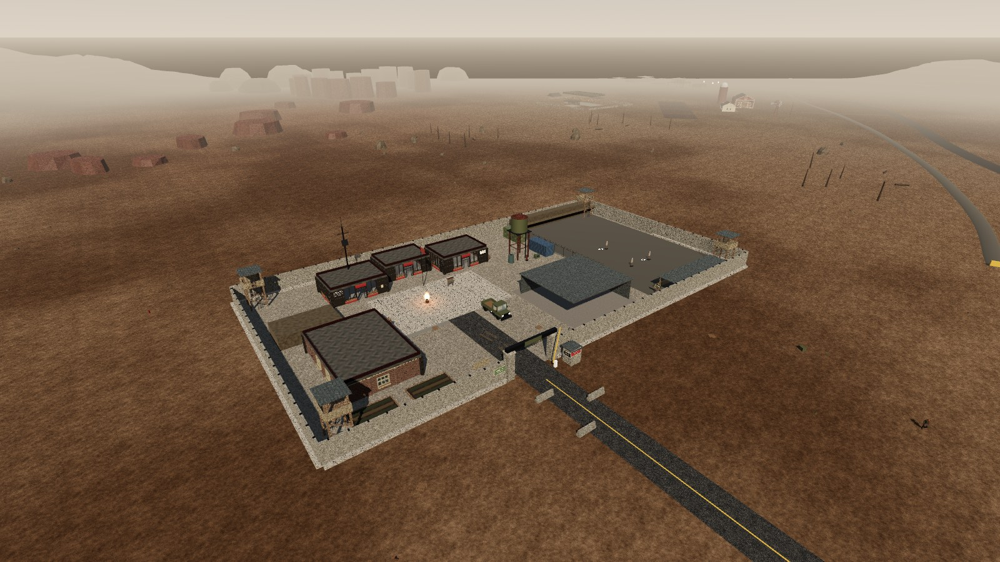

## What's there now

- **The walls:** pushed east from x 31.85 to x 61.25, so the post is 95 × 50 m over the walls. They keep the same stone segments, and the north and south runs carry on to the new corner. The two eastern guard towers moved out with it.
- **The command post** (where the old one stood), with the city kit's steel walls and three rooms:
  - **Sgt. Vance's office:** her desk, maps on the wall, a filing cabinet and **Sgt. Vance's Footlocker**.
  - **The radio room:** the way in. The field radio sits on its table, and the radio mast stands on the roof.
  - **The armory:** the weapons bench, the post's weapons locker, the settlement's Armory Locker and a table of rounds and gun parts.
- **The mess hall,** where the stacked containers were. It has tables and benches, and a stove, counter and fridge along the back wall. Those make it the post's **Kitchen**, so a Cook can work there from the day you claim it.
- **The barracks:** eight bunks, the footlockers and a locker. It's the post's shelter when raiders come.
- **The stores and workshop** (the old warehouse's footprint), through a wide bay door:
  - the **Outpost Stores** shelves;
  - the workbench, the crates and steel shelving with the loot on it.
- **The motor pool:** a steel shed with a corrugated roof over the two old trucks, which you can still scrap. It also has a tool wall, the tool chest and a fuel point.
- **The water tower,** with the pump at its foot (broken until you mend it, then upgraded like the farm's), the generator and a spare tank.
- **Two garden plots** along the south wall, for four Farmers.
- **The firing range,** inside the new east end:
  - a covered firing line behind sandbags, with the bench and its rounds;
  - steel targets at 10, 20, 30 and 40 m;
  - an earth berm against the north wall.

  The far target is at 40 m, not the 50 m on the proof: the walls are 50 m deep, and the berm needs room behind it.
- **The parade ground,** with the flag, the notice board, paths to the gate and the stores, and hard standing at the motor pool.

**Gone:** the range tower (the tall platform and ramp for testing falls), the containers stacked on containers, the yard's sandbag positions and the old flat box buildings. Two of the old shipping containers now stand on the ground by the water tower.

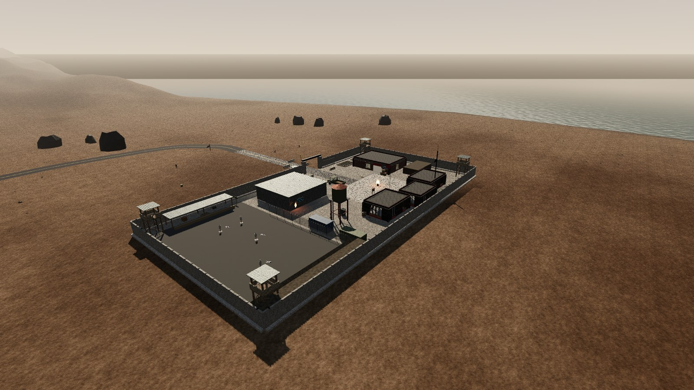

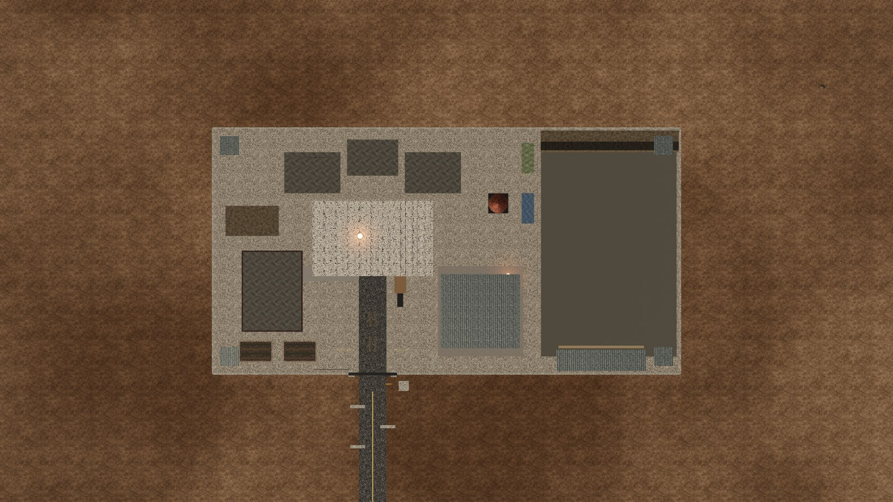

| | |
|---|---|
| 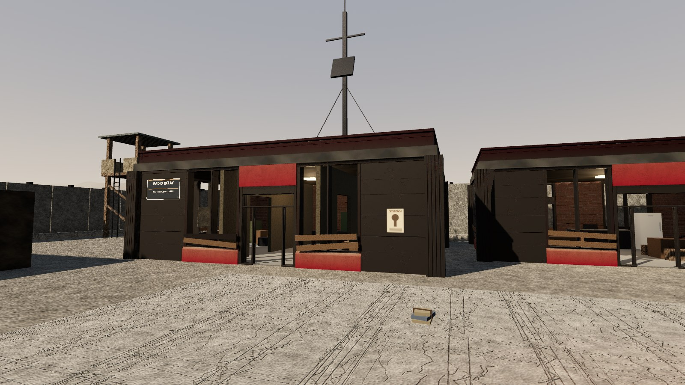 | 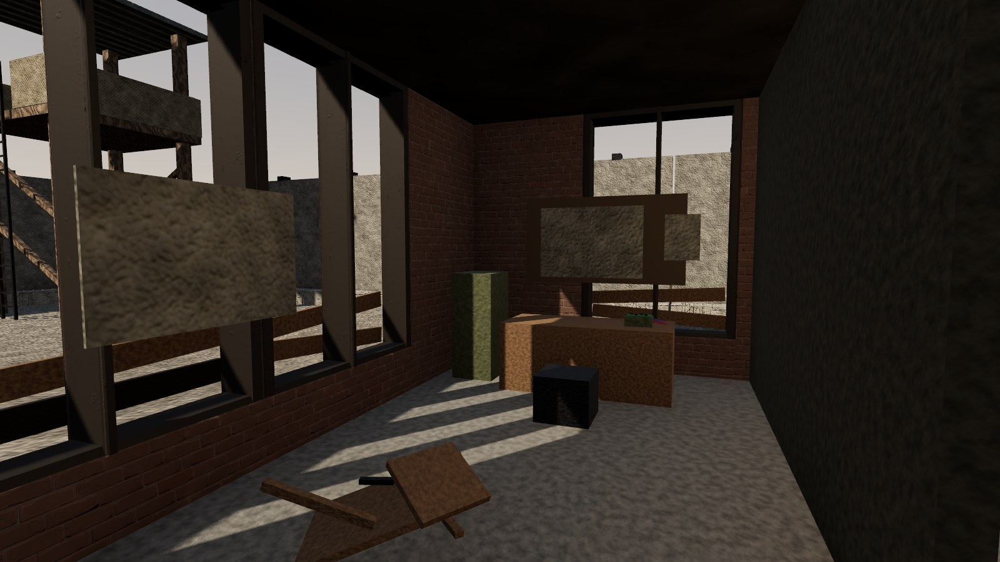 |
| 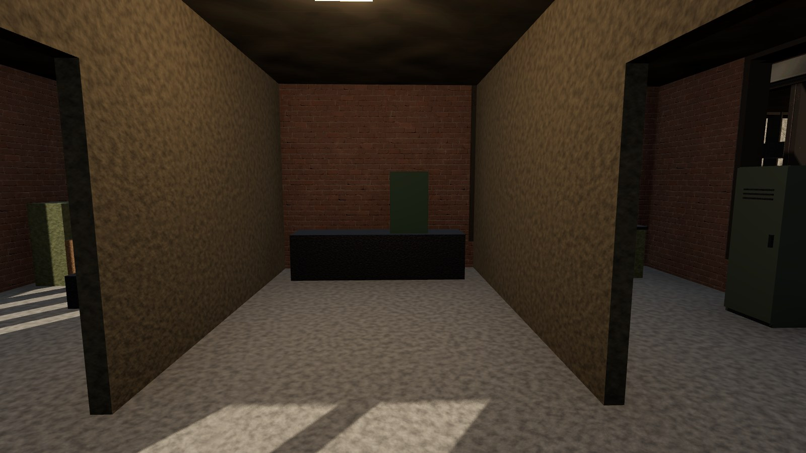 | 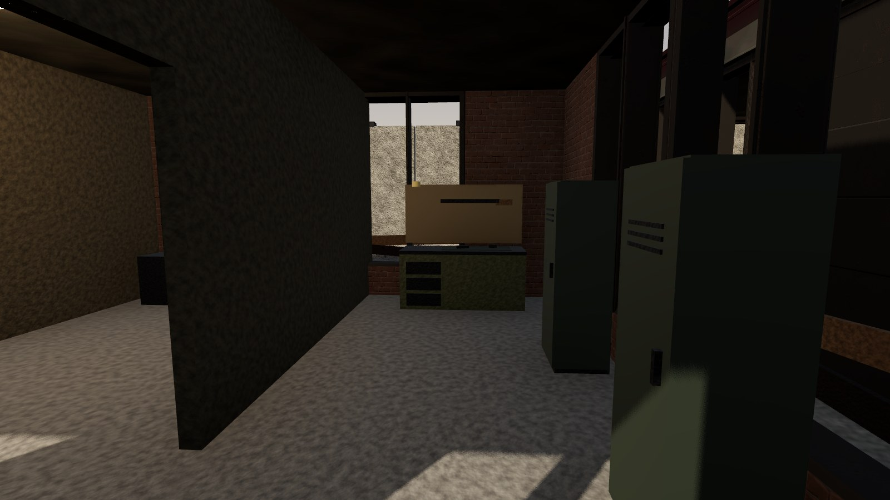 |
| 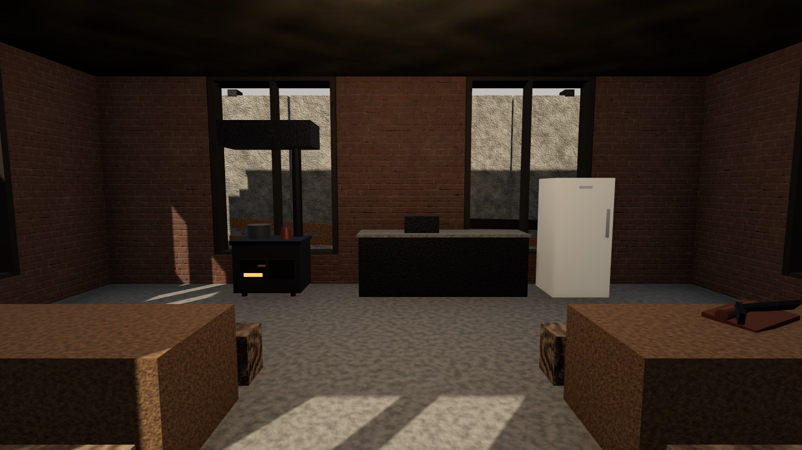 | 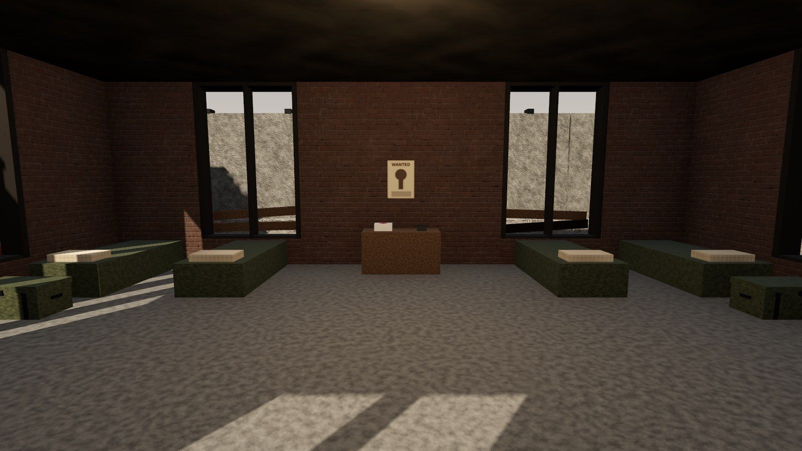 |
| 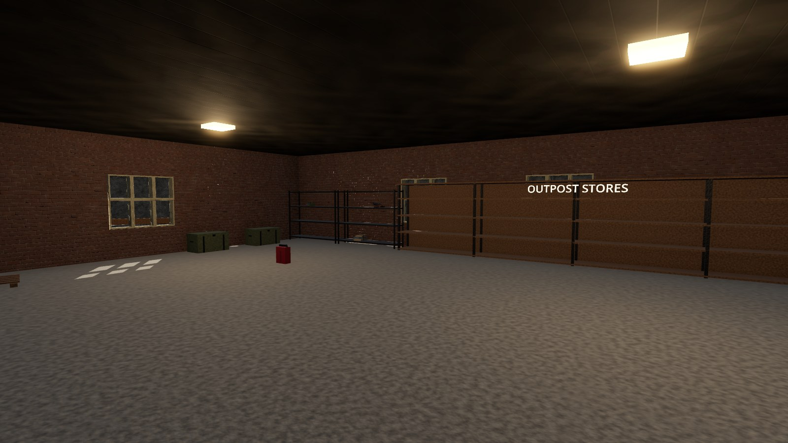 | 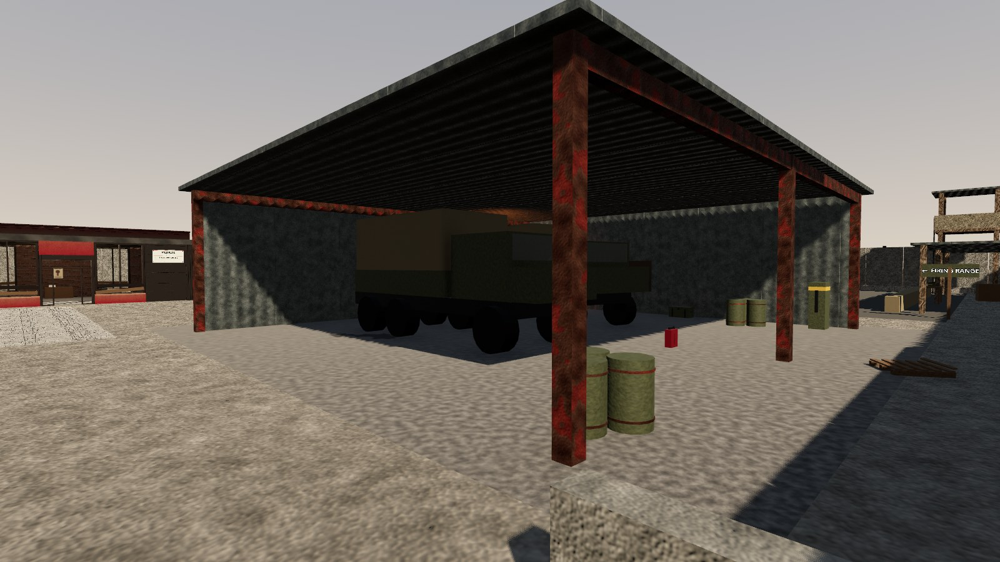 |
| 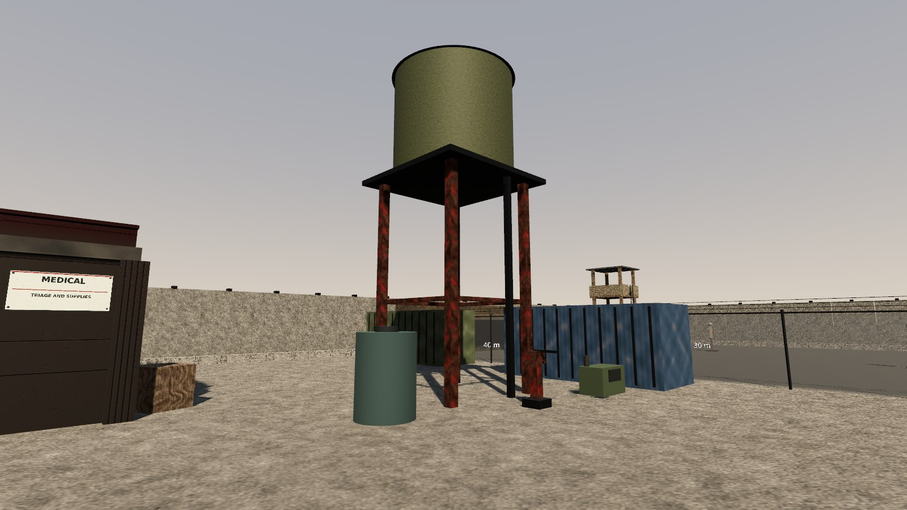 | 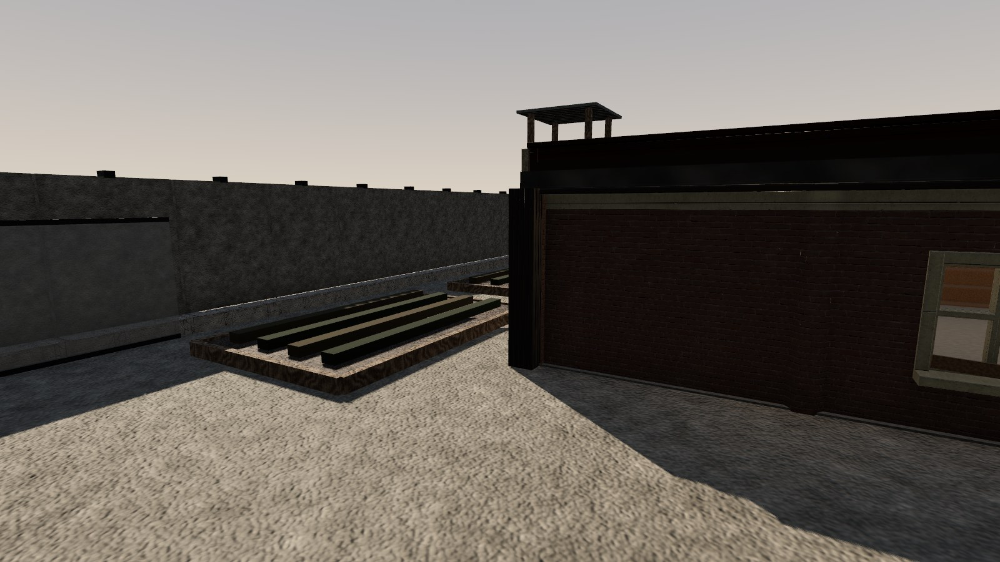 |
| 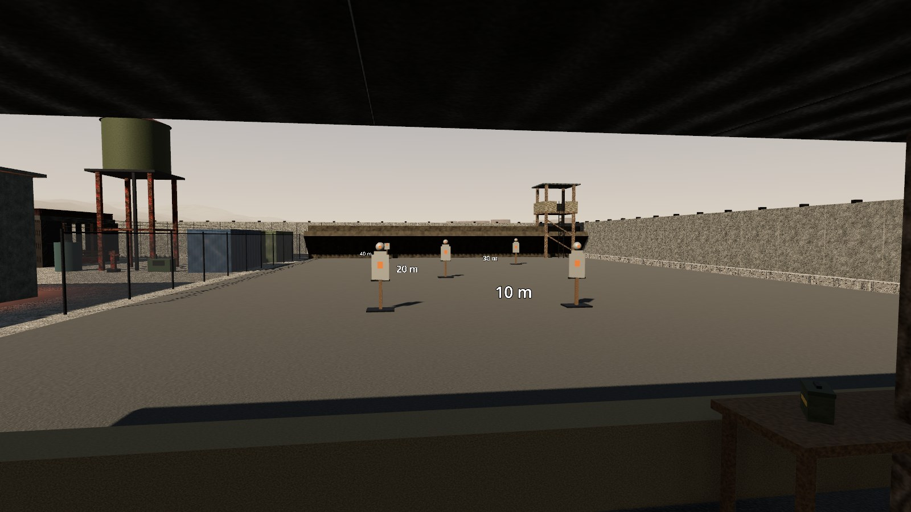 | 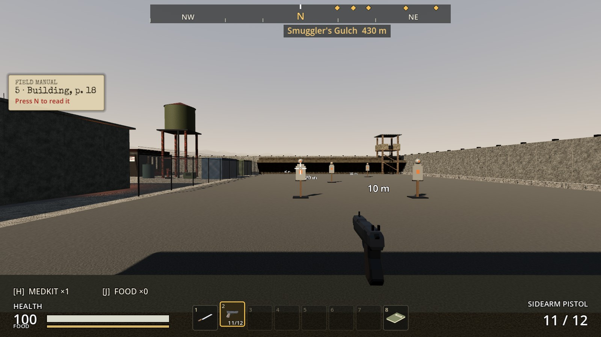 |

## Claiming it

- **Where:** the notice board on the parade ground, by the flag. Hold E.
- **When:** once you carry a gun. With only the machete, the board says *"Find a gun first: you'll need more than a machete to hold the post."* Raiders inside the walls have to be cleared first, as at the other places.
- **Once it's yours:**
  - its raiders stop coming;
  - it turns green on the compass and map;
  - the Outpost Stores get a little food;
  - newcomers walk in from the road.
- **Beds:** eight, in the barracks. Build bunkhouses for more.
- **Raids** come from the road, the east and the dunes to the north.
- **The defences** come in stages, as at Northwatch: a gate in the gateway first, then watchtowers either side of it, which guards man.
- **The supply line** links it with your other places like any other.

| | |
|---|---|
| 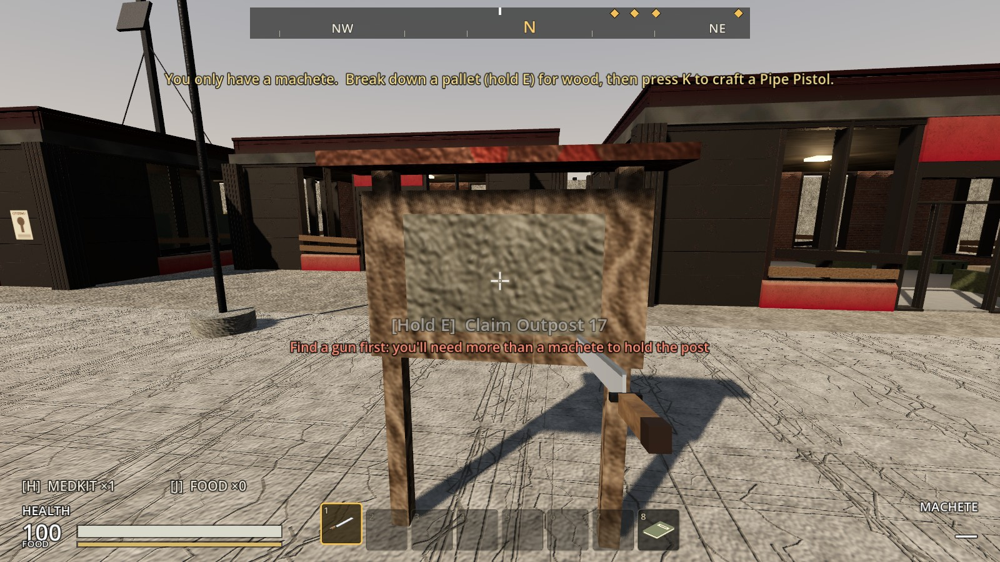 | 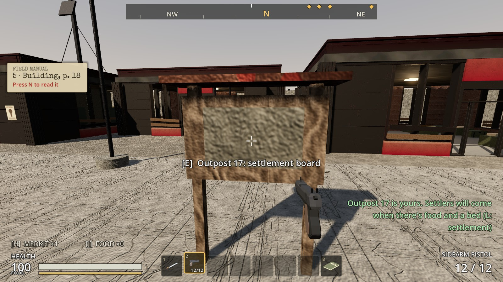 |

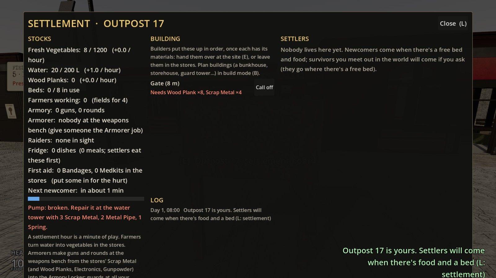

## The playtest

In a real window:
- walked in through the gate to the parade ground;
- held E at the notice board with only the machete: *"Find a gun first"*;
- took a pistol and held E again: *"Outpost 17 is yours"*;
- the settlement screen: 8 beds, fields for 4, the fridge (the mess kitchen), the broken pump at the water tower, and the gate as the Builders' first job;
- one shot from the firing line hit the 10 m target.

## Your saves

Your game carries on:

- Everything you can search, scrap or pick up at the post kept its name, so a save remembers what you've taken and searched.
- Pickups and props from a save made before this update go where the new layout has them, not where they were.
- Things that are gone (the range tower, the stacked containers) stay gone.
- If you've been at the post a while, it's simply not claimed yet: walk to the board.

## How it's built

- **`tools/rebuild_outpost_17.gd`:**
  - rebuilds the hand-made level once: moves the walls, clears the leftovers, builds the new buildings with the site kit and moves everything that's saved into them;
  - adds the settlement;
  - writes the mess kitchen's scene, `scenes/settlement/mess_kitchen.tscn`.
- **`tools/rebuild_haldens.gd -- outpost`** gives the four buildings the city kit's steel walls, the same way Halden's Crossing got its brick.
- **Then** the early zone's navigation is rebaked, and the map redrawn.
- **New:**
  - `Settlement.needs_gun` (claim only once you carry a gun), with `PlayerController.has_gun()`;
  - `SettlementBuilding.prebuilt`: built into the place, never removed by a save, never a raider's target;
  - save version 5: `SaveManager.rebuilt_outpost_17()`.

## Tests

- **New:** `tests/test_outpost_settlement.gd` (5) covers:
  - the walls and the range inside them;
  - the buildings, and everything in them reachable on foot;
  - the settlement;
  - claiming it once you carry a gun;
  - saves from before the rebuild.
- **Changed:**
  - `test_outpost_17.gd` follows the new layout. Its range-tower fall became a plain long fall, and the path-through-the-gate check now looks at where the path crosses the wall.
  - `test_art_pack3.gd` checks the paint on the two containers left.
  - The art pack tests allow the field radio on its table.
  - The tests that check a save's version expect 5.
- **Fixed on the way:** with no place held, a survivor you ask now answers for the place nearest her (Maya for Ash Creek), not whichever settlement came first.
- **Fixed on the way:** a building that's part of a place from the start no longer asks for the navmesh round it to be rebaked when the level loads (the mess kitchen did, and paths across the zone broke while it ran).

## Next

**Increment 34:** orders and achievements, and Story or Free Play at New game.
