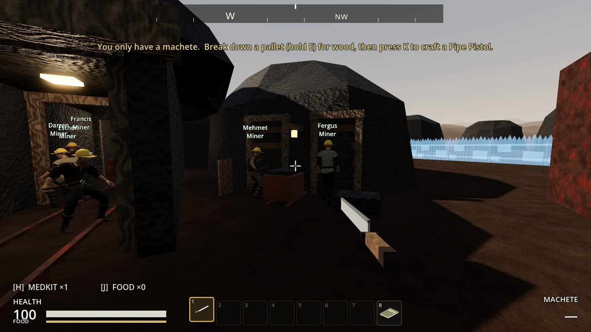
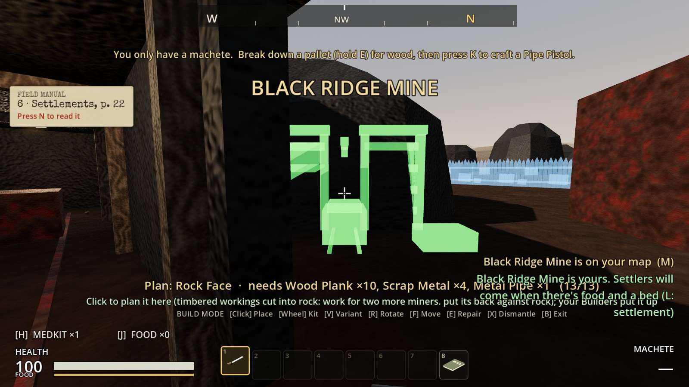
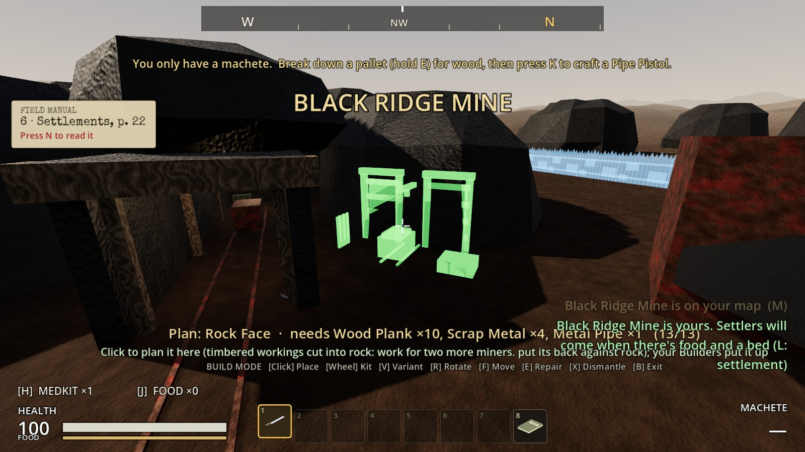
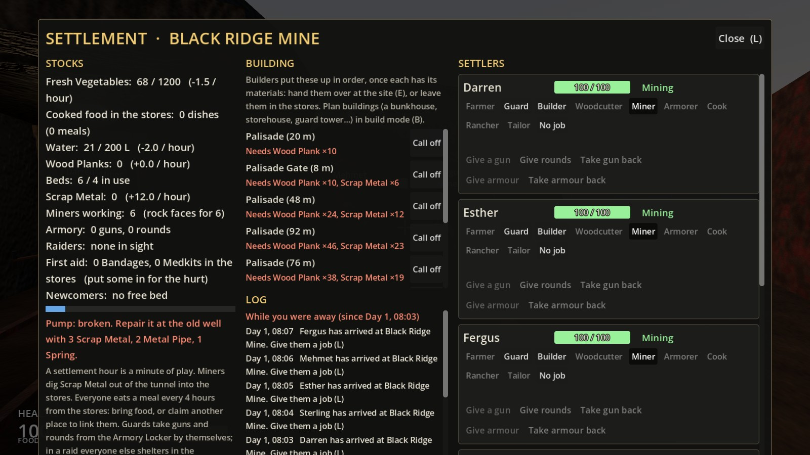
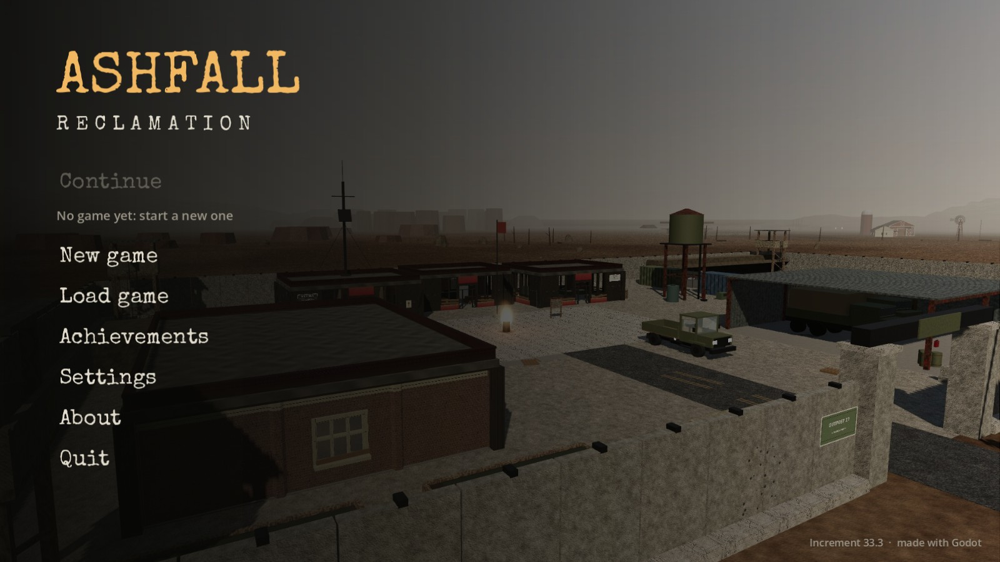

# Increment 33.3: more room to mine, and the new outpost on the menu

**Status:** RESULTS_LINE

After 33.2 you asked for a way to add more Miners at the mine: a new building you place on rocks inside the walls, to give them more room to dig. You also said yes to two things for later: stairs on Outpost 17's towers (still to come), and the rebuilt outpost on the main menu (done here).

## The Rock Face

**A Rock Face** is a new building in build mode (B):
- **What it is:** timbered workings cut into the rock. Two timber sets lagged with boards, with broken rock between them, a cart on a short run of rails, a spoil heap, a rack of picks and a lantern.
- **What it adds:** **work for two more Miners**, each digging at their own timber set. They dig Scrap Metal (and now and then Chemicals) at the same rate as the tunnel's four rock faces.
- **Cost:** 10 Wood Planks, 4 Scrap Metal and a Metal Pipe; 3 hours for a Builder.

**Where it goes:** with its back against rock, inside a place you hold.
- **At Black Ridge:** the ridge the tunnel runs into, the spoil heap and the boulders inside the palisade.
- **Placing it:** in build mode, wheel to **Rock Face** and look at the rock. The plan turns to face out from the rock, its back to it.
- **Refusals:** on open ground the plan says *"Put its back against rock"*. If it would sit too deep in the rock to leave room in front, it says *"Too far into the rock: no room to dig"*.
- **More than one:** build as many as there's rock for. Each adds two Miners.

| | |
|---|---|
|  |  |

**The settlement screen** counts them: "Miners working: 6 (rock faces for 6)". Anywhere without rock to mine, the Miner job now says *"No rock to mine here: plan a Rock Face against rock in build mode (B)"*.

## The main menu

The main menu's picture is now the rebuilt Outpost 17 from above its south-west corner, rendered from the game. Halden's Crossing's picture from 33.1 is kept in the repo.

## The playtest

In a real window, at Black Ridge:
- claimed the mine;
- in build mode, picked the Rock Face and looked at the ridge: the plan stood against it, green;
- planned it, then supplied and built it: six places to dig;
- six Miners went to work, and the two newest walked out to the Rock Face and swung their picks there;
- the settlement screen read six Miners with rock faces for six.

## How it's built

- **The building:** `rock_face` (`scenes/settlement/rock_face.tscn`), from `tools/build_settlement_buildings.gd`. That tool can now build only the ones you name (`-- rock_face`).
- **The plan:** `SettlementPlans.PLANS["rock_face"]`, with `"against_rock": true`, plus:
  - `against_rock()` and `is_rock()`: rock is anything with a rock material, the ridges, outcrops and boulders;
  - `against_rock_xform()`: where build mode stands it when you look at rock;
  - `ground_under_rock()`.
- **Checks:** `Settlement._rock_reason()` checks for rock along its back and room in front.
- **Miners:** `Settlement.mine_spots()` adds each Rock Face's two places (`SettlementBuilding.mine_spots()`).
- **The menu:** `MainMenu.ART` is `assets/ui/menu_background_outpost.jpg`.

## Tests

- **New:** `tests/test_more_mining.gd` (3):
  - the Rock Face;
  - six Miners at the mine, the two new ones digging at the Rock Face;
  - no Miners where there's no rock.
- **Changed:** `test_black_ridge.gd` has the Miner job's new wording.

## Next

**Increment 34:** orders and achievements, and Story or Free Play at New game.

Stairs on Outpost 17's corner towers come later, as you said.
