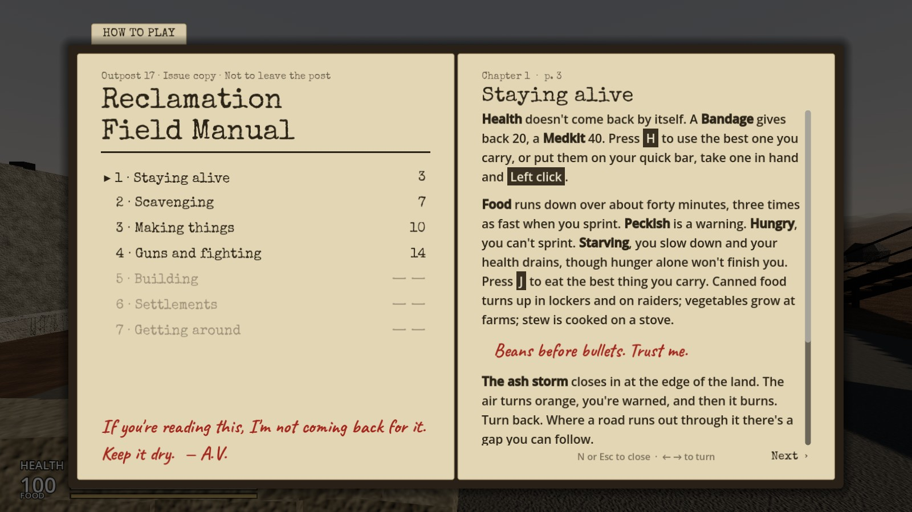
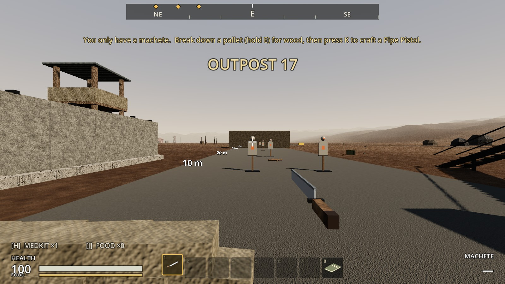
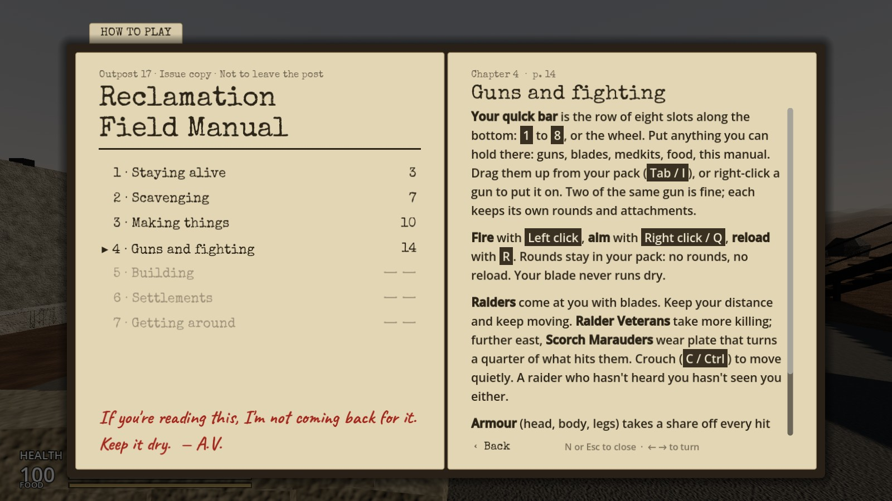
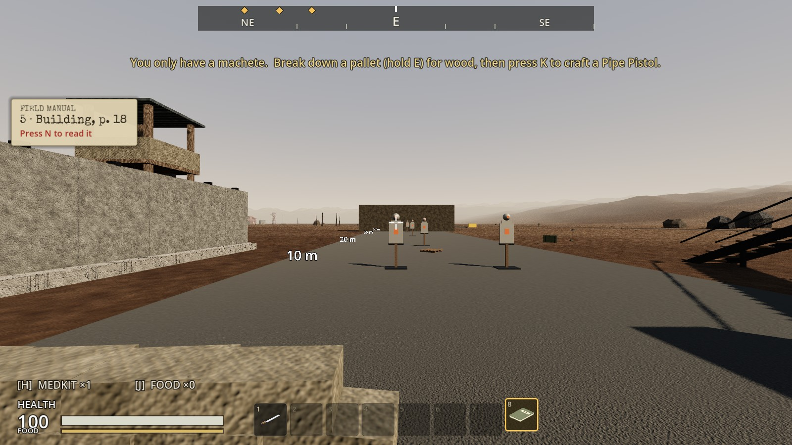
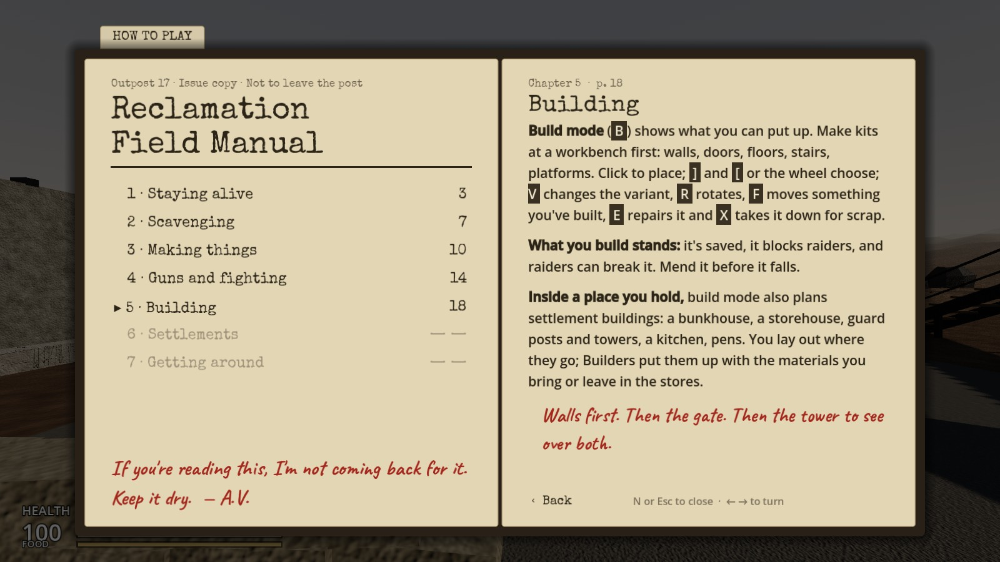

# Increment 33: the Field Manual

**Status:** complete. 10 of the tests are new (`tests/test_field_manual.gd`). In the full run, 577 of 579 passed. The two that failed pass on their own, and neither touches the manual:

- **The open-gate navmesh check:** it has now failed twice in full runs and passed every time alone, so it's flaky and needs a look.
- **The dry-fire click sound.**

This is the second step of story mode from the proofs you approved: the booklet every player starts with, explaining how the game is meant to be played. It's the Reclamation Field Manual, Outpost 17's issue copy, annotated in red pen by its last owner, **Sgt. Ada Vance**. Her notes are the first threads of **The Last Order**.

## How it plays

- **N** opens it anywhere, unless another window's open or you're driving. **N** or **Esc** closes it.
- **On the quick bar:** a new game puts it on **slot 8**. Press **8** and it comes into your hands and opens. Fire with it held opens it again. **The wheel passes over it**, so scrolling through your guns never opens a book in the middle of a fight.
- **Two pages:**
  - **Left:** the contents and Vance's note: "If you're reading this, I'm not coming back for it. Keep it dry. — A.V."
  - **Right:** a chapter.
- **Getting about the book:** click a chapter in the contents, or turn pages with **← →** (or A and D). It reopens where you left off.
- **Keys are always right.** Every key in the text is drawn from your real bindings (keycaps like **H**, **Left click**, **Tab / I**). A test checks that every key the manual names is a real, bound action.
- **You keep it when you die,** like your blade, whether it's on the bar or in your backpack. It weighs nothing.

## The chapters

| # | Chapter | Page | Open |
|---|---|---|---|
| 1 | Staying alive: health, bandages and medkits, food and hunger, the ash storm, your gear chest | 3 | From the start |
| 2 | Scavenging: searching, Take all, breaking down salvage, carry weight, the four packs | 7 | From the start |
| 3 | Making things: by hand, the workbench, the weapons bench, cooking | 10 | From the start |
| 4 | Guns and fighting: the quick bar, firing, aiming, reloading, raiders, Veterans and Marauders, armour | 14 | From the start |
| 5 | Building: build mode and its keys, what you build, settlement buildings | 18 | The first time you press **B**, or hold a place |
| 6 | Settlements: claiming, people and jobs, water and food, raids, the supply line | 22 | The first time you hold a place |
| 7 | Getting around: the compass, the map and pins, the truck and fuel, the road east | 27 | The first time you open the map or drive |

Chapters you haven't reached are greyed in the contents ("— —"). Once the story's in (Increment 35), its chapters will open them too: Roots opens Settlements, and Deep Work opens Building and Getting around.

## Tips

The first time you do something a chapter covers, a slip of paper top left says where to read about it, once: "Field Manual · 5 · Building, p. 18 · Press N to read it". For the next twelve seconds, N opens the manual at that page.

| Chapter | When its tip shows |
|---|---|
| Staying alive | You're hurt, or getting hungry |
| Scavenging | You open a container |
| Making things | You open the crafting screen |
| Guns and fighting | You take a gun out |
| Building | Build mode |
| Settlements | You hold a place, or open the settlement screen |
| Getting around | The map, or the truck |

## Your game

**Your saved game carries on.** A game from before the manual gets the book on slot 8, or the first free slot, or your backpack if the bar's full. Every chapter is open, and there are no tips for things you've already done. What's open, which tips you've had, and your page are saved.

## Fonts

Two free fonts came in for the manual, both recorded in `docs/ASSET_LICENSES.md` with their licence files in `assets/fonts/`:

| Font | Used for | Licence |
|---|---|---|
| **Special Elite** | The typewritten headings | Apache 2.0 |
| **Caveat** | Vance's pen | SIL Open Font License |

Both allow a sold game. Their licence texts go in the credits before release.

## How it's built

- **`FieldManualText`** (`scripts/ui/field_manual_text.gd`) holds the chapters as BBCode:
  - `{action}` for keys, drawn from the input map, with Godot's names shortened ("[" not "BracketLeft").
  - `((…))` for Vance's notes, in red Caveat.
- **`FieldManualProgress`** (`scripts/player/field_manual_progress.gd`), a child of the player, tracks what's open, the tips, the page and the book. It watches for first needs and gives the book.
- **`FieldManualScreen`** (`scripts/ui/field_manual_screen.gd`), built in code by the HUD, is the book. **`ManualTipCard`** is the slip.
- **The item:** the Field Manual (`resources/items/field_manual.tres`) is holdable and kept on death (a new `keep_on_death` flag), with a small booklet model and an icon (`tools/make_field_manual_item.gd`).
- **The player:**
  - `PlayerController.manual_requested` fires when it's taken in hand (a new `WeaponSlots.switched` signal, for a switch you made, not loading or respawning) or fired with.
  - `QuickBar.kept_on_death()` is used when dying.
- **N** is added to the input map at runtime, as keys 6–8 were. `project.godot` is untouched.
- The compass hides while the book's open, as it does for the map.

## Tests

`tests/test_field_manual.gd` (10 new) covers:

- slot 8 in a new game;
- the text naming only real, bound keys;
- N opening and closing it, turning pages and greyed chapters;
- its key and fire opening it, and the wheel passing over it;
- chapters opening when first needed;
- a tip coming once;
- saving and loading;
- a game from before getting it all;
- keeping it when you die;
- the open book fitting the smallest window.

Four tests in `test_quick_bar.gd` changed for the manual being on the bar.

The README's controls no longer mention travelling by road sign, which went with the zones in Increment 15.

## Next

**Increment 34: orders and achievements.** Act 1's chapters become orders in the manual's **Orders** tab. One order is tracked on screen, with a compass marker for it only, and there are no item rewards. The 33 achievements go in an **Achievements** tab, and **Story or Free Play** is chosen at New game. Then **Increment 35**, Act 1 of The Last Order: Vance's log, the dog tags, the radio at Northwatch.
